# CiteSpace Bibliometric Visualization

Because the "Frontiers of Public Finance" course required writing a feedback paper, I took the chance to learn CiteSpace for bibliometric visualization. This post also briefly introduces some other web-based visualization tools, but the focus is CiteSpace.

I wrote this post to record some points the **online tutorials leave out** and some **finer operational details** for the new version (6.2.2). Below are the guides written by Jie Li and Chaomei Chen; they also cover the discipline of knowledge graphs, but I'll show the basic operations directly in this post.

[CiteSpace: Tech Text Mining and Visualization](https://pan.baidu.com/link/zhihu/7ghWzQuOh2i0UFFGJjTpN0QUVUcLhlcwdwQ0==)

[Chinese Guide to CiteSpace, 7th Edition](https://pan.baidu.com/link/zhihu/7AhVzNuYh1i0QXV0x0NZtQRXNNYwY2RQUfxm==)

## 1. The result

CiteSpace is developed in Java, and **the basic version is free while the advanced version is paid**; here I only cover the free basic version. The basic version is actually enough.

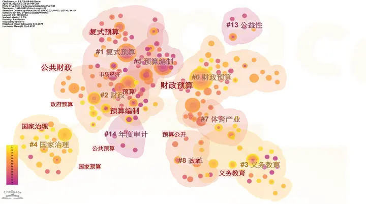

Visualization of the top 500 cited CNKI papers using "fiscal budget" as the keyword.

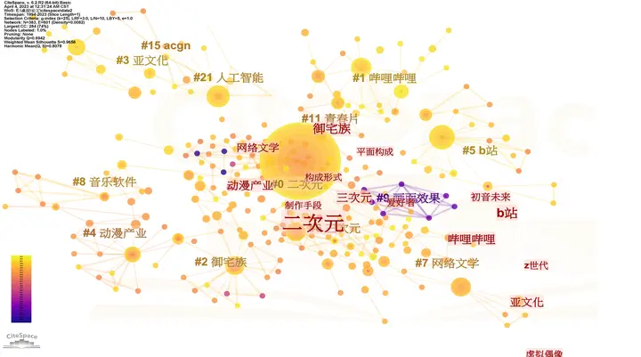

An anime/2D theme; you can see that Bilibili and Hatsune Miku are also third-level keywords (that's homo for you).

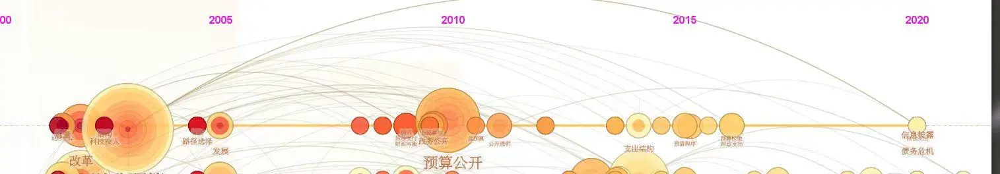

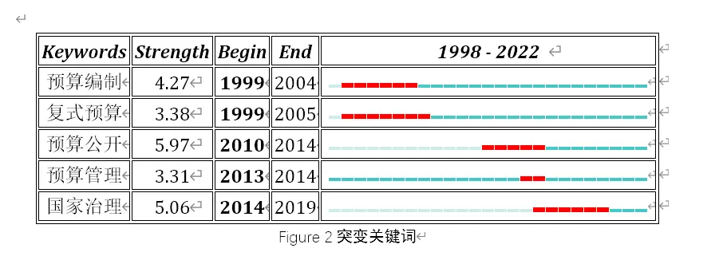
## 2. Download and the Chinese UI

**1. Download page:**

[Page](http://cluster.cis.drexel.edu/~cchen/citespace/download/)

As said earlier, CiteSpace is developed in Java, so **early versions** required downloading Java first[^1]. The latest version bundles `jre`, so no extra download is needed. Just click in, and like installing ordinary software, click "yes" all the way through.

**2. On the install location**: I'd suggest keeping the install path free of Chinese characters; it feels like this applies to all foreign software. Personally I feel it doesn't use much memory, so installing on the C drive is fine too.

**3. Chinese UI:**

**Good news: the new CiteSpace has a Chinese UI. Bad news: not much of it.**

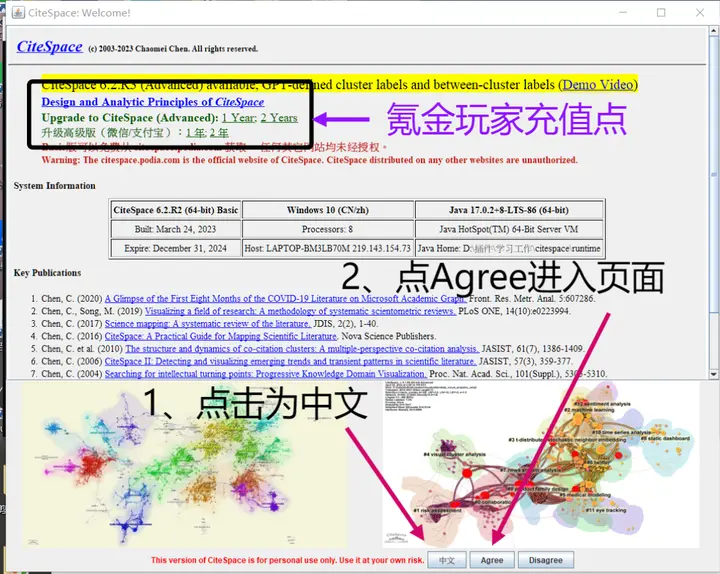
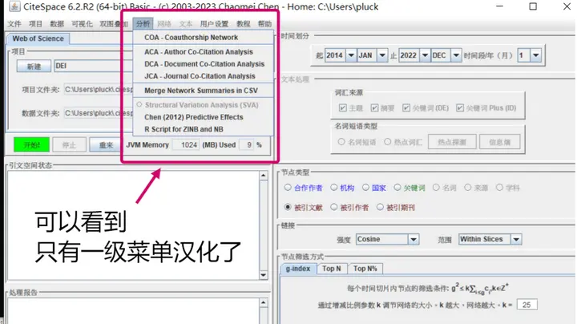

By the way, from the top you can see my computer username is "pluck"; I first learned this word because of JOJO.

## 3. Data import

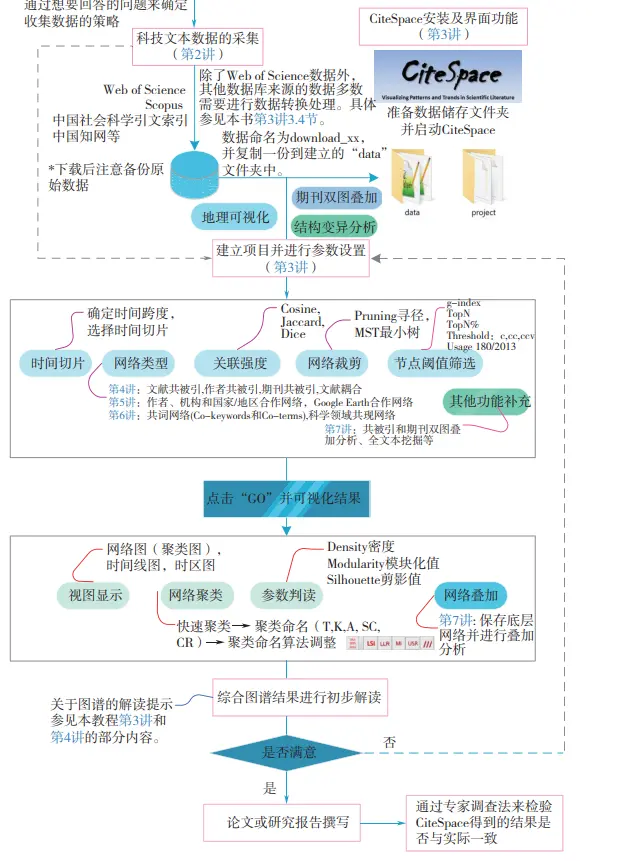

**First create three folders: in, data, project**

**Personally I suggest saving them in a shallow location that's easy to click into from "My Computer"; later data processing requires repeatedly clicking to confirm folder locations.**
$$
Folder\begin{cases} 
in: saves the literature information in txt format\newline
data: saves the cleaned text literature information from the in folder\newline
project: saves the visualization operations 
\end{cases}
$$

### (1) CNKI data import

**1. The CNKI data-selection stage**

Note when filtering: **"Select all"** only selects **all results on the current page.**

**CNKI supports exporting at most 500 records, and CiteSpace (free version) supports processing at most 500 records.**

To speed things up, first change the display to 50 per page, then select all across 10 pages to pick out 500 literature records.

To switch CNKI pages, just click where the arrow points in the upper right; no need to scroll down to look.

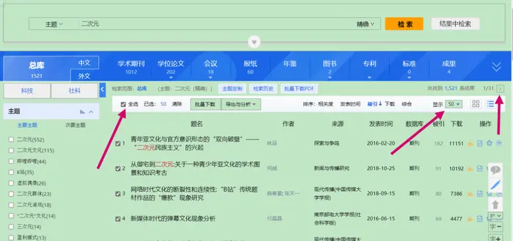

Choose to export the literature as RefWorks, exporting as a `.txt` file:

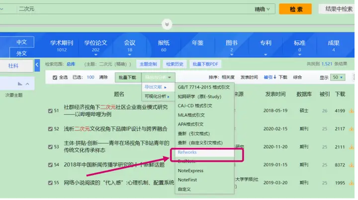

At the same time, CNKI has its own visualization page; we also need to enter CNKI's visualization analysis following the path in the figure below, and remember the time range of the 500 papers we selected. **The time range is very important and will be used later.**

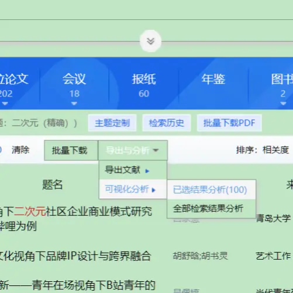

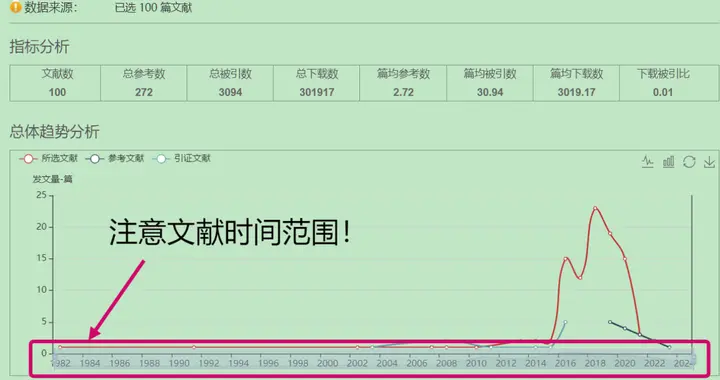

**2. The folder-cleaning stage**

Change the `.txt` file names to the format `download_x` so CiteSpace can recognize them. For example: `download_1`, `download_i`......

After cleaning, the `download_x.txt` in the `in folder` is processed into the `data folder`; you can check whether the data folder contains the processed text files as a verification.

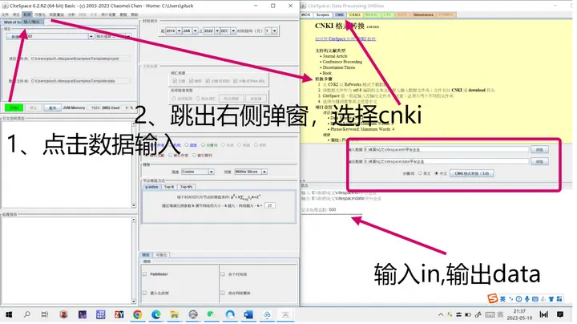

-   Once the txt files in `data` are processed, click "New" on the initial page,
-   name it in the new popup, and enter the paths for `data` and `project`[^2]
-   then choose the literature language (English\\Chinese) and the database format (usually WoS).

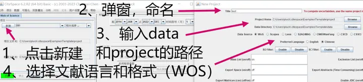

**3. The data-analysis page**

-   As shown, the bottom-right is where you choose the pruning path, trimming unnecessary branches from the relationship graph and keeping the core related literature.
-   The top-right is the literature time range, which is why I stressed earlier that you must **first use CNKI's built-in visualization to determine the time range**.
-   The middle-right is the visualization element selection; usually choose **keywords.**
-   Once selected, click start on the left.
-   If all goes well, a **popup with a "Visualize" button** will appear; click it to start the analysis.

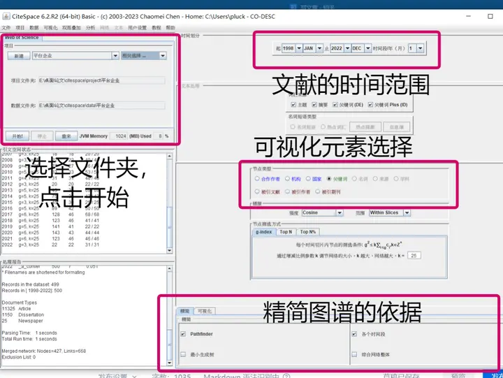
### (2) WoS data import

WoS is [web of science](https://www.webofscience.com/wos/alldb/basic-search)

Note: since CiteSpace filters **journal articles** rather than books, you **must select the Core Collection**; otherwise if there are books later, it may be impossible to proceed!

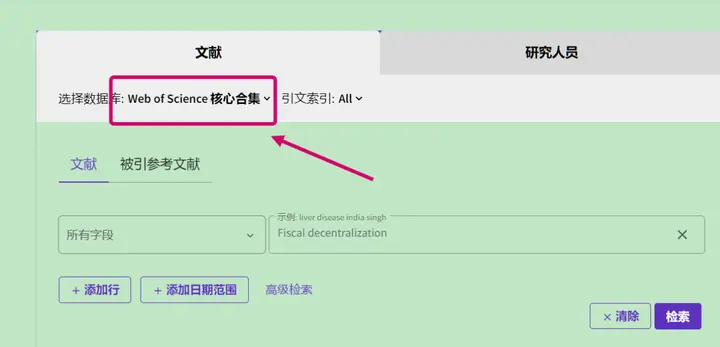

**After that it's the same as CNKI.**

-   Export as plain text files; the export limit is also 500 records.
-   The exported record content needs to be "Full Record and Cited References".

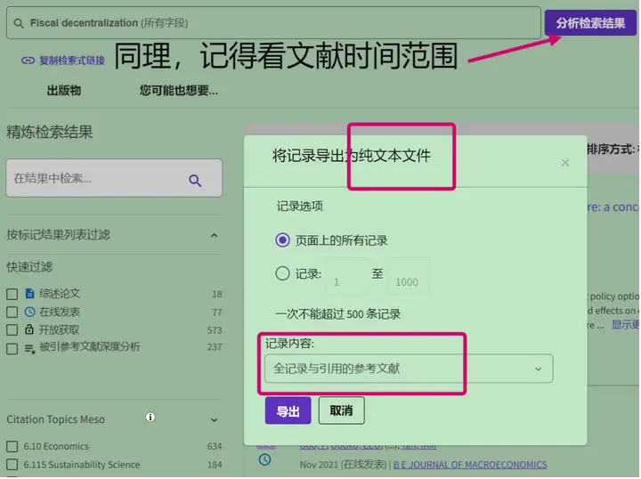

After that, the data input just means choosing WoS; the main thing here is deduplication, and everything else is the same as CNKI. Note that in CNKI's cleaned data folder, there's only one `.txt` file, but in WoS's cleaned `data folder`, the `.txt` files correspond to the article's DOI, keywords, and so on. So don't doubt whether you made a mistake, or click "Deduplicate" multiple times — that will produce duplicate files!

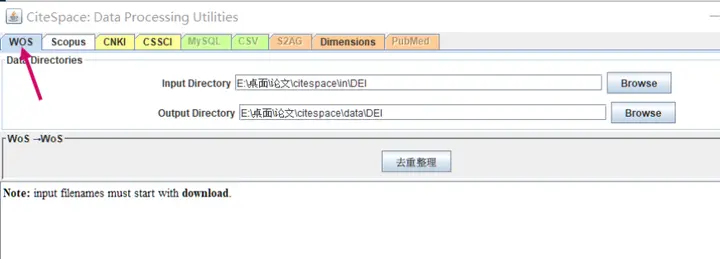
### **(3) Supported data sources**

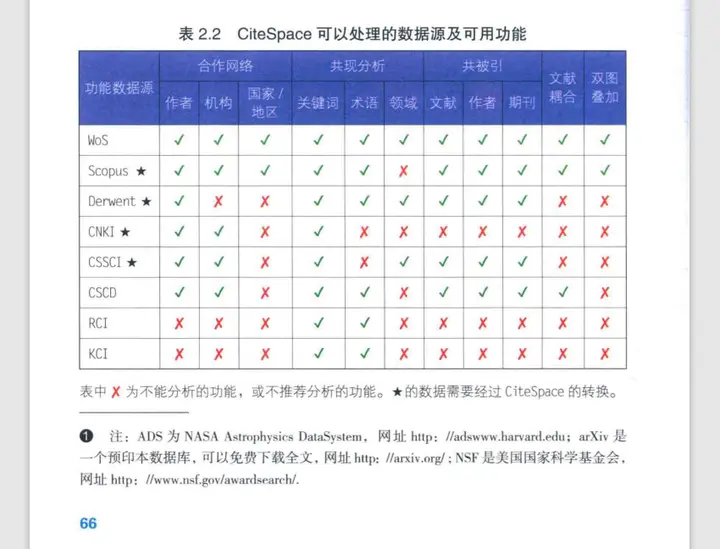

## Deduplication

Duplicate txt records will affect node computation.

The deduplication function is under the WoS option. Convert the txt documents according to their database source, then deduplicate them in the WoS option.

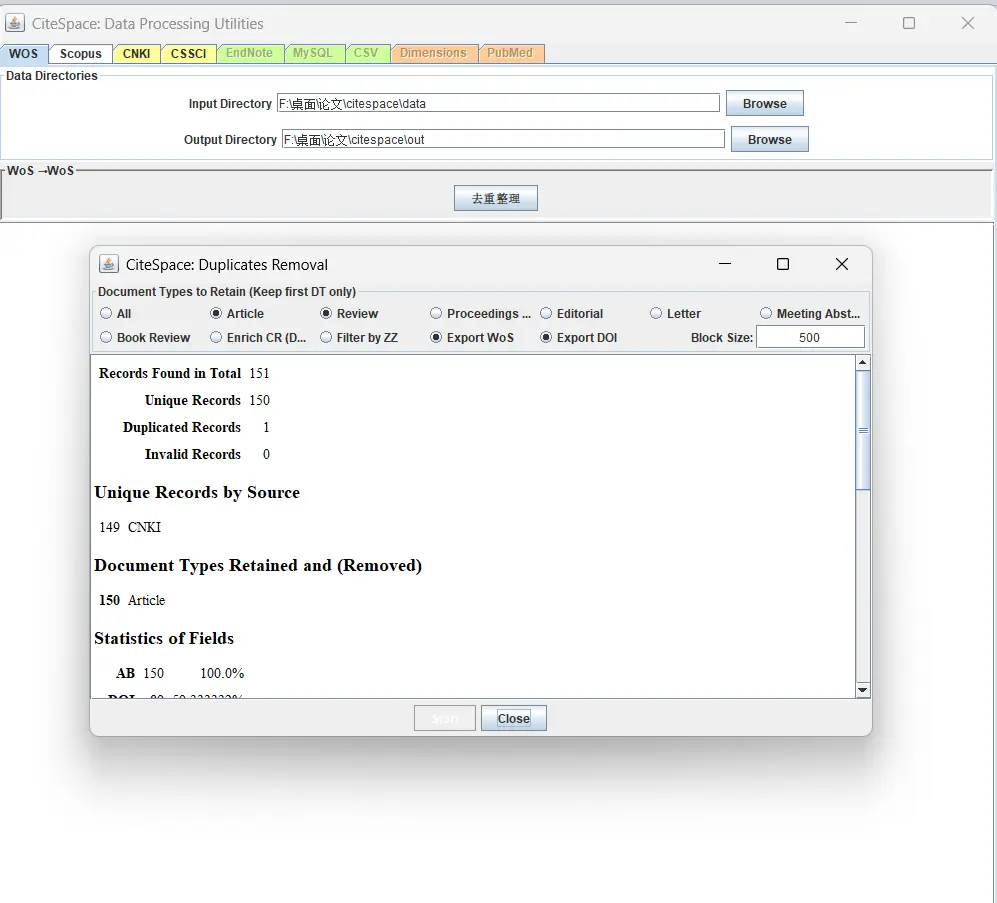

## 4. Visualization in practice

### (1) Keyword graph

**The big watermark behind the new version can't be removed.**

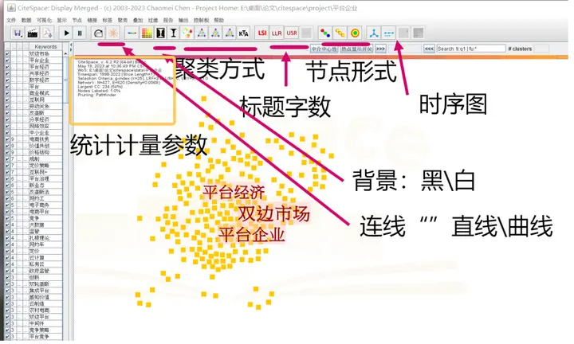

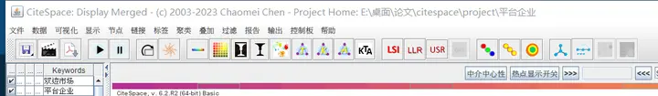

In the graph stage, we usually operate as follows:
$$
\begin{align}
&Set nodes to circles:\newline
&Nodes\Rightarrow \text{Node Shape for Keywords and Terms}  \Rightarrow  Circle \newline
&Cluster-analysis optimization:\newline
&Clusters \Rightarrow \text{Convex Hull: Show/Hide}\newline
&Cluster color blocks:\newline
&Clusters \Rightarrow \text{Visual Encoding: Advanced Settings} \Rightarrow  
\text{Areas: Fil/Border Only}
\end{align}
$$

This way you can clearly see the color-block boundaries; if it looks too flashy, click again and it becomes hide, removing the color blocks.

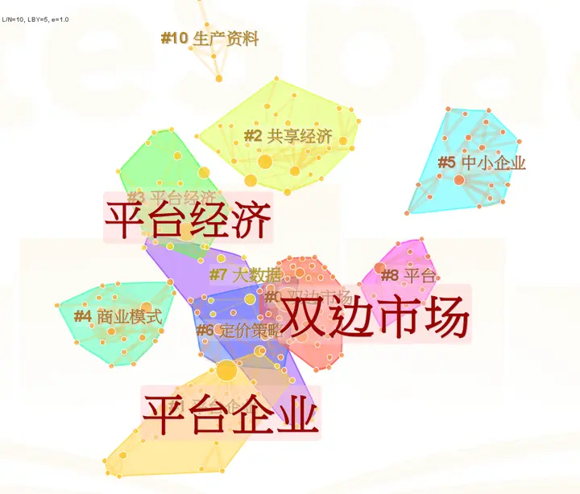
For the format, I usually pick one of the two below; choose LLR for the title and straight lines for the links.

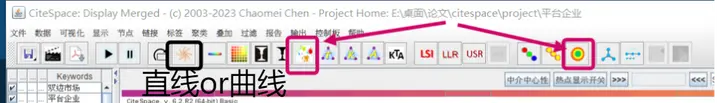

**Finer operations: also the most important control page**

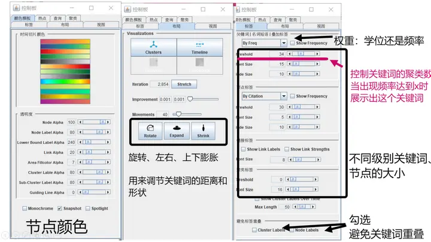

### (2) Timeline view

The controls for the number of keywords and the weighting method in the timeline view are still as shown below.

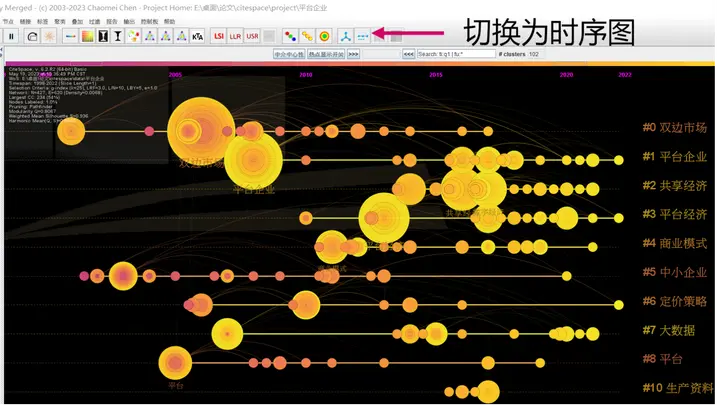

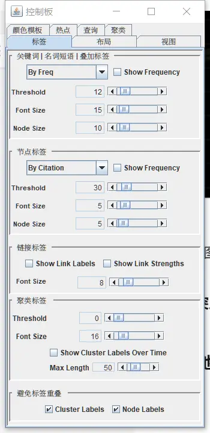

### (3) Burst terms

$Hotspots\Rightarrow View$, and they'll appear; the popup that appears at the same time can be treated as a Word table environment, so you can copy-paste directly.

**Pasting into Word with the original format gives you a table that keeps its colors.**

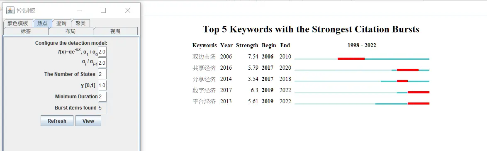

This page can be copied and pasted; it's a Word table format.

### (4) Advanced-version operations (pay to win)

It seems the ordinary version used to be able to draw time-zone maps too, but now it can't; you have to pay for the advanced version. Same for some coupling analyses.



### (5) txt tools

If you upgrade to the advanced version, it seems you can process more than 500 literature records[^3], but CNKI and WoS still cap exports at 500 per batch. In that case you can use a [txt merge tool](https://uutool.cn/txt-merge/).

### (6) Export

You can see there are two watermarks (a big one behind and a small one in the bottom-left); **the big watermark behind is new in the new version and can't be removed.**

To remove the bottom-left watermark, do this:

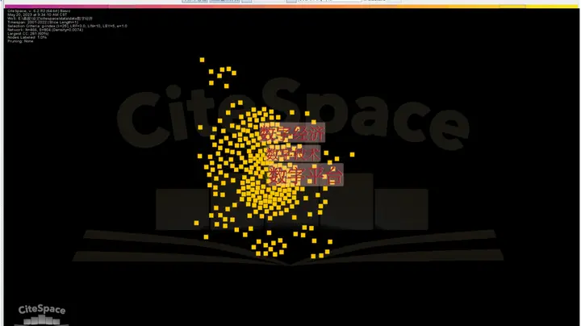
$Labels \Rightarrow \text{overlay Labels: Show/Hide}$

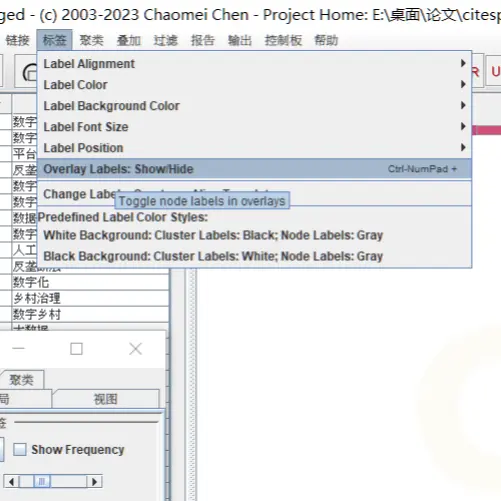

File export supports `.png` and `.jpg`. Click the "File" menu in the top-left and a `save as pdf` will pop up.

Although the bottom-left watermark is superficially removed, it still appears on export,,,,, so if you don't want any watermark, I'd suggest adjusting the view and taking a direct screenshot.

## 5. Other bibliometric visualization sites

### 1. CNKI's and WoS's built-in data visualization

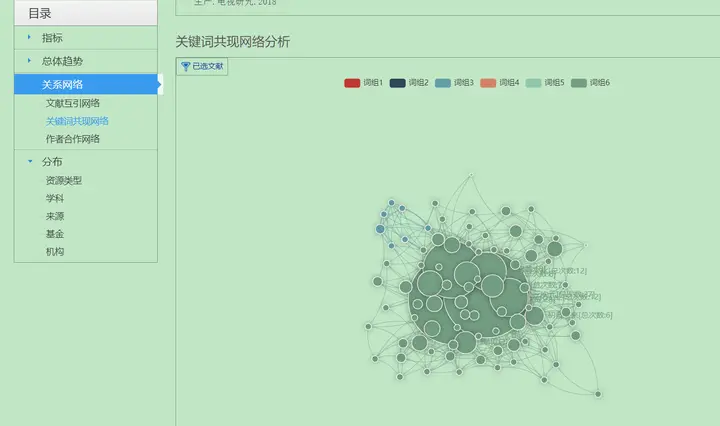

### **2. If you're a Zotero veteran, that works too.**

CNKI's visualization looks nice; can you take it home? Of course you can.

In [another post](https://zhuanlan.zhihu.com/p/624450256) I introduced Zotero's visualization plugin, which has a CNKI-like visualization built in.

The petal icon is the toggle; you can resize the window, and there are four visualization relationships. Move to the bottom of the page and the switch options will float up.

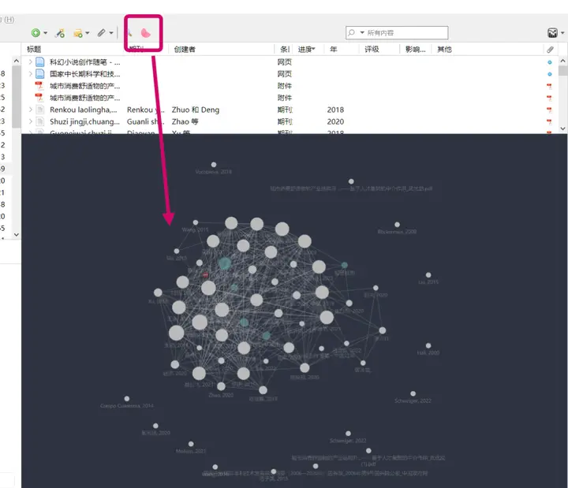

Get a visualization of the literature you've collected in Zotero.

There's also a word cloud, though it's a word cloud of the whole Zotero library's literature.

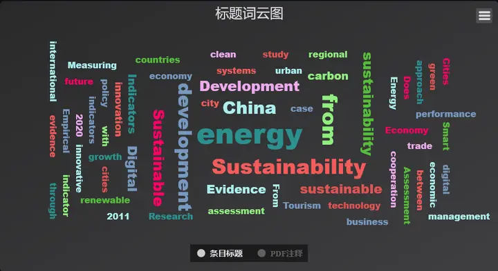

### 3. bibliometric

[Supports only the SCI database](https://bibliometric.com/)

### 4. connectpaper

Just search a keyword directly, and it will associate related literature to form a graph, including sites like arXiv.

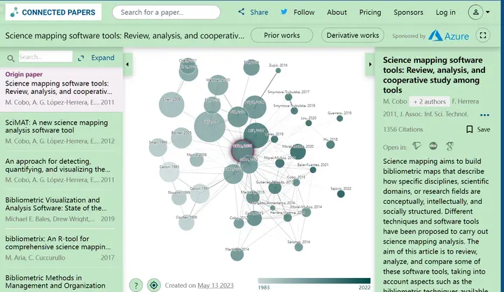

### 5. researchrabbit

Website: [www.researchrabbit.ai/](http://www.researchrabbit.ai/)

## 6. Literature reviews?

Can you use CiteSpace to churn out papers? I feel it's not easy; at least in recent years C-journal papers like that seem rare. But for homework and small projects it seems okay? Though used too much it becomes too formulaic and bland.

Personally, I think a good review should be:

-   Having a unique understanding of the whole topic's depth and prospects: not just describing trends, but grasping the era background behind the hotspots.

So when writing my feedback paper, I tried to combine hotspots and discuss "fiscal budget" and "real-world needs."

| Keyword | Fiscal extraction | State capital    | Budget disclosure    | Expenditure structure                 | Debt management    |
| :-- | ---- | ------- | :------ | -------------------- | ------- |
| Background  | Seeking development | Loss of state capital  | Corruption    | High-quality development\\public choice\\official tournament model | Economic conditions    |
| Time  | Founding of the PRC   | around 2010 | around 2014 | around 2017              | around 2022 |

-   Cleverly classify the existing research directions and theoretical development stages with a framework.
-   Grasp the topic's breadth and timeliness (this is CiteSpace's strength).

In sum, I personally prefer using CiteSpace to do hidden background work — for example, sorting out the induction route and logic of a literature review's keywords to help me choose a better topic.

## References

[^1]: I'd already installed Java locally because I play the Java edition of Minecraft, which is one reason I picked up CiteSpace so readily.
[^2]: So try to pick a folder location that's easy to click into here; otherwise you'll get tired of clicking through it later.
[^3]: Though I haven't tried it myself.

---

> Author: [滑翔闪](https://github.com/hzp2333/hzp2333.github.io)  
> URL: https://blog.huaxiangshan.com/en/posts/citespace/  

