# Court Judgment Data Cleaning Guide


# Court Judgment Data Cleaning Handbook

Author: Huaxiangshan

- This document is both a report on the current work and a summary of some lessons learned.
- It may help later students get up to speed on court judgment data cleaning more quickly.
- I hope future students will value optimizing engineering techniques, summarizing them, and sharing documentation.

**Think about how to optimize the engineering, optimize team collaboration, and turn accumulation and output into a capability.**

The world needs not only input but also output; the sharing and transmission of knowledge is the bond that keeps human civilization advancing.

## Foreword

### Which AI to choose

On AI tool recommendations: if you can use GPT or Claude, go with those top-tier ones.

But just as vibe coding has delivered its shock to the world — vibe slop. When we use AI for programming, we need to care even more about the verifiability, reusability, safety, compatibility, and readability of the code.

### Code style

**There is a tradeoff between reusability and readability.** For example, I personally don't love the top-journal style that frantically uses `program`, `global`, and `capture`. Statistical code is not product code; in research, unless we're doing heavy numerical computation, we generally don't need to bother with complex macros to optimize runtime. Most of the time we only care about how data cleaning reduces memory usage and improves reusability. All things considered, I think the readability of statistical code matters more in teamwork.

In the AI era, rather than code runtime efficiency, what we need to strengthen more is **code review**.

Writing more comments is also very important.

I personally prefer to use `local` to implement code functionality, so I often restrict AI from using `global` and `program`.

### Human initiative

AI may know a lot of functions, but it doesn't know how to combine them. Understanding the algorithm of the overall design is our biggest advantage. When asking questions, help AI sort out the algorithm of the code.

With AI around, knowing which package can achieve which function, and what role it plays under the algorithm, matters more than mastering the details.

Another good habit is to promptly summarize into md documents. After doing a lot of work with AI, keeping these detail documents can improve the efficiency of AI programming.

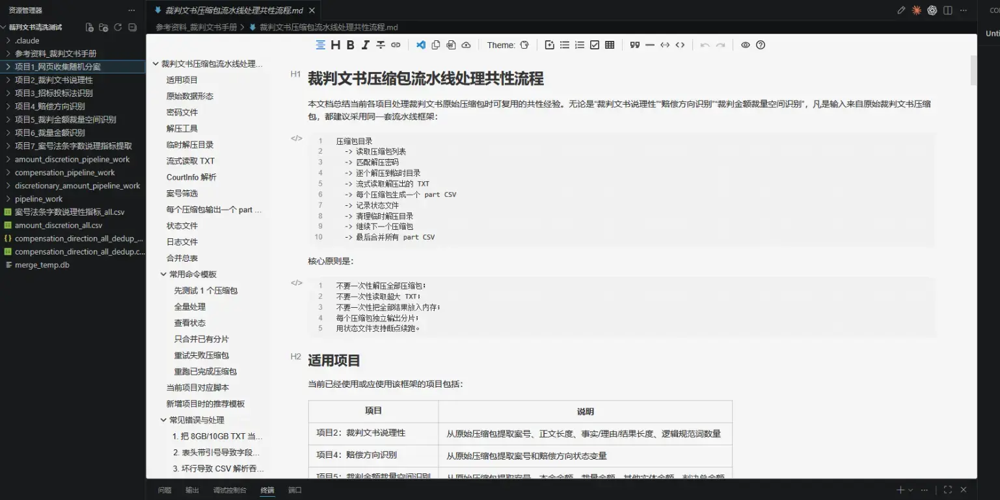

### Websites for court judgments

I don't recommend querying cases on China Judgements Online, it lags and requires frequent verification.

I recommend [PKULaw](https://home.pkulaw.com/) and [Wolters Kluwer (Weike Xianxing)](威科先行) (with built-in visualization and convenient querying)

<div style="padding: 15px; border: 1px solid transparent; border-color: transparent; margin-bottom: 20px; border-radius: 4px; color: #7d637a; background-color: #f6edf5; border-color: #f1e4f0;">
💬
    <b> Note: Cleaning court judgments requires alternately handling Chinese characters and numbers. This document will cover several common Python and Stata regular expressions.
</b></div>

AI may know a lot of functions, but it doesn't know how to combine them.

Understanding the algorithm of the overall design is our biggest advantage.

When asking questions, help AI sort out the algorithm of the code.

With AI around, knowing which package can achieve which function, and what role it plays under the algorithm, matters more than mastering the details.

## Court Judgment Data Sources

**Raw text data**: a pile of txt files. Each line is one court judgment record. The txt files are named after "万" (ten-thousand), so below we use the integer part of the number to refer to each txt file.

The accompanying documents are the archives, the document dictionary, and the variable-meaning table.

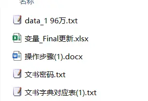

**Tip**😍: Each txt file is very large, and ordinary software usually can't open them. I personally recommend using [EmEditor](https://www.emeditor.com/) to view them. Actively using [EmEditor](https://www.emeditor.com/) to look at examples lets us better understand the mojibake situation and the writing conventions of court judgments, so we can improve our text-processing code.

- **Dta data**: Stata files already cleaned by predecessors. Split into ans 1–ans 83. Formatted as Stata `.dta` files.

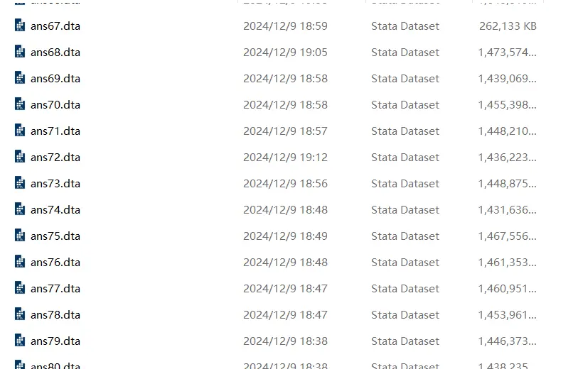

A complete cleaning pipeline is:

Filter and extract the information we need from the raw txt files, ultimately turning it into data that can be imported into Stata.

## Processing the txt Files

Most of the court judgment txt files have already been converted to JSON format, so Python can read them fairly easily.

Most of the court judgment txt files use the s-series naming structure below:

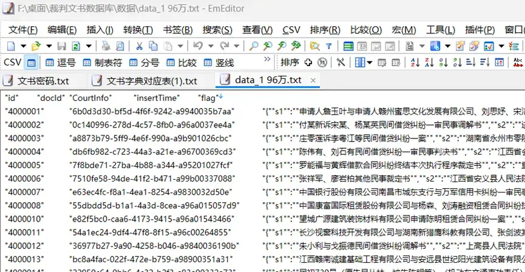

The important information is all in the third column, inside the data structure contained in the s* series.

But getting one to three txt files to run through doesn't mean all of them will run through.

<div style="padding: 15px; border: 1px solid transparent; border-color: transparent; margin-bottom: 20px; border-radius: 4px; color: #a94442; background-color: #f2dede; border-color: #ebccd1;">
⛔<b> Court judgment txt files also come in some other formats:

So when processing you need to consider **code compatibility and comprehensiveness**, write separate processing code, and then process such txt files twice.

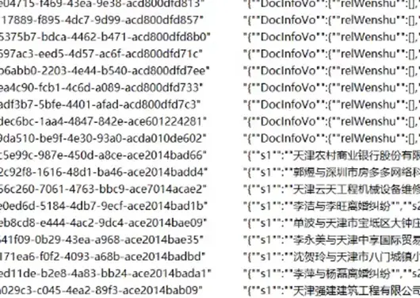

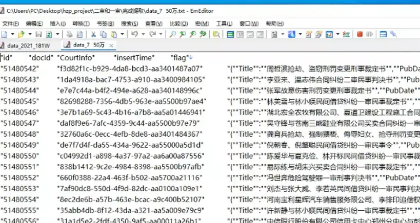

### Some Suggestions

Since the loop is easily interrupted, when processing with txt I recommend referring to the following logic:

1. Process the mojibake txt files (attached later) separately from the s-series txt files.
2. The original files are txt; after cleaning, generate new cleaned_txt files.
3. Since the cleaning loop command is easily interrupted, it's best to add one more command: compare the file names of the txt and cleaned_txt files.
4. Add one more step: move the processed txt documents to another folder, fix the erroring code, and continue the loop.

> Python's default file-reading order is txt 1, txt 10, txt 111... rather than 1, 2, 3...

### Mojibake Documents

It's not only the s-series txt files that have this:

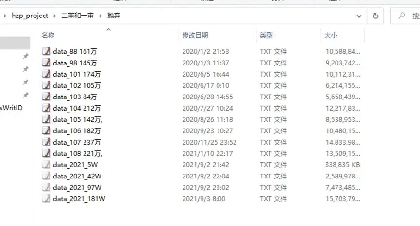

## Python Example: Extracting the Case Number Sequence

### Approach

Python reads the JSON format of the txt.

Extract the `CourtInfo` data from the third column.

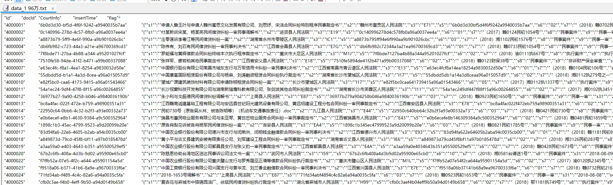

The s23 variable holds all case numbers, which we use to trace **first instance, second instance, retrial, and final instance**.

For example, `（2016）沪0104民初33043号` is essentially the ID card number of a court judgment case.

Regular expression filtering: extract strings that satisfy the `(year) chu\zhong\zai hao` rule.

```python
pattern = r"[（(]\d{4}[)）][^号]*?(?:初|终|再)[^号]*?号"
```

After extraction, remove duplicates and exclude case numbers containing "`['X', 'x', 'Ｘ', '执', '不动产', '-', '第']`".

> If you keep using this method to extract, it's best to also add **辖** to the exclusions.
>
> This kind of case number also has 辖初, 辖再, and 辖终, but they only indicate the division of a court's jurisdiction.
>
> (Maybe someone in the future can think of a way to use this feature for research? 👍)

```python
exclusions = ['X', 'x', 'Ｘ', '执', '不动产', '-', '第']
```

Sort, prioritizing sorting by the (year) in the case number. Delete all rows where the number of case numbers is greater than or equal to 5.

A case at most follows this order:

First instance, appeal if unsatisfied, retrial, final instance, appeal again if unsatisfied, final instance.

You can jump directly from first instance to final instance; after final instance there is one last chance for retrial, and after the retrial ends it generally won't change again.

> My personal sorting logic: (the biggest hole here is that I can't think of how to perfectly identify the position of a "再" case number)
>
> Generate four variables m1–m4. Case numbers containing 初 are classified into m1, case numbers containing 终 are classified into m3.
>
> The cases with 再:
>
> If there are only 初 and 再, the 再 is classified into m2.
>
> If there is only 再, I put it in m4 by default.
>
> If there are both 终 and 再, judge by relative position whether the 再 is m2 or m4.
>
> Later I found that 【辖终】 interferes with the order, so first clear out the case numbers containing 辖, then swap the order with the 【终】 case number that got squeezed into m4.
>
> This is the most troublesome part of big data:
>
> **If the earlier work isn't done perfectly, the cost of redoing it later keeps rising. The worst part is — big data can rarely exhaust all possible mojibake.**

### Processing a Single txt

The following code only targets documents named with the **s series**.

```python
import pandas as pd
from collections import OrderedDict
import json
import re
import os

# Read the data
data = pd.read_csv("F:/桌面/裁判文书数据库/test/test.txt", delimiter='\t')

# Check the first few rows of data
print(data.head(3))

# Assume the CourtInfo column contains JSON strings
json_data = data['CourtInfo']

# Parse the JSON data
def parse_json(json_str):
    try:
        return json.loads(json_str)
    except json.JSONDecodeError:
        return None

# Apply the parsing function
parsed_prac_c = json_data.apply(parse_json)

# Convert the JSON dictionary to a DataFrame and handle missing values
json_df = pd.json_normalize(parsed_prac_c.dropna(how='all'))

# Check the converted DataFrame
print(json_df.head(20))

# Regular expression pattern
pattern = r"[（(]\d{4}[）)]\s*.*?号"

# Use findall to extract all matches
matches = json_df['s23'].apply(lambda x: re.findall(pattern, x) if isinstance(x, str) else [])

# Check the converted DataFrame
print(matches.head(3))
print(matches)

# Create a new DataFrame to save the updated 's23' column
matches_df = pd.DataFrame({
    's23': matches
})

# Check the converted DataFrame
print(matches_df.head(10))
# print(matches_df)

# Select the columns to concatenate
selected_data_columns = []
selected_json_df_columns = []

# Concatenate the selected columns
combined_df = pd.concat([data[selected_data_columns], json_df[selected_json_df_columns],matches_df], axis=1)

def clean_text(text):
    if isinstance(text, list):
        text = ', '.join(text)  # Convert the list to a string, elements separated by comma and space
    if isinstance(text, str):
        if text == "[]":
            return ''
        cleaned_text = text.replace('[', '').replace(']', '').strip()
        return cleaned_text
    return ''

# Split and generate column names
def split_and_rename(content):
    content = clean_text(content)
    split_content = content.split(', ')
    result = {f'm{i+1}': split_content[i].strip() for i in range(len(split_content)) if split_content[i].strip()}
    return result

# Apply the function
expanded_df = combined_df['s23'].apply(split_and_rename).apply(pd.Series)

# Check the result
# print("Expanded DataFrame:")

# Function to extract the year
def extract_year(text):
    match = re.search(r'[（(](\d{4})[）)]', text)
    return int(match.group(1)) if match else float('inf')

# Cleaning and sorting function
def clean_and_sort(row):
    # Filter out non-string values
    filtered = [item for item in row if isinstance(item, str) and not any(keyword in item for keyword in exclusions)]
    # Remove duplicates while preserving order
    unique_items = list(OrderedDict.fromkeys(filtered))
    # Sort by year
    sorted_items = sorted(unique_items, key=lambda x: extract_year(x))
    return sorted_items

# List of keywords to exclude
exclusions = ['X', 'x', 'Ｘ', '执', '不动产', '-', '第']

# Select all m* columns
m_columns = [col for col in expanded_df.columns if col.startswith('m')]

# Apply the cleaning and sorting function to each row
def process_row(row):
    # Get the content of the m* columns
    row_values = [row[col] for col in m_columns]
    # Flatten the list
    flattened = [item for sublist in row_values for item in (sublist if isinstance(sublist, list) else [sublist])]
    # Process and sort
    sorted_items = clean_and_sort(flattened)
    return sorted_items

# Apply to each row of the DataFrame
sorted_results = expanded_df.apply(process_row, axis=1)

# Create a new DataFrame
max_length = max(sorted_results.apply(len))
sorted_df = pd.DataFrame(sorted_results.tolist(), columns=[f'm_sorted_{i+1}' for i in range(max_length)])

# Print the result
print(sorted_df.head(10))

# Concatenate to the original data
combined_df2 = pd.concat([combined_df, sorted_df], axis=1)

# Check the result
print(combined_df.head(10))
# Check whether the 'm_sorted_5' column exists, and drop non-empty rows
if 'm_sorted_5' in combined_df2.columns:
    combined_df2_cleaned = combined_df2[combined_df2['m_sorted_5'].isna() | (combined_df2['m_sorted_5'] == '')]
else:
    # If the column doesn't exist, keep the original DataFrame
    combined_df2_cleaned = combined_df2.copy()

# Print the result
print(combined_df2_cleaned.head(10))

# Get the names of all m_sorted_* columns
m_sorted_columns = [col for col in combined_df2_cleaned.columns if col.startswith('m_sorted_')]

# Filter out columns with index >= 5
columns_to_drop = [col for col in m_sorted_columns if int(col.split('_')[2]) >= 5]

# Drop the specified columns
combined_df2_cleaned = combined_df2_cleaned.drop(columns=columns_to_drop, errors='ignore')

# Print the result to check the cleaned DataFrame
print(combined_df2_cleaned.head())

combined_df2.to_csv('F:/桌面/combined_df.txt', sep='\t', index=False, quoting=1, quotechar='"')
```

### Batch Processing

My personal batch-processing approach is to loop over all documents in a folder.

The loop is easily interrupted, so I suggest writing an error log and a command to move a document once it has been processed.

```python
import pandas as pd
from collections import OrderedDict
import json
import re
import os

# Define the input and output folder paths
# Define the input and output folder paths
input_folder_path = "C:/Users/PC/Desktop/hzp_project/二审和一审/数据/"
output_folder_path = "C:/Users/PC/Desktop/hzp_project/二审和一审/清洗结果/"

# Create the output folder if it doesn't exist
if not os.path.exists(output_folder_path):
    os.makedirs(output_folder_path)

# Iterate over all .txt files in the input folder
for filename in os.listdir(input_folder_path):
    if filename.endswith('.txt'):
        input_file_path = os.path.join(input_folder_path, filename)
        output_file_path = os.path.join(output_folder_path, filename)

        # Read the data
        data = pd.read_csv(input_file_path, delimiter='\t')

        # Print the first 3 rows to check
        print(f"Processing file: {filename}")
        print(data.head(3))

        # Parse the JSON field
        json_data = data['CourtInfo']

        def parse_json(json_str):
            try:
                return json.loads(json_str)
            except json.JSONDecodeError:
                return None

        parsed_prac_c = json_data.apply(parse_json)

        # Convert the parsed JSON to a DataFrame
        json_df = pd.json_normalize(parsed_prac_c.dropna(how='all'))

        # Print the first 20 rows to check
        print(json_df.head(20))

        # Define the matching pattern
        pattern = r"[（(]\d{4}[）)]\s*.*?号"

        # Find the matches
        matches = json_df['s23'].apply(lambda x: re.findall(pattern, x) if isinstance(x, str) else [])

        # Print the first 3 matches to check
        print(matches.head(3))
        print(matches)

        # Convert the matches to a DataFrame
        matches_df = pd.DataFrame({'s23': matches})

        # Print the first 10 rows of the matches DataFrame to check
        print(matches_df.head(10))

        # Select the data columns to keep
        selected_data_columns = []
        selected_json_df_columns = []

        # Concatenate the original data, parsed JSON data, and match results
        combined_df = pd.concat([data[selected_data_columns], json_df[selected_json_df_columns], matches_df], axis=1)

        # Text cleaning function
        def clean_text(text):
            if isinstance(text, list):
                text = ', '.join(text)
            if isinstance(text, str):
                if text == "[]":
                    return ''
                cleaned_text = text.replace('[', '').replace(']', '').strip()
                return cleaned_text
            return ''

        # Split and rename function
        def split_and_rename(content):
            content = clean_text(content)
            split_content = content.split(', ')
            result = {f'm{i+1}': split_content[i].strip() for i in range(len(split_content)) if split_content[i].strip()}
            return result

        # Expand the match results
        expanded_df = combined_df['s23'].apply(split_and_rename).apply(pd.Series)

        # Function to extract the year
        def extract_year(text):
            match = re.search(r'[（(](\d{4})[）)]', text)
            return int(match.group(1)) if match else float('inf')

        # Cleaning and sorting function
        def clean_and_sort(row):
            filtered = [item for item in row if isinstance(item, str) and not any(keyword in item for keyword in exclusions)]
            unique_items = list(OrderedDict.fromkeys(filtered))
            sorted_items = sorted(unique_items, key=lambda x: extract_year(x))
            return sorted_items

        # List of exclusion keywords
        exclusions = ['X', 'x', 'Ｘ', '执', '不动产', '-', '第']

        # Get the names of all columns starting with m
        m_columns = [col for col in expanded_df.columns if col.startswith('m')]

        # Process each row
        def process_row(row):
            row_values = [row[col] for col in m_columns]
            flattened = [item for sublist in row_values for item in (sublist if isinstance(sublist, list) else [sublist])]
            sorted_items = clean_and_sort(flattened)
            return sorted_items

        sorted_results = expanded_df.apply(process_row, axis=1)

        # Compute the maximum length and create a new sorted DataFrame
        max_length = max(sorted_results.apply(len))
        sorted_df = pd.DataFrame(sorted_results.tolist(), columns=[f'm_sorted_{i+1}' for i in range(max_length)])

        # Concatenate the data again
        combined_df2 = pd.concat([combined_df, sorted_df], axis=1)

        # Filter condition
        if 'm_sorted_5' in combined_df2.columns:
            combined_df2_cleaned = combined_df2[combined_df2['m_sorted_5'].isna() | (combined_df2['m_sorted_5'] == '')]
        else:
            combined_df2_cleaned = combined_df2.copy()

        # Print the first 10 rows of cleaned data to check
        print(combined_df2_cleaned.head(10))

        # Get the names of all columns starting with m_sorted
        m_sorted_columns = [col for col in combined_df2_cleaned.columns if col.startswith('m_sorted_')]

        # Column names to drop
        columns_to_drop = [col for col in m_sorted_columns if int(col.split('_')[2]) >= 5]

        # Drop the unneeded columns
        combined_df2_cleaned = combined_df2_cleaned.drop(columns=columns_to_drop, errors='ignore')

        # Print the final first few rows to check
        print(combined_df2_cleaned.head())

        # Save to file
        combined_df2_cleaned.to_csv(output_file_path, sep='\t', index=False, quoting=1, quotechar='"')

print("Processing complete.")
```

## Python Example: Extracting Legal Provisions and Moving Folders

The number of legal provisions can measure case complexity, and the provisions themselves also measure the case type.

The s47 series of the txt documents corresponds to the legal provisions of the judgment, and inside it is a second-level JSON format:

```python
for clause in data:
    fgmc = clause.get('fgmc', '')
    tkx = clause.get('tkx', '')
    match = re.search(r'(第.*?条)', tkx)
```

The Chinese characters in `['s23', 's25', 's26', 's27']` summed up are the word count of the judgment's main text.

> "s7": "case number", "s23": "litigation records", "s24": "claims and defense", "s25": "facts", "s26": "reasoning", "s27": "judgment result".

### Multiple txt Files

```python
import pandas as pd
import json
import re
import os
import glob
import logging

# Configure logging
logging.basicConfig(level=logging.INFO, format='%(asctime)s - %(levelname)s - %(message)s')

# Explicitly specify the input and output folder paths
input_folder_path = "C:/Users/PC/Desktop/hzp_project/二审和一审/数据/"
output_folder_path = "C:/Users/PC/Desktop/hzp_project/二审和一审/清洗结果/"
log_folder_path = "C:/Users/PC/Desktop/hzp_project/二审和一审/日志/"

# Make sure the output and log folders exist
os.makedirs(output_folder_path, exist_ok=True)
os.makedirs(log_folder_path, exist_ok=True)

# Parse JSON data
def parse_json(json_str):
    try:
        if isinstance(json_str, str):
            return json.loads(json_str)
        elif isinstance(json_str, list):
            return json_str
        else:
            logging.warning(f"未知数据类型: {type(json_str)}")
            return None
    except json.JSONDecodeError:
        logging.warning(f"JSON 解析失败: {json_str}")
        return None

# Count Chinese characters
def count_chinese_chars(text):
    if pd.isnull(text):
        return 0
    return len(re.findall(r'[\u4e00-\u9fff\u0030-\u0039\u3000-\u303f\uff00-\uffef]', str(text)))

# Extract and format clauses
def extract_clauses(s47_data):
    formatted_clauses = []
    for item in s47_data.dropna():
        data = parse_json(item)
        if data is not None:
            clauses = set()  # Use a set to deduplicate
            for clause in data:
                fgmc = clause.get('fgmc', '')
                tkx = clause.get('tkx', '')
                match = re.search(r'(第.*?条)', tkx)
                if match:
                    clauses.add(f"{fgmc}{match.group(1)}")
            formatted_clauses.append(list(clauses))  # Save the clauses extracted per row
        else:
            formatted_clauses.append([])  # If parsing fails, add an empty list
    return formatted_clauses

# Process a single file
def process_file(input_file, output_folder, log_folder, total_rows):
    # Initialize an empty list to store error info
    error_logs = []

    def bad_line_handler(bad_line):
        error_logs.append((input_file, bad_line.line_num, bad_line.line))

    # Read the data
    try:
        data = pd.read_csv(input_file, delimiter='\t', on_bad_lines=bad_line_handler, engine='python')
        logging.info(f"Read {len(data)} rows from file: {input_file}")
    except Exception as e:
        logging.error(f"Error reading file: {input_file}")
        logging.error(f"Error message: {e}")
        return

    # Filter out rows where the CourtInfo column starts with "DocInfoVo" or cannot be parsed as JSON
    data = data[data['CourtInfo'].apply(lambda x: x.startswith('{"s1":') if pd.notnull(x) else False)]
    data = data[data['CourtInfo'].apply(lambda x: isinstance(parse_json(x), dict))]

    logging.info(f"Filtered out invalid rows from file: {input_file}")

    # Extract the JSON data
    json_data = data['CourtInfo']

    # Apply the parsing function
    parsed_prac_c = json_data.apply(parse_json)
    logging.info(f"Parsed JSON data from file: {input_file}")

    # Convert the JSON dictionary to a DataFrame and handle missing values
    json_df = pd.json_normalize(parsed_prac_c.dropna(how='all'))
    logging.info(f"Normalized JSON data from file: {input_file}")

    # Select specific columns
    selected_columns = json_df[['s7', 's23', 's25', 's26', 's27', 's47']].copy()  # Use .copy() to create a copy

    # Count occurrences of the character "条" in the s26 column
    selected_columns['count_tiao'] = selected_columns['s26'].apply(lambda x: x.count('条') if pd.notnull(x) else 0)
    logging.info(f"Calculated 'count_tiao' from file: {input_file}")

    # Compute the total character count of the s23, s25, s26, s27 columns
    selected_columns['total_chars'] = selected_columns[['s23', 's25', 's26', 's27']].apply(
        lambda row: sum(count_chinese_chars(x) for x in row), axis=1
    )
    logging.info(f"Calculated 'total_chars' from file: {input_file}")

    # Extract and format clauses
    unique_clauses = extract_clauses(selected_columns['s47'])
    selected_columns['unique_clauses'] = unique_clauses  # Use .loc for safe assignment
    selected_columns['clause_count'] = [len(clauses) for clauses in unique_clauses]  # Number of clauses per row
    logging.info(f"Extracted and formatted clauses from file: {input_file}")

    # Generate the output file name
    base_name = os.path.basename(input_file)
    output_file = os.path.join(output_folder, f"cleaned_{base_name}")

    # Save the result as a txt file
    selected_columns[['s7', 'count_tiao', 'total_chars', 'unique_clauses', 'clause_count']].to_csv(output_file, sep='\t', index=False, quoting=1, quotechar='"')
    logging.info(f"Processed and saved to: {output_file}")

    # Report progress
    processed_rows = len(data)
    logging.info(f"已完成处理文件: {base_name}, 条目数: {processed_rows}/{total_rows}")

    # Save the error log
    if error_logs:
        log_file = os.path.join(log_folder, f"error_log_{base_name}.txt")
        with open(log_file, 'w', encoding='utf-8') as f:
            for log in error_logs:
                f.write(f"File: {log[0]}, Line: {log[1]}, Content: {log[2]}\n")
        logging.info(f"Error logs saved to: {log_file}")

# Iterate over all files in the input folder
all_files = glob.glob(os.path.join(input_folder_path, "*.txt"))
total_files = len(all_files)
processed_files = 0

if not all_files:
    logging.warning("No files found in the input folder.")
else:
    for input_file in all_files:
        processed_files += 1
        # Report the progress of the current file
        logging.info(f"正在处理文件: {input_file} ({processed_files}/{total_files})")
        process_file(input_file, output_folder_path, log_folder_path, total_files)
```

### Moving txt Files

Because the code loop is very easily interrupted, I recommend setting up **three folders**:

The raw folder holds the raw data.

The results folder holds the processed data, uniformly renamed to `cleaned_*` txt names.

The cleaned folder: put the raw data that has finished cleaning here, so that after the loop is interrupted you can resume from where you left off.

So the logic of this code is to compare the **cleaned folder** against the **raw folder** and move the txt documents whose names have a match.

```python
import os
import shutil

# Define the folder paths
source_folder = r'F:/桌面/测试/清洗结果'
data_folder = r'F:/桌面/测试/数据'
cleaned_folder = r'F:/桌面/测试/完成提取'

# Get all .txt file names in the source folder (without paths), remove the "cleaned_" prefix, strip all extra spaces, and convert to lowercase
def standardize_filename(filename):
    return ''.join(filename.split()).lower()

# Get the file names in the source folder
source_files = [f for f in os.listdir(source_folder) if f.startswith('cleaned_') and f.endswith('.txt')]
standardized_source_files = {standardize_filename(f[8:]): f for f in source_files}

# Get the file names in the data folder
data_files = [f for f in os.listdir(data_folder) if f.endswith('.txt')]
standardized_data_files = set(standardize_filename(f) for f in data_files)

# Find files in the data folder that also exist in the source folder
common_files = standardized_source_files.keys() & standardized_data_files

# Move the matching files to the cleaned folder
for filename in common_files:
    original_filename = standardized_source_files[filename]
    source_path = os.path.join(data_folder, original_filename.replace('cleaned_', ''))
    destination_path = os.path.join(cleaned_folder, original_filename.replace('cleaned_', ''))

    # Make sure the destination folder exists
    os.makedirs(os.path.dirname(destination_path), exist_ok=True)

    shutil.move(source_path, destination_path)
    print(f"Moved: {source_path} -> {destination_path}")

print("Process completed.")
```

## Example: Re-sorting the Court Judgment Index

**The earliest first-instance case number goes first (m_sorted_1)**

**The latest final-instance case number goes last (m_sorted_3)**

**Retrial cases are arranged as "earliest before final instance, latest after final instance" (m_sorted_2, m_sorted_4)**

**The remaining case numbers fill the gaps in chronological order (m_sorted_5)**

```python
import pandas as pd
from datetime import datetime


def parse_date(year_str, month_str):
    """将年份、月份字符串转换为日期对象，若转换失败返回 None"""    try:
        year = int(year_str)
        month = int(month_str) if month_str and month_str.strip() != "" else 1
        return datetime(year, month, 1)
    except Exception:
        return None


def reorder_row(row):
    # List of extra fields to move together (associated variables other than m_sorted_i)
    extra_fields = ['court', 'court_name', 'jud_year', 'jud_month', 'win', 'judge_am', 'judge_fin']
    entries = []

    # Iterate over the original 5 groups of data, constructing each group's entry (only when both m*_judge_am and m*_jud_year have values is the group considered valid)
    for i in range(1, 6):
        judge_am = row.get(f"m{i}_judge_am")
        jud_year = row.get(f"m{i}_jud_year")
        if pd.isna(judge_am) or pd.isna(jud_year) or judge_am == "" or jud_year == "":
            continue
        case_str = row.get(f"m_sorted_{i}")
        if not case_str or pd.isna(case_str):
            continue
        jud_month = row.get(f"m{i}_jud_month")
        dt = parse_date(jud_year, jud_month)

        # Judge the case-number type
        if "初" in case_str:
            typ = "chu"
        elif "终" in case_str:
            typ = "zhong"
        elif "再" in case_str:
            typ = "zai"
        else:
            typ = "other"

        # Collect other related fields
        fields_data = {}
        for field in extra_fields:
            col_name = f"m{i}_{field}"
            fields_data[field] = row.get(col_name, "")

        entry = {
            "orig_index": i,  # Original group number
            "case": case_str,  # Case-number string
            "date": dt,  # Converted date (may be None)
            "type": typ,  # Case-number type: chu / zhong / zai / other
            "fields": fields_data
        }
        entries.append(entry)

    # If there are no valid entries, return all new groups as empty
    if not entries:
        return pd.Series({f"m_sorted_{i}": "" for i in range(1, 6)})

    # Locate "初": take the earliest date among all entries containing "初"
    chu_entries = [e for e in entries if e["type"] == "chu" and e["date"] is not None]
    initial_entry = min(chu_entries, key=lambda e: e["date"]) if chu_entries else None

    # Locate "终": take the largest date among all entries containing "终"
    zhong_entries = [e for e in entries if e["type"] == "zhong" and e["date"] is not None]
    terminal_entry = max(zhong_entries, key=lambda e: e["date"]) if zhong_entries else None

    # Get all "再" entries
    zai_entries = [e for e in entries if e["type"] == "zai" and e["date"] is not None]

    # Initialize the dictionary of new sorting positions, representing the entries finally placed in m_sorted_1 to m_sorted_5
    new_positions = {1: None, 2: None, 3: None, 4: None, 5: None}

    # m_sorted_1 always holds the "初" case
    if initial_entry:
        new_positions[1] = initial_entry

    if terminal_entry:
        # If a final case exists, m_sorted_3 is fixed to hold the final case
        new_positions[3] = terminal_entry

        # Group: "再" before the final case
        re_before = [e for e in zai_entries if e["date"] < terminal_entry["date"]]
        # Group: "再" after the final case
        re_after = [e for e in zai_entries if e["date"] > terminal_entry["date"]]

        # Take the earliest "再" with a date before the final case into m_sorted_2        if re_before:
            new_positions[2] = min(re_before, key=lambda e: e["date"])

        # Take the latest "再" with a date after the final case into m_sorted_4        if re_after:
            new_positions[4] = max(re_after, key=lambda e: e["date"])
    else:
        # If no final case exists, i.e. only "初" and "再"
        zai_sorted = sorted(zai_entries, key=lambda e: e["date"])
        if len(zai_sorted) == 1:
            new_positions[2] = zai_sorted[0]
        elif len(zai_sorted) >= 2:
            # Earliest into m_sorted_2, latest into m_sorted_4            new_positions[2] = zai_sorted[0]
            new_positions[4] = zai_sorted[-1]

    # Fill the remaining unassigned entries (including type other or unselected) into remaining gaps (e.g. m_sorted_5) after sorting by date
    assigned_indices = {e["orig_index"] for e in new_positions.values() if e is not None}
    remaining = [e for e in entries if e["orig_index"] not in assigned_indices]
    remaining_sorted = sorted(remaining, key=lambda e: e["date"] if e["date"] is not None else datetime.max)
    for pos in [2, 5]:
        if new_positions[pos] is None and remaining_sorted:
            new_positions[pos] = remaining_sorted.pop(0)

    # Construct the returned Series: write m_sorted_i and the associated fields by new group number 1-5
    result = {}
    for new_group in range(1, 6):
        if new_positions[new_group]:
            entry = new_positions[new_group]
            result[f"m_sorted_{new_group}"] = entry["case"]
            for field in extra_fields:
                result[f"m{new_group}_{field}"] = entry["fields"].get(field, "")
        else:
            result[f"m_sorted_{new_group}"] = ""
            for field in extra_fields:
                result[f"m{new_group}_{field}"] = ""

    return pd.Series(result)


# Read the data (note the raw string in the path to avoid backslash-escaping problems)
df = pd.read_csv(r"C:\Users\PC\Desktop\案号排序.txt", sep=",", dtype=str)

# Call reorder_row on each row to get the re-sorted m* series data
df_new = df.apply(reorder_row, axis=1)

# Update the re-sorted variables back into the original DataFrame (including m_sorted_1 to m_sorted_5 and each group's associated fields)
for col in [f"m_sorted_{i}" for i in range(1, 6)]:
    df[col] = df_new[col]

for new_group in range(1, 6):
    for field in ['court', 'court_name', 'jud_year', 'jud_month', 'win', 'judge_am', 'judge_fin']:
        col_name = f"m{new_group}_{field}"
        df[col_name] = df_new[col_name]

# Save the result to a new file
df.to_csv(r"C:\Users\PC\Desktop\结果_案号排序.txt", index=False)
```

## Matching the dta Data

### About Case Numbers

The case numbers of court documents are divided into ruling documents, judgment documents, and other documents (supervision, enforcement, guarantee...).

Ruling documents concern procedural matters, for example this matter shouldn't be handled by court xx and is transferred to court xx.

Judgment documents concern substantive matters, i.e., the final result of the judgment.

Note! **Judgment documents and court documents may share the same case number**!

Here I'll also share some bizarre court judgment case numbers I've seen personally; some of the strange symbols may be because someone else already used that number and added symbols to distinguish them.

```
2018（）皖02民终1098号
2016湘06民终2392号
（（2017）豫0481民再10号
一（2017）粤0605民初10499号
(2015)芙民初字第7479、7601号
（2015）芙民初字第7478.7603号
（2019）粤0305民初1382号-1429号
（2019）鲁1724民初195号- 018）
苏0509民初6820号
ｌｏｚ2016ｌｏｚ赣1030民初220号
一亿二千三百四十五万（2016）粤0605民初14359号
（2018）土地承包经营权转让浙0523民初2386号
2016闽0525民初3798号2016闽0525民初3798号
（空一行行距15磅）（2014）滨港民初字第307号
```

Because of the issue with Chinese vs. English parentheses, I recommend removing the parentheses. But I don't recommend filtering by keeping only Chinese characters and digits, since in many cases the short dashes and mysterious characters also carry identifying information.

My own matching filter is as follows:

```
sort case_wid
drop if case_wid ==""

foreach var of varlist case_wid {
	* Remove space variables, parentheses, and other symbols
	replace `var' = ustrregexra(`var',"[^\p{L}\p{N}]", "")
		}
sort case_wid

gen case_length = strlen(case_wid)

summarize case_length

drop if  case_length > 66

drop case_length
```

### De-duplicating the Identifier

After the txt extraction is complete, it's converted to `.dta` and matched into `ans*.dta`.

**The case number** is the theoretical unique identifier, but in practice duplicates may occur.

In this case I recommend the following logic: first iterate over all variables, generate the total number of non-missing values, de-duplicate, and among the duplicate rows of a case number keep the row with the most non-missing values:

```python
* Flag duplicate case_wid and count per group
    bysort case_wid: gen dup_count = _N
    replace dup_count = . if _n > 1 // Optional: keep only the count at the first occurrence
    * Create a local macro containing all variables to check
    local varlist var1 var2
    * Use a loop to create flag variables
    foreach var of local varlist {
        gen flag_`var' = cond(missing(`var'), 0, 1)
    }
    * Count the number of non-missing values per row
    egen non_missing = rowtotal(flag*)
    * Within each case_wid, sort by non-missing count descending and flag the observation to keep
    bysort case_wid (non_missing): gen keep = (_n == _N)
    * Clean up temporary variables
    capture drop flag*
    * Drop duplicates, keeping the row with the most non-missing variables
    drop if !keep
    * Clean up auxiliary variables
    drop dup_count non_missing keep
    * Save the processed file, overwriting the original
    save "`input_file'", replace
}
```

### De-duplicating the Index Values

```stata
* For the second variable, clear it if it equals the first
replace m_sorted_2 = "" if m_sorted_2 == m_sorted_1

* For the third variable, clear it if it equals any previous variable
replace m_sorted_3 = "" if m_sorted_3 == m_sorted_2 | m_sorted_3 == m_sorted_1

* For the fourth variable, clear it if it equals any previous variable
replace m_sorted_4 = "" if m_sorted_4 == m_sorted_3 | m_sorted_4 == m_sorted_2 | m_sorted_4 == m_sorted_1
* For the fifth variable, clear it if it equals any previous variable
replace m_sorted_5 = "" if  m_sorted_5 == m_sorted_4 | m_sorted_5 == m_sorted_3 | m_sorted_5 == m_sorted_2 | m_sorted_5 == m_sorted_1
```

### Format Conversion of the Text-Matching Identifier

The text format of the `ans*.dta` series is all `strL`, meaning long string. Stata string matching can only use string formats with a specific length, so we can change the variable format by truncating characters.

<div style="padding: 15px; border: 1px solid transparent; border-color: transparent; margin-bottom: 20px; border-radius: 4px; color: #31708f; background-color: #d9edf7; border-color: #bce8f1;">
🔊<b> Important: Note that the placeholder widths of English characters and Chinese characters are different.</b>
</div>

> For example, "民初 730 号" — although it's only six characters, it may actually occupy 15 positions.
>
> If we only truncate to a length of 6, the variable becomes mojibake.
>
> The longest case-number placeholder I've observed is about 39 positions, and for robustness I simply chose to truncate to 88 characters.
>
> This also means: we need to convert after cleaning out the strange symbols in the text.
>
> For example, some court names are like "`广西壮族自治区柳州市鱼峰区人民法院`"

```stata
# Truncate characters
gen judge_fin2 = substr(judge_fin, 1, 45)
gen court_name2 = substr(court_name, 1, 88)
drop judge_fin court_name
rename judge_fin2  judge_fin
rename court_name2 court_name


# Clean case numbers longer than a certain character count, e.g. 66, to empty

foreach var of varlist s7 m_sorted_1 m_sorted_2 m_sorted_3 m_sorted_4 {

	gen case_length = strlen(`var')

	summarize case_length

	replace `var' =  "" if  case_length > 66

	drop case_length

		}
```

### Choosing the Matching Command

**Many (base table) to one**: use the `merge` command directly.

**One (base table) to many**: for example, txt has some duplicate records, but the missing values differ across rows. We can use `merge`'s append matching `update nogen force`, which only matches variables onto missing values in that row; the non-missing parts are left unchanged.

```stata
clear
forvalues j = 1/83 {
    use "D:\数据合集\原始数据\ans`j'.dta", clear
    merge 1:m case_wid_str using "C:\Users\PC\Desktop\hzp_project_re\一审二审数据匹配\排序\面板数据\all.dta", update nogen force
    drop if case_wid == ""
duplicates drop case_wid_str , force
    save "C:\Users\PC\Desktop\hzp_project_re\一审二审数据匹配\排序\面板数据\ans`j'.dta", replace
}
```

For many-to-many (base table) matching: `merge` is no longer suitable here; I recommend `joinby`.

For details, see [Stata command: joinby VS merge m:m common issues](https://mp.weixin.qq.com/s/bTFFvihL221zM2MYaGZcuA)

### Loop Matching Commands

When we write loop matching commands, the numbers may have gaps, e.g. data 1, data 3, data 5, data 7...

You could use Python to directly rename the files in order, but that easily destroys the meaning of the naming.

Here I provide a Stata natural-number loop command I wrote:

> Of course, you could scan the folder for all file names, identify them, and loop over them. But if there are some files that need manual exclusion, you can refer to this code.

```stata
* Define the exclusion list
global exclude_list 22 50 54 58  105

* Initialize the valid_files variable
global valid_files

* Loop over the file number range and check whether each is in the exclusion list
forvalues i = 1/119 {
    local is_excluded 0
    foreach excl in $exclude_list {
        if `i' == `excl' {
            local is_excluded 1
            break
        }
    }
    if !`is_excluded' {
        global valid_files $valid_files `i'
    }
}

* Display the valid file numbers
display "Valid file numbers: $valid_files"


* Loop over and process the valid file numbers
foreach i of global valid_files {
    *Write your own loop matching code here
}
```

But what if the file names are complete mojibake? If the file names have no spaces or special symbols, you can read the file names into a `local` and add them to the loop. This is also a more general-purpose piece of code.

For example, the following mojibake:

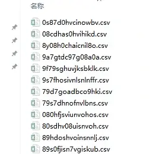

- We can use Stata's fs package to read all the names.
- Then use a `local` to store the names directly for the loop.
- During the loop we can nest another loop so that new files are named in order.

```sql
* ==============================
* Configure paths
* ==============================
local path "F:\数据合集\刑事案件"
local outpath "F:\数据合集\刑事案件简洁"

cd "`path'"


fs "*.csv", all

* ==============================
* Manually generate the CSV file list into a local
* ==============================
local files " 080hfjsviunvohos.csv 749baig9gvbblcn.csv     97sytdv97goushd.csv 08cdhas0hvihikd.csv 7839yhcudaboce.csv      98ya08chiahnicn.csv 0s87d0hvcinowbv.csv 788tgd9cayh0c-9.csv 9a7gtdc97g08a0a.csv 1368bcohucg970.csv 797fshonlsnlfu98.csv 9f79sghuvjksbklk.csv 236797rbvlsbvoo.csv 79d7goadbco9hki.csv 9s7fhosivnlsnlnffr.csv 2489ndsujbovbo.csv 79s7dhnofnvlbns.csv a97dyc8udv8+hds9.csv 28638bvbsa7f93.csv 80sdhv08uisnvoh.csv i7sdhvu9hbosdv8.csv 2937hvoushcv8h.csv 89hdoshvoinsnnlj.csv oa7gc7agbkd78ad.csv 4689578yhkjsbd.csv 89s0fjisn7vgiskub.csv oc8ahhc89ha98g.csv 4790r8hvobosh7.csv 8y08h0chaicnil8o.csv os8dvyh089shdvi.csv 4792794bvoshc8.csv 94573hvsoidhv9y.csv s8oyvf08s09vu08.csv 479hu5nnv89007.csv 9473hgnvov9h7s.csv      u8ca0hc80ha00a.csv 4927bvogf92h011.csv 97atcg97ga0hc08.csv ughdso8h98989.csv 739g4foh8hv991.csv 97sgvc98dshv08.csv "


* ==============================
* Loop over each file
* ==============================
* Initialize the counter
local i = 1

* Loop over each file
foreach f of local files {
    di "Processing file `i': `f'"
    * Import CSV
    import delimited "`f'", clear varnames(1) encoding(utf8)
    * Data cleaning
    * Processing section
    * Save as a numerically ordered DTA file
    save "`outpath'/`i'.dta", replace
    * Increment the counter
    local ++i
}
```

### Optimizing Matching Speed

Normal matching would be to match the dta files converted from the 119 txt files, nested-loop matching them onto ans 1–ans 83.

If you match with direct nested loops, it might take 4 to 5 days.

The reason the matching takes so long is that each nested loop's file reading takes too long, and there are duplicate values across files.

I recommend first using the `append` command to vertically stack the 119 dta files together, then loop-matching them onto ans 1 to ans 83. This way the entire match takes at most 2 days.

<div style="padding: 15px; border: 1px solid transparent; border-color: transparent; margin-bottom: 20px; border-radius: 4px; color: #7d637a; background-color: #f6edf5; border-color: #f1e4f0;">
💬<b> Note: The office computer runs the Stata MP version, whose feature is that "computation speed is allocated based on the computer's cores." The CPU currently has a full 16 cores, and the largest peak I've personally processed is 60 GB. It's basically fine — you just need patience while waiting through the occasional stalls.</b>
</div>

## Cleaning the dta Data

### Common Text-Processing Functions

#### Removing Spaces

For example, the chief judge (judge) variable can appear as `四川 大学`, `四川大学`, or `四 川 大 学`.

Different websites use different space characters, so I recommend the following function:

* Remove all special characters, including invisible characters, whitespace, and punctuation.

```stata
replace judge_fin = ustrregexra(法官名字变量, "[^\p{L}\p{N}]+", "")
```

#### Filtering Specific Characters

Keep a row if the variable contains a specific character.

```stata
keep if strpos(var, "民初") > 0
```

If there are two variables, e.g. one is a standardized province variable a (四川省, 内蒙古自治区) and the other is a non-standardized province variable b (四川, 内蒙古), and you want to judge whether variable a contains variable b, you can use:

```
gen localed = strpos(a, b) > 0
```

#### Removing Special Characters

The text variables in Ans 1 through Ans 83 are mixed with various non-Chinese symbols; you can use the following function to remove them:

Below are the mojibake symbols I've personally filtered out.

<div style="padding: 15px; border: 1px solid transparent; border-color: transparent; margin-bottom: 20px; border-radius: 4px; color: #7d637a; background-color: #f6edf5; border-color: #f1e4f0;">
💬<b> Note: Why insist on the exclusion method rather than keeping only Chinese characters? Because when I tried it myself, I found some Chinese variables would turn into mojibake that way.</b>
</div>

```stata
# Define the list of symbols to remove (including spaces)
local symbols "ⅩⅩⅩ Ｘ ? ; ；， 《 》 ． ＋ （ ） ( ) & # 1 2 3 4 5 6 7 8 9 0 & A-Z a-z ；？ ＊ ︰ ++  .   XX XXX   ______   ` - +  BRR H imestimes jzwjzwnjzwnjzwjzwnjzwnjzwnjzwjzwjzwjzwnjzwnjzwnjzwjzwnjzwnj jzwnjzwjzwjzwnjzwnjzwnjzwnjzwnjzwjzwjzwjzwnjzwjzwnjzwjzwj spemsp sp emsp ；； *  XX XXX Ｘ ＸＸＸ"

* Iterate over the symbol list and remove each symbol and spaces
foreach s of local symbols {
    replace judge_fin = subinstr(judge_fin, "`s'", "", .)
}
```

#### Paper Labels

Sometimes Stata data only has variable names, while a separate Excel sheet stores the label values.
How do you read the Excel file and automatically batch-generate `label variable` commands?

```sql
* Import the Excel lookup table
clear
import excel "基本情况代码对照表.xlsx", ///
    sheet("支出1编码对照")

rename B varname
rename A varlabel

* Generate the command (note the compound quotes)
gen cmd = "label variable " + varname + " `" + `"""' + varlabel + `"""' + "'"

outsheet cmd using "变量标签命令.txt", noquote replace
```

This will generate a file storing all the labeling commands for Stata.

> All code involves a tradeoff between automation and transparency; I personally prefer this kind of process with an intermediate artifact, which is easier to check and correct.

### Regular Expression Extraction

#### Character Filtering

Take the chief judge text variable as an example.

The variable should clearly be a name, but instead a whole paragraph shows up.

> Zhang San people's entrusted, Zhang San presided over the trial in 2014, Zhang San people's assessor made the ruling, Zhang San acting chief judge conducted the hearing, Zhang San and Li Si clerks opened the session......

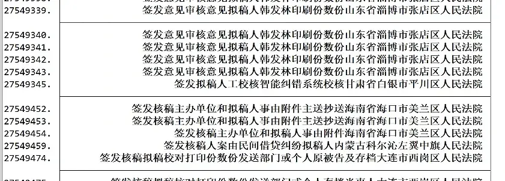

In other words, the correct text characters should be the first few characters before a specific word.

First use character-length filtering to look at the text format:

```stata
*List the variable rows with character length greater than 14
list var if ustrlen(judge_fin) >= 14
```

Then, depending on the case, **keep only specific characters**.

<div style="padding: 15px; border: 1px solid transparent; border-color: transparent; margin-bottom: 20px; border-radius: 4px; color: #a94442; background-color: #f2dede; border-color: #ebccd1;">
⛔<b> Warning: mind the order!</b>
</div>

> For example, there are these combinations:
>
> Zhang San held the trial **in** 2014
>
> Zhang San, **acting** chief judge, held the trial **in** 2014
>
> When the variable contains the two characters "庭审", we should first keep the characters before "于", and then keep the characters before "代理".
>
> For condition-based filtering it's best to look for two-character feature words, so that a judge name like "于庭审" is almost impossible to appear.

The order I personally use, for reference only:

```stata
replace judge_fin = ustrregexra(judge_fin, "人民陪审员.*", "") if  strpos(judge_fin, "人民陪审员") > 0
replace judge_fin = ustrregexra(judge_fin, "审判员.*", "") if  strpos(judge_fin, "审判员") > 0
replace judge_fin = ustrregexra(judge_fin, "独任.*", "") if  strpos(judge_fin, "独任") > 0
replace judge_fin = ustrregexra(judge_fin, "陪审员.*", "") if  strpos(judge_fin, "陪审员") > 0
replace judge_fin = ustrregexra(judge_fin, "代理.*", "") if  strpos(judge_fin, "代理") > 0
replace judge_fin = ustrregexra(judge_fin, "书记员.*", "") if  strpos(judge_fin, "书记员") > 0
replace judge_fin = ustrregexra(judge_fin, "助理.*", "") if  strpos(judge_fin, "助理") > 0
replace judge_fin = ustrregexra(judge_fin, "审判长.*", "") if  strpos(judge_fin, "审判长") > 0
replace judge_fin = ustrregexra(judge_fin, "人民.*", "") if  strpos(judge_fin, "人民") > 0
replace judge_fin = ustrregexra(judge_fin, "二.*", "") if  strpos(judge_fin, "年") > 0
replace judge_fin = ustrregexra(judge_fin, "适用.*", "") if  strpos(judge_fin, "适用") > 0
replace judge_fin = ustrregexra(judge_fin, "于.*", "") if  strpos(judge_fin, "开庭") > 0
replace judge_fin = ustrregexra(judge_fin, "对.*", "") if  strpos(judge_fin, "审理") > 0
```

Since the crawler sometimes hits website encryption, the crawled result is `陈*`, and after the above cleaning only `陈` remains. The function command to delete single-character rows is:

```stata
*Delete rows with only one character, e.g. originally *陈
drop if ustrregexm(judge_fin, "^[\p{Han}]$")
```

#### Extracting Numbers

For example, the data shows `2.34435元` (needs to be a string variable), and we only want to extract the number; you can use the following code.

```stata
gen num_var = .
replace num_var = real(regexs(1)) if regexm(str_var, "([0-9]+\.[0-9]+|[0-9]+)")
```

By the way, without the `real(regexs(1))` argument it's just a boolean test, returning only 0 and 1, indicating whether it matches the format or not.

```stata
replace num_var =  regexm(str_var, "([0-9]+\.[0-9]+|[0-9]+)")
```

## dta Time Correction

In the bidding work in my research group, many time formats are messy.

For example, two standard ones:
`2019-12-31 09:00:00`,
` 2019/12/30 09:30`

But you'll also see `20220516 09:30:00`, `2022051609:30:00`, `2022051609:30`.

For example, missing seconds, or the month position written as 4 instead of 04.

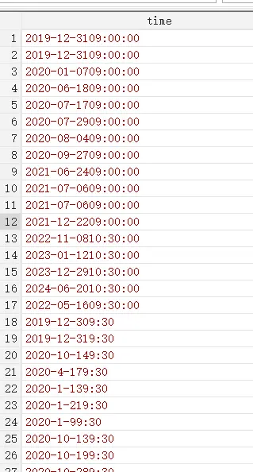

The code below handles this set of time encodings in a unified way.

Some preprocessing to convert Chinese symbols to English ones.

When there's no space between the date and time (e.g. `2022051609:30:00`), if the value falls within the corresponding year/month range (e.g. 0-31), prefer taking two digits; if it exceeds the range, take the single digit before it.

Finally, time extraction that is compatible with various formats.

```
/*-----------------------------------------
  Date extraction and conversion scheme (compact-format enhanced version)
  Version: 2.6
  Last updated: 2024-06-27
-----------------------------------------*/
version 17
clear all
set more off

use "F:\桌面\test.dta", clear
keep time

*===============================
*        Preprocessing stage (enhanced)
*===============================
// Basic cleaning
replace time = ustrtrim(time)
replace time = subinstr(time, char(92), "-", .)
replace time = subinstr(time, "：", ":", .)
replace time = subinstr(time, " ", "", .)

*===============================
*      New compact-format recognition module
*===============================
// Recognize YYYYMMDD- format (core improvement)
gen str8 compact_date = ""
replace compact_date = substr(time, 1, 8) ///
    if ustrregexm(time, "^\d{8}-")  // Strictly match 8 digits + hyphen format

// Separate the compact-format data
preserve
keep if compact_date != ""
gen date_stata = date(compact_date, "YMD")
format date_stata %tdCCYY-NN-DD
tempfile compact
save `compact'
restore

// Process the non-compact-format data
keep if compact_date == ""
drop compact_date

*===============================
*      Original processing flow (optimized)
*===============================
// Unify the separator handling
foreach s in "." "_" "/" {
    replace time = subinstr(time, "`s'", "-", .)
}

// Extract the date part
gen str50 date_part = ustrregexs(1) if ustrregexm(time, "(\d{4}-\d{1,2}-\d{2,})[^\d]")
replace date_part = time if missing(date_part)

// Smart date handling
gen str4 year = ustrregexs(1) if ustrregexm(date_part, "^(\d{4})-\d+")
gen str2 month = ustrregexs(1) if ustrregexm(date_part, "-(\d{1,2})-")
gen str5 raw_day = ustrregexs(1) if ustrregexm(date_part, "-(\d+)$")

replace month = cond(strlen(month) == 1, "0" + month, month)
replace month = "12" if real(month) > 12

gen str2 day = substr(raw_day,1,2)
replace day = substr(day,1,1) if real(day) > 31
replace day = "31" if real(day) > 31
replace day = "0" + day if real(day) < 10 & strlen(day) == 1

replace date_part = year + "-" + month + "-" + day
drop year month raw_day day

gen date_stata = date(date_part, "YMD")
replace date_stata = date(ustrregexra(time, "[^0-9]", ""), "YMD") if missing(date_stata)

*===============================
*      Merge the processing results
*===============================
append using `compact'

*===============================
*      Post-processing and verification
*===============================
format date_stata %tdCCYY-NN-DD


```

## Case Number and Date

In court documents, the `acc` year-month represents the filing year-month; the `jud` year-month represents the judgment year-month. Since the case number is assigned when the case is filed and accepted, if the filing year-month is missing, we can try to interpolate based on the case number. Each year the case numbers run from number 1 to number n, so we can interpolate the date based on that.

The case number `（2019）沪0115民初1号` actually means: in 2019, the court with Shanghai code 0115 filed a case under the 民初 procedure, and it was the first filed case of the Shanghai–this court–民初 type that year.

Likewise, we can estimate the annual publication rate of court judgments based on this. But under maximum likelihood estimation, with an optimal approximate distribution assumption, we need to use the "tank formula" to estimate it.

```sql

**********Approach*************
/*
Since case numbers each year are
民初（2020）**号, where **号 is numbered in order.
It's possible the sample only contains numbers 1, 3, 5, 7.
The "tank formula" derived from maximum likelihood estimation is used to estimate the publication rate (originating from WWII estimation of tank capture rates).
Finally, compute the publication rate for each court-year.
Consider dropping courts with low publication rates (equivalent to dropping regions with low publication rates).
*/
**********Variable Descriptions*************
/*
case_num_str: court judgment case number
court_name: court name
jud_year: judgment year
public_rate: publication rate
*/
**********References*************
/*
1 Origin of the formula, and other methods for estimating the publication rate
Augmenting serialized bureaucratic data: the case of Chinese courts (2022, working paper)

2 Application example
Suing the government under weak rule of law: Evidence from administrative litigation reform in China (2023, jpube)
*/

gen case_num_str = ustrregexs(1) if ustrregexm(case_wid_str, "民[^0-9]*([0-9]+)")
replace case_num_str = ustrregexra(case_num_str, "^0+", "")
destring case_num_str, gen(case_num)
drop case_num_str
order case_wid_str case_num


bysort court_name jud_year: egen max_case_num = max(case_num)

bysort court_name jud_year: gen case_count = _N

order max_case_N


bysort court_name jud_year: egen max_case_N = max(case_count)
gen case_count = max_case_num
gen public_rate = max_case_N / (max_case_num * (1 + 1/max_case_N) - 1)
sum public_rate

keep court_name jud_year public_rate

duplicates drop court_name jud_year, force

duplicates report  court_name jud_year
```

### Reminder

I recommend first exporting the Stata data to csv format.

The biggest problem is **mojibake**.

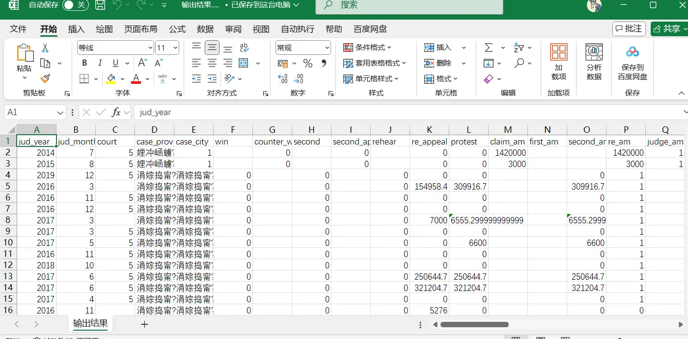

The csv is mojibake, because the extracted txt is not in utf-8 format.

<div style="padding: 15px; border: 1px solid transparent; border-color: transparent; margin-bottom: 20px; border-radius: 4px; color: #8a6d3b;; background-color: #fcf8e3; border-color: #faebcc;">
😨<b> Note: Make sure the CSV file's default format is UTF-8 before processing.</b>
</div>

## Python Example: Extracting Past and Present Feature Means of Appealing Judges

Example 3 matches row by row, but this is simply too slow.

Now I want to process it like this:

Extract the 20 cases the judge handled before the appeal and compute the fine mean; at the same time, extract the 20 cases the judge handled after the appeal and compute the fine mean.

The algorithm logic I designed is as follows:

- Group the data by the court–judge combination.
- Each record has times from first instance to final instance, forming timestamps, and each row should identify the earliest and latest times in a series of times.
- When the earliest time differs from the latest time, this record is main data.
- Within each group, keep only the samples that satisfy the condition.
- Around the main data, when there are still 10 cases before the main data's earliest record and 10 cases after it, keep only these 21 records in the end.
- If a group has multiple cases at the same time, keep all samples that satisfy the requirement.
- Generate variable a for the main data that has the corresponding number of surrounding cases, marking it as 1.
- Generate the before-appeal and after-appeal variables, and compute the mean of the corresponding number of cases.


To make better use of AI, I actually split this algorithm into two steps. The first part filters out all samples that meet the requirement; the second part computes the means of the cases before and after at the main data (a=1). Finally, integrate the code from the two parts.


In the end I set one more parameter: how many surrounding cases the main case needs to have for it to be kept.

```python
import pandas as pd
from tqdm import tqdm
import numpy as np

# Parameter configuration
input_path = r'C:\Users\PC\Desktop\hzp_project_re\re_论文开始\最终面板数据\去极端值交通民事上诉样本.csv'
output_path = r'C:\Users\PC\Desktop\hzp_project_re\re_论文开始\最终面板数据\去极端值交通民事上诉样本_论文去0_45_民诉样本.csv'
before_n = 45  # Number of records to keep before
after_n = 45   # Number of records to keep after

# Time field configuration
time_columns = [
    'jud_year', 'jud_month',
    'm1_jud_year', 'm1_jud_month',
    'm2_jud_year', 'm2_jud_month',
    'm3_jud_year', 'm3_jud_month',
    'm4_jud_year', 'm4_jud_month',
]

def extract_timestamps(row):
    """提取每行的时间戳（最早和最晚时间）"""
    timestamps = []
    for i in range(0, len(time_columns), 2):
        year = row[time_columns[i]]
        month = row[time_columns[i + 1]]
        if pd.notna(year) and pd.notna(month):
            try:
                timestamps.append((int(year), int(month)))
            except:
                continue
    return min(timestamps, default=None), max(timestamps, default=None)

def is_main_case(row):
    """判断是否为主干数据"""
    conditions = [
        (pd.notna(row['m1_judge_am']) & pd.notna(row['m2_judge_am'])),
        (pd.notna(row['m1_judge_am']) & pd.notna(row['m3_judge_am'])),
        (pd.notna(row['m1_judge_am']) & pd.notna(row['m4_judge_am'])),
        (pd.notna(row['m2_judge_am']) & pd.notna(row['m3_judge_am'])),
        (pd.notna(row['m2_judge_am']) & pd.notna(row['m4_judge_am'])),
        (pd.notna(row['m3_judge_am']) & pd.notna(row['m4_judge_am'])),
    ]
    return any(conditions)

def filter_valid_judge(data):
    """过滤有效金额（非0非空）"""
    return data[(data['judge_am'] != 0) & (data['judge_am'].notna())]

def calculate_means(group, main_case_idx):
    """
    计算主干数据的 judge_sum, bf_judge_sum 和 af_judge_sum（均排除0值和空值）
    """
    min_time, max_time = extract_timestamps(group.loc[main_case_idx])

    if min_time is None or max_time is None:
        return group

    # Compute judge_sum
    judge_data = group[group.index != main_case_idx]
    valid_judge = filter_valid_judge(judge_data)
    group.loc[main_case_idx, 'judge_sum'] = valid_judge['judge_am'].mean() if not valid_judge.empty else np.nan

    # Compute bf_judge_sum
    bf_cond = (
        (group['jud_year'] < min_time[0]) |
        ((group['jud_year'] == min_time[0]) & (group['jud_month'] < min_time[1]))
    ) & (group.index != main_case_idx)
    valid_bf = filter_valid_judge(group[bf_cond])
    group.loc[main_case_idx, 'bf_judge_sum'] = valid_bf['judge_am'].mean() if not valid_bf.empty else np.nan

    # Compute af_judge_sum
    af_cond = (
        (group['jud_year'] > max_time[0]) |
        ((group['jud_year'] == max_time[0]) & (group['jud_month'] > max_time[1]))
    ) & (group.index != main_case_idx)
    valid_af = filter_valid_judge(group[af_cond])
    group.loc[main_case_idx, 'af_judge_sum'] = valid_af['judge_am'].mean() if not valid_af.empty else np.nan

    return group

def process_group(group):
    """处理单个分组并生成特征"""
    # Create a DataFrame for the new columns
    new_columns = {}
    for i in range(1, before_n + 1):
        new_columns[f'bf_{i}_judge_am'] = np.nan
        new_columns[f'bf_{i}_count_tiao'] = np.nan
        new_columns[f'bf_{i}_total_chars'] = np.nan
        new_columns[f'bf_{i}_clause_count'] = np.nan
    for j in range(1, after_n + 1):
        new_columns[f'af_{j}_judge_am'] = np.nan
        new_columns[f'af_{j}_count_tiao'] = np.nan
        new_columns[f'af_{j}_total_chars'] = np.nan
        new_columns[f'af_{j}_clause_count'] = np.nan
    new_columns.update({
        'a': 0,
        'judge_sum': np.nan,
        'bf_judge_sum': np.nan,
        'af_judge_sum': np.nan
    })

    # Add the new columns to group all at once
    new_columns_df = pd.DataFrame(new_columns, index=group.index)
    group = pd.concat([group, new_columns_df], axis=1)

    # Filter the main data
    main_cases = group[group.apply(is_main_case, axis=1)]
    if main_cases.empty:
        return group

    for idx, row in main_cases.iterrows():
        min_time, max_time = extract_timestamps(row)
        if not min_time or not max_time:
            continue

        group.loc[idx, 'a'] = 1
        group = calculate_means(group, idx)

        # Get the valid context data
        before_data = filter_valid_judge(group[
            (group['jud_year'] < min_time[0]) |
            ((group['jud_year'] == min_time[0]) & (group['jud_month'] < min_time[1]))
        ]).sort_values(['jud_year', 'jud_month'], ascending=[True, True])

        after_data = filter_valid_judge(group[
            (group['jud_year'] > max_time[0]) |
            ((group['jud_year'] == max_time[0]) & (group['jud_month'] > max_time[1]))
        ]).sort_values(['jud_year', 'jud_month'], ascending=[True, True])

        # Fill the forward features
        for i in range(1, min(before_n + 1, len(before_data) + 1)):
            row_data = before_data.iloc[-i]
            group.loc[idx, f'bf_{i}_judge_am'] = row_data['judge_am']
            group.loc[idx, f'bf_{i}_count_tiao'] = row_data['count_tiao']
            group.loc[idx, f'bf_{i}_total_chars'] = row_data['total_chars']
            group.loc[idx, f'bf_{i}_clause_count'] = row_data['clause_count']

        # Fill the backward features
        for j in range(1, min(after_n + 1, len(after_data) + 1)):
            row_data = after_data.iloc[j - 1]
            group.loc[idx, f'af_{j}_judge_am'] = row_data['judge_am']
            group.loc[idx, f'af_{j}_count_tiao'] = row_data['count_tiao']
            group.loc[idx, f'af_{j}_total_chars'] = row_data['total_chars']
            group.loc[idx, f'af_{j}_clause_count'] = row_data['clause_count']

    return group

if __name__ == "__main__":
    try:
        with open(input_path, 'r', encoding='utf-8', errors='replace') as file:
            df = pd.read_csv(file)
        print(f"成功加载数据：{len(df):,}条")
    except Exception as e:
        print(f"数据加载失败：{str(e)}")
        exit()

    final_dfs = []
    grouped = df.groupby(['court_name', 'judge_fin'])

    with tqdm(total=len(grouped), desc="处理进度") as pbar:
        for (court, judge), group in grouped:
            final_dfs.append(process_group(group))
            pbar.update(1)

    final_df = pd.concat(final_dfs)
    final_df.to_csv(output_path, index=False, encoding='utf-8')

    # Result verification
    main_data = final_df[final_df['a'] == 1]
    print(f"\n生成主干数据：{len(main_data):,}条")
    print("字段验证（应无0值和空值）：")
    print(main_data[['judge_sum', 'bf_judge_sum', 'af_judge_sum']].describe())
```

> If the above code is run in a PyCharm environment instead of a Jupyter environment, you need to adjust the position of the input parameters.

## Some Court Judgment Variables You Can Get Quickly

- Work experience: the time span from the first appearance to the last appearance.
- Shared cases: how many cases were handled in total in the sample.
- Cumulative cases: which case this is currently being handled. Since the sample is monthly, the cumulative count should be 1, 1, 3, 3, 5, 6...

```stata

* Generate a unique row id
gen id = _n

* Make sure the data is sorted by court, judge, year, month, case order
sort court_name judge_fin jud_year jud_month id

* Create a case count variable (each row defaults to 1)
gen case_count = 1

* Group by court and judge, and cumulatively sum the case counts
bysort court_name judge_fin (jud_year jud_month): gen cumulative_count = sum(case_count)

* Correct so that the same month has the same cumulative count
bysort court_name judge_fin jud_year jud_month (cumulative_count): replace cumulative_count = cumulative_count[_N]

* Convert year and month into a single time point (in months)
gen time = jud_year * 12 + jud_month

* Compute the first time point (when each judge handled their first case at a court)
bysort court_name judge_fin (jud_year jud_month): gen first_time = time[1]

* Compute work experience (in months)
gen work_experience_months = time - first_time + 1

* Drop unneeded temporary variables
drop id case_count time first_time

egen combo_count = count(court_name + judge_fin), by(court_name judge_fin)
```

## Python Example: Case Backlog

In court documents there are two times: the case judgment time (starting with jud) and the case filing time (starting with acc).

The case backlog is all cases whose filing time is earlier than the current year-month and whose judgment year is later than the current year. This kind of operation involving cross-row variable identification is exactly Stata's weak point.

```python
import pandas as pd

import numpy as np

from tqdm import tqdm

import time


def calculate_backlog(df: pd.DataFrame) -> pd.DataFrame:

    # Build the time fields (in months)

    df['acc_time'] = df['acc_year'] * 12 + df['acc_month']

    df['jud_time'] = df['jud_year'] * 12 + df['jud_month']


    # Initialize the backlog column

    df['backlog'] = 0


    # Process grouped by court + judge

    grouped = df.groupby(['court_name', 'judge_fin'])


    print(f"共有分组数量：{len(grouped)}")

    start_time = time.time()


    # Iterate over each group

    for (court, judge), group_df in tqdm(grouped, desc="Processing court-judge groups"):

        idx = group_df.index

        jud_times = group_df['jud_time'].to_numpy()

        acc_times = group_df['acc_time'].to_numpy()


        # Initialize the backlog result

        backlog_counts = np.zeros(len(group_df), dtype=int)


        for i in range(len(group_df)):

            jud_time_i = jud_times[i]

            # Backlog condition: filing time < current judgment time, AND other cases' judgment time > current judgment time

            backlog_mask = (acc_times < jud_time_i) & (jud_times > jud_time_i)

            backlog_counts[i] = backlog_mask.sum()


        # Update the result

        df.loc[idx, 'backlog'] = backlog_counts


    elapsed = time.time() - start_time

    print(f"\n处理完成，总耗时：{elapsed:.2f} 秒")

    return df


def main(input_path, output_path):

    print("读取数据中...")

    df = pd.read_csv(input_path, encoding='utf-8', encoding_errors='replace')

    print(f"数据读取完成，共有 {len(df)} 条记录。")


    df_result = calculate_backlog(df)


    print(f"保存结果到：{output_path}")

    df_result.to_csv(output_path, index=False, encoding='utf-8-sig')

    print("保存完成。")


if __name__ == "__main__":

    # Change the input/output paths to match your environment

    input_path = r'C:\Users\PC\Desktop\hzp_project_re\re_论文开始\案件积压\案件积压计算.csv'

    output_path = r'C:\Users\PC\Desktop\hzp_project_re\re_论文开始\案件积压\论文_案件积压计算.csv'


    main(input_path, output_path)
```

## Stata Example: Court-Year Case Publication Rate

```sql
**********Approach*************
/*
Since case numbers each year are
民初（2020）**号, where **号 is numbered in order.
It's possible the sample only contains numbers 1, 3, 5, 7.
The "tank formula" derived from maximum likelihood estimation is used to estimate the publication rate (originating from WWII estimation of tank capture rates).
Finally, compute the publication rate for each court.
Consider dropping courts with low publication rates (equivalent to dropping regions with low publication rates).
*/
**********Variable Descriptions*************
/*
case_num_str: court judgment case number
court_name: court name
jud_year: judgment year
public_rate: publication rate
*/
**********References*************
/*
1 Origin of the formula, and other methods for estimating the publication rate
Augmenting serialized bureaucratic data: the case of Chinese courts (2022, working paper)

2 Application example
Suing the government under weak rule of law: Evidence from administrative litigation reform in China (2023, jpube)
*/

gen case_num_str = ustrregexs(1) if ustrregexm(case_wid_str, "民[^0-9]*([0-9]+)")
replace case_num_str = ustrregexra(case_num_str, "^0+", "")
destring case_num_str, gen(case_num)
drop case_num_str
order case_wid_str case_num


bysort court_name jud_year: egen max_case_num = max(case_num)

bysort court_name jud_year: gen case_count = _N

order max_case_N


bysort court_name jud_year: egen max_case_N = max(case_count)
gen case_count = max_case_num
gen public_rate = max_case_N / (max_case_num * (1 + 1/max_case_N) - 1)
sum public_rate

keep court_name jud_year public_rate

duplicates drop court_name jud_year, force

duplicates report  court_name jud_year
```

The court names in court judgments are also all over the place. For example, some judgments write the court as "Heilongjiang Province xx District People's Court", while others omit the province and just write "xx District People's Court". In this case the best and most convenient approach is to directly fuzzy-match against a complete court directory.

## Python Example: Matching Large-Scale Data

Matching business registration data with other enterprise databases is quite popular nowadays, and it basically starts from 50 million valid records.

Stata's `merge` command consumes a lot of memory when matching, because its temporary copies easily double the memory cost. So I personally recommend exporting everything to `.csv` files and using Python's `duckdb` (matching with `pandas` is only slightly better than Stata's `merge`).

The example below is a `duckdb` example. Its effect is the same as Stata's `merge m:1`, but with better memory optimization:

```python
import duckdb
import os

con.execute("DROP TABLE IF EXISTS using_tbl")
con.execute("DROP TABLE IF EXISTS main_tbl")
con.execute("DROP TABLE IF EXISTS merged")

# =====================
# Paths (change to your actual paths)
# =====================

MAIN_CSV = r"C:\Users\PC\Desktop\中国招投标\论文代码\回归数据.csv"
USING_CSV = r"C:\Users\PC\Desktop\中国招投标\论文代码\注册数据.csv"
OUT_CSV  = r"C:\Users\PC\Desktop\中国招投标\论文代码\merged.csv"
DB_FILE  = r"C:\Users\PC\Desktop\中国招投标\论文代码\merge.duckdb"

# =====================
# Connect to DuckDB (on disk, to prevent OOM)
# =====================

con = duckdb.connect(DB_FILE)

# (Optional) limit memory, more stable
con.execute("PRAGMA memory_limit='16GB'")
con.execute("PRAGMA threads=8")
print("1️⃣ 读取 using 表（1.8 亿）")
con.execute(f"""
CREATE TABLE using_tbl AS
SELECT *
FROM read_csv_auto(
    '{USING_CSV}',
    SAMPLE_SIZE=1000000,
    parallel=true
)
""")

print("2️⃣ 读取 main 表（2000 万）")
con.execute(f"""
CREATE TABLE main_tbl AS
SELECT *
FROM read_csv_auto(
    '{MAIN_CSV}',
    SAMPLE_SIZE=500000,
    parallel=true
)
""")

print("3️⃣ LEFT JOIN（m:1）")
con.execute("""
CREATE TABLE merged AS
SELECT
    m.*,
    u.*
FROM main_tbl m
LEFT JOIN using_tbl u
ON m.credit_code = u.credit_code
""")

print("4️⃣ 导出结果")
con.execute(f"""
COPY merged
TO '{OUT_CSV}'
(HEADER, DELIMITER ',')
""")

con.close()
print("✅ 完成")
```

## Python Example: Classifying Case Types

Reference: the paper [Women in the Courtroom: Technology and Justice](https://academic.oup.com/restud/advance-article/doi/10.1093/restud/rdaf066/8220859). What if there are too many case types in the court judgments? Cluster them into 50 case types using an LDA model.

This code assumes you already have a case panel (`.csv`) of case-number–case-type-name. Next, machine learning classification can simplify it into 50 case types.

For an application example, see [LDA Topic Model and Gephi Visualization](https://blog.huaxiangshan.com/zh-cn/posts/lda_gephi/)

```python
import ast
import pandas as pd
import jieba
import logging
from gensim import corpora, models
from tqdm.auto import tqdm
import warnings
import os
import re

# -------------------------------
# 0. Global settings
# -------------------------------
# Ignore warnings
warnings.filterwarnings("ignore")
jieba.setLogLevel(logging.INFO)
# Initialize jieba to avoid printing logs in the progress bar
jieba.initialize()

# -------------------------------
# User-configurable parameters (User Configurable Parameters)
# -------------------------------
# Set the number of topics to generate. Change the topic count here, e.g. 20, 50, 100, etc.
NUM_TOPICS = 50
# Set the minimum occurrence count for filtering low-frequency words. E.g. no_below=100 keeps only words appearing >= 100 times.
MIN_WORD_COUNT = 100
# Number of LDA training iterations (Passes)
NUM_PASSES = 10

# -------------------------------
# File path settings (file names are generated dynamically, including the topic count)
# -------------------------------
input_path = r"/root/案件类型.csv"
output_path = r"/root/案件类型_{}类别结果.csv".format(NUM_TOPICS)
topic_words_path = r"/root/主题{}词汇.csv".format(NUM_TOPICS)
doc_topic_words_path = r"/root/文档主题词_{}主题.csv".format(NUM_TOPICS)

# Define common, low-discriminative stopwords
# The goal is to force the model to focus on the case's subject nouns (e.g. buying/selling, finance, trademarks, inheritance)
CHINESE_STOPWORDS = {
    '纠纷', '责任', '案件', '争议', '纠纷案件', '追偿', '纠葛', '诉讼', '法律', '与', '及', '的', '是',
    '一', '二', '三', '四', '等', '其他', '之', '因', '中',
    # Newly added common legal words that may appear in all case types, reducing topic discrimination
    '权', '损害', '赔偿', '物', '行为', '权利', '民事', '确认'
}

print(f"正在读取数据: {input_path} ...")
# -------------------------------
# 1. Read the data
# -------------------------------
data = pd.read_csv(input_path, dtype=str)
data = data.fillna("")

# -------------------------------
# 2. Clean the type field
# -------------------------------
def clean_type(x):
    x = str(x).strip()
    try:
        val = ast.literal_eval(x)
        if isinstance(val, list):
            return " ".join(val)
    except:
        pass
    # Remove all non-Chinese characters, keeping only the Chinese case cause names
    x = re.sub(r'[^\u4e00-\u9fa5\s]', '', x)
    return x.replace("[", "").replace("]", "").replace("'", "")

tqdm.pandas(desc="清洗数据", mininterval=0.5)
data["type_clean"] = data["type"].progress_apply(clean_type)

# -------------------------------
# 3. Chinese word segmentation and stopword filtering
# -------------------------------
print("正在进行分词和停用词过滤...")
def cut_words_and_filter(text):
    # Segment words
    words = jieba.lcut(text)
    # Filter out empty words and stopwords
    filtered_words = [w for w in words if w.strip() and w not in CHINESE_STOPWORDS]
    return filtered_words

tqdm.pandas(desc="分词处理", mininterval=0.5)
data["words"] = data["type_clean"].progress_apply(cut_words_and_filter)

# Filter out empty text
original_len = len(data)
data = data[data["words"].map(len) > 0].reset_index(drop=True)
print(f"有效文本数量: {len(data)} / {original_len}")

texts = data["words"].tolist()

# -------------------------------
# 4. Build the dictionary and corpus
# -------------------------------
print("构建字典和语料...")
dictionary = corpora.Dictionary(texts)
# Filter out words appearing fewer than MIN_WORD_COUNT times
dictionary.filter_extremes(no_below=MIN_WORD_COUNT)
corpus = [dictionary.doc2bow(t) for t in tqdm(texts, desc="生成语料", mininterval=0.5)]

# -------------------------------
# 5. LDA training (accelerated with LdaMulticore)
# -------------------------------
num_topics = NUM_TOPICS # Use the user-set topic parameter
passes = NUM_PASSES    # Use the user-set iteration parameter
# Automatically set the core count, using all cores minus 1
workers = max(1, os.cpu_count() - 1)

print(f"开始 LDA Multicore 训练 (主题数={num_topics}, 轮数={passes}, 核心数={workers})...")

# Switch to LdaMulticore, using multi-core parallel computation
lda = models.LdaMulticore(
    corpus=corpus,
    id2word=dictionary,
    num_topics=num_topics,
    passes=passes,
    random_state=42,
    workers=workers, # Use multi-core parallel computation
    chunksize=5000   # Increase the chunk size to optimize performance
)

# -------------------------------
# 6. Output the high-frequency words of each topic
# -------------------------------
topn = 10
topic_words = {}
for t in range(num_topics):
    topic_words[t] = [word for word, _ in lda.show_topic(t, topn=topn)]

df_topic_words = pd.DataFrame({
    "topic": list(topic_words.keys()),
    "words": [" ".join(wlist) for wlist in topic_words.values()]
})
df_topic_words.to_csv(topic_words_path, index=False, encoding="utf-8-sig")
print(f"已输出主题高频词到：{topic_words_path}")

# -------------------------------
# 7. Text → topic mapping (ensure identical texts map to the same topic, and output the topic words)
# -------------------------------
text2topic = {}
topic_list = []
doc_topic_words_list = [] # Store the top N words of the topic for each document

print("\n正在进行文档主题预测...")
# total=len(corpus) ensures tqdm computes progress correctly
for t_clean, doc in tqdm(zip(data["type_clean"], corpus), total=len(corpus), desc="主题预测", mininterval=0.5):
    if t_clean in text2topic:
        best_topic = text2topic[t_clean]
    else:
        tp = lda.get_document_topics(doc)
        if tp:
            # Take the topic ID with the highest probability
            best_topic = max(tp, key=lambda x: x[1])[0]
        else:
            best_topic = -1
        # Cache the result
        text2topic[t_clean] = best_topic

    topic_list.append(best_topic)
    if best_topic != -1:
        doc_topic_words_list.append(" ".join(topic_words[best_topic]))
    else:
        doc_topic_words_list.append("")

# Use a dynamic column name, e.g. topic50
data[f"topic{NUM_TOPICS}"] = topic_list
data["topic_words"] = doc_topic_words_list

# -------------------------------
# 8. Save the result
# -------------------------------
output_columns = [c for c in data.columns if c not in ["words"]]
data[output_columns].to_csv(output_path, index=False, encoding="utf-8-sig")
print(f"完成！已输出最终结果到：{output_path}")

# -------------------------------
# 9. Save the document-topic-words CSV
# -------------------------------
# Adjust the column names for clarity
data_doc_topic = data[["type_clean", f"topic{NUM_TOPICS}", "topic_words"]]
data_doc_topic.columns = ["type_clean", "topic_id", "topic_words"]
data_doc_topic.to_csv(doc_topic_words_path, index=False, encoding="utf-8-sig")
print(f"文档主题词已输出到：{doc_topic_words_path}")
```

## Python Example: Predicting Gender from Names

Since judges don't publish their gender, we can predict gender from names by simply calling a Python package. Reference: the paper [Women in the Courtroom: Technology and Justice](https://academic.oup.com/restud/advance-article/doi/10.1093/restud/rdaf066/8220859). The example below uses the `ngender` package.

This package has a flaw: it uses parameters trained by Bayesian estimation, so it assumes the characters in a name are independent. For example, 王胜男 (Wang Shengnan) — each character on its own looks masculine, but it's a classic female name. Under Bayesian estimation, the package would still identify it as male.

If you want to be more rigorous, I recommend checking out a GitHub repo: [Predicting the gender of Chinese names](https://github.com/jaaack-wang/gender-predictor)

```python
import pandas as pd
import ngender

# Load the CSV file
df = pd.read_csv('F:\桌面\性别预测测试\测试.csv')  # Replace with your actual CSV file name

# Function to predict gender
def predict_gender(name):
    try:
        result = ngender.guess(str(name))  # Returns (gender, probability)
        return result[0]  # Extract gender ('male', 'female', or 'neutral')
    except:
        return 'unknown'  # Handle invalid names

# Add predicted gender column
df['预测性别'] = df['name'].apply(predict_gender)

# Save the updated CSV
df.to_csv('output.csv', index=False, encoding='utf-8-sig')

print("Gender predictions added to 'output.csv'")
```

## Python Example: Case Reasoning

## Memory Management

### Stata: Beware of Text Variable Inflation

Since the `strL` format can't be used for Stata matching, we usually convert it to a fixed text-length format, e.g. `str9s`: representing a length of 9 code characters — generally one Chinese character is 3 character placeholders.

Court judgments inevitably involve processing text variables, such as court names, plaintiff and defendant names, and case types.

Text inflation is a terrifying thing. For example, the longest judge name in `dta1` is 5 characters, but `dta2`, because dirty data has mixed in the main text, has a maximum length of 100 characters.

When we merge vertically, all text variables, to be compatible with the longest format, will uniformly become `str100s`, at which point the extra spaces also occupy memory. When you have tens of millions of court judgments, and n text variables all undergo this inflation, it's a huge memory disaster.

Some of my personal default handling:

```sql
*Judge name
gen judge_fin2 = strtrim(substr(judge_fin,1,20))
*Court
gen court_name2 = strtrim(substr(court_name,1,50))
drop judge_fin court_name
rename judge_fin2 judge_fin
rename court_name2 court_name
```

### Python: Streaming Processing of Archives

Fully decompressing all the court judgments from 2013 to 2019 is roughly 1 TB of memory. To save memory, we can build a streaming-processing management process.

- There are n archives.
- Decompress one archive and extract the relevant variables.
- Delete the archive.
- Visualize the current progress and record which archives have been extracted so far (checkpointing, so that after a temporary power outage you can continue from where you left off).

Below is my code example. Because some archives have passwords, I also added a step to read a password-description file to decompress with the password:

```python

#!/usr/bin/env python

# -*- coding: utf-8 -*-

"""
逐个解压裁判文书压缩包，并提取案号、法条数、字数和说理性指标。
"""

from __future__ import annotations


import argparse

import csv

import hashlib

import json

import logging

import re

import shutil

import subprocess

import sys

import time

from datetime import datetime

from pathlib import Path

from typing import Any


from extract_case_reasoning_metrics import OUTPUT_FIELDS, parse_tsv_line, process_record


ARCHIVE_EXTENSIONS = {".rar", ".zip", ".7z"}

DEFAULT_ARCHIVE_DIR = r"F:\数据合集\裁判文书压缩包"

DEFAULT_PASSWORD_FILE = Path(__file__).resolve().parent.parent / "参考资料_裁判文书手册" / "文书密码.txt"

WORK_DIR = Path("pipeline_work")

EXTRACT_DIR = WORK_DIR / "extracting"

PARTS_DIR = WORK_DIR / "parts"

STATE_PATH = WORK_DIR / "pipeline_state.json"

LOG_PATH = WORK_DIR / "pipeline.log"

COMBINED_OUTPUT = Path("案号法条字数说理性指标_all.csv")


def setup_logging() -> None:

    WORK_DIR.mkdir(exist_ok=True)

    logging.basicConfig(

        level=logging.INFO,

        format="%(asctime)s %(levelname)s %(message)s",

        handlers=[logging.FileHandler(LOG_PATH, encoding="utf-8"), logging.StreamHandler(sys.stderr)],

    )


def now() -> str:

    return datetime.now().strftime("%Y-%m-%d %H:%M:%S")


def safe_name(text: str) -> str:

    cleaned = re.sub(r"[^\w\u4e00-\u9fff.-]+", "_", text, flags=re.UNICODE)

    digest = hashlib.md5(text.encode("utf-8", errors="ignore")).hexdigest()[:8]

    return f"{cleaned[:80]}__{digest}"


def natural_key(text: str) -> list[Any]:

    parts = re.split(r"(\d+)", text)

    return [int(x) if x.isdigit() else x.lower() for x in parts]


def load_state() -> dict[str, Any]:

    if STATE_PATH.exists():

        return json.loads(STATE_PATH.read_text(encoding="utf-8"))

    return {"created_at": now(), "archives": {}}


def save_state(state: dict[str, Any]) -> None:

    WORK_DIR.mkdir(exist_ok=True)

    tmp = STATE_PATH.with_suffix(".json.tmp")

    tmp.write_text(json.dumps(state, ensure_ascii=False, indent=2), encoding="utf-8")

    tmp.replace(STATE_PATH)


def find_extractor(user_path: str | None) -> tuple[str, str]:

    candidates: list[Path] = []

    if user_path:

        candidates.append(Path(user_path))

    candidates.extend(

        [

            Path(r"C:\Program Files\WinRAR\UnRAR.exe"),

            Path(r"C:\Program Files\WinRAR\WinRAR.exe"),

            Path(r"C:\Program Files\Bandizip\bz.exe"),

            Path(r"C:\Program Files\Bandizip\Bandizip.exe"),

        ]

    )

    for candidate in candidates:

        if candidate.exists():

            name = candidate.name.lower()

            if name == "unrar.exe":

                return "unrar", str(candidate)

            if name == "winrar.exe":

                return "winrar", str(candidate)

            if name == "bz.exe":

                return "bandizip_cli", str(candidate)

            if name == "bandizip.exe":

                return "bandizip_gui", str(candidate)

    tar = shutil.which("tar")

    if tar:

        return "tar", tar

    raise FileNotFoundError("找不到可用解压工具。可用 --extractor 指定 UnRAR.exe/WinRAR.exe/bz.exe。")


def list_archives(archive_dir: Path) -> list[Path]:

    archives = [p for p in archive_dir.iterdir() if p.is_file() and p.suffix.lower() in ARCHIVE_EXTENSIONS]

    return sorted(archives, key=lambda p: natural_key(p.name))


def normalize_archive_key(text: str) -> str:

    match = re.search(r"data[_\s-]*(\d+)", text, re.IGNORECASE)

    return f"data_{int(match.group(1))}" if match else text.lower()


def read_passwords(path: Path) -> dict[str, list[str]]:

    if not path.exists():

        return {}

    raw = path.read_text(encoding="utf-8", errors="ignore")

    passwords: dict[str, list[str]] = {}

    for line in raw.splitlines():

        key_match = re.search(r"(data[_\s-]*\d+)", line, re.IGNORECASE)

        if not key_match:

            continue

        key = normalize_archive_key(key_match.group(1))

        candidates = re.findall(r"([A-Za-z0-9@*^_-]{8,})", line)

        candidates = [x for x in candidates if not re.fullmatch(r"data[_-]?\d+", x, flags=re.IGNORECASE)]

        for password in candidates:

            passwords.setdefault(key, [])

            if password not in passwords[key]:

                passwords[key].append(password)

    return passwords


def password_candidates(archive: Path, password_map: dict[str, list[str]]) -> list[str | None]:

    candidates: list[str | None] = [None]

    candidates.extend(password_map.get(normalize_archive_key(archive.stem), []))

    out: list[str | None] = []

    for item in candidates:

        if item not in out:

            out.append(item)

    return out


def ensure_clean_extract_dir() -> None:

    if EXTRACT_DIR.exists():

        resolved = EXTRACT_DIR.resolve()

        work_resolved = WORK_DIR.resolve()

        if work_resolved not in resolved.parents and resolved != work_resolved:

            raise RuntimeError(f"拒绝删除非工作目录: {resolved}")

        shutil.rmtree(EXTRACT_DIR)

    EXTRACT_DIR.mkdir(parents=True, exist_ok=True)


def remove_extract_dir() -> None:

    if not EXTRACT_DIR.exists():

        return

    resolved = EXTRACT_DIR.resolve()

    work_resolved = WORK_DIR.resolve()

    if work_resolved not in resolved.parents and resolved != work_resolved:

        raise RuntimeError(f"拒绝删除非工作目录: {resolved}")

    shutil.rmtree(EXTRACT_DIR)


def build_extract_command(kind: str, exe: str, archive: Path, dest: Path, password: str | None) -> list[str]:

    archive_s = str(archive)

    dest_s = str(dest) + "\\"

    if kind == "unrar":

        cmd = [exe, "x", "-y", "-o+", "-inul"]

        cmd.append(f"-p{password}" if password else "-p-")

        cmd.extend([archive_s, dest_s])

        return cmd

    if kind == "winrar":

        cmd = [exe, "x", "-ibck", "-y", "-o+"]

        cmd.append(f"-p{password}" if password else "-p-")

        cmd.extend([archive_s, dest_s])

        return cmd

    if kind == "bandizip_cli":

        cmd = [exe, "x", archive_s, dest_s, "-y"]

        if password:

            cmd.append(f"-p:{password}")

        return cmd

    if kind == "bandizip_gui":

        cmd = [exe, "x", "-y", "-o:" + str(dest), archive_s]

        if password:

            cmd.append("-p:" + password)

        return cmd

    if kind == "tar":

        return [exe, "-xf", archive_s, "-C", str(dest)]

    raise ValueError(f"未知解压工具类型: {kind}")


def extract_archive(archive: Path, extractor_kind: str, extractor_path: str, passwords: list[str | None]) -> tuple[bool, str | None, str]:

    last_error = ""

    for password in passwords:

        ensure_clean_extract_dir()

        cmd = build_extract_command(extractor_kind, extractor_path, archive, EXTRACT_DIR, password)

        logging.info("extracting %s password=%s", archive.name, "<none>" if not password else "<provided>")

        result = subprocess.run(cmd, capture_output=True, text=True, encoding="utf-8", errors="replace")

        if result.returncode == 0:

            return True, password, ""

        last_error = (result.stdout + "\n" + result.stderr).strip()[-4000:]

        logging.warning("extract failed: %s password=%s returncode=%s", archive.name, bool(password), result.returncode)

    return False, None, last_error


def process_txt_file(txt_path: Path, writer: csv.DictWriter, progress_every: int) -> tuple[int, int, int]:

    total = written = bad = 0

    with txt_path.open("r", encoding="utf-8-sig", errors="replace", newline="") as src:

        header = parse_tsv_line(src.readline())

        if not header:

            logging.warning("skip txt with unreadable header: %s", txt_path)

            return total, written, 1

        for line_no, line in enumerate(src, start=2):

            total += 1

            parts = parse_tsv_line(line)

            if not parts or len(parts) < len(header):

                bad += 1

                if bad <= 5:

                    logging.warning("skip bad tsv line: %s:%s", txt_path.name, line_no)

                continue

            out = process_record(dict(zip(header, parts)))

            if out is None:

                continue

            writer.writerow(out)

            written += 1

            if progress_every and written % progress_every == 0:

                logging.info("  %s rows written from %s", written, txt_path.name)

    return total, written, bad


def process_extracted_txts(part_path: Path, progress_every: int) -> tuple[int, int, int, list[dict[str, Any]]]:

    txt_files = sorted(EXTRACT_DIR.rglob("*.txt"), key=lambda p: natural_key(p.name))

    PARTS_DIR.mkdir(parents=True, exist_ok=True)

    total_rows = written_rows = bad_rows = 0

    txt_details: list[dict[str, Any]] = []

    with part_path.open("w", encoding="utf-8-sig", newline="") as out:

        writer = csv.DictWriter(out, fieldnames=OUTPUT_FIELDS)

        writer.writeheader()

        for txt_path in txt_files:

            logging.info("processing txt: %s", txt_path.name)

            total, written, bad = process_txt_file(txt_path, writer, progress_every)

            total_rows += total

            written_rows += written

            bad_rows += bad

            txt_details.append(

                {

                    "name": txt_path.name,

                    "relative_path": str(txt_path.relative_to(EXTRACT_DIR)),

                    "total_rows": total,

                    "row_count": written,

                    "bad_rows": bad,

                    "size": txt_path.stat().st_size,

                }

            )

    return len(txt_files), written_rows, bad_rows, txt_details


def rebuild_combined(parts_dir: Path, combined_output: Path) -> int:

    part_files = sorted(parts_dir.glob("*.csv"), key=lambda p: natural_key(p.name))

    rows = 0

    with combined_output.open("w", encoding="utf-8-sig", newline="") as out:

        writer = csv.DictWriter(out, fieldnames=OUTPUT_FIELDS)

        writer.writeheader()

        for part in part_files:

            with part.open("r", encoding="utf-8-sig", newline="") as src:

                reader = csv.DictReader(src)

                for row in reader:

                    writer.writerow({key: row.get(key, "") for key in OUTPUT_FIELDS})

                    rows += 1

    return rows


def archive_record_key(archive: Path) -> str:

    return str(archive.resolve())


def run_pipeline(args: argparse.Namespace) -> None:

    archive_dir = Path(args.archives)

    if not archive_dir.exists():

        raise FileNotFoundError(f"压缩包目录不存在: {archive_dir}")


    extractor_kind, extractor_path = find_extractor(args.extractor)

    logging.info("extractor: %s %s", extractor_kind, extractor_path)

    password_map = read_passwords(Path(args.password_file))

    logging.info("password keys loaded: %s", len(password_map))


    state = load_state()

    archives = list_archives(archive_dir)

    if args.limit_archives:

        archives = archives[: args.limit_archives]

    logging.info("archives to scan: %s", len(archives))


    completed = failed = skipped = 0

    for index, archive in enumerate(archives, start=1):

        key = archive_record_key(archive)

        record = state["archives"].get(key, {})

        status = record.get("status")

        part_path = PARTS_DIR / f"{safe_name(archive.stem)}.csv"


        if status == "done" and part_path.exists() and not args.retry_done:

            skipped += 1

            logging.info("[%s/%s] skip done: %s", index, len(archives), archive.name)

            continue

        if status == "failed" and not args.retry_failed:

            skipped += 1

            logging.info("[%s/%s] skip failed: %s", index, len(archives), archive.name)

            continue


        logging.info("[%s/%s] start archive: %s size=%s", index, len(archives), archive.name, archive.stat().st_size)

        state["archives"][key] = {

            "name": archive.name,

            "path": str(archive),

            "status": "processing",

            "started_at": now(),

            "part_csv": str(part_path),

        }

        save_state(state)


        used_password: str | None = None

        start = time.time()

        try:

            ok, used_password, error = extract_archive(archive, extractor_kind, extractor_path, password_candidates(archive, password_map))

            if not ok:

                raise RuntimeError("解压失败，可能缺密码或压缩包损坏。最后错误:\n" + error)

            txt_count, row_count, bad_rows, txt_details = process_extracted_txts(part_path, args.progress_every)

            elapsed = round(time.time() - start, 2)

            state["archives"][key].update(

                {

                    "status": "done",

                    "finished_at": now(),

                    "elapsed_seconds": elapsed,

                    "txt_count": txt_count,

                    "row_count": row_count,

                    "bad_rows": bad_rows,

                    "txt_details": txt_details,

                    "used_password": bool(used_password),

                    "part_csv": str(part_path),

                }

            )

            save_state(state)

            completed += 1

            logging.info("[%s/%s] done archive: %s txt=%s rows=%s bad=%s elapsed=%ss", index, len(archives), archive.name, txt_count, row_count, bad_rows, elapsed)

        except Exception as exc:

            failed += 1

            state["archives"][key].update({"status": "failed", "finished_at": now(), "error": str(exc), "used_password": bool(used_password)})

            save_state(state)

            logging.exception("[%s/%s] failed archive: %s", index, len(archives), archive.name)

            if not args.continue_on_error:

                raise

        finally:

            if args.keep_extracted_on_error and state["archives"].get(key, {}).get("status") == "failed":

                logging.warning("keep extracted files for failed archive: %s", archive.name)

            else:

                remove_extract_dir()


    logging.info("summary: completed=%s failed=%s skipped=%s", completed, failed, skipped)

    if args.rebuild_combined_after:

        rows = rebuild_combined(PARTS_DIR, Path(args.combined_output))

        logging.info("rebuilt combined output: %s rows=%s", args.combined_output, rows)


def print_status() -> None:

    state = load_state()

    records = list(state.get("archives", {}).values())

    counts: dict[str, int] = {}

    rows = 0

    for rec in records:

        counts[rec.get("status", "unknown")] = counts.get(rec.get("status", "unknown"), 0) + 1

        rows += int(rec.get("row_count") or 0)

    print("状态文件:", STATE_PATH)

    print("总记录压缩包:", len(records))

    print("状态统计:", counts)

    print("已完成输出行数:", rows)

    for rec in records[-10:]:

        print(f"{rec.get('status')}\t{rec.get('name')}\trows={rec.get('row_count', '')}\t{rec.get('finished_at', '')}")


def parse_args() -> argparse.Namespace:

    parser = argparse.ArgumentParser(description="逐个解压裁判文书压缩包并提取项目7指标。")

    parser.add_argument("--archives", default=DEFAULT_ARCHIVE_DIR, help="压缩包目录。")

    parser.add_argument("--password-file", default=str(DEFAULT_PASSWORD_FILE), help="密码文件。")

    parser.add_argument("--extractor", help="手动指定 UnRAR.exe/WinRAR.exe/bz.exe 路径。")

    parser.add_argument("--progress-every", type=int, default=100000, help="每写出多少行打印一次进度。")

    parser.add_argument("--limit-archives", type=int, help="只处理前 N 个压缩包，用于测试。")

    parser.add_argument("--retry-failed", action="store_true", help="重试 failed 压缩包。")

    parser.add_argument("--retry-done", action="store_true", help="重跑 done 压缩包。")

    parser.add_argument("--continue-on-error", action="store_true", default=True, help="某个压缩包失败后继续。")

    parser.add_argument("--stop-on-error", action="store_false", dest="continue_on_error", help="某个压缩包失败后停止。")

    parser.add_argument("--keep-extracted-on-error", action="store_true", help="失败时保留临时解压目录。")

    parser.add_argument("--rebuild-combined", action="store_true", help="只根据 parts 重建总 CSV。")

    parser.add_argument("--rebuild-combined-after", action="store_true", help="处理完成后重建总 CSV。")

    parser.add_argument("--combined-output", default=str(COMBINED_OUTPUT), help="总 CSV 输出路径。")

    parser.add_argument("--status", action="store_true", help="显示当前状态。")

    return parser.parse_args()


def main() -> None:

    args = parse_args()

    setup_logging()

    if args.status:

        print_status()

        return

    if args.rebuild_combined:

        rows = rebuild_combined(PARTS_DIR, Path(args.combined_output))

        logging.info("rebuilt combined output: %s rows=%s", args.combined_output, rows)

        return

    run_pipeline(args)


if __name__ == "__main__":

    main()

```

## Descriptive Statistics

### Donut Chart

```python
import pandas as pd
import matplotlib.pyplot as plt
from aquarel import load_theme

# Load and apply the theme
theme = load_theme("boxy_light")
theme.apply()

# Set the Chinese font
plt.rcParams['font.sans-serif'] = ['STZhongsong']
plt.rcParams['axes.unicode_minus'] = False

# Data processing
types = df['type'].explode().value_counts()
top_types = types.head(10)

# Color configuration
colors = ['#FF6347', '#4682B4', '#008000', '#FFA500', '#8B0000',
          '#FFFF00', '#9400D3', '#FF1493', '#00FA9A', '#1E90FF']

# Create the canvas
fig, ax = plt.subplots(figsize=(10, 8))

# Draw the donut chart
wedges, texts, autotexts = ax.pie(
    top_types.values,
    autopct='%1.1f%%',
    startangle=90,
    pctdistance=0.85,
    wedgeprops=dict(width=0.3),
    colors=colors
)

# Create a custom legend
legend_labels = [f"{label} ({value})" for label, value in zip(top_types.index, top_types.values)]
legend = ax.legend(
    wedges,
    legend_labels,
    title="案件类型",
    loc="center left",
    bbox_to_anchor=(1, 0, 0.5, 1),
    fontsize=9,
    title_fontsize=10,
    frameon=False
)

# Add statistical info
total = len(df['type'])
plt.text(1.35, -1.35,
        f"总样本数: {total}\n前10类型覆盖率: {top_types.sum()/total:.1%}",
        bbox=dict(facecolor='white', alpha=0.9))

# Adjust the layout
plt.title('数量前10案件类型分布', pad=20)
plt.tight_layout()
plt.axis('equal')
plt.show()
```

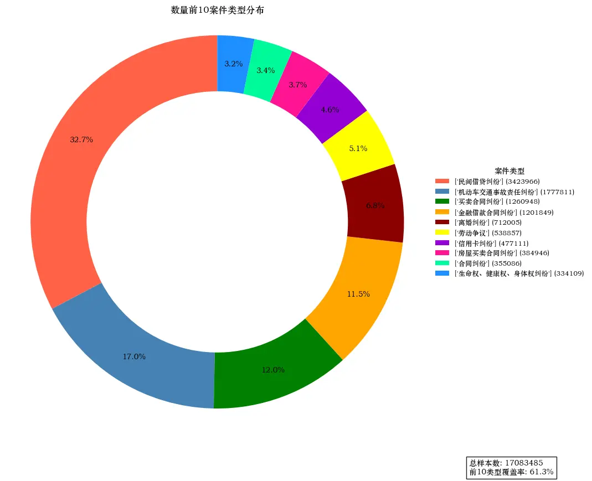

### Bar Chart

Optimized the number arrangement so it doesn't overlap.

Specified the ordering of 民初, 再, and 终 case numbers.

Used the Python package `pip install aquarel` to optimize the plot style.

[Aquarel](https://github.com/lgienapp/aquarel)

```python
import pandas as pd
import matplotlib.pyplot as plt
from pylab import mpl

# Set the Chinese font and fix the minus-sign display
mpl.rcParams['font.sans-serif'] = ['STZhongsong']    # Specify the default font: solve the problem of plot not displaying Chinese
mpl.rcParams['axes.unicode_minus'] = False           # Solve the problem of the minus sign '-' showing as a box when saving images

# Load the data
df = pd.read_csv(r'C:\Users\PC\Desktop\hzp_project_re\re_论文开始\最终面板数据\民事上诉样本.csv', encoding='utf-8', low_memory=False)

# Extract the case type from case_wid_str
df['case_type'] = df['case_wid_str'].str.extract(r'(民初|民终|民再)')

# Count the distribution of each case type across court levels
distribution = df.groupby(['court', 'case_type']).size().unstack(fill_value=0)

# Keep only specific court levels, but only those that actually exist
desired_courts = [1, 3, 4, 5, 6]
existing_courts = [court for court in desired_courts if court in distribution.index]
distribution = distribution.loc[existing_courts]

# Compute the total case count per court level
total_cases_per_court = distribution.sum(axis=1)

# Compute the proportions
distribution_ratio = distribution.div(total_cases_per_court, axis=0) * 100

# Set the figure size
plt.figure(figsize=(12, 8))

# Define an empty list for the bottom heights
bottoms = [0] * len(distribution_ratio)
# Stack in the order 民初, 民再, 民终
case_types_order = ['民初', '民再', '民终']
for case_type in case_types_order:  # Use ascending order to ensure 民初 is at the bottom
    if case_type in distribution.columns:
        plt.bar(range(len(distribution_ratio.index)), distribution_ratio[case_type], bottom=bottoms, label=case_type)
        # Display the specific count above each bar
        for index, value in enumerate(distribution[case_type]):
            text_y_position = bottoms[index] + (distribution_ratio.loc[existing_courts[index], case_type] / 2)
            # Adjust text positions to avoid overlap
            if case_type == '民再':
                if index % 2 == 0:
                    text_y_position += 2  # Move up
                else:
                    text_y_position -= 2  # Move down
            plt.text(index, text_y_position,
                     str(int(value)), ha='center', va='center', color='black', fontsize=9)
        # Update the bottom heights
        bottoms = [sum(x) for x in zip(bottoms, distribution_ratio[case_type])]

# Modify the x-axis labels
court_labels = {i: label for i, label in enumerate(["最高", "高级", "中级", "基层", "专门"][:len(existing_courts)])}
plt.xticks(range(len(existing_courts)), list(court_labels.values()))

# Add the title and labels
plt.title('案件类型在不同法院级别的比例分布', fontsize=14, pad=20)
plt.xlabel('法院级别', fontsize=12, labelpad=15)
plt.ylabel('比例 (%)', fontsize=12, labelpad=15)
plt.legend(title="案件类型", bbox_to_anchor=(1.05, 1), loc='upper left')

# Show the chart
plt.tight_layout()
plt.show()
```

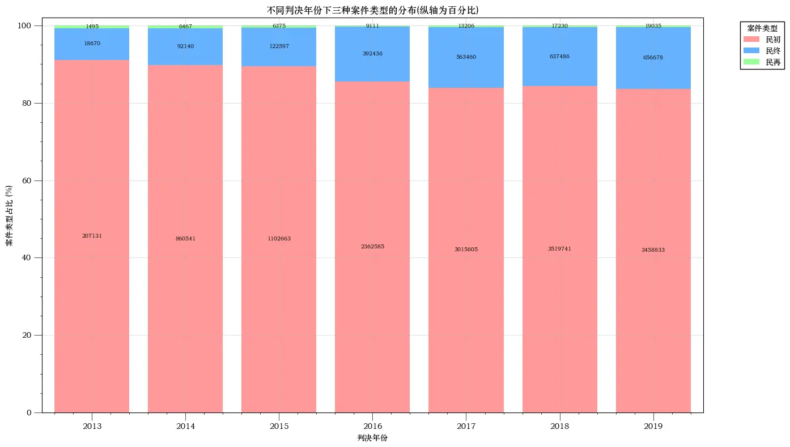

### Mean and Median Distribution Plot

Includes the mean, median, and cumulative proportion.

Uses parameter-name mapping.

```python
import pandas as pd
import numpy as np
import matplotlib.pyplot as plt
import seaborn as sns
from pylab import mpl

# Set the Chinese font and fix the minus-sign display
mpl.rcParams['font.sans-serif'] = ['STZhongsong']    # Specify the default font: solve the problem of plot not displaying Chinese
mpl.rcParams['axes.unicode_minus'] = False           # Solve the problem of the minus sign '-' showing as a box when saving images

# Assume this is the mapping from your data columns to their Chinese names
var_names_zh = {
    'work_experience_years': '工作年限（年）',
    'work_experience_months': '工作经历（月）',
    'average_cases_per_month': '平均处理案子数（月）'
}

# Load the data
df = pd.read_csv(r'C:\Users\PC\Desktop\hzp_project_re\re_论文开始\最终面板数据\民事上诉样本.csv', encoding='utf-8', low_memory=False)

# Convert work experience to years
df['work_experience_years'] = df['work_experience_months'] / 12

# Compute how many cases are handled per month on average
df['average_cases_per_month'] = df['cumulative_count'] / (df['work_experience_months'] + 1)

def add_statistics(ax, data):
    """在给定的轴上添加平均数和中位数的标注"""
    mean_val = data.mean()
    median_val = data.median()

    ax.axvline(mean_val, color='red', linestyle='--')
    ax.axvline(median_val, color='blue', linestyle='--')
    # Add the legend to the lower right
    ax.legend([f'均值: {mean_val:.2f}', f'中位数: {median_val:.2f}'], loc='lower right')

def add_percentage_axis(ax, data):
    """在给定的轴上添加右侧的百分比轴"""
    values, base = np.histogram(data.dropna(), bins=30)
    cumulative = np.cumsum(values)
    percentage = cumulative / cumulative[-1] * 100  # Convert the cumulative values to percentages
    ax_percent = ax.twinx()
    ax_percent.plot(base[1:], percentage, c='green', label='累计百分比')
    ax_percent.set_ylabel('累计百分比 (%)')
    ax_percent.legend(loc='upper right')

def trim_data(data, lower=0.5, upper=99.5):
    """返回给定百分比范围内的数据"""
    lower_quantile = np.percentile(data, lower)
    upper_quantile = np.percentile(data, upper)
    return data[(data >= lower_quantile) & (data <= upper_quantile)]

variables = ['work_experience_years', 'work_experience_months', 'average_cases_per_month']
fig, axes = plt.subplots(len(variables), 1, figsize=(15, len(variables)*5))

for idx, var in enumerate(variables):
    # Use the Chinese name
    var_zh = var_names_zh.get(var, var)
    if var == 'average_cases_per_month':
        data_to_plot = trim_data(df[var])
    else:
        data_to_plot = df[var]

    # Raw data distribution
    sns.histplot(data_to_plot, kde=True, color="skyblue", edgecolor="black", ax=axes[idx])
    axes[idx].set_title(f'{var_zh} 分布图', fontsize=14)
    add_statistics(axes[idx], data_to_plot)  # Add the mean and median annotations

    # Add the cumulative percentage axis
    add_percentage_axis(axes[idx], data_to_plot)

plt.tight_layout()
plt.show()
```

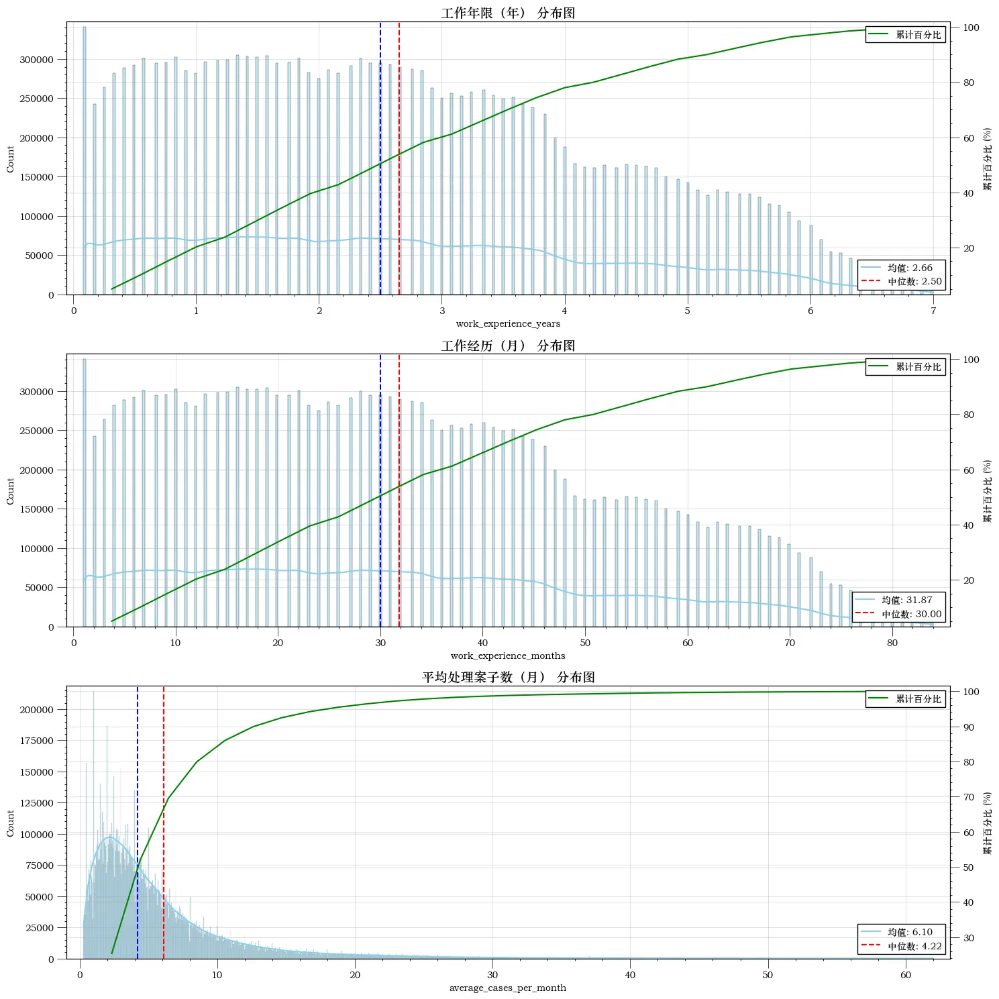


---

> Author: [滑翔闪](https://github.com/hzp2333/hzp2333.github.io)  
> URL: https://blog.huaxiangshan.com/en/posts/cpws_stata/  

