# A Quick Guide to Cleaning Economic Microdata


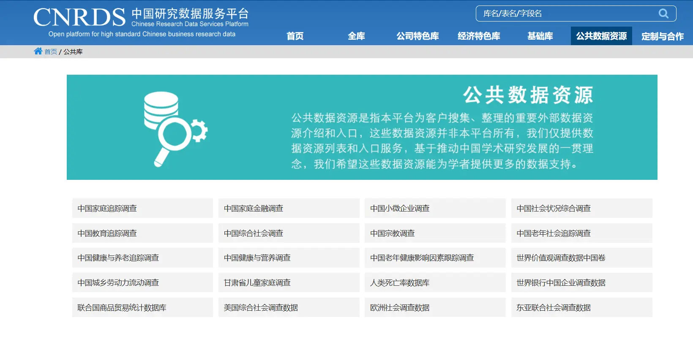


**The predecessors have covered it thoroughly; I've only lightly stepped in a few pits.**  
Main software: `stata`, `EXCEL`, `SAS`.

## 1. Popular domestic databases:

> Most microdata database files are mainly in DTA, SAS, and EXCEL formats. They're split by subject (community questionnaire, household questionnaire, social files) and by theme (background info, health, economy...). Each year's cross-section data is also separate, so you need to process it into panel data yourself.

Apply on the official site with a **student email**.

**Application experience: CFPS\CHARLS\CHIP\CGSS have a very good application experience. It's just that the site occasionally crashes and won't open, so once your application is approved, I suggest downloading all the data right away.**

### Large, comprehensive databases

1. CFPS: [www.isss.pku.edu.cn/cfps/](http://www.isss.pku.edu.cn/cfps/)

**China Education Panel Survey:** CFPS is implemented by the Institute of Social Science Survey (ISSS) at Peking University. It tracks data at three levels — individual, household, and community — reflecting changes in Chinese society, economy, population, education, and health, and provides a data foundation for academic research and public policy analysis.

2. CMDS: [Data application (chinaldrk.org.cn)](https://www.chinaldrk.org.cn/wjw/#/application/index)

**China Migrants Dynamic Survey:** A large-scale annual national sampling survey of the migrant population conducted by the National Health Commission since 2009. Its content covers basic information about the migrant population and their family members, migration range and trends, employment and social security, income and expenditure and housing, basic public health services, marriage/childbearing and family planning service management, children's migration and education, psychological culture, and more.


3. CHARLS: China Health and Retirement Longitudinal Study [ (pku.edu.cn)](http://charls.pku.edu.cn/)

**China Health and Retirement Longitudinal Study:** China Health and Retirement Longitudinal Study. A large interdisciplinary survey project hosted by the National School of Development at Peking University and executed by the Institute of Social Science Survey, representing high-quality microdata on households and individuals aged 45 and above in China.

4. CSS: Chinese Social Survey ([http://css.cssn.cn/css_sy/](http://css.cssn.cn/css_sy/))

**Chinese Social Survey:** A nationwide large-scale continuous sampling survey project initiated by the Institute of Sociology at the Chinese Academy of Social Sciences in 2005. Its purpose is to obtain data on social change in China during the transitional period through long-term longitudinal surveys of the public's employment, family and social life, social attitudes, and more, thereby providing detailed and scientific basic information for social science research and government decision-making. Currently, eight waves of CSS data — 2006, 2008, 2022, 2013, 2015, 2017, 2019, and 2021 — have been made open to the public.

5. CHIP: China Household Income Project ([http://www.ciidbnu.org/](http://www.ciidbnu.org/))

**China Household Income Project:** Launched by the Income Distribution Research Institute at Beijing Normal University[^6]. The project aims to collect household survey data for potentially useful empirical analysis of trends in China after reform and opening up, such as income, inequality, and poverty.

6. CGSS: China Household Income Survey ([http://www.cnsda.org/](http://www.cnsda.org/))

Chinese General Social Survey (CGSS) is China's first nationwide, comprehensive, and continuous large-scale social survey project. Its purpose is to periodically and systematically collect data on all aspects of Chinese people and Chinese society, summarize the long-term trends of social change, explore social issues of major theoretical and practical significance, promote the openness and sharing of domestic social science research, and provide data for government decision-making and international comparative research.

7. **China Statistical Yearbook:** city data, regional data...

The panel data organized from this is all over the internet.

Others: for example, there's also the China Household Finance Survey CHFS ([https://chfser.swufe.edu.cn/datasso/Home/Login?4813085540248732983](https://chfser.swufe.edu.cn/datasso/Home/Login?4813085540248732983)).

**We can also use some small specialized databases to supplement the main databases for analysis.**

For example, the Peking University Digital Inclusive Finance Index: [Peking University Digital Inclusive Finance Index](https://idf.pku.edu.cn/yjcg/zsbg/513800.htm), the Innovation and Entrepreneurship Index, the Government Governance Index...

> For example, when it comes to measuring urban digital economy nowadays,  
> most people use Zhao Tao's (2020)[^1] method,  
> taking the urban statistical yearbook + inclusive finance data as indicators.  
> With the "digital economy" craze, who knows how many people's first econometrics paper started with digital economy, urban resilience,,,,,,

There are also some paid websites (your school may have purchased access[^2])

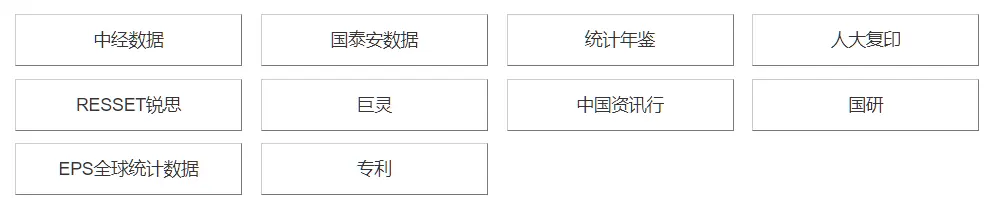

Economics also has these paid databases; you can check whether your school has purchased them

I don't know finance databases very well; Ruisi looks pretty handy

**Economics: China Economic Information Network, EPS — directly organizing panel data on the webpage is very handy.**

> The **gray industry** of databases on the internet:  
> There are lots of free accounts for sale online,  
> which are basically students pooling their school account privileges into database-access websites.

## 2. Cleaning approach and its purpose

What exactly does cleaning data involve? Basically these tasks.

-   **Table matching**: match and merge different database tables, aiming to integrate and screen indicators, divided into horizontal and vertical matching.
-   **Removing bad data:** remove bad data. For example, blank data, extreme data, unneeded data...
-   **Filling in blank data:** fill in data. For panel data and time series, we often use linear interpolation to fill in missing values in the middle or at the edges.
-   **Data aggregation:** build indicators through specific methods, like principal components, entropy weighting, analytic hierarchy process...

The most important thing is to master the **W!O!R!K!F!L!O!W!**

> When running regressions, "not enough variables", "lost variables" and other disasters usually happen; we may need to go back at any time to update variables and check where mistakes happened, so keeping a complete workflow folder is very necessary.


**Rule of thumb!!!!!** Keep one folder for raw data, one folder for after table matching, and one more folder for the cleaning process!

> Writing code so that it runs smoothly from data cleaning all the way to outputting results in one breath — that's the highest level of a pipeline!

First, it lets us present each work step for easy checking; second, it makes it convenient to "redo" from any intermediate step.

## 3. STATA operations

### Recommended tutorials

One tutorial video is enough (two hours):

> The intro mentions this uploader's personal github homepage (screen recordings and do files)



### Some situations I've encountered personally

### 1. Transcoding when importing Chinese databases

Chinese garbled text — either upgrade your statastata version, or use code

> The two methods actually do the same thing.

**Method 1: encountered when processing** cmdscmds **

```sql
clear
cd "C:\Users\Desktop\转码"    // create a new transcoding folder, then change to your own path
unicode encoding set gb18030
unicode analyze 流动人口数据个人问卷2018.dta   // adjust the filename to your own data
unicode translate 流动人口数据个人问卷2018.dta, invalid   // adjust the filename to your own data
```

**Method 2: encountered when processing the** PSU. Dta[^3] **of** charlscharls **, where provinces and cities were garbled**

```sql
cd "D:\household_and_community_questionnaire_data"  //set the file storage location
unicode analyze PSU.dta //replace PSU.dta with the file to be compiled
unicode encoding set "GB18030"
unicode retranslate psu.dta, transutf8
```

### 2. Matching databases

It basically revolves around integrating around the sample's ID, yearID, and year.

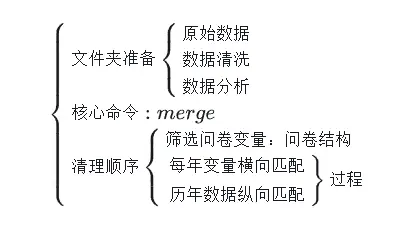

Stata matching code — **only brief explanations below**

```sql
//master_data.dta is the base database, using_data.dta is the database we want to match onto it
//m:n id means m ids in the first data can correspond to n sample ids in the second database
//In short, m:n is many-to-one, n:n is 1-to-1, m:m is many-to-many
// So we can also add multiple matching conditions, e.g. merge 1:1 id year treat ......
************horizontal match 1**************************
use "master_data.dta"
merge m:n id using "using_data.dta"
drop _merge
save "new_data.dta"
************horizontal match 2**************************
use "master_data.dta"
joinby id using "using_data.dta"
************vertical match**************************
use "data1.dta"
append using "data2.dta"
save "new_data.dta"

```



`merge` is suitable when the identifier of the matching side or the matched side is **unique**.

For one-to-many matching, e.g. when the master data's identifier is unique but the matched data repeats, with each repeated identifier row missing different variables, you can use `merge`'s append-match subcommand to only update the missing part each time.

```
use "master_data.dta"
merge 1:m id using "using_data.dta", update nogen force
```

For many-to-many matching, you need to use `joinby`.

For details, see: [Many-to-many merge - merge - joinby](https://mp.weixin.qq.com/s/gJbMNzmVQ8C1za5rMdOjPQ)


### 3. Quickly selecting variables

> Shortcuts like Shift\ctrl are basically universal in software design; once you use them a lot, you can apply them to other software too.

There's a variable window in the top-right of Stata. Right-click to get select-all and other options; it can also serve as a search box.

Simultaneous selection is ctrl+multiple clicks. If you need to select a dozen scattered variables at once, use it actively.

To select a middle range, click one variable, then shift+click another variable, and it selects the middle range.

> For example, you can first right-click, select all, then ctrl+click to remove the variables you don't want;  
> For example, to check the completeness of specific data, name them "x\_i" first during processing, then filter for those named x and select all.

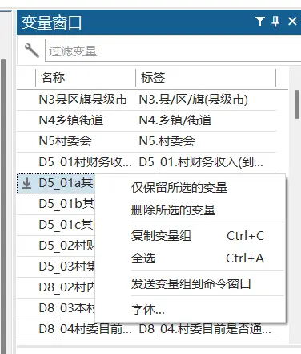

### 4. Interpolation

Linear interpolation, panel data.

As usual for panel data, first **mark the individual id and year id**,

```sql
xtset id  year
by id: ipolate YY year,gen(YYY)  //interpolation, middle missing values, named as new variable YYY after filling
by id: ipolate XX year,gen(XXX) epolate //extrapolation, edge missing values, named as new variable XXX after filling
```

My suggestion is, use `forvalues` whenever you can[^4], and make good use of variable macros.

> Once you know the basic loop commands + variable nesting + conditional filter commands, writing code becomes free-flowing.

For example, the following batch interpolation loop:

$var_i  \stackrel{interpolate}{\longrightarrow}varx_i\stackrel{extrapolate}{\longrightarrow}varn_i\stackrel{replace}{\longrightarrow}var_i\stackrel{delete}{\longrightarrow}varx_i $

```sql
global var var0 var1 var2 var3 genshin
*pack up all the variables to be interpolated
foreach i in $var {
by id: ipolate `i' year,gen(varx`i') 
by id: ipolate varx`i' year,gen(varn`i') epolate
replace `i' =  varn`i' 
drop  varx`i'   varn`i' 
  } 
```

Similarly, cleaning bad data in questionnaire data is the same loop

```sql
global var  var0 var1 var2 var3 genshin 
*pack up all the variables to be interpolated
foreach i in $var {
drop if `i' == -88
drop if `i' == -99
drop if `i' ==.
drop if `i' <=0
  } 
```

The internet also circulates a "one-click significance" cleaning. The idea is to brute-force permute the control variables, and later even start screening samples. My view: you can look at the control-variable-selection code, but don't casually touch the samples. A core soul of econometrics is the "randomized experiment"; interfering with sample selection easily breaks data randomness, which is basically fabrication.

(Though purely in terms of code thinking, this does show that once you've mastered the filtering, judging, and looping commands, there's already a lot you can do. The same cleaning task — how you combine the algorithms is what tests the person.)

### 5. **Converting characters to numbers:**

For example, the communityID in the charls database exists in character form.

> Although Chinese can be used as a variable name to match, when it's too long stata seems unable to process it.  
> Use the command to **force** convert to numbers:

```sql
destring ID householdID communityID , replace force *add force, justice is served!
```

### **6. Date transcoding**[^5]

Sometimes the date codes we download can't be recognized by stata, in which case we need the date function.

> For example, in a class assignment, I wanted to show China's confidence!  
> Give the teacher a little Chinese shock. (This is China.jpg)  
> I used [iiMedia](https://data.iimedia.cn/page-category.jsp?type=basic)'s Huawei and Apple laptop Taobao data.  
> ps: at the time I also found export trade data for China, Japan, Russia, and the US; data source [World Bank](https://data.worldbank.org.cn/indicator/NY.GDP.MKTP.CD?view=map).

But awkwardly, the date format loaded from Excel was Y-M-D, which stata can't directly recognize.

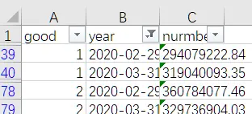

Using the code (I found it on the Jinggu forum):

```sql
clear
import excel "E:\桌面\笔记本.xlsx", sheet("Sheet1") firstrow
generate date=date(year,"YMD") //recognize the date
format date %td //further conversion
```

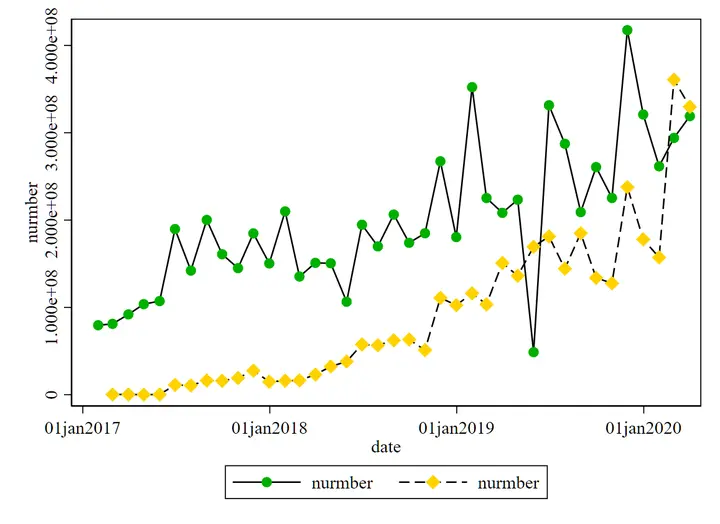

Green is Apple, gold is Huawei. You can see that after processing, date becomes a special date form, and it can be directly used to draw scatter plots in stata. The original plot is gone, so I just redrew it simply; please ignore this garish color scheme.

Another example, a dataset about air pollution. In Excel, the date column is in "**short date format**"

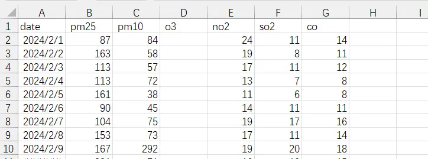


Import into stata, use the date function to plot

```ada
generate year=date(date, "YMD") //recognize the date
format year %td //further conversion
```

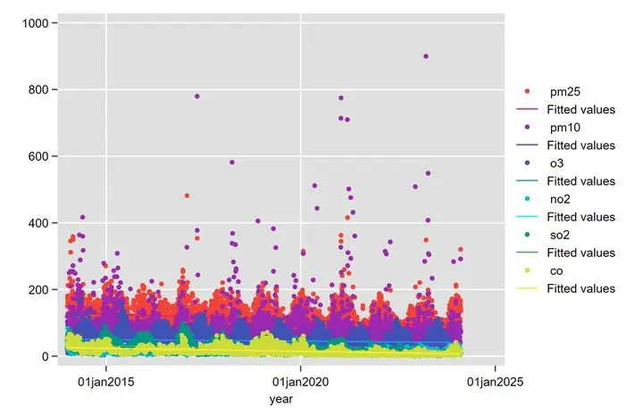

From descriptive statistics plotting, we can see air pollution has seasonality. So we want to slice out the month separately for season numbering.

```abap
generate month = month(year) //slice the month from the already-processed year date
//for a more detailed explanation, see: https://stata-club.github.io/stata_article/2017-10-29.html
gen spring = 1 if month == 3 |month == 4 | month == 5
replace spring = 0 if spring != 1
gen summer = 1 if month == 6 |month == 7 | month == 8
replace summer = 0 if summer != 1
gen fall = 1 if month == 9 |month == 10 | month == 11
replace fall = 0 if fall != 1
gen winter = 1 if month == 12 |month == 1 | month == 2
replace winter = 0 if winter != 1
```


### 7. Deletion and conditional statements

Stata's command to delete specific columns is the drop command.

I suggest directly typing "h drop" to view the help.

**Making good use of if conditions and forvalues loops is when algorithmic ability is tested!**

- What kind of data do you need to process, and what is your goal?
- How can the goal be decomposed, into what flow, which if conditions filter faster, and which forvalues loops can simplify your cleaning steps as quickly as possible?
- Make good use of stata's do files and consider code reusability, so that after writing code, it can be reused in loops later, e.g. by only changing variable names.

### 8. Winsorizing

Use the `winsor2` command, written by [Lian Yujun](https://www.lianxh.cn/details/562.html).

```
histogram var,  ylabel(, angle(0)) xtitle("x-axis label") name(image filename, replace) \\draw a frequency histogram to see the distribution
winsor2 var, cut(0 97.5) trim replace  \\remove the 2.5% extreme data on the right side of variable var
```

### 9. Grouping

Group by the variable "border", compute the corresponding variable for each group

```ada
bysort 国界: egen 乡村振兴边境 = mean(乡村振兴)
bysort 国界: egen 产业兴旺边境 = mean(产业兴旺)
bysort 国界: egen 生态宜居边境 = mean(生态宜居)
bysort 国界: egen 治理有效边境 = mean(治理有效)
bysort 国界: egen 乡风文明边境 = mean(乡风文明)
bysort 国界: egen 生活富裕边境 = mean(生活富裕)
```

### 10. Sorting

To sort data from small to large according to some criteria, use the sort command

```ada
sort year age income //first sort by year; within the same year, sort by age; same year and age, sort by income
```

### 11. Removing duplicate rows

```
duplicates drop var，force
```

### 12. Extracting characters

A Chinese character takes three positions

```
gen x=substr(var,1,4)
```

### 12. Some descriptive statistics plots

##### Some visualization code sites

- [SDAS Stata Graph Gallery](https://surveydesign.com.au/stata/graphs.html)
- [StataViz by Asjad Naqvi](https://asjadnaqvi.github.io/stata-portfolio/tags/portfolio/)
- [Stata Visual Library](https://worldbank.github.io/stata-visual-library/)

I recommend custom delimiters, which makes plotting commands more elegant:


```stata

#delimit;
;
gen di = year - branch_reform;
eventdd entre_activation i.year lnagdp indust_stru finance ainternet market,
 timevar(di) //define the time dummy variable
 ci(rcap) //error bars  
 noline //don't plot the confidence interval bar for period -1
 method(fe) //to add autocorrelation clustering — method(fe,cluster(autocorrelation clustering))
 baseline(0) //base year is 0
 level(95)
 graph_op(ytitle("coefficients") xtitle("Time")  xlabel(-10(2)14)); // cancel the custom line break
#delimit cr

```


**Combining graphs**

```
graph combine "a.gph" "b.gph", col(1) xcommon ycommon
```

**Bubble chart**

Seen in [Stata draws advanced bubble charts](https://zhuanlan.zhihu.com/p/581227252), quite interesting

```sql
sysuse auto,clear
set scheme white_tableau //set the theme; you can set it according to your own preference
twoway ///
(scatter mpg weight [w= price] if foreign == 0 & price <= 4220, msymbol(Oh) mcolor("220 235 136") msize(small)) ///
(scatter mpg weight [w= price] if foreign == 1 & price <= 4220, msymbol(o) mcolor("220 235 136") msize(small)) ///
(scatter mpg weight [w= price] if foreign == 0 & (price > 4220 & price <= 6332), msymbol(Oh) mcolor("180 232 172") msize(medium)) ///
(scatter mpg weight [w= price] if foreign == 1 & (price > 4220 & price <= 6332), msymbol(o) mcolor("180 232 172") msize(medium)) ///
(scatter mpg weight [w= price] if foreign == 0 & price > 6332, msymbol(Oh) mcolor("152 210 196") msize(large)) ///
(scatter mpg weight [w= price] if foreign == 1 & price > 6332, msymbol(o) mcolor("152 210 196") msize(large)), ///
xlabel(2000(1000) 5000) ylabel(10(10)50) legend(label(1 " ") label(2 " ") label(3 " ") label(4 " ") label(5 " ") label(6 " ") order(2 4 6 1 3 5) row(2) ring(0) size(10) position(2) bmargin(medlarge)) text(45.3 3800 "Foreign", size(*0.7)) text(39.5 3800 "Domestic", size(*0.7)) text(49.5 4100 "Low Price", size(*0.7)) text(49.5 4450 "Med Price", size(*0.7)) text(49.5 4800 "High Price", size(*0.7)) 
//mycolor is RGB color codes; you can define them according to your preference;
//xlabel and ylabel set the horizontal and vertical axis labels; legend sets the legend; text sets the specific position of text, format text(y-coordinate x-coordinate "label text")
```

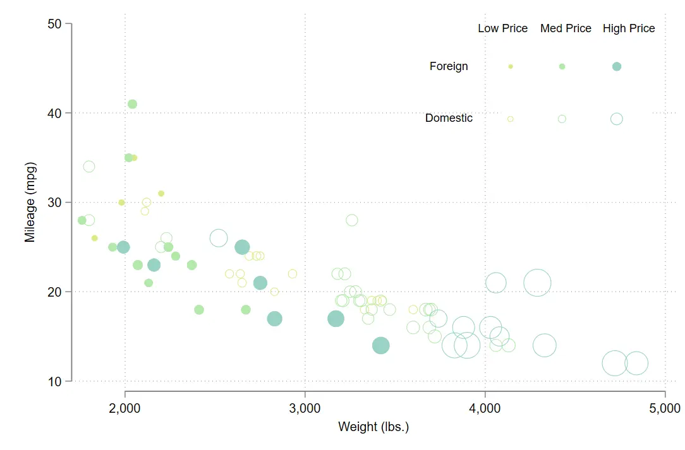
 **Line chart**

```sql
twoway ///
	(line var2 date if group==1) ///
	(line var2 date if group==2) ///
	(line var2 date if group==3) ///
	(line var2 date if group==4) ///
	(line var2 date if group==5) ///
	(line var2 date if group==6) ///
	(line var2 date if group==7) ///
	(line var2 date if group==8) ///
	(line var2 date if group==9) ///
	(line var2 date if group==10) ///
	(line var2 date if group==11) ///
	(line var2 date if group==12) ///
	, ///
		legend(order(1 "group1" 2 "group2" 3 "group3"  4 "group4"  5 "group5" 6 "group6" 7 "group7" 8 "group8" 9 "group9" 10 "group10" 11 "group11" 12 "group12")) ///
		title("Line plot") ///
		note("The Stata Guide", size(vsmall))
```

 **Pie chart**

```sql
graph pie var2 if group <= 10, ///
	over(group) plabel(_all percent, format(%9.2f)) ///
	line(lcolor(black) lwidth(vvthin)) 	///                  
	// outline colors have to be manually added
	title("Pie plot") ///
		note("The Stata Guide", size(vsmall))
```

**Box plot**

```
graph box ///
	var* ///
		, ///
		title("Box plot") ///
		note("The Stata Guide", size(vsmall))
```

**Histogram**

```
histogram var4, percent ///
	title("Histogram") ///
		note("The Stata Guide", size(vsmall))
```

Add a kernel density line

```
histogram var4, ///
    ylabel(, angle(0)) ///
    xtitle("tax") ///
    kdensity
```

**Vertical bar chart**

```
graph bar ///
	var* ///
		, ///
		blabel(bar, format(%9.2f)) ///
		title("Bar graph") ///
		note("The Stata Guide", size(vsmall))
```

**Horizontal bar chart**

```
graph hbar (mean) ///
	var* ///
	if group <= 6, ///
		over(group) ///
		percentages stack	///
		legend(order(1 "Var 1" 2 "Var 2" 3 "Var 3"  4 "Var 4"  5 "Var 5" 6 "Var 6")) ///
		title("Bar graph") ///
		note("The Stata Guide", size(vsmall))
```

 **Confidence interval**

```
twoway ///
	(lpolyci var1 var9, fcolor(%80)) ///
	(lpolyci var2 var9, fcolor(%80)) ///
	(lpolyci var3 var9, fcolor(%80)) ///
		, ///
		title("Confidence Interval") ///
		note("The Stata Guide", size(vsmall))
```

**Range plots**

```
twoway ///
	(rcapsym var2 var3 date if group==1, sort) ///
	(rcapsym var2 var3 date if group==2, sort) ///
		, ///
		title("Range plots") ///
		note("The Stata Guide", size(vsmall))
```

**Area chart**

```
twoway ///
	(area den1d den1x, fcolor(%50)) ///
	(area gen2d gen2x, fcolor(%50)) ///
	(area gen3d gen3x, fcolor(%50)), ///
			title("Density plots") ///
			note("The Stata Guide", size(vsmall))
```

 **Labeled scatter plot**

```
twoway ///
	(scatter var2 var1, mlabel(group)) ///
		if date==22320///,///title("Confidence Interval") ///
		note("The Stata Guide", size(vsmall))
```

 **Grouped scatter plot**

```
twoway ///
	(scatter var2 var1) ///
		if group <= 12, ///
		by(group, yrescale xrescale)	///
		by(, title("By graphs") note("The Stata Guide", size(vsmall)))
```

 **Radar chart**

Both `radar` and `spyder` work; I think the spider web looks much nicer.

For radar charts, see [reference](https://bbs.pinggu.org/thread-4128289-1-1.html).

```sql
ssc install palettes, replace
ssc install colrspace, replace
ssc install schemepack, replace
* update
ado update, update
clear
input strL 属性 A B C D E F
力量 2 2 6 4 5 6
敏捷 1 1 3 4 3 6
智力 3 2 2 4 5 6
感知 2 5 1 6 2 5
魅力 4 6 4 5 6 5
幸运 5 3 3 5 4 4
end
compress
spider A-F, over(属性)


sysuse auto,clear   
radar make weight if foreign
```

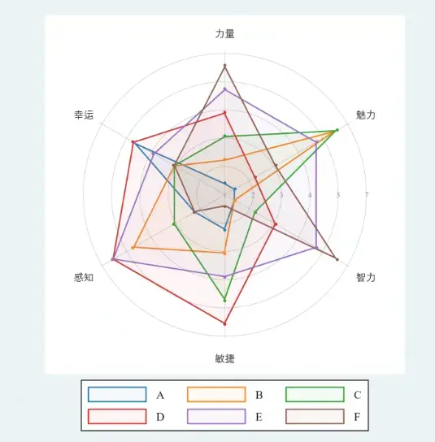
### 13. Plotting styles

See [the best plotting package](https://www.lianxh.cn/news/e76a8a7e3c6c4.html)

I personally recommend the `Rainbow` and `gg_tableau` styles the most.

The gg series imitates R's default style. Rainbow is very bright, distinctive enough, and I also like the closed box with a pure white background. But note that the `Rainbow` style has a grid background by default, which makes customizing reference lines a bit inconvenient.

```sql
ssc install schemepack, replace  
* set scheme white_tableau 
* set scheme black_tableau 
* set scheme gg_tableau 
* set scheme white_tableau
* set scheme Rainbow  

The summary of styles is as follows —
Series:
    Tableau - white_tableau black_tableau gg_tableau
    Cividis - white_cividis black_cividis gg_cividis
    Viridis - white_viridis black_viridis gg_viridis
    Hue     - white_hue     black_hue     gg_hue
    BrBg    - white_brbg    black_brbg    gg_brbg
    PiYg    - white_piyg    black_piyg    gg_piyg
    pTol    - white_ptol    black_ptol    gg_ptol
    Jet     - white_jet     black_jet     gg_jet
    w3d     - white_w3d     black_w3d     gg_w3d
Standalones:
    Rainbow            - rainbow
    Neon               - neon
    Taylor Swift's Red - swift_red  
    Ukraine            - ukraine
Colorblind-friendly schemes:
    Tab1               - tab1
    Tab2               - tab2
    Tab3               - tab3  
    cblind1            - cblind1   

```

### More:

[Common Stata data-cleaning skills and knowledge, misallocation code](https://mp.weixin.qq.com/s/czoXZ-GhQGpWmCkd8kiAnA)

## **4. STATA to EXCEL**

**How to convert a dta file to excel?**

**The code is:**

```ada
export excel using "data.xlsx", firstrow(variables)
```

> Here firstrow (variables) means the excel row keeps the variable names  
> "data.xlsx" is the name of the file you save  
> Correspondingly, to specify a save location, you can change it to "E:\\Desktop\\New folder (2)\\stata\\merge.dta"

## 5. EXCEL

### 0. Common garbled text

Some garbled excel/csv text like the ones below is due to wrong formatting. For example, in the figure below, adjusting the text box format to date fixes it.

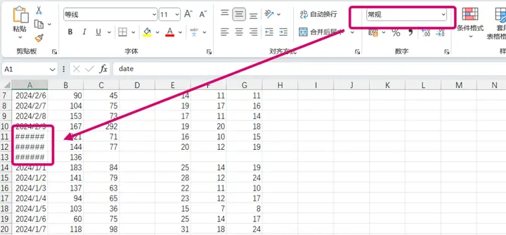

### 1. The VLOOKUP function

After using it a lot, I feel stata is much faster than Excel. For example, I did a task on descriptive statistics of rural revitalization levels, where I needed to show the number of villages above the mean for each indicator. In Excel this is fairly troublesome, involving judgment (if you haven't mastered VBA); stata handles it much faster.

```ada
global $xlist x1 x2 x3 x4 x5 

foreach i in $xlist {
	egen b = mean(`i')
	gen a = 1*(b < `i')+0*(b>= `i')
	egen sum_`i' = sum(a)	
	drop a
	drop b
  }
```

> The easiest data to find and analyze in economics is definitely urban panel data,  
> and city code matching is unavoidable

Please refer to: [link](https://zhuanlan.zhihu.com/p/463789763), which thoughtfully includes the city codes; many thanks!

When using the vlookup function, you may also encounter a [situation](https://zhidao.baidu.com/question/1242779765711800899.html#:~:text=%E4%BD%BF%E7%94%A8vlookup%E5%85%AC%E5%BC%8F%E5%90%8E%EF%BC%8C%E4%B8%8D%E6%98%BE%E7%A4%BA%E8%AE%A1%E7%AE%97%E7%BB%93%E6%9E%9C%EF%BC%8C%E5%8F%AA%E6%98%BE%E7%A4%BA%E6%88%91%E7%9A%84%E5%85%AC%E5%BC%8F%E7%9A%84%E5%8E%9F%E5%9B%A0%E6%98%AF%E6%88%91%E4%BB%AC%E5%B0%86%E6%9C%AC%E8%AF%A5%E6%98%BE%E7%A4%BA%E6%95%B0%E6%8D%AE%E7%9A%84%E5%8D%95%E5%85%83%E6%A0%BC%E8%AE%BE%E7%BD%AE%E6%88%90%E9%9D%9E%E6%96%87%E6%9C%AC%E6%A0%BC%E5%BC%8F%E4%BA%86%EF%BC%8C%E6%88%96%E8%80%85%E6%98%AF%E6%88%91%E4%BB%AC%E5%B0%86%E5%85%AC%E5%BC%8F%E9%80%89%E9%A1%B9%E5%8B%BE%E9%80%89%E4%B8%8A%E4%BA%86%E6%98%BE%E7%A4%BA%E5%85%AC%E5%BC%8F%EF%BC%8C%E8%A7%A3%E5%86%B3%E8%AF%A5%E9%97%AE%E9%A2%98%E7%9A%84%E5%85%B7%E4%BD%93%E6%93%8D%E4%BD%9C%E6%AD%A5%E9%AA%A4%E5%A6%82%E4%B8%8B%EF%BC%9A,1%E3%80%81%E5%A6%82%E5%9B%BE%E6%88%91%E4%BB%AC%E6%89%93%E5%BC%80%E7%94%B5%E8%84%91%E9%87%8C%E7%9A%84excel%E8%A1%A8%E6%A0%BC%E6%8F%92%E5%85%A5vlookup%E5%87%BD%E6%95%B0%E5%8F%91%E7%8E%B0%E4%B8%8D%E6%98%BE%E7%A4%BA%E7%BB%93%E6%9E%9C%E5%8F%AA%E6%98%BE%E7%A4%BA%E5%85%AC%E5%BC%8F%E3%80%82); excel's format settings are truly bizarre!

### 2. Pivot tables

Use it for simple **counting** and relatively complex **grouped summation** during cleaning.

Insert - PivotTable. Excel's current feature is quite smart, mainly very handy for cleaning panel data that needs accumulation.

> Note: the pivot table's "sum function" requires the excel format to be "number", while the "count function" has no format restriction.  
> Sometimes data imported from excel
>
> 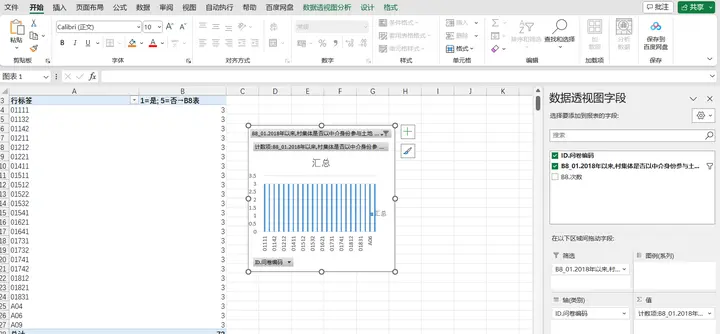 has a format defaulting to "text", and needs adjustment (at least first set it to "general" format).

### 3. Splitting text

> As far as econometrics goes, the current top-tier approach is DID.  
> If your school has a student econometrics paper competition, it's very likely pure "difference-in-differences" hand-to-hand combat (dog head)  
> When doing DID, we need to manually record the policy variables. For example, smart cities and innovation cities piloted in three batches over several years.  
> At this point we can't foolishly copy-paste one by one; please use Excel's text splitting.

For example, splitting the set of pilot cities "Beijing, Chongqing, Tianjin, Shanghai",

you can select that cell, $Data\Rightarrow Text to Columns$,

**In the "Text to Columns Wizard" dialog, choose "Delimited", click "Next", and check "," in "Delimiters".**

At this point the rows are split. Then combine with the VLOOKUP function to match.

### 4. Deleting and modifying characters

Clever use of vlookup already handles most situations, but still not enough! The pits of data cleaning are hard to guard against

> Some Excel files have cityid as 1100, some as 110000  
> Some say Chengdu, some say Chengdu with the word "City" tacked on!

- Excel remove-character operation: A2=LEFT(A1,LEN(A1)-1)
- Excel add-character operation: A2=A1&"市"

### **5. Database merging**

> **[Look at the big screen](https://zhuanlan.zhihu.com/p/510963665)!**  
> At first I thought Excel was quite beginner-ish to use this way, but after learning stata I realized merging data files is far more efficient than Excel.


## 6. Closing

These days the Jinggu forum (经管之家) shut down,

and I realized there's nowhere to ask many basic stata questions,,,,,

90% of the problems were solved by methods found on Zhihu, the Jinggu forum, and Bilibili.

**Indeed the predecessors have covered it thoroughly; I've only lightly stepped in a few pits.**


## References

[^1]: Zhao Tao, Zhang Zhi, & Liang Shangkun. (2020). Digital Economy, Entrepreneurial Activity, and High-Quality Development — Empirical Evidence from Chinese Cities. Management World, 36(10), 65-76. https://doi.org/10.19744/j.cnki.11-1235/f.2020.0154[](https://www.sci-hub.ee/10.19744/j.cnki.11-1235/f.2020.0154)
[^2]: You can look into your own school's library resources
[^3]: The province and city matched by the database sample id are in the 2013 data on its website, and are continued afterward but no longer updated in other years
[^4]: stata loop statements
[^5]:https://stata-club.github.io/stata_article/2017-10-29.html

[^6]: The chip\cfps websites often crash, which is quite annoying


---

> Author: [滑翔闪](https://github.com/hzp2333/hzp2333.github.io)  
> URL: https://blog.huaxiangshan.com/en/posts/data/  

