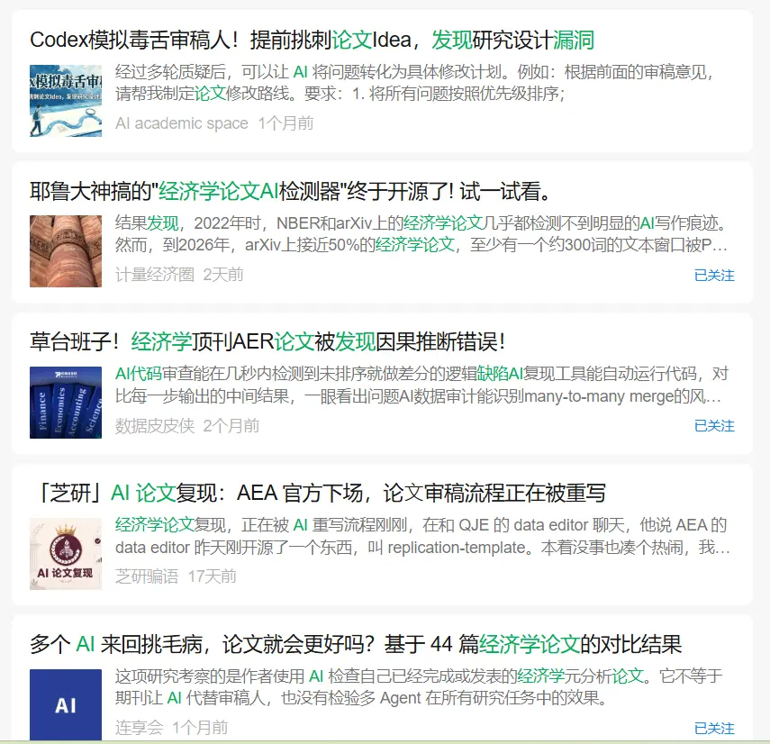
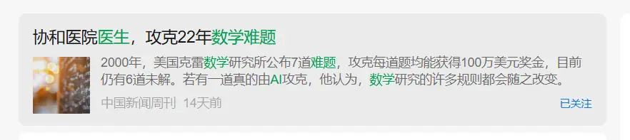
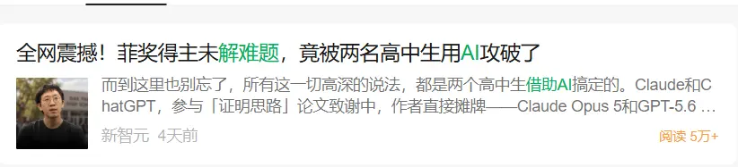

# Academia and the Messenger

> The theorist is science's messenger: when two armies clash, you don't kill the messenger.

A practice called `p hacking` is popular in economics: using all sorts of techniques that skirt the edges of academic ethics to make results look better. Of course, this isn't unique to economics; it's just that the dark humor of the p-value gets magnified in this particular term. 

I often wonder: **is science invented or discovered?** If it's discovery, then **data and regularities are objective**. Setting aside applied work like prediction and mechanism design, most econometricians are really just **messengers of regularities**. 

As the saying goes — when two armies clash, you don't kill the messenger.

Because whether the news is good or bad does not, objectively, depend on the messenger. But take empirical economics: economists are both the messengers and the ones who choose whom to report to. Yet academia only rewards successful good news. So two situations have arisen in academia: 

**The first**: we don't know which regularities are verifiable and reliable, so academia has come up with mystical words like intuition and taste, and rewards the economic messengers who deliver good news.

Since significance is an existential proposition and non-significance is a universal one, proving existence is more credible in probabilistic science than proving non-existence. In econometric significance, the difficulty of verification and the reward are asymmetric.

In fact, **regularities are objective, but evaluation is subjective**. The same topic earns higher praise when a big name says it. For example, under the AI shock, top journals and ordinary ones, economics and non-economics, may all have studies on the danger that AI pushes human capital into long-term decline — but depending on the author's status, the level of the publication will be completely different.

See the empirical evidence:
[From Peer Review to Team Building: 14 Science-of-Science Papers Reveal the Origins of Inequality in Science](https://mp.weixin.qq.com/s/38kByFRW9xdzrmO5bCFBYg?scene=1&click_id=539751671)

**The second** is `p hacking`. Since not everyone brings good news, under this institutional design many people dress up bad news as good news to claim the reward, even if it isn't real. 

In the AI era, this might improve.

First, messengers who misreport are more easily punished.

Second, statistical regularities as an empirical paradigm for discovering laws may see the **independence of the messenger** strengthened. AI is actually someone who cannot be "selected." When AI acts as the researcher, it may really be the case that when two armies clash, the messenger isn't killed.

Third, a kind of "Great Steel Campaign" for everyone. In the AI era, anyone can go mining for regularities, and the lucky ones can come from entirely unexpected places. 

I once asked my parents what they'd each want to research: one said the relationship between free highways and GDP growth[^1], the other wanted to study holidays and consumption[^2]. As you can see, these topics have all been published in top journals.

When AI becomes the main subject of research, science's messenger will be more independent, but the joy of exploration will always belong to humans. So there's at least one piece of good news now: like Ratatouille says, anyone can cook — everyone can enjoy the fun of research exploration. **Not everyone can become a great artist, but a great artist can come from anyone.**



In a way, being a critic is far too easy: we risk almost nothing. From on high, we put workers and their contributions under our pens and judge them at will; we lean toward negative reviews because they please both the writer and the reader. But critics must face a hard truth: in this wide world, a tiny, insignificant creature may not be as lowly as the critics attack it for being.

Critics sometimes face a tricky problem: discovering and protecting the new. This world is not kind to new genius or to the new, and the new needs friends all the more. Last night I personally experienced something new: an incomparable dish from a wholly unexpected hand. In all honesty, that dinner and its cook posed a subversive challenge to my view of food and made me re-examine myself; they thoroughly shook my convictions.

Before, I held a strong prejudice against certain chefs and attacked Chef Gusteau's motto — "anyone can cook." But now I truly understand what it means. Not everyone can become a great artist, but a great artist can come from anywhere.


[^1]: Lü Dan, Yan Yurui, Zhang Juntao. "Canceling Highway Tolls and Regional Economic Growth." China Industrial Economics, 2026(1): 76-98.

[^2]: Liu Na, Li Jing, Zhang Chuanchuan. "Consumption Bound by Time: The Effect of Working Hours on Household Consumption." Journal of Quantitative & Technological Economics, 2025(9).

---

> Author: [滑翔闪](https://github.com/hzp2333/hzp2333.github.io)  
> URL: https://blog.huaxiangshan.com/en/posts/econ_xs/  

