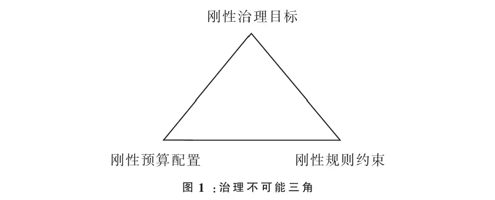
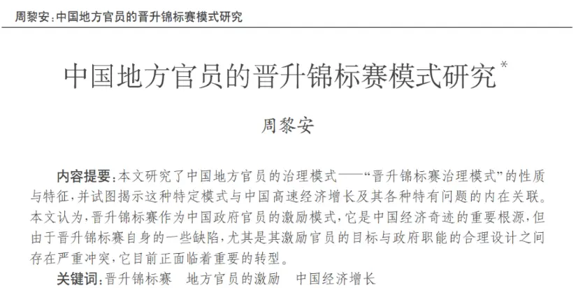
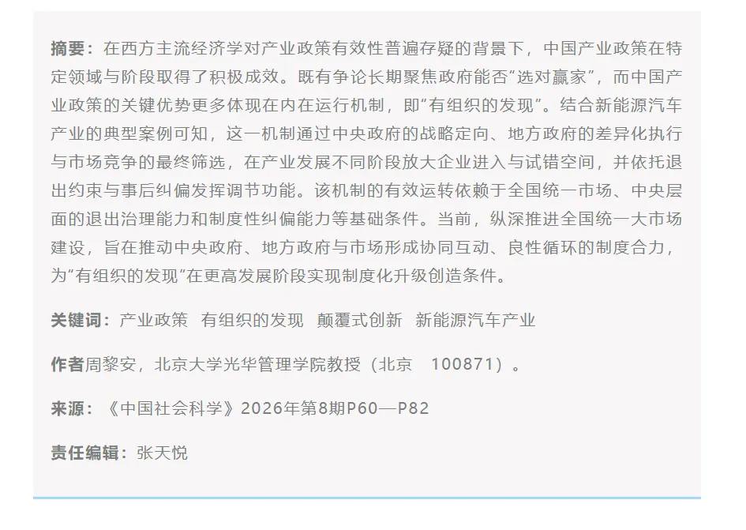

# The Impossible Triangle of Governance (an Information-Use View)

> Economics is the science of choice. If the world could always have it both ways, there would be no need for economics. Too often we view policy through the lens of "either perfect or a dead end," but what we ultimately have to learn is trade-offs. Just as politics is the art of compromise, economics too must compromise for the sake of choice.

Recently Professor Zhou Li'an proposed two new terms: the **impossible triangle of governance** and **organized discovery**. I'd like to talk about my own understanding. Zhou Li'an discusses the impossible triangle of governance in the context of bureaucratic governance under fiscal constraints; we can generalize it a bit.

The **administrative subcontracting system** (xingzheng fabao zhi) is essentially a **center-centered governance structure**. The center plans, then distributes goals downward, forming layers of management, with each layer given different goals and constraints[^1].

Within this framework we've already assumed a premise: **that any governance is governance with a center**. Why do the concepts of state, collective, and ethnic group exist? Over the long course of social evolution, organizational forms like the state and the firm — centered groups — always seem to appear, and anarchism never really evolved into being. So we can treat **grand unification and center-based governance** as seemingly inevitable 🧙.

The second point: center-based governance also has costs. Center-based governance may be inevitable, but inevitability has a price — otherwise why would Bitcoin's idea of decentralization be so celebrated in principle? The cost of centralization is **the limits of information use**. For an organization, information can be divided into public information and private information. Individuals usually know their own private information best, but once a collective forms, the leader or our delegated authority may not know as much of that private information as we do ourselves. Meanwhile, to be efficient, management inevitably forms hierarchies, and as information passes up layer by layer it is full of loss and distortion.

For example, along a management chain of a-b-c, if your private information passed upward hurts b, then once b knows it, b will conceal it or distort it into information that favors b. The person at the very top might manage tens of thousands of people alone. On the one hand, the cost of knowing each person's information is very high; on the other, the information among different people is interest-laden, and striking a balance is extremely hard — something already proven mathematically by the "[Arrow impossibility theorem](https://blog.huaxiangshan.com/zh-cn/posts/shxz/)"[^2]. This is where the **principal-agent model**, **information asymmetry**, and **public choice theory** come from. People used to imagine a parental government. The social contract told us that once we hand power to the government, the government "naturally" serves the community. But real-world corruption tells us this imagination is too idealistic: even with a social contract in place, the performance of obligations is not automatic.

So what to do? Checks and balances on power arrived. I hand power to you, and then we assess and compete with each other. Hence the **official promotion tournament theory**. But it has problems too. Once any goal becomes a target of assessment, it ceases to be a good goal ([Goodhart's Law](https://en.wikipedia.org/wiki/Goodhart%27s_law)). Take GDP: local governments keep borrowing and investing in infrastructure[^3] because it makes their assessments look good. In the end, our country's assessment system patches in multi-target assessment this way and that, tweaking constantly, and if a mistake slips in, it gets amplified layer by layer.

We can also look at the Hayek–Keynes debate from the angle of **information use**. More than his The Road to Serfdom, the work Hayek is taken more seriously for in academia is "**The Use of Knowledge in Society**" (1945). Hayek argued that knowledge is dispersed among individuals, and only the market can dig out that dispersed knowledge through evolving market relations. So he emphasized the dispersion of knowledge, the defense of free markets, and spontaneous order. The process by which a government arrogantly assumes it can grasp dispersed knowledge and replace the market is precisely a process of distorting information, and it leads to even greater errors.

Hayek is right, but we can also point out his **blind spots**. Adam Smith imagined the invisible hand of the market, with everyone "self-interested"[^4], making society better off — a bit like "the sum of local optima is the global optimum" 😀. But game theory tells us this is wrong. In the **prisoner's dilemma**, each person decides to maximize their own interest, and both end up worse off, precisely because information is dispersed and they can't communicate to reach an agreement. Dispersed knowledge can lead to this: when information is too dispersed, decisions collide, producing zero-sum games[^5].

So this is where the government needs to step in to organize and coordinate. Liberalism and Keynesianism reached a compromise: **clarify the boundary between government and market**. When the market fails and dispersed information collides, the government coordinates that part of the information. The remaining problem is that the government seems to be defusing the bombs left by market information, and if it's careless it might detonate them.

Faced with this, Zhou Li'an says we need to learn **organized discovery**. The disagreement between Keynes and Hayek is:

- Hayek believes that knowledge and information can only flow bottom-up, through market evolution, and any government delusion of substituting for the market is a sin.
- Planners who believe in an active government think the government can, through top-down coordination, resolve the information that clashes in the market and smooth it out. What we often call the socialist whole-nation system, the advantage of concentrating resources on big things, might be seen as exactly this.
  
  The pattern of center-based governance is already set; what follows is to lock power in the cage of institutions and make it mutually checked. **Organized discovery is top-down coordination of information**, and at the same time **bottom-up acquisition of information**. But acquiring information is fraught with difficulty, and we have to pay extra costs and prices.

Management always has two sides; restraint has a cost. Imagine this **philosophical thought experiment**:

We have a single task a, and we appoint a compassionate angel 👼 to this important post. Appointing people by merit has been the best political ideal since ancient times. But if we have 10 angels and split one task into 10 procedures, then even with ten times the angels, they can't bring their original compassion to bear.

Sounds sad?

But apart from oneself, no one knows whether they are good or bad. Even more often, a good person who goes down the wrong path won't realize it. Since we've imagined 10 angels, why not also imagine 10 villains 👿? While 10 angels can't release their compassion, 10 villains likewise can't release their destructive urges. This is the cost of constraining discretionary power.

So can we get back to the managers and carefully identify who is good and who is bad? Yes, reality has evolved this way. But "above there are policies, below there are countermeasures" — isn't this just top-down, endless assessment to test people's quality? In the end it's **add-on upon add-on at every level**, paying enormous inspection costs, and the long, drawn-out testing reduces efficiency and may even cause distortion.

Precisely because of this, we might view the impossible triangle of governance from a more general angle — **constraints (goals, finances, power)**, **the rate of return on risk and profit**, and **the efficiency of information use** — that's where this impossible triangle comes from.

[^1]: The opposite of constraint is a kind of freedom; the technical term is discretionary power. Constraints come in many forms: fiscal constraints, rule constraints, or constraints of rights and responsibilities.
    
[^2]: Democracy is a black box, and voting and rights systems are its implementing forms.
    
[^3]: That's why China now emphasizes combining investment in people with investment in things.
    
[^4]: Economists still debate how to understand Adam Smith's notion of self-interested behavior.
    
[^5]: In fact, this is also the angle from which Marxian economic theory explains economic crises: the local optimum of capitalist production relations inevitably leads to global collapse.

---

> Author: [滑翔闪](https://github.com/hzp2333/hzp2333.github.io)  
> URL: https://blog.huaxiangshan.com/en/posts/econ_zl/  

