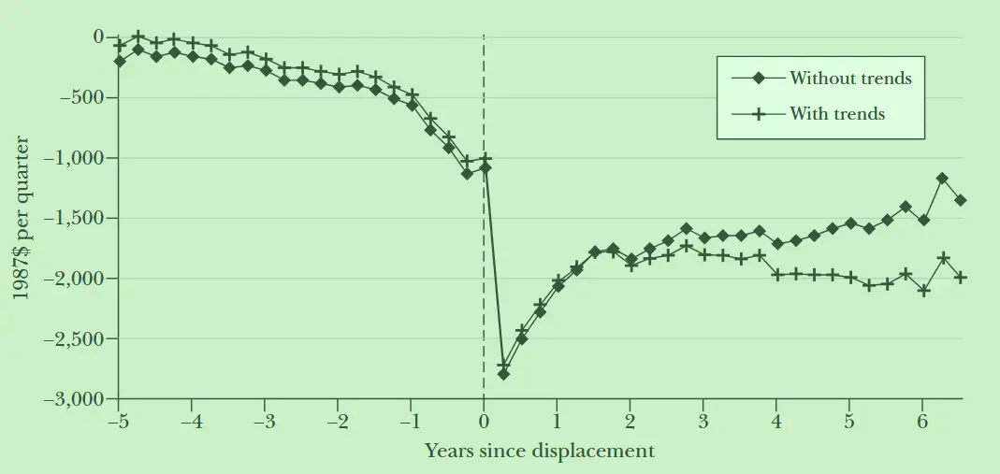
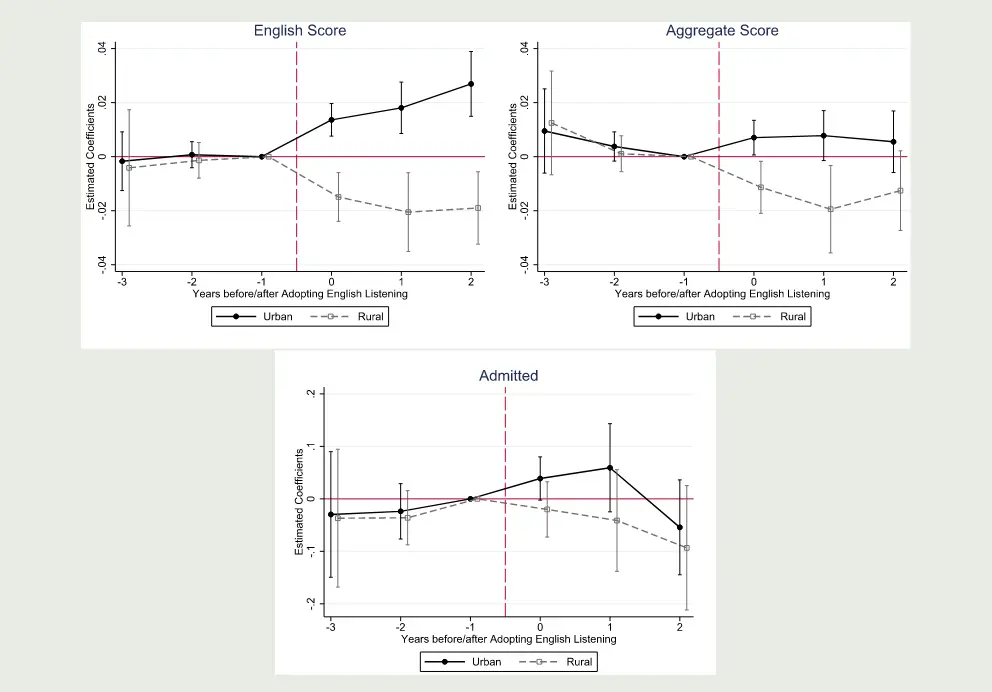
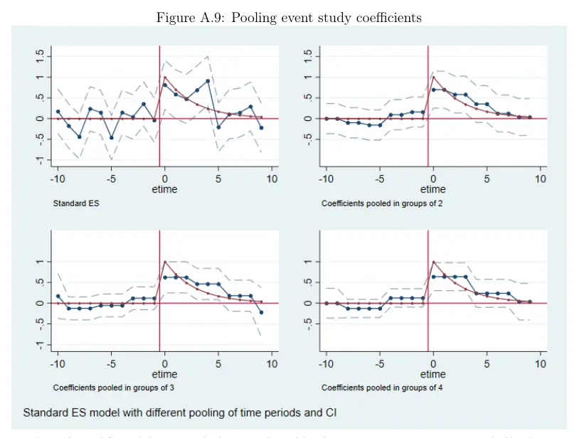
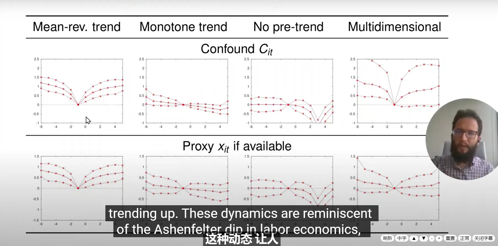
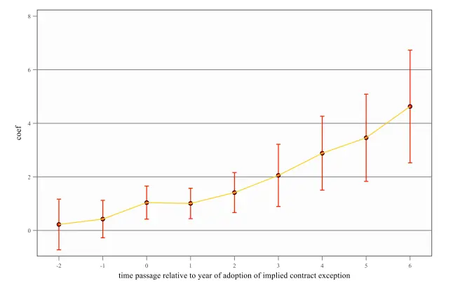
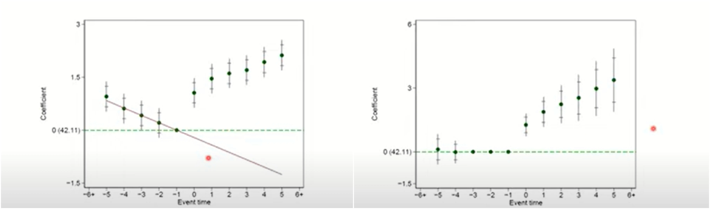
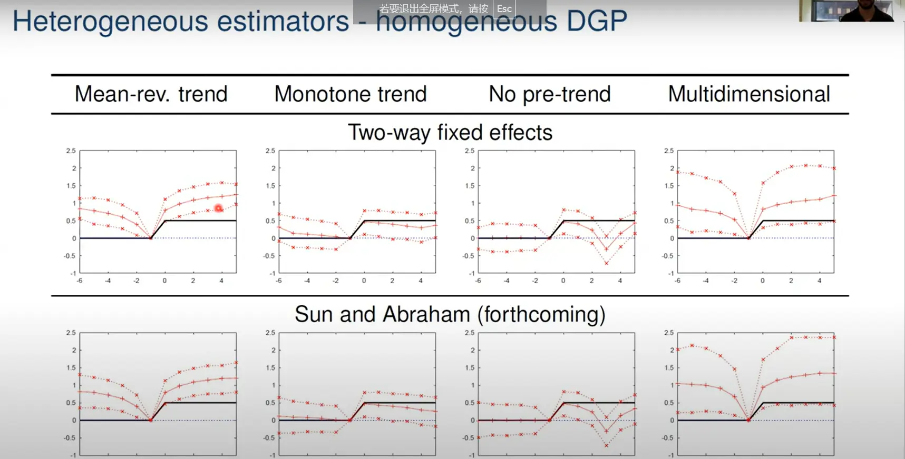

#  Econometrics: Event Studies 1

- [Econometrics: Event Studies 1](https://blog.huaxiangshan.com/zh-cn/posts/event1/)
- [Econometrics: Event Studies 2](https://blog.huaxiangshan.com/zh-cn/posts/event2/)
- [Econometrics: Event Studies 3](https://blog.huaxiangshan.com/zh-cn/posts/event3/)

> Anyone who has done DID is no stranger to parallel-trends tests. And **a parallel-trends test is one special application of the event study method**.  
> Recently my advisor had me read and study the paper *An Introductory Guide to Event Study Models*.  
> The authors also published a [YouTube video series](https://www.youtube.com/@linearpanelevent-studydesi780).
> This post records my own reflections based on that paper's framework.  
> I haven't looked closely at the code yet, so for now I'll put down my understanding of the statistical theory.

## How does economics study event shocks?

**Event studies** study whether a **specific event affected the object of study**. This method was first applied in finance — for example, analyzing the impact of company renamings, corporate scandals, and information disclosures on stock price movements.[^3]

> Of course, this method calls for more rigorous statistical analysis — Zhihu, for instance, is constantly full of questions like this:
> 
> After a policy was implemented or a product launched, Apple's or Nvidia's stock evaporated or surged by tens of billions the next day — what's the reason?
> 
> That kind of analysis is the starting point of event studies, but the statistical test still needs to be more rigorous.

Introduced into econometrics, event studies are mainly used to study **dynamic treatment effects**. By slicing the treatment effect into time groups, we can further discuss the impact of an event.

For example, in the figure below studying the effect of unemployment on income,[^1] dynamic time dummies are built from each person's unemployment timing: one year before unemployment (t-1), one year after (t+1), two years after (t+2). These include anticipatory trends and post-event trends.

- **Pre-event trends**: For example, if everyone expects a wave of unemployment to come, you can see a slow decline before the event arrives, but the shock is still clearly visible right around the moment the event hits (where the x-axis is 0).
- **Post-event trends**: After the shock passes, the effect starts to rebound. That is, compare whether the effect strengthens or weakens year by year after the shock.
- **Model assumptions**: The parallel-trends test in DID is also an event study. It verifies that the policy satisfies the model assumption — an exogenous shock. So before the policy starts, the treatment effect should be insignificant with a coefficient close to 0, and after it starts, the coefficient should be significantly different from 0.

> Take the paper on English listening exams and educational inequality[^2] as an example.
> 
> The time dummy it sets is **when the English listening section was added to the gaokao**.
> 
> Dependent variables: English scores, math and Chinese scores, and admission rates.
> Heterogeneity groups: urban and rural samples.
> 
> The figure also shows that before English listening was introduced, the urban-rural gap was small, and after its introduction the gap kept widening.
> 

## The "countless" little details of event studies

### The regression specification

In econometrics, an event study estimates dynamic treatment effects — it **slices the regression over time**.

Taking panel data as an example, the distinctive feature is adding **event-time dummies**  $D_{i, t-j}$ .

$$
y_{ii}=\underbrace{\left(\sum\_{j\in\{-m,\ldots,0,\ldots,n\}}\gamma_{j}\cdot D_{i,t-j}\right)}\_{\text{事件时间虚拟变量}}+\underbrace{\alpha_{i}+\delta_{i}}\_{\text{面板固定效应}}+\underbrace{\beta\cdot X_{ii}}\_{\text{ 控制变量}}+\epsilon_{ii}.
$$
### Data structure classification

*An introductory guide to event study models*[^4] gives two classification criteria:

1. Is there a sample group that "never received treatment"?
2. Do different sample groups have substantially different event dates for treatment?

|   Grouping   | No "never-treated" sample | Has a "never-treated" sample |
| :----: | ------------- | ------------ |
| Same event date | N/A           | DID-type     |
| Different event dates | Timing-based  | Hybrid       |

TL;DR —

- N/A: no control group, so the treatment effect can't be estimated at all.

- DiD-type: a perfect controlled experiment — the traditional DID.

- Timing-based: everyone is in the treated group, but the event shocks differ across units, so a comparison can still be made.

> Take a panel-data study on relocation for poverty alleviation as an example.[^5] Renmin University's relocation database has long run surveys at relocation resettlement sites, so their study is actually an [ITT](https://blog.huaxiangshan.com/zh-cn/posts/effect/) — **all samples are treated units that went through the relocation policy**.
> 
> But! Relocation was carried out in batches — some people moved out earlier, some later. So in the same year, there is both a treated group that already moved and a control group that hasn't, which means the study can still be done.
> 
> By the way, the paper's conclusion is that once living conditions improve, migrant workers no longer want to leave home. Hence the paper's title, *Home Sweet Home*.

- Hybrid: has both a comparison between treated and control groups and a comparison within the treated group in the same year.

### Choosing the event time

The overall logic of the event study method is:

Choose the `event and when it occurs`, choose the `base period for the event`, choose the `window (the range of dynamic treatment effects)`, choose the `treated and control groups`, and compute and decompose the `average treatment effect`.

#### Choosing the event date

Even if a policy is rolled out nationwide at a specific time, markets may react in advance; moreover, most of the time the shock is uneven, spreading out gradually by group, by carrier, by time, and by space. But in applied statistics you just work with what you have and pick the best option available.

> Take the study of Facebook's effect on college students' mental health as an example.[^6] When each person started using Facebook is obviously hard data to get, so the study matches individual mental-health questionnaires to the timing of when Facebook rolled out on each campus, and runs the regression with that.
> 
> By the way, the finding: social media use worsened college students' mental health. A channel test shows it was driven by comparison anxiety.

#### Handling the base period

A quick refresher on dummy variables in econometrics:

> To avoid collinearity, use n-1 dummy variables to estimate the relative gaps among n variables.
> For example, compare air-pollution levels across the spring-summer-autumn-winter cycle.
> Estimating such treatment effects requires a base period for comparison.
> We can default to spring as the base period,
> so the estimated coefficients for summer, autumn, and winter are all results compared against spring's data.

The time dummies in event studies also need a base period, hence the following choices or treatments:

- Absolute base period: usually choose **the period right before the event** (the contrast works better and highlights the jump): it reflects long-run gaps, used when there are many pre-event periods.
- Relative base period: use the previous period as the base: used when focusing on anticipatory effects, or when there are few pre-event periods.
- Merging periods: to handle collinearity. For example, merge t-6 and earlier into one period, and t+5 and later into one period, or drop a certain period.
- Base-period treatment: normalize it, set it to 0......
- Time trends: whether to add time trends, individual fixed effects, and time fixed effects.
- Event endpoints: the endpoints may be shifted and look ugly, or may reflect the event's trend.

> *An introductory guide to event study models* notes that since the choice of event dummies can affect the results, one should strengthen the description of how the dummies are set and restricted.
> 
> But in the top-5 papers I've read recently, event studies seem mainly used to visually display heterogeneity and the model's exogenous-shock assumption. So this part is usually glossed over — they just say how the dummies were set, without stressing why.

#### Choosing the window

Choosing the window is essentially a balance between prettier results and statistical bias.

- Too short, and the statistics are biased; too long, and the counterfactual estimate isn't efficient enough.
- From a pragmatic standpoint 🤪 — it's best to let the regression show a clear trend.
- A symmetric pre- and post-event window is best.
- You can go further with fitting — for example, first estimate the dynamics by month, then weight by season to bring out a trend. Weighted fitting across multiple events works the same way.

#### Choosing the treated and control groups
1. Exclude special samples. With Chinese city data, for instance, we usually drop municipalities directly under the central government because they're too special! And in the heterogeneity section, we usually look at the difference between provincial capitals and non-capital cities.
2. Pay attention to the parallel-trends test. That is, before the shock, the treated and control groups should look as similar as possible.
3. Add control variables.
4. Weighted matching. For example, synthetic control and propensity score matching.
5. If an event study has a Hybrid data structure, you can choose to drop the never-treated group's data.
6. The authors also recommend standardizing the coefficients.

> An interesting question: what's the difference between control variables and propensity matching? In my view, one is a back-door control, estimating through the causal path; the other is a front-door control, strengthening the comparison by matching samples.

#### The problem of trend contamination

**Trend decomposition is too complicated to fully understand, so I'll just talk about it in broad strokes.**

Two aspects of trends need to be considered:

- If individual and time trends aren't controlled for, the treatment-effect estimate will be biased.
- The treatment effect itself also changes over time and needs to be decomposed.

1. In some cases, because event time, calendar time, and individual fixed effects are multicollinear, you can't handle linear trends — unless you estimate them as nonlinear.

> I do have strong feelings about estimating trends. There are actually some clever ways to decompose them — see *[Lifecycle and Wage Decomposition]( https://blog.huaxiangshan.com/zh-cn/posts/hlt/ )*. The economic analysis there is very elegant. Even when individual, time, and event time are collinear, they can still be separated through theory. Of course, this only works for specific settings; it's not a general statistical method.

2. You can set one period to 0 and then discuss nonlinear trends.

3. Some specific endogeneity. Some policies, for example, are rolled out over time. In that case the effect for later-treated units may look larger than for earlier-treated ones. But it might just be that units develop over time. So when building survey databases, many people also add fixed effects for the survey-entry batch.

4. Add interactions between time trends and individual dummies.

5. For Timing-based data, it's suggested to include **quadratic trend variables** to avoid collinearity.

6. Add a time trend. Time fixed effects decompose the intercept; time-trend estimation decomposes the slope.

### Inference for event studies

Clustering tests for autocorrelation. Cluster at whichever level the autocorrelation lives.

See [Grouping and Measuring Econometric Data (Stata Edition)](https://blog.huaxiangshan.com/zh-cn/posts/ji_sata/).
## Future directions

1. Measuring event effects with varying intensity

Interact the time dummies with the size of the event.

I feel this is similar to the shift-share instrumental variable ([shift-IV](https://www.lianxh.cn/details/912.html)). It uses **the group trend net of the individual, multiplied by the individual's size**, as the instrument.

2. Multiple events per unit

Weight them, or restrict to a single one — count only the largest event or the first occurrence.

3. Handling heterogeneity

Interactions, or grouping by time — for example, earlier-affected and later-affected groups.

Estimate further through the counterfactual. Because event studies can be biased when fixed effects and trends aren't estimated, the paper uses an estimation technique to make it more accurate (I didn't understand this part).

  
4. Considering non-year event time

For example, cohort effects. This is really just custom grouping of time dummies.

5. State transitions

*[An Introductory Guide to Event Study Models](https://www.aeaweb.org/journals/jep)* doesn't mention this, but I think there's one more direction worth exploring — decomposing the extensive and intensive margins.

See *[Is the Log(y+1) Transformation Reliable?](https://blog.huaxiangshan.com/zh-cn/posts/log0/)*

## TL;DR

Event studies fundamentally estimate dynamic treatment effects.

For accurate estimation, here are some suggestions:

1. Standardize the coefficients
2. Choose an appropriate base period and event window
3. Account for individual effects, time effects, and time trends
4. Account for confounders arising from sample characteristics (use the estimator provided in the paper).

## Main references

- [Stata: Programming the Event Study Method](https://www.lianxh.cn/details/707.html)
- [From DID to Event Studies (1): Three Acts Make a Play](https://mp.weixin.qq.com/s?__biz=MzAwODY5MDA3NA==&mid=2455735619&idx=1&sn=74012c8b12a5666372e84621664e0840&chksm=8cc02db6bbb7a4a06dada3d7118df00d04d741416704c8fee67cf55ab2aee901a0f2df63378b&scene=21#wechat_redirect)
- [Stata: Understanding the Event Study Method in One Post](https://www.lianxh.cn/details/678.html)
- [An Introductory Guide to Event Study Models](https://www.aeaweb.org/journals/jep)
- [Xu Wenli's Econometrics Lecture Notes](https://raw.githubusercontent.com/wenddymacro/AppliedEconometrics/main/AppliedEconometrics.pdf)
- [ES, Launch! — A Beginner's Guide to Event Studies](https://mp.weixin.qq.com/s/5kC3RyyhZkOILtFrlbQOag)
- [[Literature Study] A Beginner's Guide to Event Studies](https://mp.weixin.qq.com/s/cqPkBcsTPmceHVyi7ubsbQ)

[^1]: Jacobson L S, LaLonde R J, Sullivan D G. Earnings losses of displaced workers[J]. The American economic review, 1993: 685-709.
[^2]: Li H, Meng L, Mu K, et al. English language requirement and educational inequality: Evidence from 16 million college applicants in China[J]. Journal of Development Economics, 2024: 103271.
[^3]: This fits perfectly with my stereotype of finance research relentlessly mining information factors.
[^4]: Miller D L. An introductory guide to event study models[J]. Journal of Economic Perspectives, 2023, 37（2）: 203-230.
[^5]: Qiu H, Hong J, Wang X, et al. Home sweet home: Impacts of living conditions on worker migration with evidence from randomized resettlement in China[J]. Journal of Economic Behavior & Organization, 2024, 220: 558-583.
[^6]: Braghieri L, Levy R, Makarin A. Social media and mental health[J]. American Economic Review, 2022, 112（11）: 3660-3693.

---

> Author: [滑翔闪](https://github.com/hzp2333/hzp2333.github.io)  
> URL: https://blog.huaxiangshan.com/en/posts/event1/  

