#  Econometrics: Event Studies 2

 

- [Econometrics: Event Studies 1](https://blog.huaxiangshan.com/zh-cn/posts/event1/)
- [Econometrics: Event Studies 2](https://blog.huaxiangshan.com/zh-cn/posts/event2/)
- [Econometrics: Event Studies 3](https://blog.huaxiangshan.com/zh-cn/posts/event3/)

Picking up from last time, this post is a record of learning the code from *[An Introductory Guide to Event Study Models](https://www.aeaweb.org/articles?id=10.1257/jep.37.2.203)*.  
## Appendix A: Distinguishing DID and Timing-based

This code is descriptive statistics, describing the sample distribution (or serving as the background for policy implementation).

- DID type: has both a treated group and a control group (which never received the policy)
- Timing-based: only a treated group, but the event shock times differ within it.

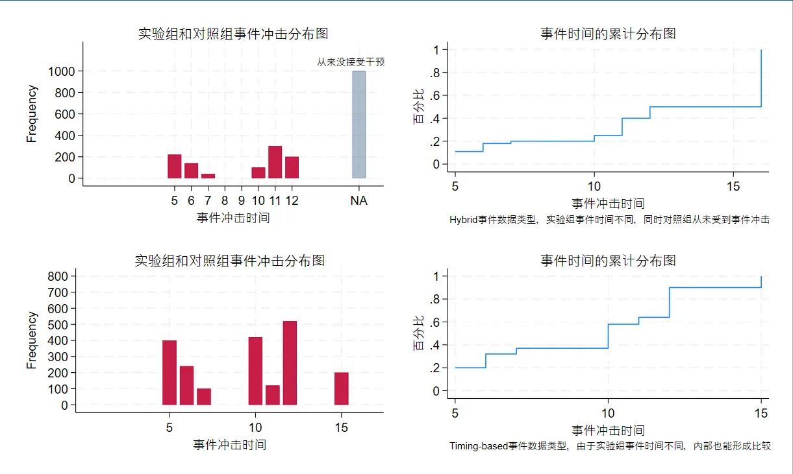

The code below generates data, then draws a frequency plot and a cumulative plot. In the original, the cumulative plot first uses `cumul` to compute cumulative proportions and then uses `twoway` to draw a line chart. That's too complicated, so here I've replaced it with the `cdfplot` command, which does it in one step.

Don't be surprised if the result differs from the original — the original code also interpolates endpoint values on both sides, and I removed that part.

```SQL
clear

*-generate random panel data for difference-in-differences

set seed 2024 
set obs 100 
gen i = _n 
gen treated = i > 50 
gen E_i = 11 if treated == 1 
expand 20 
sort i 
qui by i: gen t = _n 
xtset i t 


*-set the treatment effect

gen D = (t == E_i) 
gen etime = (t - E_i) 
label var i "个体编号"
label var t "日期"
label var D "did变量=time*post"
label var E_i "事件冲击时间"


*-plot the distribution of the treated and control groups

replace E_i=16 if treated==0
replace E_i=5 if treated==1 & i>=51 & i<=61
replace E_i=6 if treated==1 & i>=62 & i<=68
replace E_i=7 if treated==1 & i>=69 & i<=70
replace E_i=10 if treated==1 & i>=71 & i<=75
replace E_i=11 if treated==1 & i>=76 & i<=90
replace E_i=12 if treated==1 & i>=91


#delimit ; 
/*
delimiter setting: change the semicolon to the line-break symbol for commands.
this way, unless a semicolon is added at the end, commands written across lines are read as one line.
this makes graphing commands much more convenient.
*/
twoway  (histogram E_i if treated==1, discrete frequency start(4) barwidth(0.8) xscale(range(0 17)) yscale(range(0 1200))   color(cranberry%100)) 
(histogram E_i if treated==0, discrete frequency start(4) barwidth(0.8) xscale(range(0 17)) yscale(range(0 1200))   color(navy%40)),  
title("实验组和对照组事件冲击分布图", 
color(black) size(v.small)) legend(off)
xlabel(  5 "5" 6 "6" 7 "7" 8 "8" 9 "9" 10 "10" 11 "11" 12 "12" 16 "NA")
text(1100 15.5 "从来没接受干预", size(small))
name(histogram4 , replace);

#delimit cr

*-plot the distribution of the treated and control groups
preserve //save the current dataset

#delimit ;
cdfplot E_i,  
    title("事件时间的累计分布图",
color(black) size(v.small)) legend(off)
ytitle(百分比)
name(CDF4, replace)
note(Hybrid事件数据类型，实验组事件时间不同，同时对照组从未受到事件冲击)
;
#delimit cr
restore //reload the saved dataset


*-distribution of the treated and control groups
replace treated=1
replace E_i=5 if treated==1 & i>=1 & i<=20
replace E_i=6 if treated==1 & i>=21 & i<=32
replace E_i=7 if treated==1 & i>=33 & i<=37
replace E_i=10 if treated==1 & i>=38 & i<=58
replace E_i=11 if treated==1 & i>=59 & i<=64
replace E_i=12 if treated==1 & i>=65 & i<=90
replace E_i=15 if treated==1 & i>90
#delimit ;
twoway  (histogram E_i if treated==1, discrete frequency start(4) barwidth(0.8) xscale(range(0 17)) yscale(range(0 800))   color(cranberry%100)),  
    title("实验组和对照组事件冲击分布图", 
    color(black) size(v.small)) legend(off)
ylabel(0(100)800)
name(histogram5 , replace)
;
#delimit cr

*-plot the cumulative distribution of the treated and control groups
#delimit ;
cdfplot E_i,   
    title("事件时间的累计分布图",
color(black) size(v.small)) legend(off)
ytitle(百分比)
note(Timing-based事件数据类型，由于实验组事件时间不同，内部也能形成比较)
name(CDF5, replace)
    ;

#delimit cr
*-combine and display the above plots
graph combine histogram4 CDF4 histogram5 CDF5 
iscale 0.25 //scale the image down to a quarter
```

## Appendix B: Parameter restrictions for Timing-based

When estimating event effects in DID, you generally don't add a time trend, but you do add individual fixed effects and time fixed effects, whose role is to decompose the **intercept**. The usual ways to handle collinearity are to default $t_{-1}$ to 0, merge or drop some variables, impose other constraints, or make it nonlinear......

For the Timing-based data form, since there is no control group, we can only compare within the treated group. **More parameter restrictions are needed**.

- The variation in event timing is itself part of the information.
- The larger the minimum difference in event timing across treated groups, the more information is lost.
- The more individuals there are, the more information there is.

So what Appendix B's code studies is —

When studying a Timing-based data structure, for different timing and individual distributions, how many additional parameters are needed to solve the problem?

> My understanding: this may be a matter of building a system of equations through a series of regressions, forming a matrix from the system, and then judging via the matrix's rank how many more parameter constraints are needed before it can be solved.

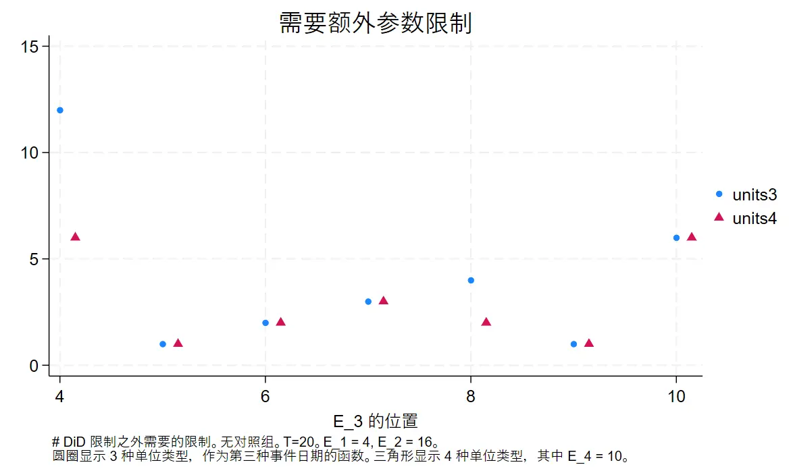

Let me explain what Appendix B's output figure means.

First, take a dataset where everyone receives the event shock, but the event timing differs. In the initially generated dataset, the event shock times are 4 and 16. At this point the additional constraint parameters needed to solve are 12 (which can be understood as how many degrees of freedom are still missing).

Here's what the figure means:

First look at the **first column of blue dots**.

When you add other samples whose **event shock time** is 4 (the x-axis), no extra information is added. The whole dataset is still two types of samples — event shock time 4 or 16 — so the **additional parameters** needed to solve are still 12 (the y-axis).

Similarly, the **second column of blue dots** means that when you add a third group of samples with shock time 5, the difference in event timing shrinks and information increases, so the additional parameters needed drop to 1.

The red triangles mean: on top of the dots in each column, what happens to the parameters needed when you add the samples the triangles represent.

> I originally expected that, given a fixed timing difference, the more individual groups there are, the fewer additional parameters would be needed. It turns out only the fifth column behaves that way, which is why the paper says this is strange and worth studying — though the author doesn't know why either.

The following code has comments added via GPT:

```SQL
#delimit ;

cap log close ;

set trace off ;
set more off ;
clear all ;
set seed 101 ;

cap prog drop runme ; 
prog def runme ;
args list ctrl trends ;

qui gendata "`list'" `ctrl' `trends' ;

qui forvalues i = 0/20 { ;
gen D_p`i' = (etime == `i') ;  // generate the positive treated-group dummy
gen D_m`i' = (etime == -1 * `i') ;  // generate the negative treated-group dummy
summ D_p`i' ;  // summarize the positive treated-group dummy
local dropme = (r(mean) == 0) ;
if `dropme' == 1 { ;
drop D_p`i'  ;  // if the mean is 0, drop the positive treated-group dummy
} ;
summ D_m`i' ;  // summarize the negative treated-group dummy
local dropme = (r(mean) == 0) ;
if `dropme' == 1 { ;
drop D_m`i'  ;  // if the mean is 0, drop the negative treated-group dummy
} ;
} ;

drop D_m0  ;  // drop the baseline case of the negative treated-group dummy

egen unittype = group(E_i) , miss ;  // generate a unit-type variable from E_i, handling missing values
qui tab unittype , gen(udum) ;  // summarize the unit-type variable and generate the corresponding dummies
qui tab t , gen(tdum) ;  // summarize the time variable and generate the corresponding dummies

unab vars : D_* udum* tdum* ;  // generate the variable list for everything related to D_*, udum*, and tdum*
mata: count() ;  // call the Mata function to compute variable statistics
local c1 = count[1,1] ;  // get the first column of the statistics
local c2 = count[1,2] ;  // get the second column of the statistics
local c3 = count[1,3] ;  // get the third column of the statistics

di "`list'" _column(20) `c1' _column(25) `c2'  
_column(35) `c3' ;  // display the variable list and its statistics

end ;

mata: ;

void count() 
{  ;
v = st_local("vars") ;  // get the Stata local macro "vars"
X = st_data(.,v) ;  // get the variable data from the current dataset

mycols = cols(X) ;  // compute the number of columns of the data matrix
myrank = rank(X) ;  // compute the number of non-missing values per column of the data matrix
gap = mycols - myrank ;  // compute the number of missing values per column of the data matrix
output = (mycols,myrank,gap) ;  // combine the statistics into a tuple
st_matrix("count",output) ;  // store the statistics into a matrix named "count"
} ;
end ;

cap prog drop gendata ;
program define gendata ;
args list ctrl trends ;

drop _all ;

local numobs = 48 ;  // define the number of observations
local treatedunittypes = wordcount("`list'") ;  // compute the number of treated unit types

/* "ctrl" is 0/1 whether we have control (untreated) units */
/* if we have them, put half of data into control units */
local numtreatedobs = round(`numobs' / (1 + `ctrl')) ;  // compute the number of treated-unit observations
local numuntreatedobs = `numobs' - `numtreatedobs' ;  // compute the number of control-unit observations

local obspertype = floor(`numtreatedobs' /
`treatedunittypes') ;  // compute the number of observations per treated unit type

forvalues i = 1/`treatedunittypes' { ;
local eventdate_`i' = word("`list'",`i') ;  // get the event date for each treated unit type
} ;

set obs `numobs' ;/* number of observations */
gen i = _n ;

gen treated = i > `numuntreatedobs' ;/* treated-group units */

gen E_i = . ;
forvalues i = 1/`treatedunittypes' { ;
local start = (`i'-1)*`obspertype' + `numuntreatedobs' + 1 ;
local stop = (`i')*`obspertype' + `numuntreatedobs' ;
replace E_i = `eventdate_`i'' if i >= `start' & i <= `stop' ;  // set the event date for each treated unit type
} ;
replace E_i = `eventdate_`treatedunittypes'' if i > `stop' ;
tab E_i , miss ;  // summarize the event-date variable and show missing values

expand 20 ;/* time span */

sort i ;
qui by i: gen t = _n ;

xtset i t ;  // define the unit and time variables for the panel data

/* make variables that determine the DGP */
gen etime = (t - E_i) ;/* event time */

/* gen TE = 1 * (etime >= 0) ;/* step-function treatment effect */
*/
gen TE = (etime >= 0) * (etime+1) ;/* endless ramp-function treatment effect */
replace TE = 0 if E_i == . ;

gen Y0_pure = 0 ;/* the simplest counterfactual case */
*gen Y0_pure = 4 * treated +  0.3 * treated * t ;/* treated group has a pre-trend ... */
*gen Y0_pure = 4 * treated +  0.1 * treated * (t-10) * (E_i - 9);/* pre-trend based on E_i ... */

gen eps = sqrt(0.2) * rnormal() ;
gen actual = Y0_pure + TE * treated ;
gen y = actual + eps ;/* observed Y */


end ;

cap prog drop bigone ;
prog def bigone ;

runme "10 11" 0 0 ;

forvalues i = 4/16 { ;
runme "4 16 `i' " 0 0 ;
local rest_m3_`i' = count[1,3] - 2 ;
runme "4 16 `i' 10" 0 0 ;
local rest_m4_`i' = count[1,3] - 2 ;
} ;

drop _all ;
set obs 7 ;
gen E_i = _n + 3 ;
qui gen units3 = . ;
qui gen units4 = . ;
qui forvalues i = 4/10 { ;
replace units3 = `rest_m3_`i'' if E_i == `i' ;
replace units4 = `rest_m4_`i'' if E_i == `i' ;
} ;

gen E4_i = E_i + 0.15 ;
graph twoway (scatter units3 E_i , msymbol(o) msize(medsmall)) 
(scatter units4 E4_i , msymbol(triangle) msize(medsmall)) 
,
ti("需要额外参数限制") 
xtitle("E_3 的位置") 
note("# DiD 限制之外需要的限制。无对照组。T=20。E_1 = 4, E_2 = 16。"
"圆圈显示 3 种单位类型，作为第三种事件日期的函数。三角形显示 4 种单位类型，其中 E_4 = 10。") 
;
graph export figures/apdx_fig_A03.png , replace ;


end ;


bigone ;

```

So when we need additional constraints, how can we add them?

- Method 1: sum to 0 — $r_1+r_2=0$
- Method 2: arithmetic sequence — $r_2-r_1=r_0-r_{-1}$
- Method 3: not mentioned in the paper, but I have actually seen it used: $r1=2r_2$

These constrained regressions are implemented with the `cnsreg` command.
## Appendix C: Choosing the estimator

There are currently two kinds of estimator choices:
- Constrain the coefficient of the pre-event period variable to 0
- Constrain the sum of the pre-event dummy variable coefficients to 0

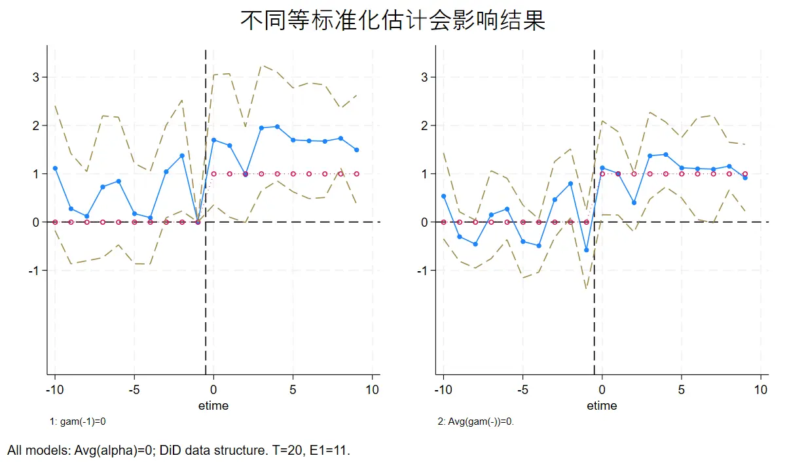
The code in this part is a **simulation experiment**.

First, generate the treatment effect according to the conditions, with the treatment effect fixed at 1 (the red line in the figure is the actually generated treatment effect). Then add a random noise term, and finally run the regression.

The constraint on the left normalizes the pre-event period; the constraint on the right constrains the pre-event dummies. You can see the right one is closer to the actual treatment effect (the red line).

The following code has comments by GPT, with some corrections by me.

Code structure: define the data-structure generation function and the constraint-selection function, then plot.
```SQL
#delimit ;

cap log close ;

set trace off ;
set more off ;
clear ;
set seed 2024202431 ;

cap prog drop runme ; 
prog def runme ;


gendata ;
/* create the estimation variables */
/* event-time dummies */

forvalues i = 0/20 { ;
gen D_p`i' = (etime == `i') ;
gen D_m`i' = (etime == -1 * `i') ;
summ D_p`i' ;
local dropme = (r(mean) == 0) ;
if `dropme' == 1 { ;
drop D_p`i'  ;
} ;
summ D_m`i' ;
local dropme = (r(mean) == 0) ;
if `dropme' == 1 { ;
drop D_m`i'  ;
} ;
} ;

drop D_m0  ;

gen byte group2 = E_i == 11 ;
gen trend_group2 = t * group2 ;

summ ; 


/* 1 normalize the event-time dummy at -1 to 0 */
constraint define 1 D_m1 = 0 ;

/* 2, the fixed effects of all groups sum to 0 */
constraint define 2 1.i + 2.i + 3.i + 4.i + 5.i + 
6.i + 7.i + 8.i + 9.i + 10.i = 0 ;

/* 7 set the average of the pre-treatment event-time dummies to zero*/
constraint define 7 D_m10 + D_m9 + D_m8 + D_m7 + D_m6 + D_m5 + D_m4 + 
D_m3 + D_m2 + D_m1 = 0 ; 

cnsreg y D_m* D_p* 
ibn.t ibn.i , cluster(i) nocons constraints(2 1 )  collinear ;
matrix myb_ES1 = e(b) ;
matrix myV_ES1 = e(V) ;

cnsreg y D_m* D_p* 
ibn.t ibn.i , cluster(i) nocons constraints(2 7 )  collinear ;
matrix myb_ES2 = e(b) ;
matrix myV_ES2 = e(V) ;


tempfile main ;
save `main' ;

/* plot */

*start debugging;
tempfile pooled ;
forvalues i = 0/10 { ;
drop _all ;
set obs 2 ;
gen label = "m`i'" in 1 ;
replace label = "p`i'" in 2 ;

gen etime = -1 * `i' in 1 ;
replace etime = `i' in 2 ;

foreach j in 1 2 { ;
gen cf_m`j' = . ;

/* set the estimation equation for the treatment effect */
gen truth_m`j' = (0) in 1 ;
replace truth_m`j' = (1) in 2 ;

local myb = 0 ;
cap local myb = myb_ES`j'[1,"D_m`i'"] ;
gen ES_b_m`j' = `myb' in 1 ;
local myv = . ;
cap local myv = myV_ES`j'["D_m`i'","D_m`i'"] ;
local myse = sqrt(`myv') ;
gen ES_se_m`j' = `myse' in 1 ;

local myb = 0 ;
cap local myb = myb_ES`j'[1,"D_p`i'"] ;
replace ES_b_m`j' = `myb' in 2 ;
local myv = . ;
cap local myv = myV_ES`j'["D_p`i'","D_p`i'"] ;
local myse = sqrt(`myv') ;
replace ES_se_m`j' = `myse' in 2 ;
} ;


capture append using `pooled' ;
save `pooled' , replace ;
} ;


drop if label == "m0" ;
drop if label == "p10" ;
sort etime ;
save `pooled' , replace ;


local note1 "gam(-1)=0" ;
local note2 "Avg(gam(-))=0." ;

forvalues i = 1/2 { ;

gen top_`i' = ES_b_m`i' + 1.96 * ES_se_m`i' ; 
gen bot_`i' = ES_b_m`i' - 1.96 * ES_se_m`i' ; 

graph twoway (connected ES_b_m`i' truth_m`i' etime ,  msize(medsmall medium) 
msymbol(o oh) lpattern(solid dot) )
(line cf_m`i' etime , lpattern(dash) )
(line top_`i' bot_`i' etime, lpattern(dash dash) lcolor(brown brown))
, legend(off) xline(-0.5) 
note("`i': `note`i''") 
name(g`i' , replace) yscale(range(-3,3.5)) yline(0 , lpattern(dash) lcolor(black)) ;
} ;


graph combine g1 g2 , ti("不同等标准化估计会影响结果") 
note("All models: Avg(alpha)=0; DiD data structure. T=20, E1=11.") ;
graph export figures/apdx_fig_A04.png , replace ;


end ;

cap prog drop gendata ;
program define gendata ;

/*****************
main data-generation process options

/* possible treatment-effect types */
1 - zero treatment effect
2 - step-function treatment effect
3 - permanent ramp
4 - ramp to plateau
5 - AR(1) type

/* distribution of E_i */
T = 19; E_i ~ U(6,14)

/* are there never-treated units? */
yes; no

/* Y0 (the "signal" of the potential outcome) dynamics */
1 - baseline: Y0 = 0
2 - level shift: Y0_i,t = E_i
3 - trend shift: Y0_i,t = t * E_i

end of main options
******************/

drop _all ;

/*
/* classic ES data structure */
set obs 9 ;/* number of groups */
gen i = _n ;
gen E_i = 5 + i ;
gen treated = 1 ;/* all treated */
expand 20 ;/* number of periods */
*/


set obs 10 ;/* number of groups */
gen i = _n ;

/* NxT DiD data structure*/
gen treated = i > 5 ;/* half treated */
gen E_i = 11 if treated == 1 ;


expand 20 ;/* number of periods */

sort i ;
qui by i: gen t = _n ;

xtset i t ;

/* create variables that determine the DGP */
gen D = (t == E_i) ; /* the event "pulse" */
gen etime = (t - E_i) ;/* event-time dummy */

gen TE = 1 * (etime >= 0) ;/* treated-group indicator */
*gen TE = (etime >= 0) * (etime+1) ;/* endless ramp function for treatment effect */
replace TE = 0 if E_i == . ;

gen treated_post = etime >= 0 ;

gen Y0_pure = 0 + 1 * treated ;/* offset counterfactual */
*gen Y0_pure = 4 * treated +  0.3 * treated * t ;/* treated have a pre-trend ... */
*gen Y0_pure = 4 * treated +  0.01 * treated * (t-10) * (E_i - 9);/* pre-trend based on E_i ... */

gen eps = sqrt(0.3) * rnormal() ;
gen actual = Y0_pure + TE * treated ;
gen y = actual + eps ;/* observed Y */


end ;


runme ;

```


The rest of part C is a Timing-based data simulation; the code structure is the same, only the data structure and constraints differ, so I won't repeat it here — I'll just show the output.

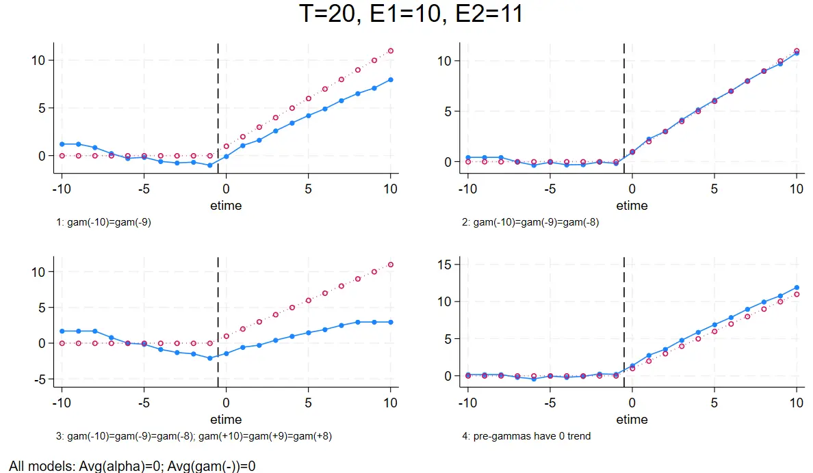

- Top-left: only the first two time-dummy coefficients are constrained to be equal.
- Top-right: the first three time-dummy coefficients are constrained to be equal.
- Bottom-left: the three periods on each side of pre/post are constrained to have equal coefficients.
- Bottom-right: the pre-event anticipatory-effect dummy coefficients are constrained to sum to 0.
```SQL
constraint define 4 D_m11 = D_m10 ;
constraint define 5 D_m10 = D_m9 ;
constraint define 6 D_m9 = D_m8 ;
constraint define 7 D_m8 = D_m7 ;
```

## Appendix D: Approaching the raw data

DID gets deified again and again 🤣（

Appendix D can essentially be understood as a decomposition that adds a time trend (a slope comparison). The code structure is the same as before; what's added this time is predicting the counterfactual group, and using it to strengthen the causal argument through another comparison.

```SQL
/* create the counterfactual prediction cf_ES2 */
gen cf_ES2 = y ;  // initialize cf_ES2 as the observed variable y

/* loop over the time range */
qui summ etime ;  // get summary statistics of etime
local mymin = r(min) ;  // get the minimum
local mymax = r(max) ;  // get the maximum

forvalues i = `mymin'/`mymax' {  // loop over the time range
    if `i' < 0 {  // if time is less than 0
        local j = abs(`i') ;  // take the absolute value
        replace cf_ES2 = cf_ES2 - _b[D_m`j'] * D_m`j' ;  // subtract the treatment-effect coefficient times the corresponding dummy
    }
    else {  // if time is greater than or equal to 0
        replace cf_ES2 = cf_ES2 - _b[D_p`i'] * D_p`i' ;  // subtract the treatment-effect coefficient times the corresponding dummy
    }
}

/* compute the counterfactual prediction mean by unit type and time */
egen meancf_ES2 = mean(cf_ES2), by(t unittype) ;  // compute the mean of cf_ES2 by t and unittype

```
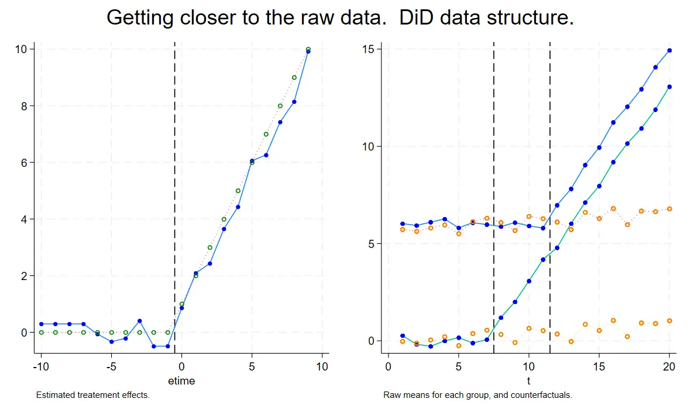

## Appendix E: Repeated event shocks

The problem this part solves is: if an event occurs repeatedly at different times, how should you choose? Here the generated <font color="#ff0000">true treatment effect is a continuously decaying curve</font>.

**Approach 1** constrains the coefficients of the event dummies to be equal ($\gamma_1=\gamma_2$):

The constraints below are segmentations into two-period, three-period, and four-period groups.

Here's an example of the constraint code:

```SQL
#delimit; 
/*two periods per group*/
constraint define 9 D_m10=D_m9;
constraint define 10 D_m8=D_m7;
constraint define 11 D_m6=D_m5;
constraint define 12 D_m4=D_m3;
constraint define 13 D_m2=D_m1;
constraint define 14 D_p0=D_p1;
constraint define 15 D_p2=D_p3;
constraint define 16 D_p4=D_p5;
constraint define 17 D_p6=D_p7;
constraint define 18 D_p8=D_p9;

/*three periods per group */
#delimit;
constraint define 21 D_m1=D_m2;
constraint define 22 D_m1=D_m3;

constraint define 23 D_m4=D_m5;
constraint define 24 D_m4=D_m6;

constraint define 25 D_m7=D_m8;
constraint define 26 D_m7=D_m9;

constraint define 27 D_p0=D_p1;
constraint define 28 D_p2=D_p1;

constraint define 29 D_p3=D_p4;
constraint define 30 D_p3=D_p5;

constraint define 31 D_p6=D_p7;
constraint define 32 D_p6=D_p8;

```

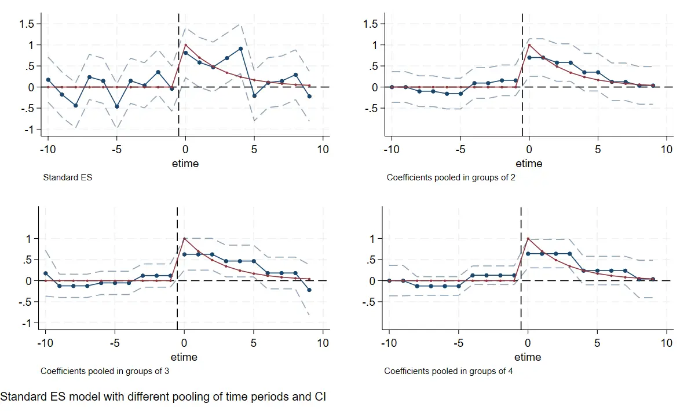
**Approach 2** constrains the slopes between coefficients to be equal ($\gamma_1-\gamma_0=\gamma_2-\gamma_1$)

Here's an example of the constraint code:
```SQL
constraint define 9 D_m10=D_m9;
constraint define 10 D_m8=D_m7;
constraint define 11 D_m6=D_m5;
constraint define 12 D_m4=D_m3;
```

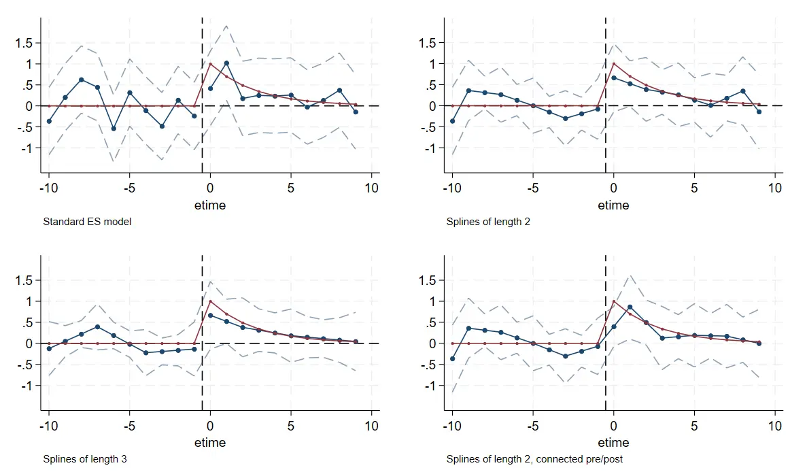

- Top-left is the ordinary case.
- Top-right is the grouping with equal two-period slopes.
- Bottom-left is the grouping with equal three-period slopes.
- Bottom-right is the grouping where the two periods before and after are each constrained to be equal.

## Appendix F: Controlling the time trend

What this part studies is whether to add time-trend controls and other constraints.
###  DID: one unit, two times
Two kinds of constraints. One adds a trend control — adding `trend_group2` to the controls:

```SQL
//trend control variable
gen byte group2 = E_i == 11 
gen trend_group2 = t * group2 same constraint
//other constraint types are the same as before, ensuring event-time dummies have equal coefficients or equal slopes
```

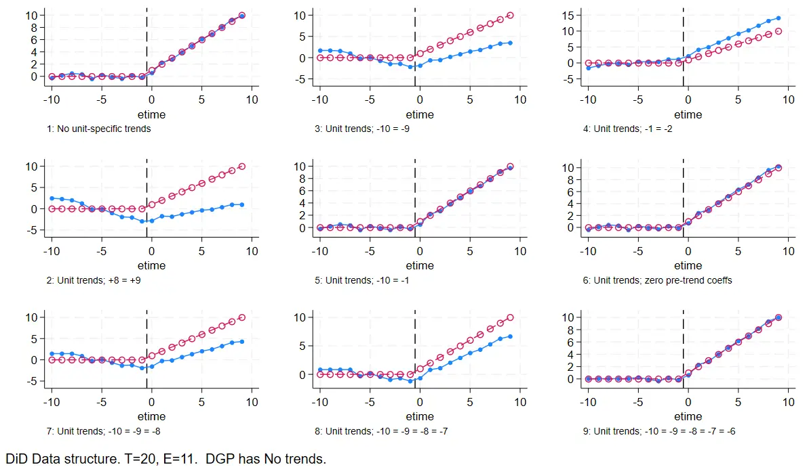

### Time-based: one unit, two times
Next, verify the Time-based data form.

The DID form has a control group to help generate counterfactual predictions, but time-based lacks a control group. The usual options are:

1. The event-time dummy coefficients for the earliest and latest periods are equal, making the plot smoother
1. The slopes between the earliest and latest event-time dummy coefficients are equal, better showing the trend
1. The sum of the pre-trend coefficients is constrained to 0
1. The trend-weighted constraints across multiple event times sum to 0

You can see that in the experiment below, the fourth plot actually produced a strange result.
The constraints applied were:
1. Individual fixed effects sum to 0
2. Pre-event effects sum to 0
3. The slopes at the end of the post-event period are equal
4. The weighted pre-trend is 0
```SQL
\\I don't understand where the 5.5 base period in this constraint comes from?
constraint define 8 (10-5.5)*D_m10 + (9-5.5)*D_m9 + (8-5.5)*D_m8 + (7-5.5)*D_m7 
+ (6-5.5)*D_m6 + (5-5.5)*D_m5 + (4-5.5)*D_m4 + 
(3-5.5)*D_m3 + (2-5.5)*D_m2 + (1-5.5)*D_m1 = 0 ; 
```


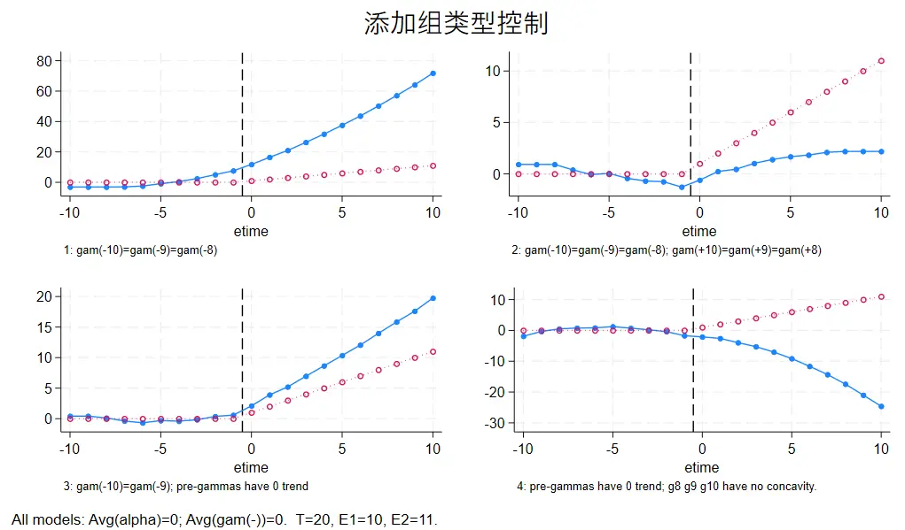

So should we choose the constraint that the **coefficients' slopes are equal** or that the **coefficient values are equal**?

The answer depends on the situation. If a policy's true effect doesn't change over time, choose the **equal coefficient values** constraint; if the policy effect changes over time, choose the **equal coefficient slopes** constraint.
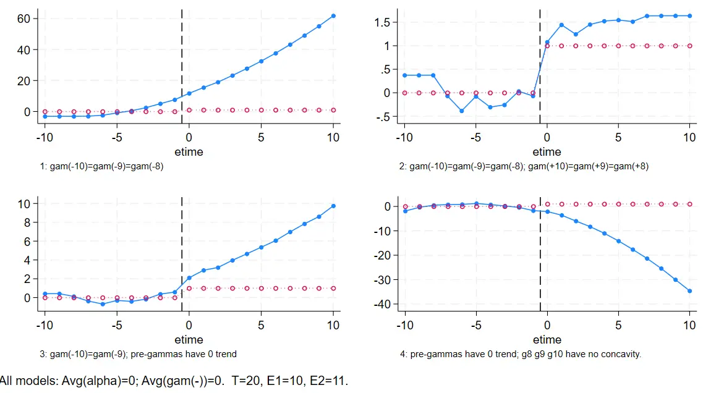

> I think this conclusion has become circular reasoning. The whole point of event studies is to estimate the treatment effect (whether it is dynamic or static is precisely what we need to find out), and now it's turned into choosing the method based on the result.
>
> Still, the takeaway is simply to analyze the policy background, form an assumption, and then choose the constraint.

###  DID: many units, many times

For multi-period DID, adding **multiple event-time trend-weighted constraints that sum to 0** makes the estimation more efficient. As shown:

The first column is the ordinary estimate, with no restrictions beyond two-way individual and time fixed effects.
The second column adds, on top of the first, the constraint that the pre-event trends sum to 0:
```SQL
//event dates are still 10 and 5; I don't understand where the 5.5 base period comes from
constraint define 3  -4.5*D_m10  - 3.5*D_m9 - 2.5* D_m8  - 1.5* D_m7 
- 0.5*D_m6 + 0.5 * D_m5 +  1.5 * D_m4 + 
 2.5 *D_m3 +  3.5 *D_m2 +  4.5 *D_m1 = 0 ;
```
The third column adds a type control:
```SQL
gen treated_time = treated * t 
```

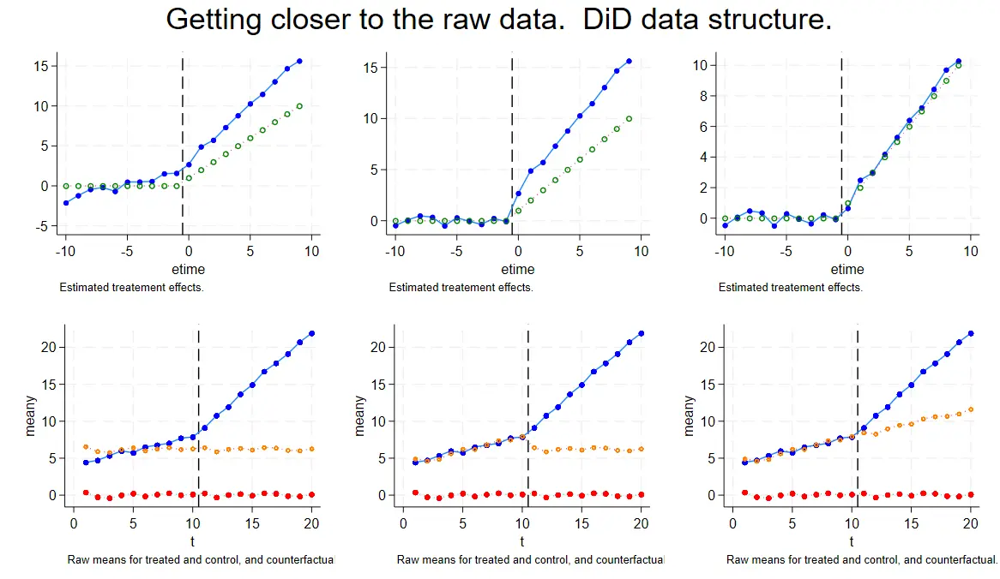
### Time-based: many units, many times

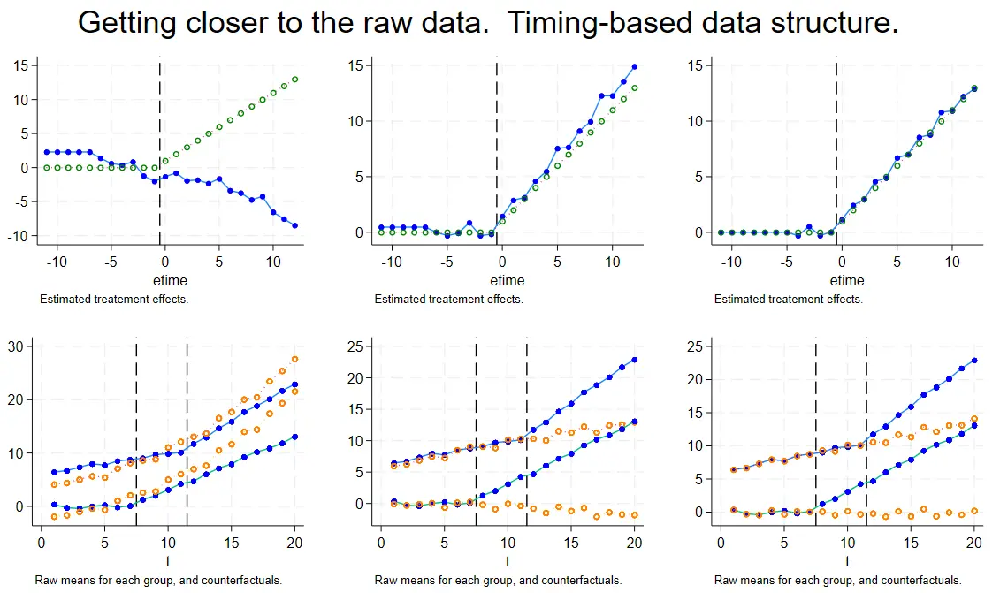
Above is a Time-based structure where everything is the treated group, but this time there are individual differences.

The second column adds, on top of the first, individual grouping and a time-weighted trend of 0:
```SQL
//individual grouping
Egen unittype = group (E_i) ;
Egen meany = mean (y) , by (t unittype) 
//time-trend weighting; I still don't understand where the 3.5 base period comes from
constraint define 103   (6-3.5) * D_m6 + (5-3.5) * D_m5 + 
(4-3.5) * D_m4 + (3-3.5) * D_m3 + (2-3.5) * D_m2 + (1-3.5) * D_m1 = 0  ; 
```
The third column adds coefficient constraints on top of the second:
```SQL
constraint define 8 D_m7 = D_m6 ;
constraint define 9 D_m6 = D_m5 ;
```

## Summary

Event study analysis is a generalization of DID.

> My understanding is that event studies further slice DID over time. Because there are more time dummies, solving requires more constraints, so we have to add time-trend controls based on the research context.

1. DID and event studies complement each other; event studies can further show the dynamic effects of the DID estimate (increasing, decreasing, or reverting to the normal value after variation over time). If the two estimates point in opposite directions, it may be because the wrong constraints were chosen, or there is a collinearity issue.
2. Different data structures call for different numbers and types of additional constraints in event studies.
3. From the appendix-code experiments —
- Solving a Time-based dataset requires adding constraints, and how many depends on the number of event times and individuals.
- In event studies, standardizing the pre-trend generally tends to be more accurate.
- A dataset with only one unit but shocks at different times needs constraints added carefully, or you may get the opposite result.
- Data with many individuals, whether time-based or did, should add a group-type control.


---

> Author: [滑翔闪](https://github.com/hzp2333/hzp2333.github.io)  
> URL: https://blog.huaxiangshan.com/en/posts/event2/  

