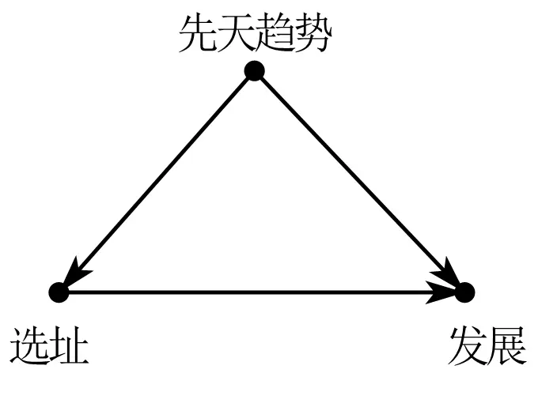
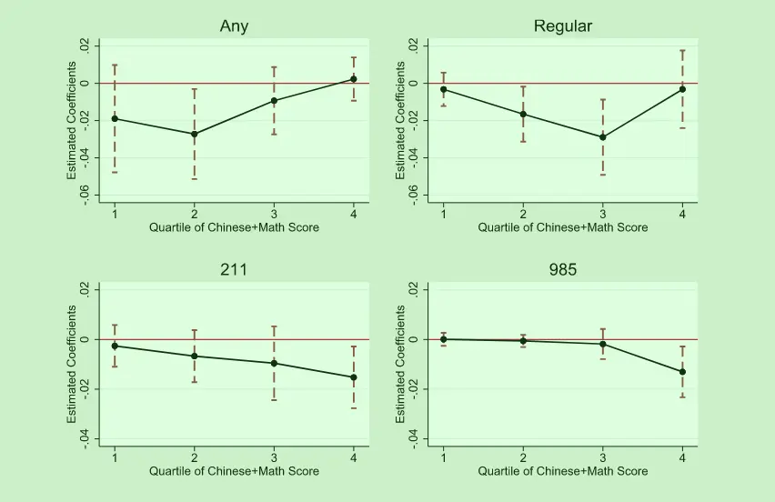
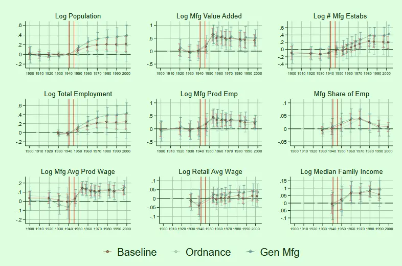
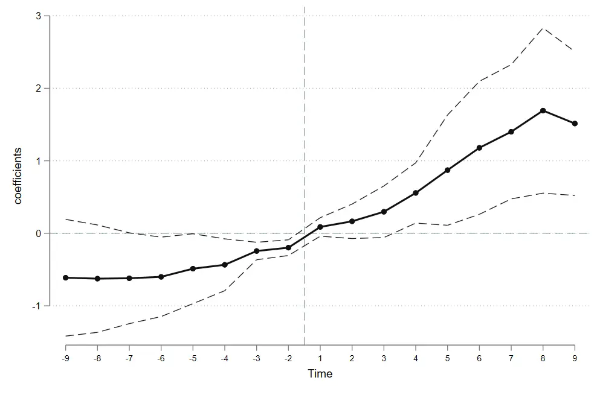
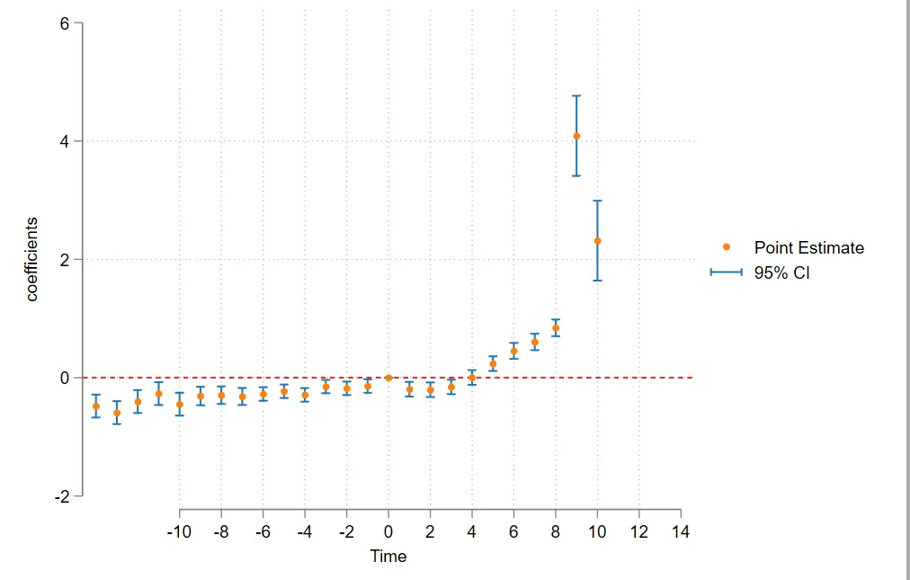
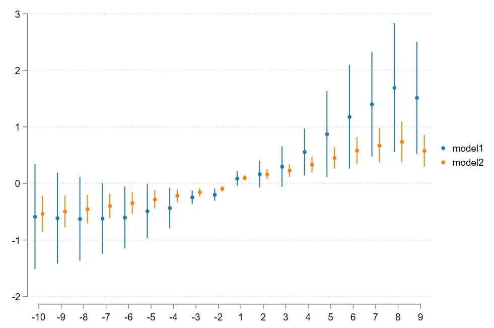
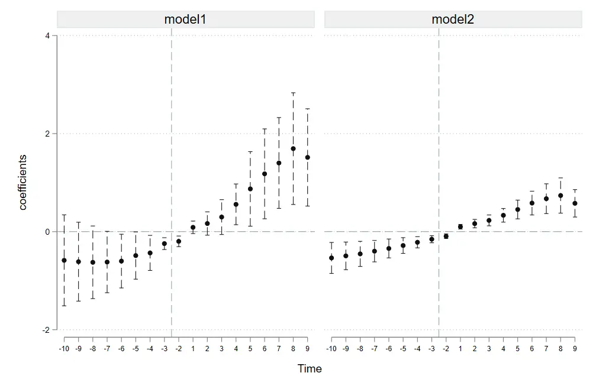
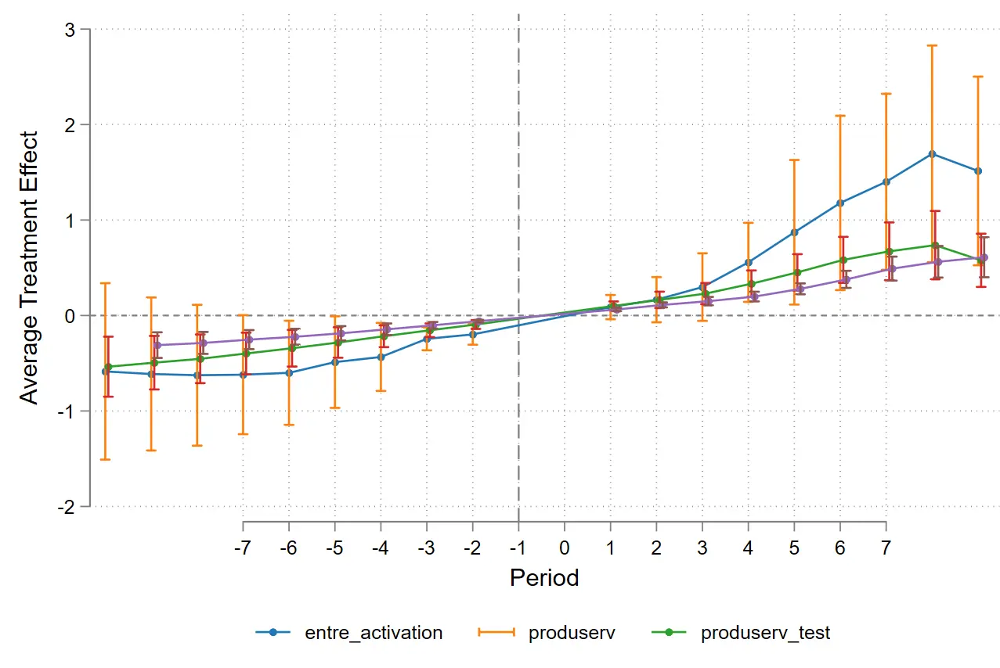

#  Econometrics: Event Studies 3

 

- [Econometrics: Event Studies 1](https://blog.huaxiangshan.com/zh-cn/posts/event1/)
- [Econometrics: Event Studies 2](https://blog.huaxiangshan.com/zh-cn/posts/event2/)
- [Econometrics: Event Studies 3](https://blog.huaxiangshan.com/zh-cn/posts/event3/)

> This post is a record of learning the code from *[An Introductory Guide to Event Study Models](https://www.aeaweb.org/articles?id=10.1257/jep.37.2.203)*. The third part tackles the Stata code.
> 
> This post introduces the plotting code for the coefplot, eventplot, eventdd, and cnreg commands in event studies.


## A quick review of the event study concept


**Operationally**: a regression usually estimates an average treatment effect, while an event study slices that average effect over time.

**Statistically**: each dummy time period gets a coefficient, and stringing them together shows the dynamic evolution of the average treatment effect.

The average estimate:

$$
y_{ij}=\beta X_i+\underbrace{\alpha_{i}+\delta_{i}}\_{\text{面板固定效应}}+\underbrace{\beta\cdot X_{ij}}\_{\text{ 控制变量}}+\epsilon_{ij}.
$$

After time-slicing:

$$
y_{ij}=\underbrace{\left(\sum\_{j\in\{-m,\ldots,0,\ldots,n\}}\gamma_{j}\cdot D_{i,t-j}\right)}\_{\text{事件时间虚拟变量}}+\underbrace{\alpha_{i}+\delta_{i}}\_{\text{面板固定效应}}+\underbrace{\beta\cdot X_{ij}}\_{\text{ 控制变量}}+\epsilon_{ij}.
$$

**A parallel-trends test is just a special case of an event study.** Say there are two counties, A and B. County A implemented rural revitalization and B didn't, and then A got rich.

We can't casually say rural revitalization caused A to get rich — A might have been blessed to begin with: beautiful scenery, fertile soil, rich mineral resources...... A and B have always had a development gap. To verify that A and B's data were nearly identical before rural revitalization, **that way the DID event is exogenous to both counties**.

In short, the parallel-trends test argues that the treated and control groups had almost no difference before the event.



> By the way — panel data generally defaults to two-way fixed effects, and the coefficient bias in parallel-trends tests with three or more periods has long been a hot research topic.
> 
> The core sticking point is **decomposing heterogeneity**: some variables have time trends and some don't; different pre-trend shapes call for different constraints.
> 
> But in practice, nobody actually knows these population-level facts.

## Event studies in top journals

In the top-5 papers I've read, there's already a trend — anything that can be shown in a figure gets a figure. So event studies are being used more and more often.

For example, see the post *[One-Time Government Investment and Long-Run Manufacturing Growth](https://blog.huaxiangshan.com/zh-cn/posts/zftz/)*.

Here I'll give examples from papers I like that use event studies flexibly.

JDE's *English language requirement and educational inequality: Evidence from 16 million college applicants in China* uses event studies to argue that the English listening exam widened urban-rural educational inequality.

It uses event studies to show the heterogeneity in how gaokao students stratify — from 985 universities down to first-tier admission rates, the effect keeps growing.



QJE's *The Long-Run Impacts of Public Industrial Investment on Local Development and Economic Mobility: Evidence from World War II* uses event studies to argue that during the Cold War, the US dispersing factories raised the future wages of local children.

Through dynamic comparisons swapping in different variables, you can see that the number of local firms barely changed, but employment grew markedly — so the job growth came from scale effects rather than a rise in the number of firms.



Later it also uses a population-flow panel to argue that the wage gains came from better local job pay rather than human-capital gains or in-migration.

## Stata code

The example data below is from *China Industrial Economics*' [*Does Innovation-Driven Policy Boost Urban Entrepreneurship Activity — Evidence from the National Innovative City Pilot Policy*](https://ciejournal.ajcass.com/Magazine/show/?id=83285).

**Honestly I wanted to use data I collected myself as an example, but not a single coefficient was significant!** 🤧

The data are all in the journal's online appendix; just go in and download them. This paper should also be one of the earlier domestic papers to publicly release the full difference-in-differences code. City-level panel data is handy for learning any kind of code.

### Two ways to do the parallel-trends test

#### The coefplot command

The `coefplot` command can extract regression coefficients. We just need to generate time dummies, run the regression, and then store the coefficients via the command and plot them.

**Steps summarized:**
1. Define the panel data
2. Set the event time — year minus the event time — then generate the dummies for each time slice in turn
3. Regress
4. Store the coefficients and plot


```SQL
clear all
use "F:\桌面\事件研究法发学习代码\数据.dta", clear
xtset city year

*generate the relative time variable di = current year - reform year
gen di = year - branch_reform
sum di //currently ranges from -14 to 10 periods, too long; the window can be shortened, merged, or trimmed

*trim or merge the data on both ends
replace di = -10 if di < -10
replace di = 10 if di > 10

*generate the lead dummies d_1 through d_10
forvalues i = 1/10{
gen d_`i'=(di==-`i')

}

*generate the lead dummies d1 through d10
forvalues i = 1/10{
gen d`i'=(di==`i')

}

*regress
xtreg  entre_activation  d_2-d_10 d1-d9 di i.year  lnagdp indust_stru finance ainternet market i.city#c.di , fe r
xtreg  entre_activation  d_2-d_10 d1-d9 di i.year  lnagdp indust_stru finance ainternet market  i.city#c.di , fe r 
#delimit; //set a custom line-break symbol, i.e. ; is the line break. this makes the plotting command easier.
;
coefplot,
baselevels
keep(dd_10 d_9 d_8 d_7 d_6 d_5 d_4 d_3 d_2  d1 d2 d3 d4 d5 d6 d7 d8 d9)
order(d_10 d_9 d_8 d_7 d_6 d_5 d_4 d_3 d_2  d1 d2 d3 d4 d5 d6 d7 d8 d9 ) 
vertical  // transpose the graph
coeflabels( 
d_10=-10 d_9=-9 d_8=-8 d_7=-7 d_6=-6 d_5=-5 d_4=-4 d_3=-3 d_2=-2 d_1=-1
d1=1 d2=2 d3=3 d4=4 d5=5 d6=6 d7=7 d8=8 d9=9 d10=10
)
yline(0, lwidth(vthin) lpattern(dash) lcolor(teal))
xline(8.5, lwidth(vthin) lpattern(dash) lcolor(teal))
ylabel(, labsize(*0.85) angle(0)) xlabel(, labsize(*0.75))
ytitle("coefficients")
xtitle("Time")
msymbol(O) msize(small) mcolor(gs1)  // marker style
addplot(line @b @at ,lcolor(gs1) lwidth(medthick)) //connect the points
ciopts(recast(rline) lwidth(thin) lpattern(dash) lcolor(gs2))  //  confidence-interval style: rarea rline rcap
graphregion(color(white)); // background color

#delimit cr //restore the line-break symbol
```




#### The Eventdd command

The Eventdd command can draw the plot in one step; just enter the corresponding parameters following the code below.

**Whatever variable follows Eventdd is the regression to run.**

```SQL
clear all
use "F:\桌面\事件研究法发学习代码\数据.dta", clear
set scheme white_tableau
xtset city year

#delimit;
;
gen di = year - branch_reform;
eventdd entre_activation i.year lnagdp indust_stru finance ainternet market,
 timevar(di) //define the time dummy
 ci(rcap) //error bars  
 noline //do not plot the confidence-interval bar for period -1
 method(fe) //to add an autocorrelation cluster -- method(fe,cluster(autocorrelation cluster))
 baseline(0) //the base year is 0
 level(95)
 graph_op(ytitle("coefficients") xtitle("Time")  xlabel(-10(2)14)); // cancel the custom line break
#delimit cr
```



### Regression tips for parallel trends

The specification I chose is:

```SQL
xtreg  entre_activation  d_2-d_10 d1-d9 di i.year  lnagdp indust_stru finance ainternet market i.city#c.di , fe r
```

- Here `i.city#c.di` additionally controls for each unit's time trend (the time effect decomposes the intercept, while this decomposes the slope).
- The `d_1` period is dropped: on one hand to serve as the baseline, on the other to avoid collinearity.
- Some papers subtract the coefficient mean to make the plot prettier, but it's not necessary.
- The parallel-trends test has plenty of bias controversy, but nobody really scrutinizes these points; doing them is just better.

### Constrained regression

Following the code in *[An Introductory Guide to Event Study Models](https://www.aeaweb.org/articles?id=10.1257/jep.37.2.203)*, we can add constraints to the regression.

Just use the `cnsreg` command. I already explained it in [Econometrics: Event Studies 2](https://blog.huaxiangshan.com/zh-cn/posts/event2/). In the coefplot command, just swap the regression for the constrained one.

The `constaint` command sets the constraints; adding `c (1-5)` in the regression adds **all five** constraints. Got it? 😉

```SQL
constraint 1 d_1=d_2 //corresponding coefficients are equal
constraint 2 d_2-d_1=d_4-d_3 //corresponding slopes are equal
constraint 3 d_1=d_2*0.5
constraint 4 d_1=d_2+d_2


cnsreg  entre_activation  d_2-d_10 d1-d9 di i.year  lnagdp indust_stru finance ainternet market i.city#c.di , c(2) r

```

### Showing multiple regression coefficients on one plot

The `twoway` command can also do it, but it's too much trouble, so I won't cover it here.

#### The Coefplot command

Still use the `coefplot` command; other parameters can still be added — **but you can't set line parameters** (`addplot`).

```SQL
// run the first regression model
xtreg entre_activation d_2-d_10 d1-d9 di i.year lnagdp indust_stru finance ainternet market i.city#c.di, fe r
estimates store model1  // save the first model

// run the second regression model (which can be a different variable or specification)
xtreg produserv d_2-d_10 d1-d9 di i.year lnagdp indust_stru finance ainternet market i.city#c.di, fe r
estimates store model2  // save the second model

// draw the parallel-trends plot
set scheme white_tableau
#delimit; 
;
coefplot model1  model2, // coefplot model1 || model2
    baselevels  
    keep(d_10 d_9 d_8 d_7 d_6 d_5 d_4 d_3 d_2 d1 d2 d3 d4 d5 d6 d7 d8 d9)  
    order(d_10 d_9 d_8 d_7 d_6 d_5 d_4 d_3 d_2 d1 d2 d3 d4 d5 d6 d7 d8 d9)
    vertical
coeflabels(  
d_10=-10 d_9=-9 d_8=-8 d_7=-7 d_6=-6 d_5=-5 d_4=-4 d_3=-3 d_2=-2 d_1=-1
d1=1 d2=2 d3=3 d4=4 d5=5 d6=6 d7=7 d8=8 d9=9 d10=10
);
    yline(0, lwidth(vthin) lpattern(dash) lcolor(teal))
    xline(8.5, lwidth(vthin) lpattern(dash) lcolor(teal))  
    ylabel(, labsize(*0.85) angle(0)) xlabel(, labsize(*0.75))  
    ytitle("coefficients") xtitle("Time") 
    msymbol(O) msize(small) mcolor(gs1)
    ciopts(recast(rcap) lwidth(thin) lpattern(dash) lcolor(gs2))  //rarea rline rcap
legend(order(1 "entre_activation" 2 "produserv") region(lstyle(none)) position(6))
    graphregion(color(white)); 

```



If you don't want to show them on one plot, just add a **separator** like the other commands.

```
coefplot model1 || model2,
```



#### The Event plot command

I'd guess most publications with connected-line plots, if they aren't using R, drew them with the event plot command.

**The nice thing about this command is that you can set different reform years for comparison, and it supports connected scatter plots. It also seems to have many good subcommands aimed at difference-in-differences.**

I'd bet the QJE paper mentioned above drew its figure with this command.

```SQL

clear all
use "F:\桌面\事件研究法发学习代码\数据.dta", clear
set scheme white_tableau
xtset city year

//generate the relative time: current year - reform year
gen di = year - branch_reform
sum di //currently ranges from -11 to 12 periods, too long; the window can be shortened, merged, or trimmed

*trim or merge the data on both ends
replace di = -10 if di < -10
replace di = 10 if di > 10

*generate the lead dummies d_1 through d_10
forvalues i = 1/10{
gen pre_`i'=(di==-`i')

}

*generate the lead dummies d1 through d10

forvalues i = 1/10{
gen post`i'=(di==`i')

}


gen testi=di+1

*generate the lead dummies d_1 through d_10
forvalues i = 1/10{
gen fpre_`i'=(testi==-`i')

}

*generate the lead dummies d1 through d10

forvalues i = 1/10{
gen fpost`i'=(testi==`i')

}


// run the first regression model
xtreg entre_activation pre_2-pre_10 post1-post9 di i.year lnagdp indust_stru finance ainternet market i.city#c.di, fe r
estimates store model1  // save the first model

// run the second regression model (which can be a different variable or specification)
xtreg produserv pre_2-pre_10 post1-post9 di i.year lnagdp indust_stru finance ainternet market i.city#c.di, fe r
estimates store model2  // save the second model

// run the second regression model (which can be a different variable or specification)
xtreg produserv fpre_2-fpre_10 fpost1-fpost9 di i.year  i.city#c.di, fe r
estimates store model3  // save the second model


#delimit;
;
event_plot model1 model2 model3,
stub_lag(post# post# fpost#) stub_lead(pre_# pre_# fpre_#) 
plottype(connected ) ciplottype(rcap)  together noautolegend  
graph_opt(xtitle("Period", size(middle))ytitle("Average Treatment Effect", size(middle)) xlabel(-7(1)7,)legend(order( 1 "entre_activation" 2 "produserv" 3 "produserv_test" ) 
rows(1) position(6) region(style(noe))) xline(-1,lcolor(gs8) lpattern(dash)) yline(0, lcolor(gs8))
graphregion(color(white)) bgcolor(white) ylabel(,angle(horizontal)));

```

The `plottype(connected ) ` part is what sets both a connecting line and markers.

`Stub_lag (post# post# fpost#) stub_lead (pre_# pre_# fpre_#) ` — if the three models share one x-axis, you only need to enter the shared x-axis symbols. But here, for testing, I shifted the reform year of one model (model 3) earlier, so they need to be matched one-to-one; even for the same coordinate you have to write it out repeatedly.




## Summary

Econometrics is like this figure: it looks complicated, but the core idea can always be stated in one sentence.

In terms of operation — **an event study is just coefficient visualization**, but putting the pieces together can vividly show a lot more — heterogeneity, structural comparison, parallel trends, between-group differences, long-run effects...... What matters even more is the design thinking behind the group regression and the analysis of economic meaning.


---

> Author: [滑翔闪](https://github.com/hzp2333/hzp2333.github.io)  
> URL: https://blog.huaxiangshan.com/en/posts/event3/  

