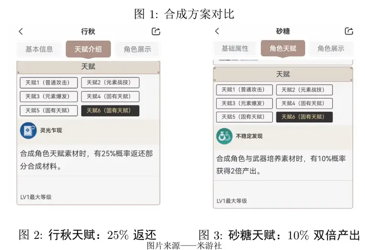
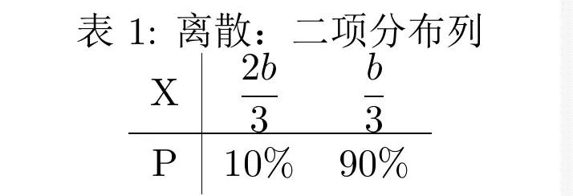
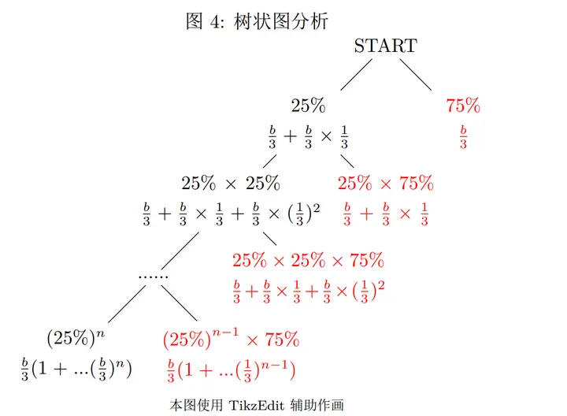
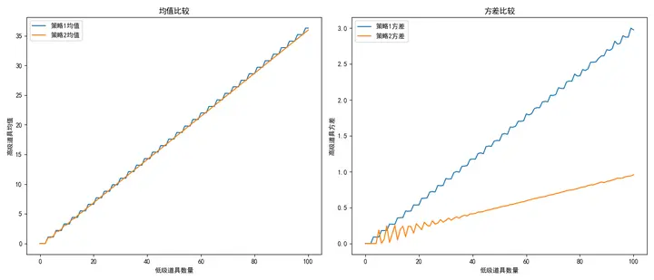
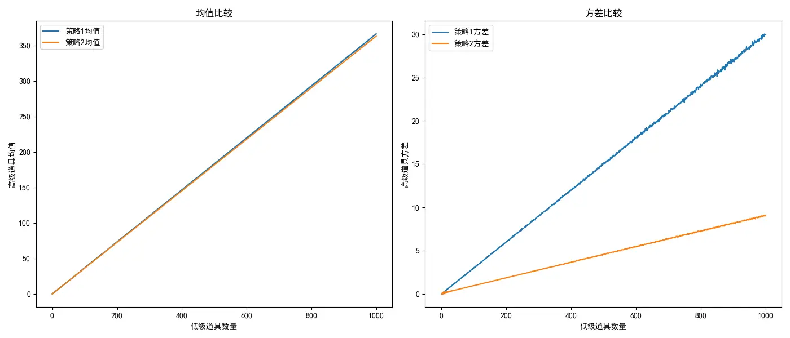
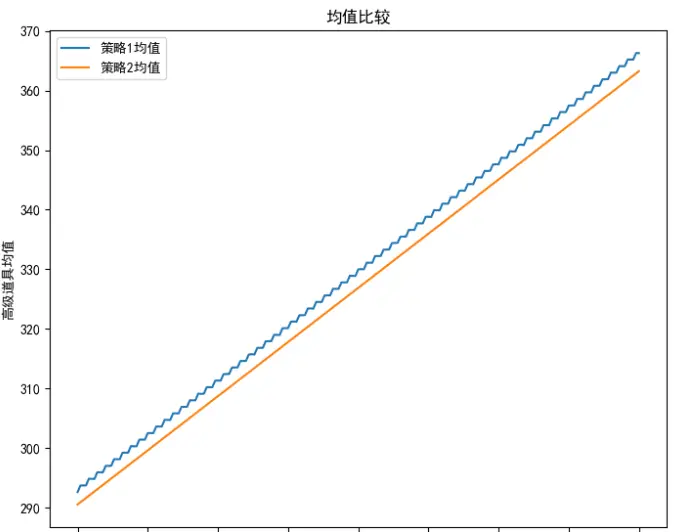

# Genshin Impact Probability: For Material Crafting, Should You Pick the 10% Double Output or the 25% Refund?


Plenty of people online have already computed the expected value, but no one seems to have computed the variance, so I'll fill that in here.

## 1. Setup

In Genshin Impact, **three low-level materials can be crafted into one high-level material**. We denote this as $a \xrightarrow{\text{转化}}\dfrac{b}{3}$

To keep units consistent, we uniformly **use b for both input and output**, assuming both sides start with initial material a, which is equivalent to $\dfrac{b}{3}$.

There are two talents, **as shown below**



-   One has a 10% chance of double output.

> Each time you use a materials, i.e. $\dfrac{b}{3}$ material, there is a 10% chance of directly producing $\dfrac{2}{3}b$ material.

-   The other has a 25% chance of refunding some low-level materials.

> Each time you use a materials, i.e. $\dfrac{b}{3}$ material, there is a 25% chance of returning $\dfrac{1}{3} \times \dfrac{1}{4}b$ material.

In terms of a **random variable**, that is:

$$X_{总产出}=\frac{b}{3}+Y_{额外产出}$$
## **2. Computing Expectation and Variance**

> **Plenty of people online have already computed the expected value, but no one seems to have computed the variance, so I'll fill that in here as well.**

### **(1) Expectation and Variance of the 10% Double Output**

**1. Expectation**

This is a **binomial discrete distribution**. 10% chance of double output, 90% chance of ordinary output.

As in Table 1:



$$
\mathrm{E}\_{{双倍}}[X]=\mathrm{E}\_{{双倍}}[\frac{b}{3}+Y\_{额外}]=\frac{b}{3}+np=10\% \times\frac{2}{3}b+90\% \times\frac{1}{3}b
$$
So investing a materials is equivalent to investing $\dfrac{b}{3}$ material, and the expectation of the 10% double talent is $E_{\text{双倍}}(\dfrac{b}{3})=\dfrac{11 b}{30} $ .

**2. Variance**

$$
\mathrm{Var}[X]=\mathrm{Var}[\frac{b}{3}+Y\_{额外产出}]=\mathrm{Var}[Y\_{额外产出}]
$$

$$
\mathrm{Var}[Y]=np(1-p)=\frac{b}{3}\times0.1\times0.9=\frac{3}{100}b
$$
So investing a materials is equivalent to investing $\dfrac{b}{3}$ material, and the variance of the 10% double talent is $Var_{\text{双倍}}(\dfrac{b}{3})=\dfrac{1}{100}b^2$.

### (2) Expectation and Variance of the 25% Refund

**1. Two ways to compute the expectation**

**Method 1: geometric series**

$$
\begin{align*}	
 E_{\text{返回}}\left(\frac{b}{3}\right)  
 &= \frac{b}{3} + \frac{b}{3} \times 25\\% \times \frac{1}{3} + \ldots + \frac{b}{3} \times \left(\frac{1}{12}\right)^n \newline	 
 &= \frac{b}{3} \times (1+{\frac{1}{12}}+{\frac{1}{12}}^2+...+{\frac{1}{12}}^n)  \newline	 	 
 &= \frac{b}{3} \times \frac{1 \times (1-{\frac{1}{12}}^n)}{1-\frac{1}{12}}  \newline	 
 \end{align*}
$$

$$
\lim_{n\rightarrow + \infty}E_{\text{返回}}\left(\frac{b}{3}\right)=\frac{b}{3} \times \frac{1 \times (1-{\frac{1}{12}}^n)}{1-\frac{1}{12}}=\frac{4b}{11}
$$

The illustration is as follows:



We can verify whether this classification has covered all cases by summing all the probabilities:

$$
\lim_{n\rightarrow +\infty}75\\%+...+{(25\\%)}^{n-1}75\\%=1
$$
All the corresponding probabilities sum to 1, which to some extent verifies that this classification is correct.

**Method 2: recursion**

**Because the refunded materials are refined again, a recursion forms, so we get:**
$$
E_{\text{返回}}\left(\frac{b}{3}\right)=\frac{b}{3} +E_{\text{返回}}\left(\frac{b}{3}\right)\times 25\% \times \frac{1}{3}
$$
 The answer is the same as above:

So investing a materials is equivalent to investing $\dfrac{b}{3}$ material, and the expectation of the 25% refund talent is $E_{\text{返回}}(\frac{b}{3} )=\frac{4b}{11}$.

**2. Variance**

The following approach to computing the variance comes from *[A More Refined Calculation of Whether to Pick the 10% Double or 25% Refund for the Material Crafting Talent](https://zhuanlan.zhihu.com/p/656792523)*

Now we continue by introducing a recurrence, and we have the following recurrence.

$$\mathrm{E}(a_k)=\mathrm{E}(a_{k-1})\times 25\% \times \dfrac{1}{3}$$
> Meaning: 
> 
> Before the $k$-th craft, you have $a_k$ low-level materials in hand. 
> 
> The condition for being able to do the $k$-th craft is: the $(k-1)$-th craft triggered the effect and refunded some low-level materials.

Using the law of total expectation, this is

$$
\mathrm{E}(a_k)=\mathrm{E}[\mathrm{E}[a_k| a_{k-1}]]=\mathrm{E}[\frac{1}{12}a_{k-1}]=\frac{1}{12}\mathrm{E}[a_{k-1}]
$$

$$
\mathrm{E}[X]=\sum_1^{k}a_k=\sum_1^{k}\frac{1}{12^k}a_0
$$
> This expression can be expanded as a recursion or as a geometric series — the two methods for computing the expectation above.


After introducing conditional expectation, next we introduce the variance decomposition formula:

$$
\mathrm{Var}[X]=\mathrm{E}[X^2]-[\mathrm{E}(X)]^2
$$
Rearranging and adding **conditional expectation**, we can get two expressions involving $\mathrm{E}(X|Y)$.

$$
\mathrm{Var}[\mathrm{E}(X|Y)]=\mathrm{E}\left\\{\left[\mathrm{E}(X|Y)\right]^{2}\right\\}-\left\\{\mathrm{E}\left[\mathrm{E}(X|Y)\right]\right\\}^{2}=\mathrm{E}\left\\{\left[\mathrm{E}(X|Y)\right]^{2}\right\\}-\left[\mathrm{E}(X)\right]^{2}
$$

$$
\mathrm{E}[\mathrm{Var}(X|Y)]=\mathrm{E}\left\\{\mathrm{E}(X^{2}|Y)-[\mathrm{E}(X|Y)]^{2}\right\\}=\mathrm{E}(X^2)-\mathrm{E}\left\\{\left[\mathrm{E}(X|Y)\right]^2\right\\}
$$

Adding the two expressions above gives the variance decomposition formula:

$$
\mathrm{Var}(X)=\mathrm{Var}[\mathrm{E}(X|Y)]+\mathrm{E}[\mathrm{Var}(X|Y)]
$$

Substituting $a_k, a_{k-1}$ into this formula:

$$
\mathrm{Var}(a_k)=\mathrm{Var}[\mathrm{E}(a_k|a_{{k-1}})]+\mathrm{E}[\mathrm{Var}(a_k|a_{k-1})]
$$
where

$$
\mathrm{Var}[\mathrm{E}(a_k|a_{{k-1}})]=\mathrm{Var}[\frac{1}{12}a_{k-1}]
$$
$$
\mathrm{E}[\mathrm{Var}(a_k|a_{k-1})]=\mathrm{E}[np(1-p)]=\mathrm{E}[np(1-p)]=\mathrm{E}\left[\frac{a_{k-1}}{16}\right]
$$
We get:

$$
\begin{aligned}\mathrm{Var}\left[a_k\right]=\frac{3}{4} \frac{a_0}{12^k}+\frac{1}{12^2} \mathrm{Var}\left[a_{k-1}\right]\end{aligned}
$$
Since $\mathrm{Var}(a_0)=0$, using the recursion we get the general term:

> I tossed it to GPT to compute and then verified it; it also satisfies the 144-fold relationship between variance terms:

$$
\mathrm{Var}[a_k]=\frac{9}{143}a_0\left(1-\frac{1}{144^k}\right)=a_0\times \frac{1}{16\times 144^{k-1}}
$$
$$
\mathrm{E}\left[a_k^2\right] = \mathrm{Var}[a_k] + \left(\mathrm{E}\left[a_k\right]\right)^2 =9\frac{k{a_0}}{12^{2k}} + \frac{a_0^2}{12^{2k}}
$$

Then we set the subsequent recursion to fuse $l$ times

$$
\begin{aligned} &\mathrm{E}\left[a_k a_\ell\right]=\mathrm{E}\left[\mathrm{E}\left[a_k a_\ell \mid a_\ell\right]\right]\\\\ &=\mathrm{E}\left[a_\ell \mathrm{E}\left[a_k \mid a_\ell\right]\right]\\\\ &=\frac{1}{12^{k-\ell}}\mathrm{E}\left[a_\ell^2\right]\\\\ &=\frac{9a_0^2l+a_0^2}{12^{k+\ell}} \end{aligned}
$$
This is to compute the covariance:

$$
\mathrm{Cov}(a_\ell, a_k) = \mathrm{E}\left[a_\ell a_k\right] - \mathrm{E}\left[a_\ell\right]\mathrm{E}\left[a_k\right]=\frac{9a_0^2\ell}{12^{k+\ell}}
$$
Substituting to compute the variance:

Because Genshin Impact crafts three into one:

$$
X_n=\sum\limits_{k=0}^n \frac{a_k}{3}
$$
We get the variance formula:

$$
\mathrm{Var}\left[X_n\right]  =\frac{1}{9}\left(\sum_{k=0}^n \mathrm{Var}\left[a_k\right]+2 \sum_{\ell<k} \mathrm{Cov}\left[a_{\ell} a_k\right]\right)
$$

Substituting gives:

> The part below was expanded by GPT; I can sense that the problem lies in the variance accumulation part — there can't be a standalone 1 term that can't be canceled out, because then it wouldn't converge.

$$
\begin{align*} \text{Var}[X_n] &= \frac{1}{9} \Bigg( \frac{9}{143} a_0 \left[ (n+1) - \frac{144}{143} \left( 1 - \frac{1}{144^{n+1}} \right) \right] \\\\&\quad + 2 \cdot \frac{9a_0^2}{11} \sum_{\ell=0}^{n-1} \frac{\ell}{12^{2\ell}} \left( 1 - \frac{1}{12^{n-\ell}} \right) \Bigg) \end{align*}
$$Next, let n tend to the limit.

Based on the code plot, eyeballing it, the limit should be around 0.009b, i.e. around 0.027a.

## 3. Conclusion and Computer Simulation

Fitting with code, it also matches the computed result:

- The 10% has a slightly higher expectation, but within 1000 materials the difference in expectation isn't large.
- The 25% has smaller variance fluctuation; it just needs more crafts, so the Mora cost is a bit higher.
- Considering Genshin Impact's 999 material cap, the expected high-level materials differ by only about 2-3.







Experiment code

```python
import random
import matplotlib.pyplot as plt
import numpy as np

# set matplotlib's font so it supports Chinese display
plt.rcParams['font.sans-serif'] = ['SimHei']  # used to display Chinese labels correctly
plt.rcParams['axes.unicode_minus'] = False  # used to display the minus sign correctly

# function that simulates crafting high-level items
def synthesize_items(low_items, strategy):
    high_items = 0
    while low_items >= 3:
        合成结果 = random.random()
        if strategy == 1:
            if 合成结果 < 0.1:
                high_items += 2  # additionally gain one high-level item
            else:
                high_items += 1
        elif strategy == 2:
            if 合成结果 < 0.25:
                low_items += 1  # refund one low-level item
            high_items += 1
        low_items -= 3
    return low_items, high_items

# simulate many crafts and compute the mean return and variance
def simulate_synthesis(low_items, strategy, trials=10000):
    results = []
    for _ in range(trials):
        _, high_items = synthesize_items(low_items, strategy)
        results.append(high_items)
    mean = np.mean(results)
    variance = np.var(results)
    return mean, variance

# plot the charts
def plot_results(means, variances, strategies):
    plt.figure(figsize=(14, 6))

    # plot the mean comparison chart
    plt.subplot(1, 2, 1)
    for strategy, data in means.items():
        plt.plot(data, label=f'策略{strategy}均值')
    plt.xlabel('低级道具数量')
    plt.ylabel('高级道具均值')
    plt.title('均值比较')
    plt.legend()

    # plot the variance comparison chart
    plt.subplot(1, 2, 2)
    for strategy, data in variances.items():
        plt.plot(data, label=f'策略{strategy}方差')
    plt.xlabel('低级道具数量')
    plt.ylabel('高级道具方差')
    plt.title('方差比较')
    plt.legend()

    plt.tight_layout()
    plt.savefig('results.png')  # save the chart as an image file

# main function
def main():
    num_items = range(1, 1001)  # range of the number of low-level items invested
    trials = 100000  # number of simulations
    strategy1_means = []
    strategy1_variances = []
    strategy2_means = []
    strategy2_variances = []

    for items in num_items:
        mean1, variance1 = simulate_synthesis(items, 1, trials)
        mean2, variance2 = simulate_synthesis(items, 2, trials)
        strategy1_means.append(mean1)
        strategy1_variances.append(variance1)
        strategy2_means.append(mean2)
        strategy2_variances.append(variance2)

    plot_results({
        1: strategy1_means,
        2: strategy2_means
    }, {
        1: strategy1_variances,
        2: strategy2_variances
    }, [1, 2])

if __name__ == '__main__':
    main()
```

For more discussion, see: [Genshin Impact Probability](https://zhuanlan.zhihu.com/p/648950822?)


---

> Author: [滑翔闪](https://github.com/hzp2333/hzp2333.github.io)  
> URL: https://blog.huaxiangshan.com/en/posts/genshin/  

