#  ArcGIS: Batch Converting TIF to Excel

> This post records the detailed steps so I can look them up again later.
>
> Though after speedrunning it, I realized the era seems to have already shifted from ArcMap to Pro......
>
> The great wind of life blows forth the world's spirit; only the old can see the destruction within......

In [Drawing GIS Colored Maps in Stata](https://blog.huaxiangshan.com/zh-cn/posts/statagis/) I introduced the shp-type files commonly used in GIS. In short, GIS's basic data structure needs three elements: coordinates, a unique identifier, and a measured value. Here I'll explain how to extract a cross-sectional Excel data file for administrative divisions from an administrative-division map file and a TIF map file.


graph TD; 
0(Get map file)==>1(Map main file .Shp); 
0(Get map file)==>11(Line main file .Shp);
0(Get map file)==>3(Table file .dbf); 
1(Map main file .Shp)==translate==>2(Map outline data);
11(Line main file .Shp)==translate==>9(Map line data);
3(Table file .dbf)==translate==>4(Label file); 
5(Data analysis file)==>6(Matching file); 
4(Label data)==>6(Matching file); 6(Matching file)==id identifier==>7(Plotting); 
2(Map outline data)==id identifier==>7(Plotting); 
9(Map line data)==id identifier==>7(Plotting)
 

# A quick guide to GIS

Official tutorial: [ArcGIS help](https://pro.arcgis.com/zh-cn/pro-app/latest/help/main/welcome-to-the-arcgis-pro-app-help.htm)

ArcGIS, as commercial software, is actually very easy to pick up. Like Excel, once you understand the layout you can grasp the basic usage.

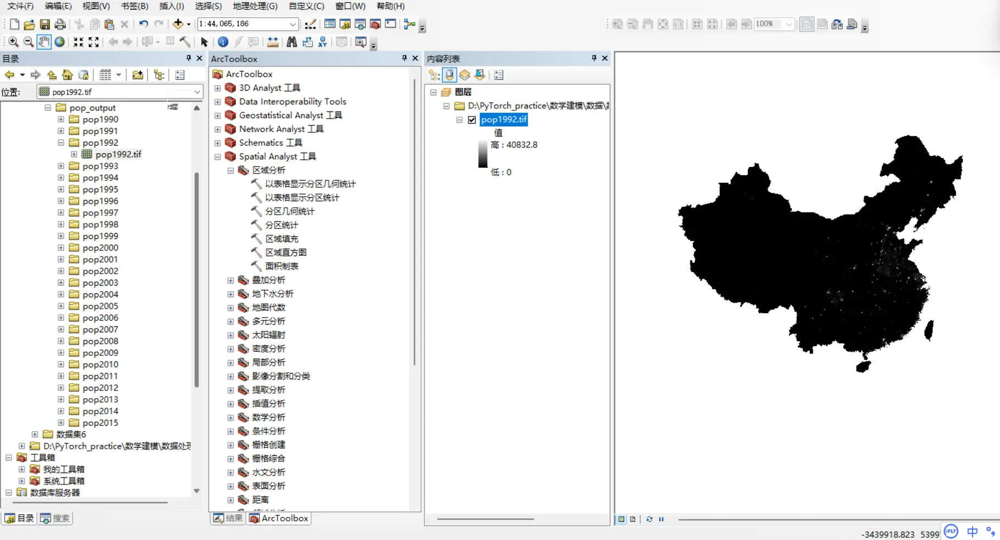

- As shown, the far left is the file area, for viewing working files.
- To its right is the tool list, with various tool functions to help process data files, so just follow the prompts.
- Further right is layer management.
- The far right is the drawing preview area; drop a GIS file in and you can see the image.

# GIS batch processing

## From point data to polygon data

Economics data analysis is generally province-, city-, and county-level panel data. GIS files are image files, which can be seen as point-set data, while administrative panels are block-shaped, i.e. polygon data. So our processing approach is to compute the average of the point data within each administrative area, then export.

Partition by the administrative-division shp.
Use the function `Spatial Analyst` - `Zonal` - `Zonal Statistics as Table` to connect the data map with the administrative-division map and compute the mean within each administrative area.

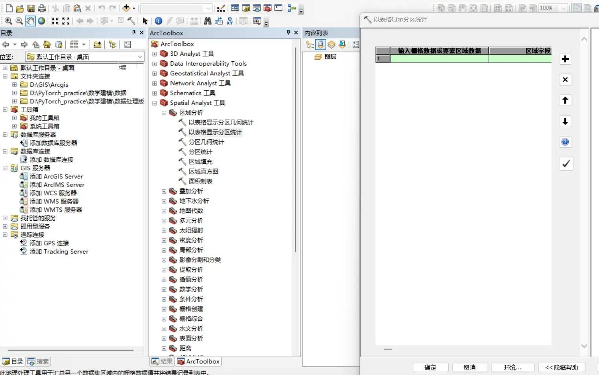

## The fake batch processing

For each method/function, right-click - Batch will pop up an Excel table of custom actions. It seems like you could set your repeated actions via Excel rows to batch-process quickly, but if you actually use it, you'll find the problem.

After defining n repeated actions this way, only the last-defined action is kept.

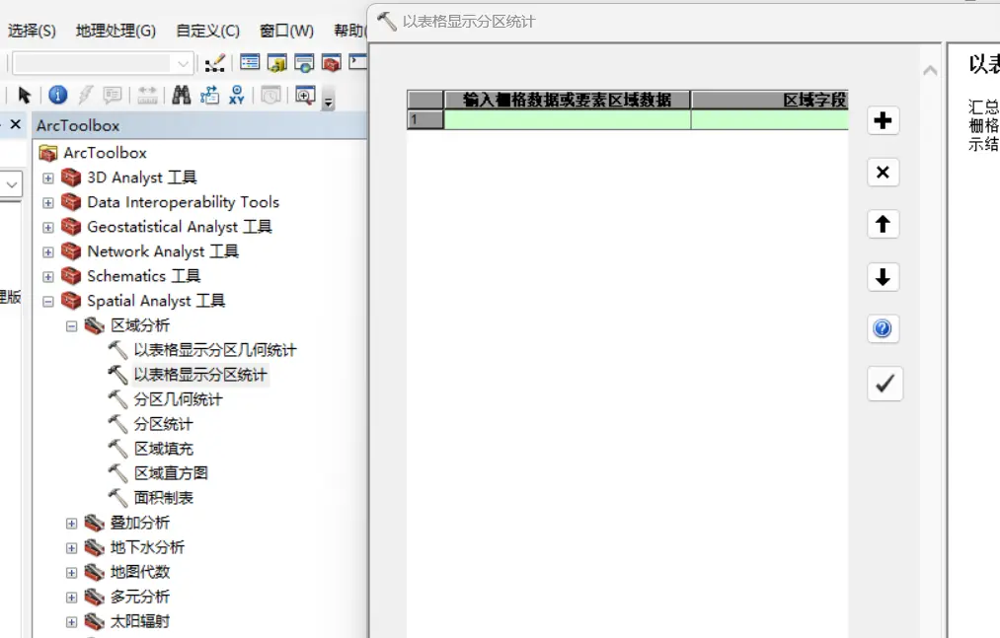

## The real batch processing

### Import the TIF files

Real batch processing means designing a flowchart by hand! Take the TIF data provided in the 2024 Huawei Mathematical Contest in Modeling as an example; put the TIFs in one folder (preferably named in English and with the .tif extension, to make the later connections easier).

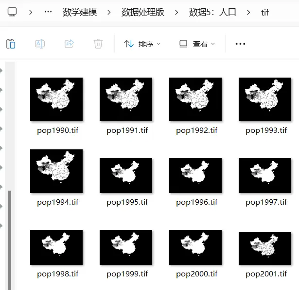

### Find the shp file

The principle was mentioned earlier — we want to convert the GIS point dataset into administrative-division panel data, for which we need the administrative-division shp map.

There are many resources on GitHub; you can also look in "[Drawing GIS Colored Maps in Stata](https://blog.huaxiangshan.com/zh-cn/posts/statagis/)".

### Design the flowchart

ArcGIS's real batch processing is drawing the flowchart yourself.

### Batch-converting TIF to table

First, right-click under the connected folder and create a new toolbox.

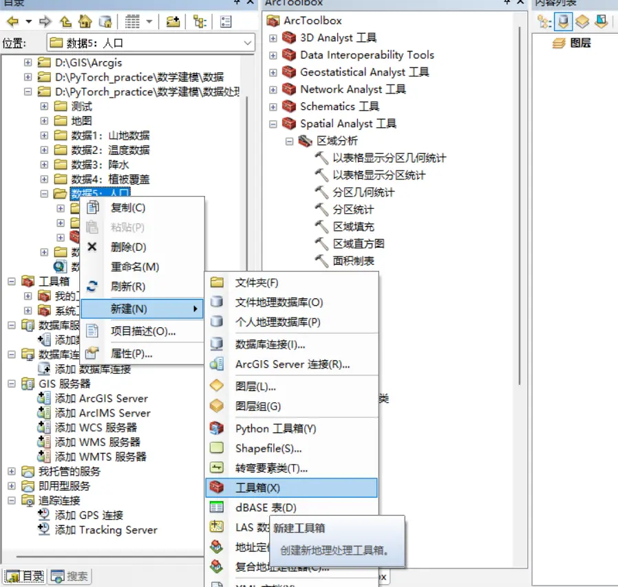

Then right-click under the toolbox to create a new model.

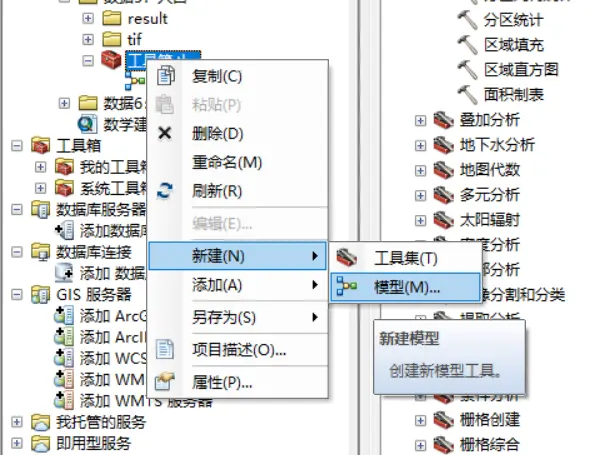

Open the model to edit it, and drag the functions you want from the toolbar.

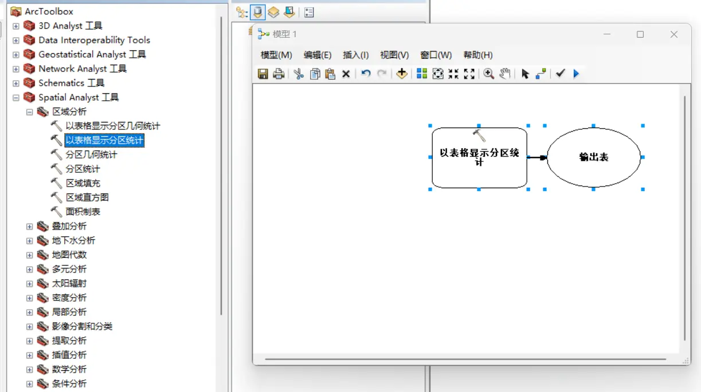

TIF is raster data; Insert - Iterators - Raster

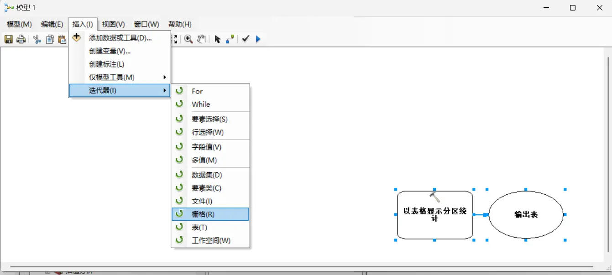

Double-click "Iterate Rasters". For workspace or raster catalog, choose the tif folder in the data folder; for raster format, choose TIF.

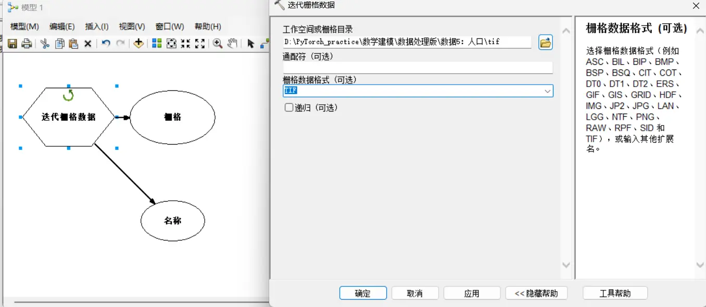

Insert - Model Only Tools - Parse Path

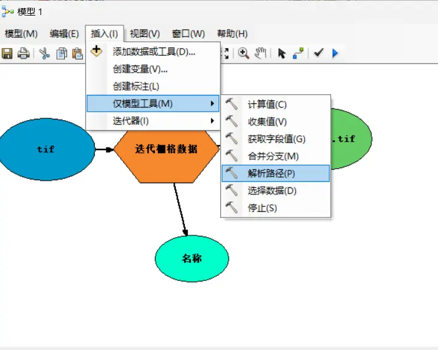

Drag the shp folder you found into the model frame. This post uses the `district.shp` file of the county-level administrative-division map.

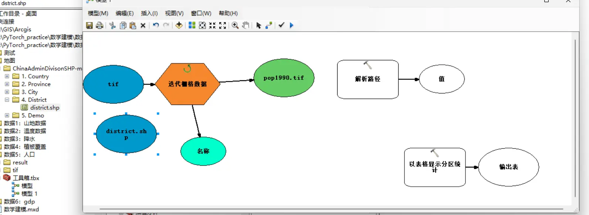

Switch to the connect tool

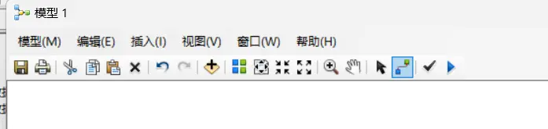

Connect from "Name" to "Parse Path", choosing "Input data element".

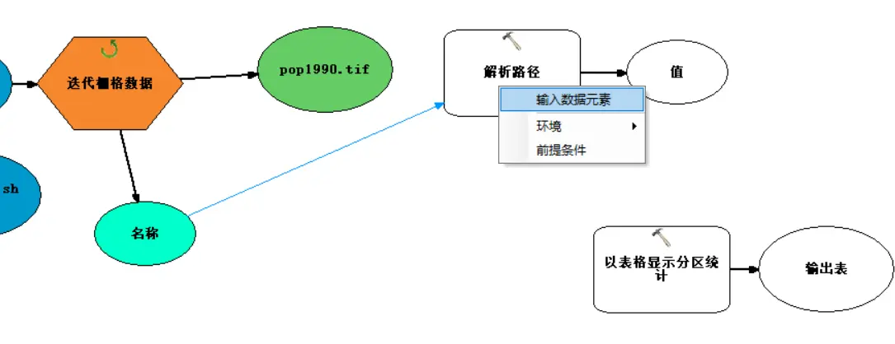

Double-click "Parse Path", and choose NAME as the parse type.

> So note: it's best for the tif filenames to be in the form `variable` + `number`, to make the pattern easy to recognize. Best to name all looped files with this kind of structure.

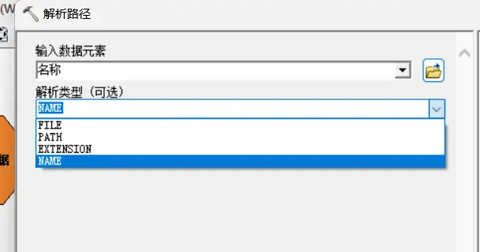

Next is the operation of connecting parameters.

1. Connect from "Value" to "Zonal Statistics as Table", choosing "Environments" - "Output config keyword".
2. Connect from "the first recognized tif data (in this example `pop1990.tif`)" to "Zonal Statistics as Table", choosing "Input value raster".
2. Connect from "the first recognized tif data (in this example `pop1990.tif`)" to "Zonal Statistics as Table", choosing "Input value raster".
3. Connect from "the shp file (in this example `district.shp`)" to "Zonal Statistics as Table", choosing "Input raster or feature zone data".

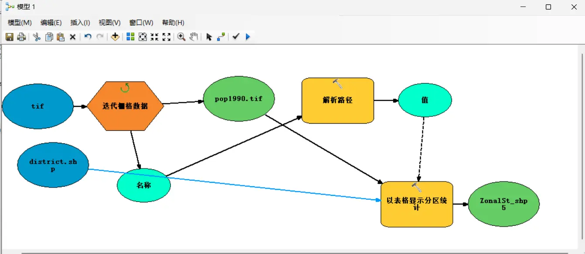

Double-click `ZonalSt_shp5`. Change "Look in" to the result folder inside the folder (if there isn't one, you can create one on the fly in the dialog), and change "Name" to `%value%`.

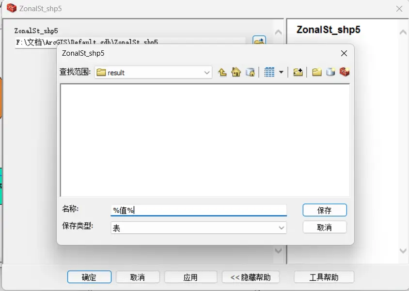

Right-click the tif module and choose Model Parameter.

> Don't forget at this point to switch from connect mode to select mode in the top toolbar, so that right-clicking selects.

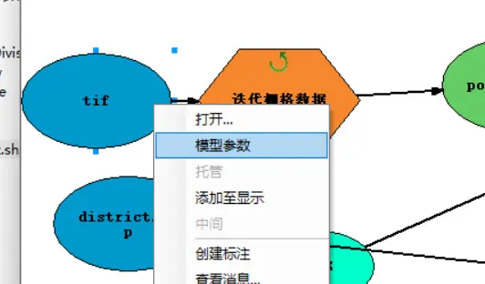

Right-click the zone-division module (in this post, district.shp), and choose Model Parameter.

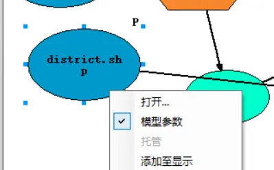

The Auto Layout button at the top can help us tidy up the layout.

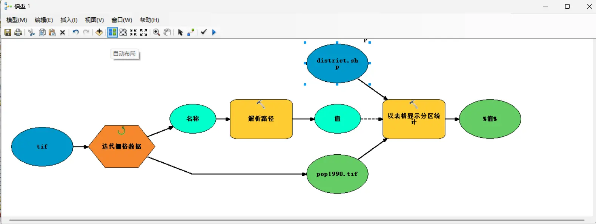
### Batch-converting tables to Excel

Continue adding on top of the previous flowchart.

Drag the "Table to Excel" tool from "Toolbox - Conversion Tools - Excel" into the model frame.

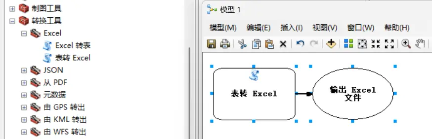

Connect "%value%" to "Table to Excel", choosing Input table.

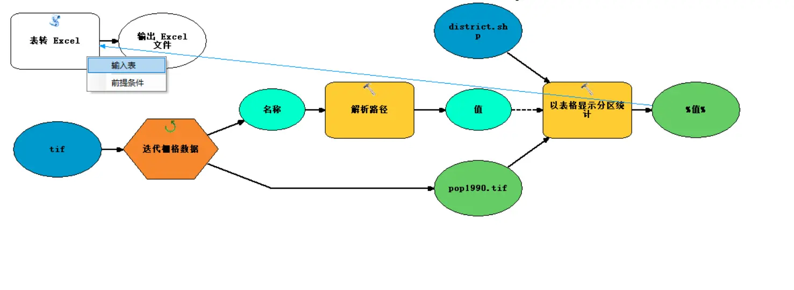

Double-click `%value%\_TableToExcel.xls`, choose the folder for the save path, and set the filename to `%value%\_TableToExcel.xls`.

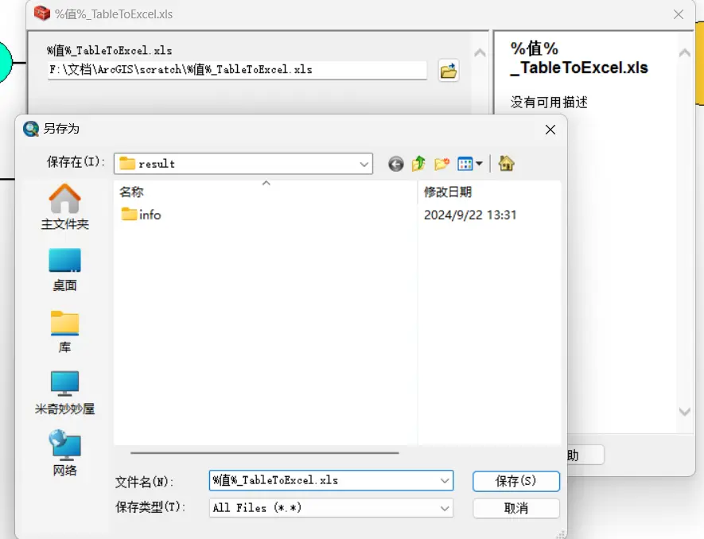

After drawing the flowchart, click the model's OK to run it.

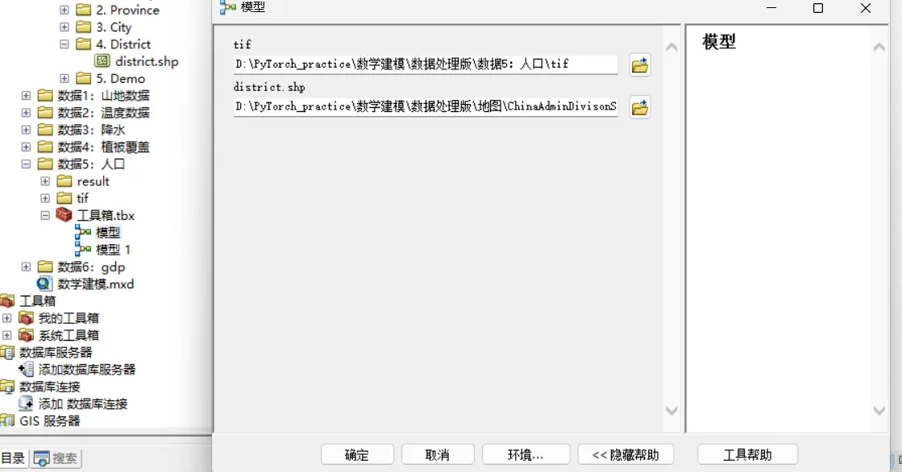

## Other tips

If the operations are all correct, but reading stops partway and says there's a reading problem, the most likely causes are:

- The GIS file isn't in `.tif` format.
- The folder name is in Chinese.
- The data filenames aren't structured — for example, both `1990pop.tif` and `pop1998.tif` appear at the same time.
- It's best to keep the Result folder and the tif folder in the same-level directory.

---

> Author: [滑翔闪](https://github.com/hzp2333/hzp2333.github.io)  
> URL: https://blog.huaxiangshan.com/en/posts/gis/  

