# ArcGIS Pro: A Quick Operations Guide

> Notes on spatial analysis and technical methods (simple hands-on practice).
## Spatial econometrics

### Spatial relationships

What is regional economics? Its core is using **spatial data** to characterize **spatial relationships**. Spatial data needs data and location. **Location** isn't just latitude and longitude, but also distance. **Distance** isn't just spatial distance; cultural similarity can also be seen as a kind of distance, as can the degree of a relationship (provincial GDP ranking, closeness between peers). There are also many ways to define **locational relationships** — point adjacency, edge adjacency, etc.

### Why we need spatial econometrics

Recommended reading: *[Introduction to Spatial Econometrics](https://zh.z-library.ec/book/16726690/efe0c9/%E7%A9%BA%E9%97%B4%E8%AE%A1%E9%87%8F%E7%BB%8F%E6%B5%8E%E5%AD%A6%E5%AF%BC%E8%AE%BA.html?ts=1509)* (James LeSage / R. Kelley Pace)

- **Spatial dependence**: the values at different observation points influence each other.
	- **Competition, cooperation, imitation, diffusion (spatial spillovers), rivalry**...... 
	- This endogeneity could be that x in location a affects y in location b; or that y in a directly affects y in b.
- **Spatial autocorrelation**: a measure of spatial dependence.
	- **Spatial heterogeneity**: spatial dependence is not evenly distributed. With domestic data, for example, the Northeast might have negative correlation across many internal locations, while the Southwest has positive correlation internally.
	- Measurement is also divided into global autocorrelation and local autocorrelation.

Therefore, different spatial autocorrelations need to be estimated with different models.

## Software versions

- R, Stata, and MATLAB each have suitable spatial econometrics packages.
- [GeoDa](https://geodacenter.github.io/zh-Hans/) is a free, open-source spatial econometrics software.
- **The focus is GIS software**: if you choose the [ArcGIS](https://www.arcgis.com/index.html) line, it's divided into the old series and the Pro series.
- ArcGIS Pro is an upgrade of ArcGIS, but it's still iterating and unstable; **in theory Pro can be compatible with all old versions**. Because the country needs version stability, the surveying industry generally requires `arcgis 10.2` or `arcgis 10.8`. Most online tutorials also target the old ArcGIS versions.

I'm an economics major, not a professional surveyor, so following "learn the new, not the old," I chose ArcGIS Pro. The official help documentation can be found at [the official website](https://pro.arcgis.com/zh-cn/pro-app/latest/get-started/get-started.htm).

> I've used the old version before too; the steps I recorded were [converting tif to Excel](https://blog.huaxiangshan.com/zh-cn/posts/gis/). I feel the Pro version's interface is cleaner and nicer-looking.

## Operations

### Basic setup

Learning Stata requires cultivating good habits for managing code files, e.g. starting from do-files, and GIS likewise starts from **creating a directory**. The new directory is your own project.

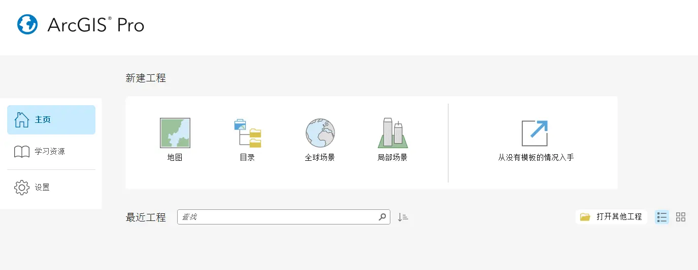

Here I created a new map (`Insert` - `New Map`), currently the default online global map. Click anywhere on the map to formally start the project. If you're not happy with the page layout, drag the panels around to reposition them.

You can see along the **right edge**:

- Catalog: the `Add Folder` in the Insert interface lets you add other folders to the catalog. Later, create processing layers in the catalog folder. If you have map data (`.geodatabase` files), you can also load the map file into the catalog's database via the `Connect` option in the Insert interface.
- Geoprocessing: the main analysis tools.
- Attributes: data attributes, since the data may be boundary outlines or point/polygon data.
- History: operation history.

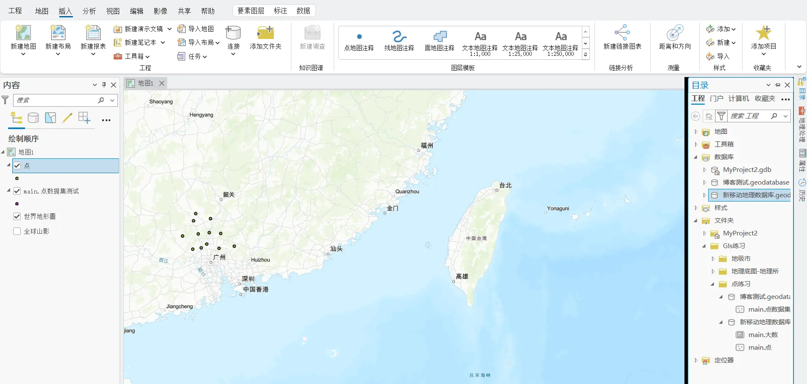

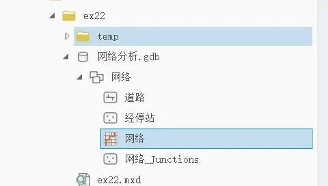

The whole file-catalog environment is essentially computer folders. Creating a `.gdb` is really creating a folder for a GIS project. Under the `.gdb` you can create a feature dataset. And under the feature dataset is where the GIS data are stored. For example, in the figure it's `ex22 - network analysis - network - with a bunch of dataset files under it`.

Every time you create a new environment you create a `.gdb`, then create a database under it, and then import the data you want to use.

### Buffer analysis

A buffer is a range delimited around a boundary or a point.

> *"Immediate Results upon Erecting the Pole": Strategic Environmental Regulation and the Structural Improvement of Environmental Quality* (2024, *China Economic Quarterly* (Chinese)) makes use of the buffer strategy.
> 
> The study finds that after monitoring stations were set up, the PM2.5 concentration within 4 km of a station fell by 0.74 percentage points more than in the 4-8 km zone, indicating a structural improvement in environmental quality around the stations (local authorities deliberately sprayed water near the monitoring stations to beautify their assessment metrics). Its buffer analysis **used GIS software to identify the 4 km zone around each monitoring station**.

Right-click the folder we added under the `Catalog` page in the right sidebar.

1. Right-click and create a `Mobile Geodatabase`.
2. Right-click the new `Mobile Geodatabase`.
3. Create a `Feature Class`: choose the point data type, and follow the prompts for the rest.
4. You can see the newly created point data already in the content pane on the left.

At this point, continue by clicking `Edit` - `Create`, then click anywhere on the page to create point locations. Similarly, follow the earlier steps to create a `polygon feature class`, and the corresponding editing creates different polygon data.

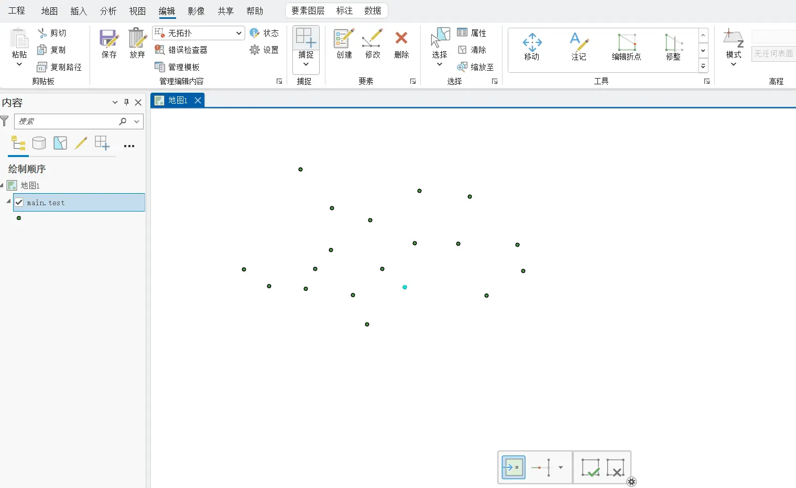 

At this point, click the `Geoprocessing toolbar` (the toolbox-shaped icon), then follow the prompts to choose. For example, here I ran a buffer analysis on the point data, requiring it to delineate a 100000-meter zone around each point; the result is shown below. Buffers can of course also target line data.

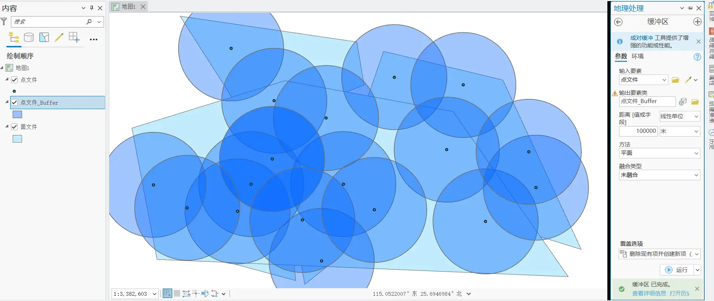

### Proximity analysis

Going further, the tool used here is Generate Near Table.

For example, here the input features and near features are both the same point dataset, meaning **which point is closest to each point**?

After outputting the table data, right-click to open it. If you want a visual comparison, right-click `Contents` - `point file` - `Labels` to add labels. The situation is like this: for example, the first point is closest to the second point.

Proximity analysis can analyze the adjacency relationships among points, lines, and polygons.

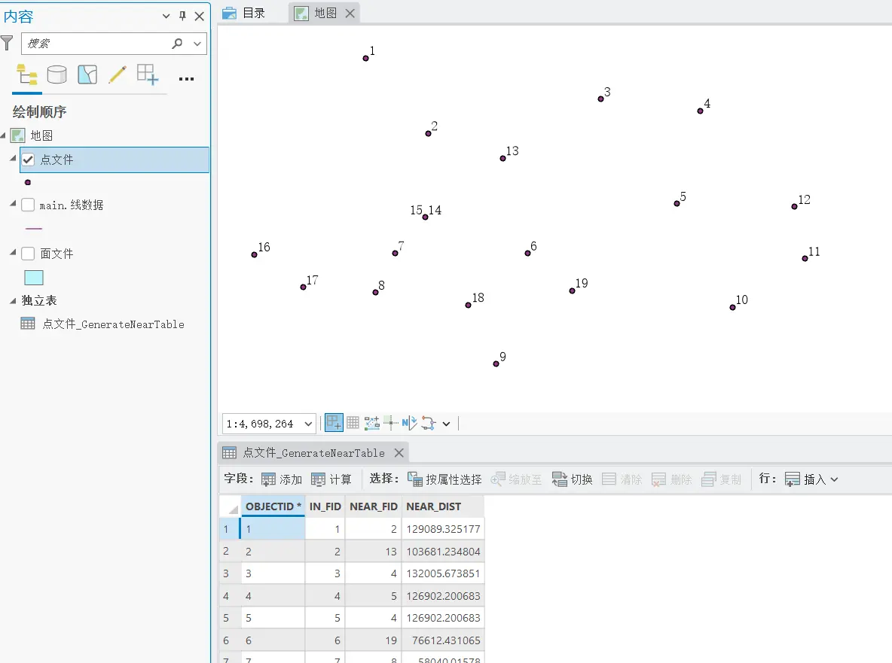

The near table only joins FID by default; if you want to add name labels, right-click the output near-result table and choose `Add Join`.

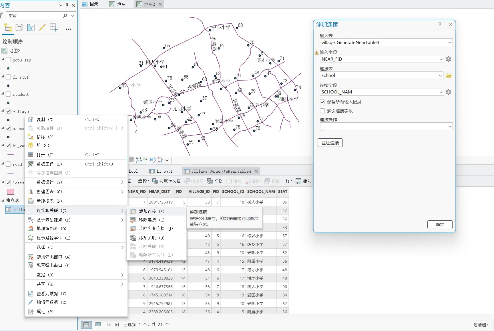

### Raster data

GIS has vector, raster, and image data. In fact, remote-sensing images are also raster data, divided and colored through a grid — like the pixel concept of a phone photo.

Different vector-to-raster interpolation methods yield different results. For example, characterizing **urban form** in regional economics is actually quite difficult — **what if there's a big mountain or river in the middle of the city? How do you interpolate then?**

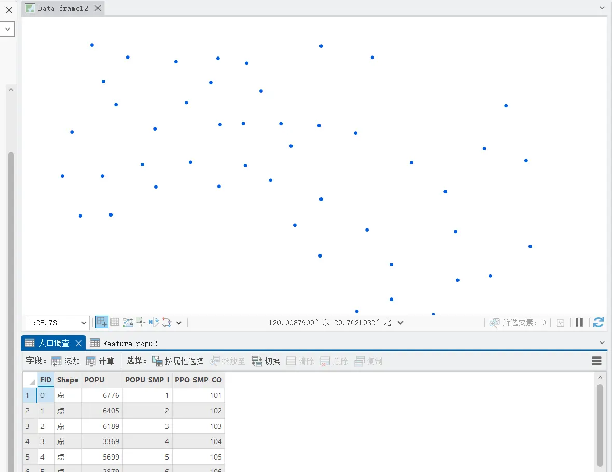

You can convert via the `Feature to Raster` command — typically coloring uniformly into the corresponding grid cells.

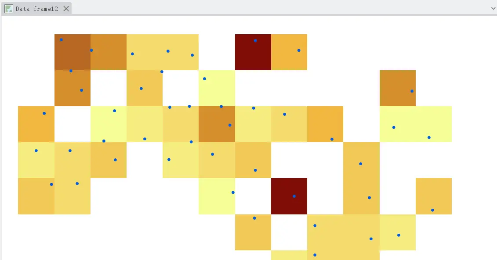

Use interpolation for filling; here I use the **Inverse Distance Weighting** method in `Interpolation`.

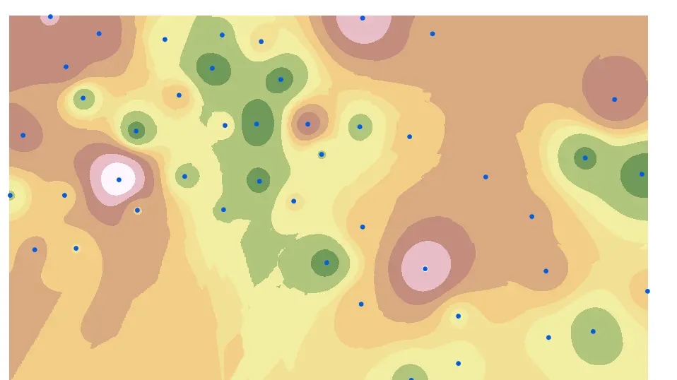

Use `Density` for calculation; here I use `Kernel Density` estimation.

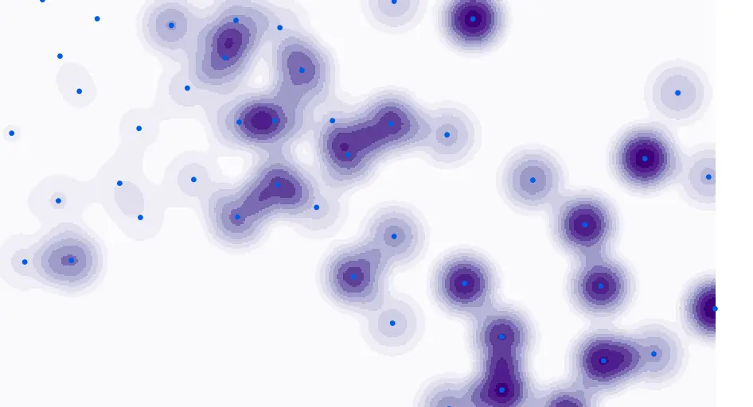

In addition, via `Surface - Contour` you can insert contour lines.

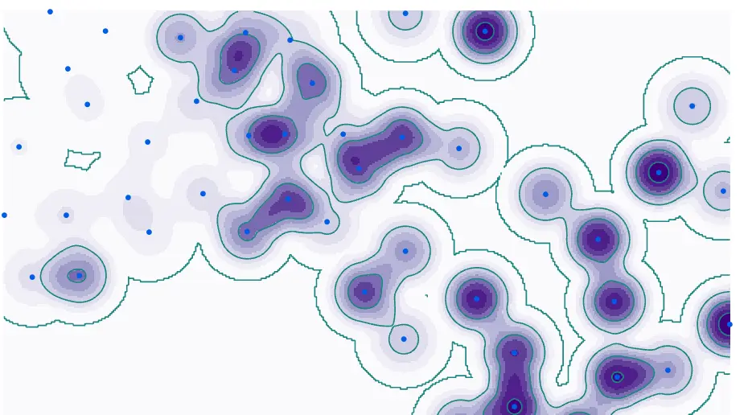

If you want to change the classification levels, right-click the layer and click `Symbology` to modify it.

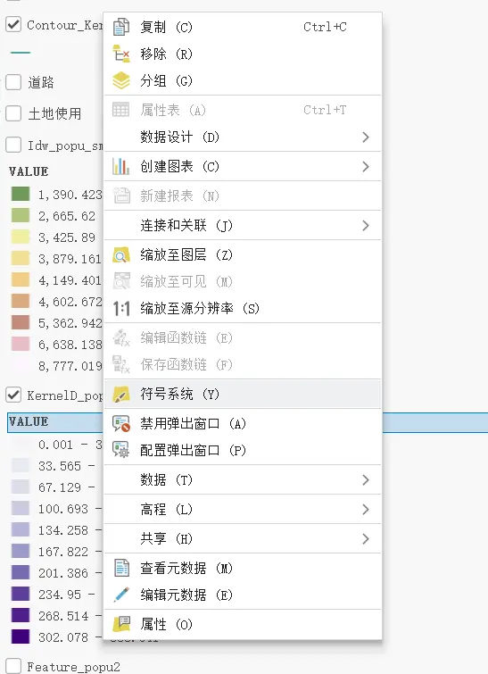

For example, in urban planning, we have vector density maps of urban land-use planning, population density, school distribution, and road traffic. Next, thinking about where to build a new school, we can use `Map Algebra - Raster Calculator` to overlay and compute the value of each raster.

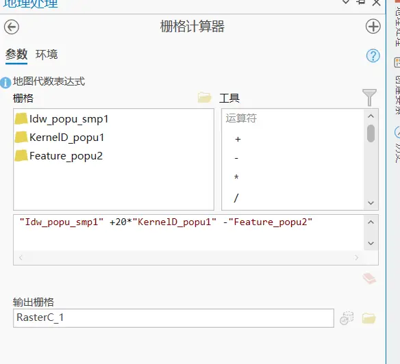

For example, where population flow is high, add five points; where there's a mountain, subtract five; where there's school coverage, subtract five — ultimately getting a raster score for building a new school.

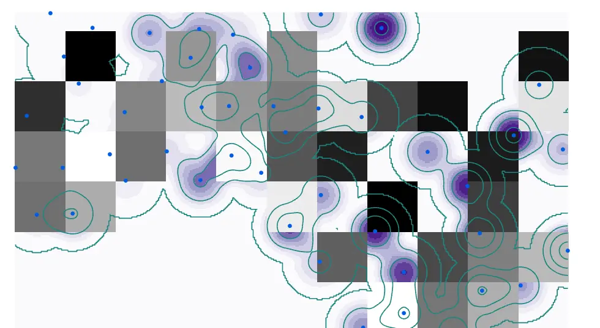
### Network analysis

---

> Author: [滑翔闪](https://github.com/hzp2333/hzp2333.github.io)  
> URL: https://blog.huaxiangshan.com/en/posts/gis_econ/  

