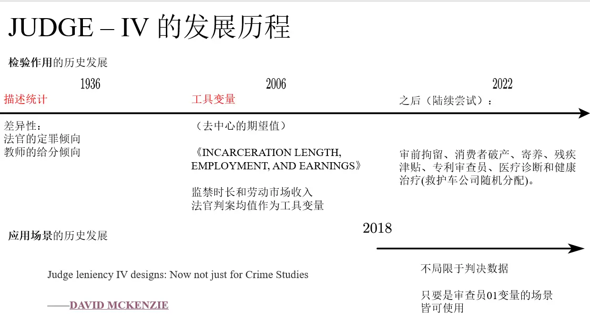
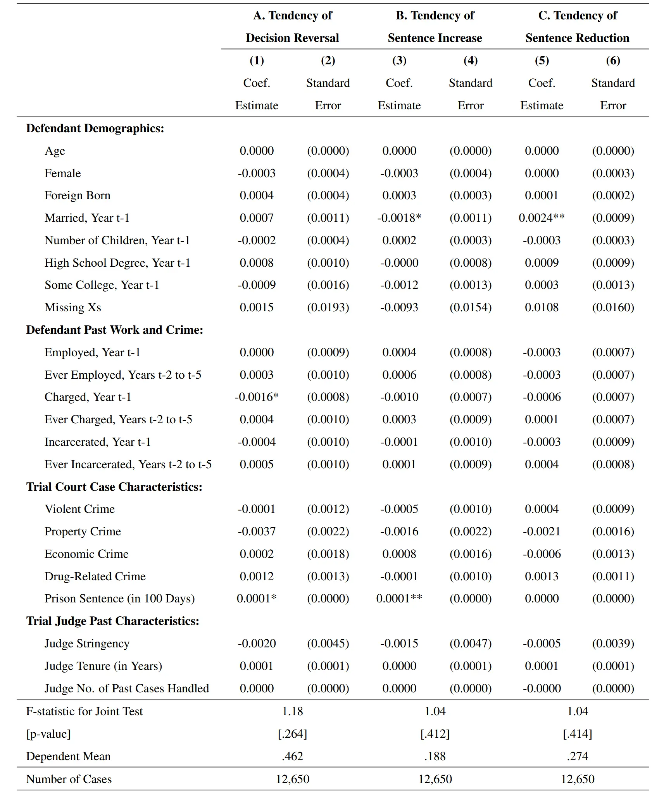
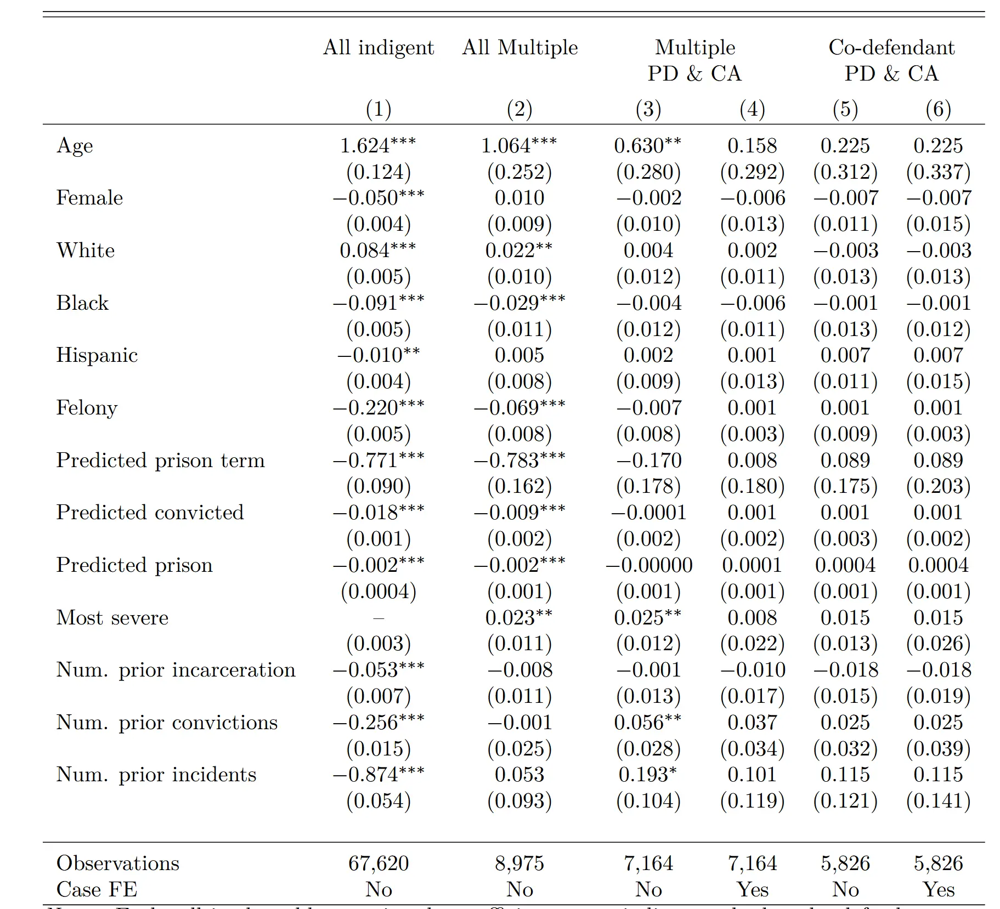
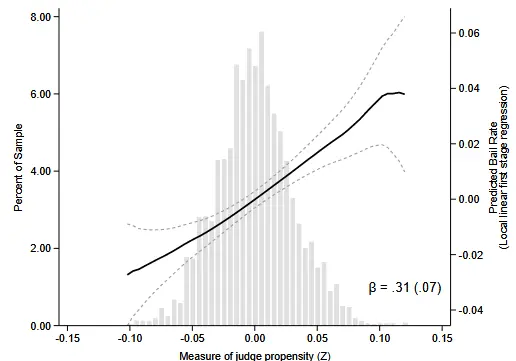
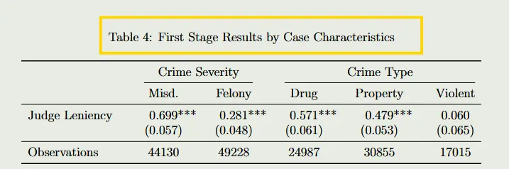

#  Judge IV (Examiner Designs): Causal Inference via Random Assignment

> Finding simplicity amid chaos — Einstein

Nature is full of magic. **Random assignment** makes natural experiments possible, and it is one of the foundational stones from which causal inference springs[^2]. It is generally held that random assignment averages out the bias related to the explanatory variable, thereby yielding treatment and control groups with good properties. In 2022, an instrumental-variable idea based on random assignment began to appear more and more frequently in the top-five economics journals.

## Development

An example:

- In a large standardized exam we pray we'll get a kind grader.
- When applying for a loan we pray we'll meet a lenient examiner.
- When traveling we pray we'll meet a kind passerby.

The random assignment of fate is full of magic: some people really are randomly assigned to more lenient examiners, and so their fate diverges from that of the people randomly assigned to strict examiners. This is the core causal idea of `Judge_IV`: first quantify how strict these examiners are, then compare the later development of the groups randomly assigned to their hands, and thus obtain a kind of causal inference based on random assignment.

> Judge leniency IV designs: Now not just for Crime Studies
> ——[David McKenzie](https://blogs.worldbank.org/en/team/d/david-mckenzie)

JUDGE–IV can also be called Examiner Designs, or Judge leniency IV designs. The idea of this kind of instrumental variable originated in descriptive statistics, when people tallied the grading and ruling tendencies of different teachers and different judges and found significant differences. In 2006 a paper directly used this instrumental variable for testing.

The construction of the instrumental variable is very simple, and similar to the construction of other instrumental variables[^1] — a **de-meaned mean expectation**.

Since 2018, studies have continually extended this method. This measure focuses on the examiner's strictness. Simply put, it is the probability of `{pass, fail}`. The de-meaned mathematical expectation ranges between 0 and 1 and is used to measure strictness.

That is to say, as long as you have randomly assigned examiners and a directional outcome, you can try using Judge IV. For example, whether a domestic-violence investigator chooses to take the child away; ambulance companies in the U.S. are randomly assigned, but their prices vary and can have different effects in a rescue; some mortgage examiners are careless and pass loan applications very easily...

## Empirical Analysis

- Define the **explanatory variable** $D_i$: it represents the direction of the examiner's decision, 1 for pass and 0 for fail.
- Define the **instrumental variable** $Z_{a_{\{-i\}} }$: it represents the pass rate of the examiner's **other cases excluding the current one**.

The two-stage regression is then:

$$
\text{First stage:}D_i=Z_{a(-i)}\pi+\nu_i
$$
$$
\text{Second stage:}Y_i=\alpha+\delta D_i+\epsilon_i
$$



The **difference in later development** of the reviewed subjects after being randomly assigned to examiners of different inclinations.

Written in the form of a moment estimator, the instrumental variable can be seen as a kind of sample weight (a special moment condition in the GMM framework), and what is compared here is the difference in behavior among those assigned to judges of similar strictness. This is also similar in effect to sample matching.



An ordinary IV cannot test a variable's exclusion restriction and monotonicity and can only supplement them through theoretical exposition, but Judge IV's advantage is that it can test the instrument's monotonicity and exclusion restriction through experimental design[^3].

### Random Assignment

#### Example One

> Regress sample characteristics on the instrumental variable or the explanatory variable; if the coefficients are insignificant, or the F-test does not pass, it shows that sample characteristics do not intervene in the explanatory variable, that is, the explanatory variable is exogenous.

In "Feedback and Learning: The Causal Effects of Reversals on Judicial Decision-Making," the authors regress case characteristic variables on the reversal direction of the case (the instrumental variable); all are insignificant, verifying random assignment. That is, the case outcome is unrelated to the judge's characteristics, and each case is randomly assigned to a different judge.

Random assignment also proves the instrument's **exclusion restriction**. A judge randomly draws a case and rules on it, cutting off factors other than the judge's own temperament (for example, trading power for money).

Above, the explanatory variable is regressed on other characteristics, and random assignment is tested through the F-test.

#### Example Two

The [2025 Sloan award-winning](https://escholarship.org/uc/item/3sd0f741) doctoral dissertation below studies the random assignment of lawyers: poor defendants are randomly assigned to public- and private-organization defense lawyers. Using lawyer characteristics as an instrumental variable and regressing them on assignment type, the economic coefficients are close to 0 and insignificant, showing little difference between groups and thus random assignment.

### Visualizing the First-Stage Regression

#### Monotonicity Test 1: Average Monotonicity

The first-stage regression tests monotonicity and relevance at the same time.

$$
\text{First stage:}D_i=Z_{a(-i)}\pi+\nu_i
$$

The coding idea is: first use the Frisch–Waugh–Lovell theorem to regress the explanatory variable and the instrumental variable separately on control variables such as fixed effects, standardize the residuals, and then use the residuals for local linear fitting (the Stata command is `lpoly`).

The results from "Examiner and Judge Designs in Economics: A Practitioner's Guide" are shown below. It studies the relationship between judges of different inclinations and whether incarceration is chosen.

The horizontal axis is the standardized instrumental-variable residual, measuring the examiner's strictness. The vertical axis is the residual of the corresponding explanatory variable (the review outcome of the specific event). The **local** fit takes the shape of a **positively correlated** **straight line** and passes the test. **This test generally uses a second-degree polynomial local regression**.



The answer is no — a positive correlation and a relatively smooth straight-line **trend** are both indispensable.

A positive fitted coefficient means that when a case is assigned to a stricter (or more lenient) examiner, the probability of failing (or passing) is correspondingly higher. The fitted coefficient further back must be higher than the one further ahead, to show that a case that would pass in a lenient judge's hands is not easily passed in a strict judge's hands.

A positive coefficient not only verifies the relevance between the explanatory variable and the dependent variable, but also verifies the monotonicity of the pass rate across judges.



#### Monotonicity Test 2: Multi-Peaked Preferences

A judge should not be strict with some types of cases and lenient with others. One can try classifying cases by type and by severity and running the first-stage regression test. The grouping angles demonstrated in "Judging Judge Fixed Effects" are case type and case severity.

## Points Still Worth Discussing

- Judge IV's construction is very simple, but whether it can be used in a specific setting[^6] and how to test it are still worth discussing — especially the monotonicity of the instrument.
- Must an examiner design be a discrete variable? Can it not be a continuous one? How would negative weights affect the estimates[^4]?
- What if an event has multiple examiners?[^5]
- Where does Judge IV's asymptotic requirement show up? Should one focus on the number of times a subject is reviewed, or on the examiner's number of cases? Personally I think both sample sizes matter.

Haven't many people had this thought? If at some moment we had met someone else, would our lives have turned out differently? Random assignment always makes me think about the relationship between chance and necessity. Necessity within chance — someone is bound to win the lottery; it is only by chance that the winner is you. Once we know about random assignment, how should we regard fate? For a person, should they choose the upper bound of chance, or the lower bound of the mean[^7]?

## Recommended References

### Course Materials

For now, reference materials outside journal papers on Judge IV are relatively scarce:

[A Causal Inference Method You May Never Use in Your Life: The Lenient-Judge Instrumental Variable](https://mp.weixin.qq.com/s/ZKEOQgUdBB_2vsTnSQw4bw)

[A blog post by a World Bank economist writing for the Development Economics column](https://blogs.worldbank.org/en/impactevaluations/judge-leniency-iv-designs-now-not-just-crime-studies)

I particularly recommend following their [econometric-techniques topics](https://blogs.worldbank.org/en/impactevaluations/curated-list-our-postings-technical-topics-your-one-stop-shop-methodology-0) column.

[A Yale PhD teaching assistant's course (econometrics topics)](https://www.youtube.com/watch?v=Aa0i54jxFa8)

### Some AER Papers Discussing Judge IV

- [Monotonicity among Judges: Evidence from Judicial Panels and Consequences for Judge IV Designs](https://www.aeaweb.org/articles?id=10.1257/aer.20231104) (AER, 2026)
- [Judging judge fixed effects](https://www.aeaweb.org/articles?id=10.1257/aer.20201860) (AER, 2023)

[^1]: Some ideas for finding instruments: relationships of relationships, distant historical variables, averaging, growth rates, and combinations of the preceding. For example, the shift-share instrumental variable is a de-meaned average plus a growth rate.
[^2]: We can view the development of econometrics along two lines: optimization and causal inference. Optimization is about how to enhance the consistency of measurement; causal inference makes us think about how to design the experimental process.
[^3]: All econometric tests test necessary conditions rather than sufficient ones.
[^4]: Bhuller M, Sigstad H. 2SLS with multiple treatments[J]. Journal of Econometrics, 2024, 242(1): 105785.
[^5]: Chyn E, Frandsen B, Leslie E C. Examiner and Judge Designs in Economics: A Practitioner's Guide[R]. National Bureau of Economic Research, 2024.
[^6]: At present the relatively mature testing setting is judicial data, but the paradigm for other settings still has no settled answer.
[^7]: Actually these aspects are more related to the theory of uncertainty.

---

> Author: [滑翔闪](https://github.com/hzp2333/hzp2333.github.io)  
> URL: https://blog.huaxiangshan.com/en/posts/judge_iv/  

