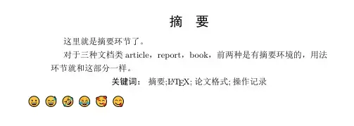
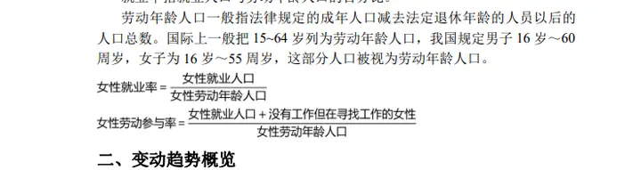
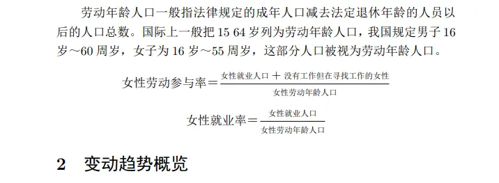
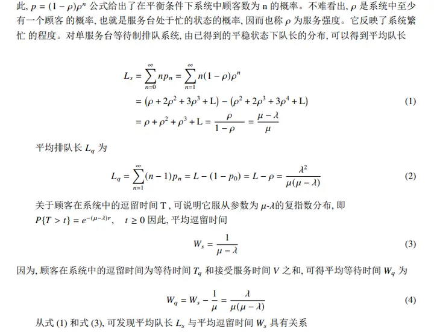

# How to Get Started with LaTeX in One Hour?


I got into LaTeX through a senior's WeChat Moments post. I'm recording the learning process here, and also compiling the useful posts I've read recently.

## What is LaTeX?

> LaTeX (/ˈlɑːtɛx/, often pronounced /ˈlɑːtɛk/ or /ˈleɪtɛk/) is a high-quality typesetting system based on TeX, developed in the early 1980s by the American computer scientist Leslie Lamport. It is very suitable for producing high-print-quality scientific, mathematical, and physics documents, and is especially good at typesetting complex tables and math formulas. LaTeX is the de facto standard for scientific literature exchange and publication. (Wikipedia)

- Word: what you see is what you get
- LaTeX: the typesetting format and the text content are separate

(The typesetting is adjusted through code, and the best part is the various packages — you call them to do all sorts of things, like inserting a few emoji into your article~)



For me, LaTeX's typesetting is genuinely beautiful, and getting a comfortable layout just right is very satisfying. If your article contains **a lot of math formulas, figures, and tables**, then LaTeX is definitely the better choice~







## Download and installation

You don't have to download it; there are online LaTeX editing websites. You can skip this part and look at the LaTeX websites later.

LaTeX has many versions: LaTeX, Ctex... and the corresponding coding environment configurations also have many versions: winedit, studio...

Personally I recommend the following setup (for Windows): `texlive` + `texstudio`

Reason: beginner-friendly, with Chinese UI support (winedit's UI is English-only)

[LaTeX download tutorial]( https://blog.csdn.net/SevenBerry/article/details/126692374 ): picked at random; you can find a newer one yourself.

> The tutorial I originally found was from 2018, but the 2021 installation turned out a bit different. The one linked here is the 2022 version.

## Quick start (within two hours)

> Tips before opening the link:
> 
> One part in it no longer works after a Windows update — "how to make LaTeX support Chinese text". The corrected code is in the code block below the link:



```
\usepackage[fontset=windows]{ctex} 
%The percent sign means "comment"
%usepackage is like adding a package, like downloading an app to your phone or a plugin to your browser; with a package you can do more things
%After a Windows upgrade, use this to conveniently output or recognize Chinese
```

If the built-in PDF preview won't display, the PDF reader might be to blame.

## Advanced tutorial (what you need for papers)

Supplementing what the video above doesn't cover.

### Two ways to cite

[LaTeX bibliography insertion methods (both complete)](https://blog.csdn.net/weixin_44378800/article/details/109905695?spm=1001.2101.3001.6661.1&utm_medium=distribute.pc_relevant_t0.none-task-blog-2%7Edefault%7ECTRLIST%7ERate-1.pc_relevant_paycolumn_v3&depth_1-utm_source=distribute.pc_relevant_t0.none-task-blog-2%7Edefault%7ECTRLIST%7ERate-1.pc_relevant_paycolumn_v3&utm_relevant_index=1)

If the first method (BiB format) doesn't compile:

1. Check whether the bib format or the cited entry has any weird symbols
2. The compilation order and number of compilations are wrong
3. Restart and try again

### Supplement: how to convert CNKI references to BIB format?

My approach is the Tampermonkey plugin (a college student's online-course lifesaver!).
Firefox, QQ Browser, Edge, and Chrome all support the Tampermonkey plugin.
- [Tampermonkey plugin download](https://www.tampermonkey.net/index.php?browser=chrome&locale=zh)
- [Plugin script download](https://greasyfork.org/zh-CN/scripts?page=2)
- [CNKI references bibtex](https://greasyfork.org/zh-CN/scripts/393305-%E7%9F%A5%E7%BD%91-%E5%8F%82%E8%80%83%E6%96%87%E7%8C%AE-bibtex)

### Emoji cuteness

I recommend inserting emoji via the package approach.
Check the corresponding manual for details.

For example:

	\emoji{grinning}	
	\emoji{sweat-smile}	
	\emoji{rofl}	
	\emoji{joy}	
	\emoji{smiling-face-with-hearts}	
	\emoji{face-savoring-food}

[Using Emoji in LaTeX ✌️](https://zhuanlan.zhihu.com/p/109158588)

LaTeX has many compilers; the one that works with the emoji package is luaLaTeX.

> But if you go straight at it this way, it seems you can't produce a PDF file. My advice is: skip the emoji package at first, compile with pdfLaTeX to produce the PDF, then add the emoji commands and compile with luaLaTeX.

### Interesting packages

Chess packages — Go, Chinese chess, international chess, music scores.

[LaTeX editorial office](https://www.LaTeXstudio.net/huLaTeX/templet/musicBook.htm)

### The advanced path (supplement from a senior)

> For further LaTeX study, you can learn:
>  
> 1. Drawing with the Tikz package 
> 2. Making slides with the Beamer document class 
> 3. Developing your own package/class documents 
> 
> I feel like that's about as far as a LaTeX user can go.

## LaTeX websites

### Online LaTeX editing websites
- Overseas: [overleaf](https://www.overleaf.com/)
- Domestic: [texpage](https://www.texpage.com/) , [slager](https://www.slager.link/#/home)
- LaTeX templates: [TeX Studio](https://www.LaTeXstudio.net/category/5.html), [shareLaTeX](https://www.shareLaTeX.com/)
### Math formula recognition websites
- [SimpleLaTeX](https://simpletex.cn/)
- [Baimiao](https://web.baimiaoapp.com/image-to-LaTeX)
- [LaTeX formula editor](https://www.LaTeXlive.com/)
- [Mathpix](https://mathpix.com/)
### LaTeX table generation
- [LaTeX tables](https://www.tablesgenerator.com/)
- [Table conversion tool](https://tableconvert.com/zh-cn/LaTeX-generator#google_vignette)
### PDF processing websites
> Why put this under LaTeX? Because LaTeX's output is a PDF, and sometimes in competitions or paper settings, only the PDF cover is given. When collaborating with others on LaTeX, we also need to merge several PDFs.

[PDF processing website](https://www.ilovepdf.com/zh-cn/merge_pdf)


## My starter code


```LaTeX
\documentclass{article}
\usepackage[fontset=windows]{ctex}
%After a Windows upgrade, use this to conveniently output or recognize Chinese
\usepackage{graphicx}%for inserting images
\usepackage{emoji}%for emoji
\usepackage{amsmath}
\usepackage{xcolor}
 \usepackage{cite}%for citations
\usepackage{amssymb}%math symbols
\usepackage{indentfirst}
\usepackage{tikz}
\usepackage{pdfpages} %for inserting PDFs
%\pagestyle{myheadings}%set the page format
%arabic Arabic numerals
%roman lowercase Roman numerals
%Roman uppercase Roman numerals
%alph lowercase letters
%Alph uppercase letters
\pagenumbering{arabic}%set the page number format
\usepackage{fancyhdr}%import the fancyhdr package
\pagestyle{fancy}
\fancyhead[L]{left header}
\fancyhead[R]{right header}
\fancyhead[c]{center header}
\fancyfoot[L]{left footer}
\fancyfoot[C]{\thepage}
\fancyfoot[R]{right footer}
%-------------------------------
%\fancyfoot[LO]{odd-page left footer}
%\fancyfoot[LE]{even-page left footer}
%\fancyfoot[RO]{odd-page right footer}
%\fancyfoot[RE]{even-page right footer}
%------------------------------
\renewcommand{\headrulewidth}{4pt}%header rule width 4pt
\renewcommand{\footrulewidth}{4pt}
%The above imports various packages, like browser plugins; with these packages you can conveniently use some handy code
\title{\heiti My \LaTeX
getting-started notes}
\author{\kaishu Hu Ang}
\date{\today}
\renewcommand{\abstractname}{\textbf{\zihao{4}Abstract}}
%Abstract font: size 4, bold, with a space in the middle
%The above part is the preamble

%————————————————————————%
%What follows is the body
\usepackage{tikzit}
\begin{document}

\maketitle%get the title
%%the percent sign means comment
\newpage%start a new page
\tableofcontents%command to output the table of contents
%\listoffigures   list of figures
%\listoftables    list of tables
\newpage

\begin{abstract}%abstract

This is the abstract part. Of the three document classes article, report, and book, the first two have an abstract environment, and the usage is just like this part.

\noindent{\textbf{Keywords:} Abstract;\LaTeX;paper format;operation record}\centering%keywords centered

\end{abstract}

\emoji{grinning}
\emoji{sweat-smile}
\emoji{rofl}
\emoji{joy}
\emoji{smiling-face-with-hearts}
\emoji{face-savoring-food}

\part{Heading hierarchy}

But chapter is generally used in report
{chapter is larger than section}

\section{First chapter}
Write something right under the chapter heading?\emoji{+1}
Describe font handling here\emoji{joy}
\subsection{First subsection under the first chapter}
\subsubsection{I can already start nesting}
I'll just start rambling and writing something
Hahaha\footnote{this is the command for adding a footnote}

\subsubsection{Use unlimited sub to describe sub-sections}

\section{Second chapter}

\section{Third chapter}
What's explained here is lists
the begin end corresponds to the list environment, where all content shares one text format


\begin{itemize}

\item unordered list one 
\item unordered list two
\item unordered list three

\end{itemize}

\begin{enumerate}

\item ordered list one 
\item ordered list two
\item ordered list three

\end{enumerate}

\part{Text effects}

\textbf{bold}

\textit{italic}

\underline{underline}

\part{Math typesetting}

\section{Formula environment}


LaTeX supports direct input, but needs specific symbols: $E=C^2$
You can also write it on its own line, by adding symbols

\begin{equation}
E=MC^2
\end{equation}

    It can also be abbreviated: 
      
    \[
x^{4}+\frac{x}{y}=x^3-23y{7}
\]
    
    \[
    d={k \varphi(n)+1} \over e   
    \]
    
    \[
\mathrm{func}(x, y)\triangleq \sum \left({x^{100}}\right)
    \]
    
\section{Plus and minus signs}

Math symbols: variables

Greater than: \textgreater

Less than: \textless

The ones below need a space after them, or they'll be recognized incorrectly

Greater than or equal to: \geq

Less than or equal to: \leq

\section{Braces}

Method 1:


$$ f(x)=\left\{
\begin{aligned}
x & = & \cos(t) \\
y & = & \sin(t) \\
z & = & \frac xy
\end{aligned}
\right.
$$

Method 2:

$$ F^{HLLC}=\left\{
\begin{array}{rcl}
F_L       &      & {0      <      S_L}\\
F^*_L     &      & {S_L \leq 0 < S_M}\\
F^*_R     &      & {S_M \leq 0 < S_R}\\
F_R       &      & {S_R \leq 0}
\end{array} \right. $$

Method 3:

$$f(x)=
\begin{cases}
0& \text{x=0}\\
1& \text{x!=0}
\end{cases}$$


$\longleftrightarrow$ \\arrow


\part{How to make tables}

Write something random?

\begin{table}
\centering
\begin{tabular}{||p{2cm}|r|c|l||}
\hline\hline 
cell1&cell2&cell3&cell\\
\hline
cell4&cell5&cell6&cell\\
\hline
cell7&cell8&cell9&cell\\
\hline\hline
\end{tabular}
\caption{Table title}
\end{table}


Below is a really slick three-line table

\begin{table}[h]

\begin{tabular}{ccc}
\hline
changing aspect  & private (easily changing) & state-owned (not easily changing) \\ \hline
farmland    & self-cultivated; abandoned; outsourced & generally unchanged     \\
unused wasteland & converted to farmland    & converted to farmland    \\ \hline
\end{tabular}

\end{table}


\part{Relationship diagram}

\begin{tikzpicture}
\node [draw,rectangle](a)at(0,0){concat};
\node [draw,rectangle](b)at(0,-1){relation};
\node [draw,rectangle](c)at(-2,-1){relation};
\node (d)at(1,-1){...};
\node [draw,rectangle](e)at(2,-1){relation};
\node [draw,circle](f)at(-3.5,2){+};
\node (g)at(-3.5,3){$\{f_A^n\}$};
\node (h)at(-3.5,-3){$\{f_A^n\}$};
\node (i)at(-2,-3){$\{f_G^m,f_G^n\}$};
\node [draw,rectangle](j)at(4.3,2.5){mat multiply};
\node [draw,rectangle](k)at(6,1.5){weight eq.(3)};
\node [draw,rectangle](l)at(6.5,0.5){ReLU};
\node [draw,rectangle](m)at(5,-0.5){scaled dot};
\node [draw,rectangle](n)at(3.5,-1.5){$W_V$};
\node [draw,rectangle](o)at(4.6,-1.5){$W_Q$};
\node [draw,rectangle](p)at(5.6,-1.5){$W_K$};
\node [draw,rectangle](q)at(6.5,-0.5){$W_G$};
\node [draw,rectangle](r)at(6.7,-1.5){$\epsilon_G$};
\node (s)at(6.7,2.5){relation};
\node (t)at(4.3,3.5){$\{f_R^n\}$};
\node (u)at(4.6,-2.5){$\{f_A^n\}$};
\node (v)at(6.7,-2.5){$\{f_G^m,f_G^n\}$};

\draw [dashed](3,3) rectangle (7.5,-2);
\draw [dashed](2.5,-0.7)--(3,3);
\draw [dashed](2.5,-1.25)--(3,-2);

\draw [->](node cs:name=a,angle=90)|-(f);
\draw [->](node cs:name=b,angle=90)--(a);
\draw [->](node cs:name=c,angle=90)|-(a);
\draw [->](node cs:name=e,angle=90)|-(a);
\draw [->](node cs:name=f)--(g);
\draw [->](node cs:name=h)--(f);
\draw[->](node cs:name=i,angle=90)--(c);
\draw [->](-3.5,-2) -|(-2.3,-1.25);
\draw [->](-3.5,-2) -|(-0.3,-1.25);
\draw [->](-3.5,-2) -|(1.7,-1.25);
\draw [->](-2,-2.3) -|(0.3,-1.25);
\draw [->](-2,-2.3) -|(2.3,-1.25);
\draw [->](3.5,-1.25)--(3.5,2.25);
\draw [->](4.6,-1.25)--(4.6,-0.75);
\draw [->](5.6,-1.25)--(5.6,-0.75);
\draw [->](6.6,-1.25)--(6.6,-0.75);
\draw [->](q)--(l);
\draw [->](6.5,0.7)--(6.5,1.2);
\draw [->](k)|-(j);
\draw [->](j)--(t);
\draw [->](u)-|(n);
\draw [->](u)--(o);
\draw [->](u)-|(p);
\draw [->](v)--(r);
\end{tikzpicture}

\begin{tikzpicture}[node distance=10pt]
\node[draw, rounded corners]                        (start)   {Start};
\node[draw, below=of start]                         (step 1)  {Step 1};
\node[draw, below=of step 1]                        (step 2)  {Step 2};
\node[draw, diamond, aspect=2, below=of step 2]     (choice)  {Choice};
\node[draw, right=30pt of choice]                   (step x)  {Step X};
\node[draw, rounded corners, below=20pt of choice]  (end)     {End};

\draw[->] (start)  -- (step 1);
\draw[->] (step 1) -- (step 2);
\draw[->] (step 2) -- (choice);
\draw[->] (choice) -- node[left]  {Yes} (end);
\draw[->] (choice) -- node[above] {No}  (step x);
\draw[->] (step x) -- (step x|-step 1) -> (step 1);
\end{tikzpicture}

\begin{tikzpicture}[tikzfig]
\begin{pgfonlayer}{nodelayer}
\node [style=none] (5) at (-9.5, -0.5) {};
\node [style=none] (7) at (-9.5, 0) {};
\end{pgfonlayer}
\end{tikzpicture}

\begin{tikzpicture}
\begin{pgfonlayer}{nodelayer}
\node [style=none] (0) at (-5.75, 1) {Y};
\node [style=none] (2) at (-2, 0.75) {indifference curve};
\node [style=none] (3) at (-4, 4) {};
\node [style=none] (4) at (2.25, -1) {};
\node [style=none] (5) at (-5, 3.75) {};
\node [style=none] (6) at (-5, -1.5) {};
\node [style=none] (7) at (2.75, -1.5) {};
\node [style=none] (8) at (-1, -2.25) {X};
\end{pgfonlayer}
\begin{pgfonlayer}{edgelayer}
\draw [bend right=45, looseness=1.50] (3.center) to (4.center);
\draw (6.center) to (7.center);
\draw (6.center) to (5.center);
\end{pgfonlayer}
\end{tikzpicture}


\part{How to insert images}

\section{Inserting local images into the corresponding folder}

[htbp] are options for adjusting image placement, explained as follows:

[h] Here. Place the figure where the figure environment appears in the body text. If the remaining space on this page is insufficient, this option will not take effect.

[t] Top. Place the figure at the top of the page.

[b] Bottom. Place the figure at the bottom of the page.

[p] Float page. Place the figure on a page that only allows floating objects.

\begin{figure}
\centering
    % centering means displaying the image centered
\includegraphics[width=0.2\textwidth]{薇尔莉特}
\caption{Violet}\emoji{innocent}
\includegraphics[width=0.2\textwidth]{我自己}
\caption{Mr. Huang}
\end{figure}

textwidth is the width of the text area


\section{Inserting emoji images}

\emoji{grinning}

\emoji{sweat-smile}

\emoji{rofl}

\emoji{joy}

\emoji{smiling-face-with-hearts}

\emoji{face-savoring-food}

\section{Inserting PDFs}


\begin{figure}
\centering
\includegraphics[width=0.8\textwidth,height=0.5\textwidth]{实践时间是.pdf}
\\the square brackets control the PDF's size (width and height); the curly braces hold the PDF's name
\caption{Title} 
\end{figure}
%\includepdf{实践时间是.pdf} 

\section{Two images side by side}

\begin{figure}[h]
\centering
\begin{minipage}{.5\textwidth}
\centering
\includegraphics[width=.8\linewidth]{截面PSM 平衡性检验.pdf}
\caption{\heiti Cross-section PSM balance test}
\end{minipage}%
\begin{minipage}{.5\textwidth}
\centering
\includegraphics[width=.8\linewidth]{support.pdf}
\caption{\heiti Distribution of samples satisfying the common support assumption}
\end{minipage}
\end{figure}

\section{Four images, 2x2}

\begin{figure*}
\begin{minipage}[t]{0.5\textwidth}
\centering
\includegraphics[width=3.2in]{1.pdf}
\caption{fig1}
\label{fig:side:a}
\end{minipage}%
\begin{minipage}[t]{0.5\textwidth}
\centering
\includegraphics[width=3.2in]{2.pdf}
\caption{fig2}
\label{fig:side:b}
\end{minipage}
\begin{minipage}[t]{0.5\textwidth}
\centering
\includegraphics[width=3.2in]{3.pdf}
\caption{fig3}
\label{fig:side:a}
\end{minipage}%
\begin{minipage}[t]{0.5\textwidth}
\centering
\includegraphics[width=3.2in]{4.pdf}
\caption{fig4}
\label{fig:side:b}
\end{minipage}
\end{figure*}


\part{Citing references}

\section{Simple citations}

\section{File citations}


%separate different databases with a comma


\section*{References}

\begin{thebibliography}{99}  

\bibitem[]


\end{thebibliography}


\end{document}


```

## Conclusion

Congratulations, you're now a member of the LaTeX army.
Now go enjoy your refined typesetting life!

Finally, a little LaTeX joke:

What can Word do that LaTeX can't? Writing a huge block of text behind an image to pad the word count! (lol~)


---

> Author: [滑翔闪](https://github.com/hzp2333/hzp2333.github.io)  
> URL: https://blog.huaxiangshan.com/en/posts/latex/  

