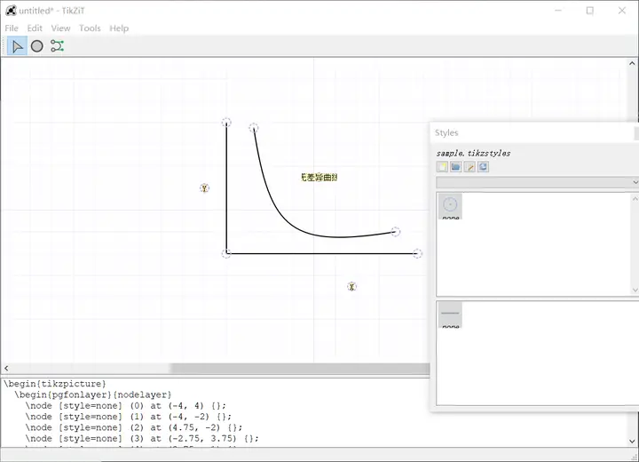
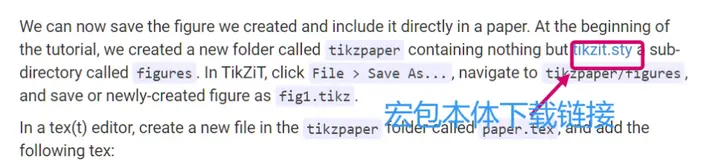
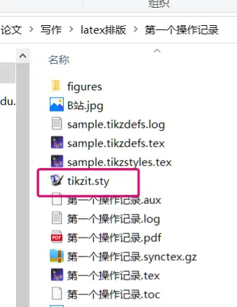
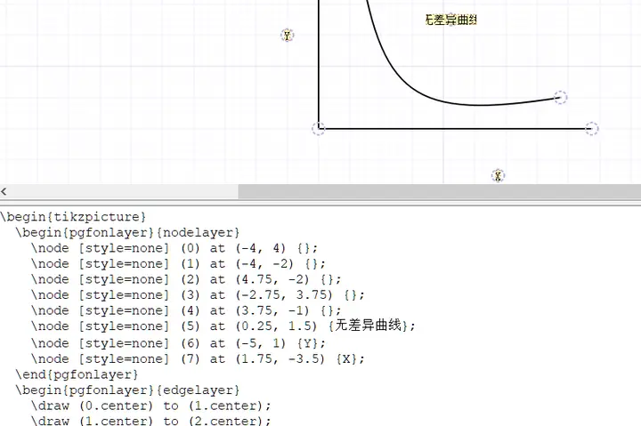
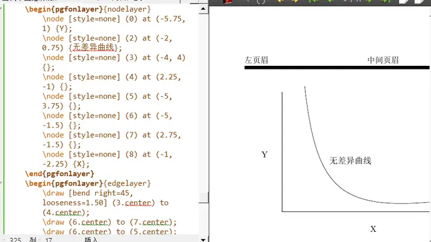
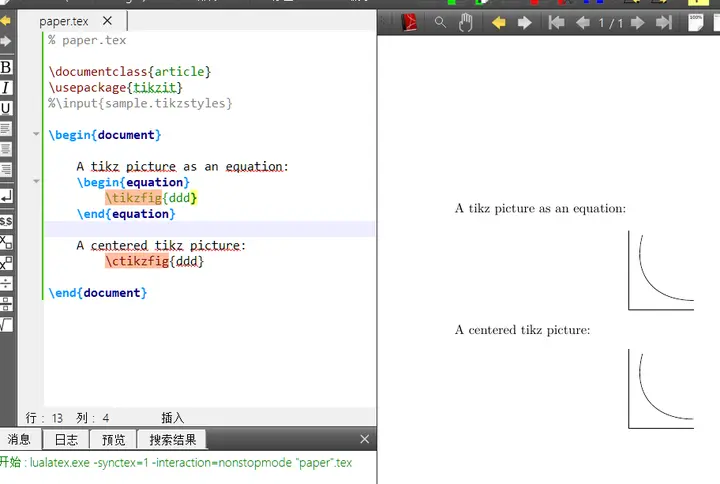
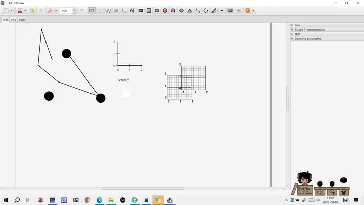
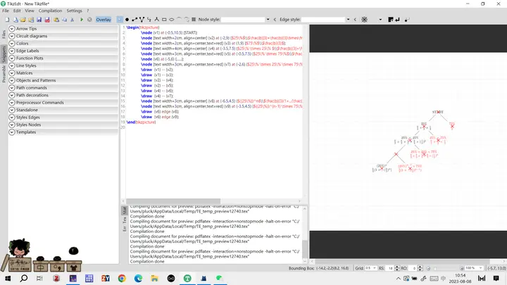
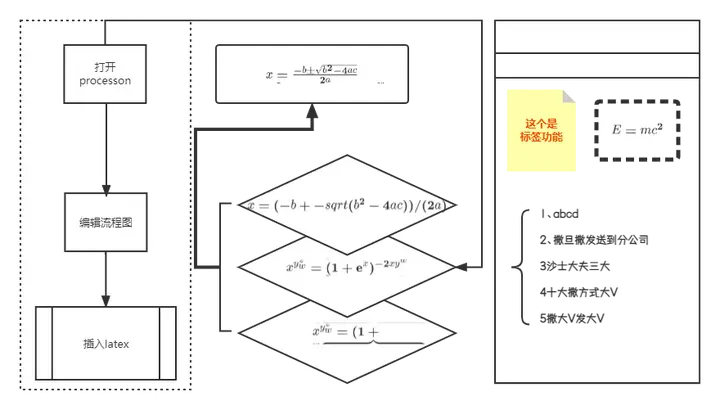

# LaTeX and Drawing


As everyone knows, the tikz package is the god-tier package for drawing in latex, but the code is genuinely hard to write.

So I recommend using the tikzit software — draw with the mouse, then it automatically converts to latex code.

## Downloading the software

Download link: [TikZit](https://tikzit.github.io/)

I suggest using Google Translate; the feature introductions are detailed and patient.
I won't repeat the drawing tutorial here — tikzit's page is clean and easy to understand.

The page looks like this:



## Environment setup (two ways to insert images)

Let me stress environment setup first.

The key is that you also need to download the package extension yourself — [tikzit.sty](https://tikzit.github.io/tikzit.sty)


There are also two ways to insert images.



This text is in the "insert into LaTeX" section of the download page; note the blue hyperlink text, click it to download.

### My recommendation: direct code insertion

First, place the downloaded `tikzit.sty` in the same directory as your LaTeX paper document,



so that the package can be recognized.

Using the LaTeX package:

```LaTeX
\usepackage{tikzit} \\use the tikzit.sty package
```

Once you finish a diagram in tikzit, click the toolbar in order: `tool`, `jump to selection`, and the LaTeX code will pop up at the bottom.




The complete environment code looks like this:
```LaTeX
\documentclass{article}
\usepackage{tikzit}
\begin{document}

\begin{tikzpicture}
	\begin{pgfonlayer}{nodelayer}
		\node [style=none] (0) at (-5.75, 1) {Y};
		\node [style=none] (2) at (-2, 0.75) {indifference curve};
		\node [style=none] (3) at (-4, 4) {};
		\node [style=none] (4) at (2.25, -1) {};
		\node [style=none] (5) at (-5, 3.75) {};
		\node [style=none] (6) at (-5, -1.5) {};
		\node [style=none] (7) at (2.75, -1.5) {};
		\node [style=none] (8) at (-1, -2.25) {X};
	\end{pgfonlayer}
	\begin{pgfonlayer}{edgelayer}
		\draw [bend right=45, looseness=1.50] (3.center) to (4.center);
		\draw (6.center) to (7.center);
		\draw (6.center) to (5.center);
	\end{pgfonlayer}
\end{tikzpicture}

\end{document}
```





### Image reference insertion

The process is: first use tikzit to save multiple groups of vector diagrams you've drawn, number them, then insert them into the tex file.

> (Refer to the similar insertion approach for LaTeX bibliography and image insertion.)

The specific process,

- Create a folder named `tikzpaper`.
- Put [tikzit.sty](https://tikzit.github.io/tikzit.sty) inside it.
- Inside the `tikzpaper` folder, create a folder called `figures`, and save all the diagrams tikzit has saved into it.
- Create `paper.tex` in the `tikzpaper` folder.

The `paper.tex` environment is as follows:

> Here `\tikzfig{ddd} ` and `\ctikzfig{ddd} ` are the two ways to reference images; the content inside the curly braces {} is the image filename saved in the figures folder.

```LaTeX
% paper.tex
\documentclass{article}
\usepackage{tikzit}
%\input{sample.tikzstyles}

\begin{document}
		
		A tikz picture as an equation:
		\begin{equation}
			\tikzfig{ddd} 
		\end{equation}
		
		A centered tikz picture:
			\ctikzfig{ddd}	
\end{document}
```



## Other tools

Open-source software is small and elegant, and much of it works straight out of the box.

- [mathcha](https://www.mathcha.io/) (web, paid)
- [tikzcd-editor]( https://tikzcd.yichuanshen.de/ ) (many answers mention this site, but the trouble is it doesn't tell you which package you need; though now that we have GPT, it hardly matters)
```LaTeX
\usepackage{tikz} \usetikzlibrary{cd} \\tikz sub-package for calling the tikzcd command environment of relationship diagrams
```
- [inkscape](https://inkscape.org/) (you can treat it as an open-source PS)
- [ipe](http://ipe.otfried.org/) (free and open-source, but there's no Chinese localization yet, though the page is mostly graphics)
When downloading ipe, don't have Chinese characters in the install path, or it will error when opening.
(For ipe, I suggest pairing it with a teaching video on Bilibili: [Bilibili tutorial](https://www.bilibili.com/video/BV14E411u7Na/?spm_id_from=333.337.search-card.all.click&vd_source=0e137afa81fa006aaa9f39b597699a06))
- [latexdraw](https://latexdraw.sourceforge.net/) (free and open-source)


- [TikzEdit](http://tikzedt.org/) (free, open-source, English, but easy to understand


Tikzedit is like a just-in-time compiling tex; the page is also exactly the same as tex.

> I've tried both TikzEdit and latexdraw. latexdraw's visual editing is better — text position and color can also be adjusted visually. TikzEdit is more about visual moving-editing of points and lines. But neither can visually edit arrow styles. For someone with some background, TikzEdit is more convenient.

- The dark-art method: use flashy tools (like PPT, [processon](https://www.processon.com/) (an online web page)) to draw, save as PDF, then crop and insert it into latex as a PDF file (this also reduces the typesetting and code-running pressure on latex).
    


Here is the local environment for inserting a cropped PDF:

```LaTeX
\begin{figure}
	\centering
	\includegraphics[width=0.8\textwidth,height=0.5\textwidth]{实践时间是.pdf}
	\\the square brackets control the PDF's size (width and height); the curly braces hold the PDF's name
	\caption{Title} 
\end{figure}

By the way, here's the complete environment for inserting a whole-page PDF file:

\documentclass[a4paper]{article}
\usepackage{pdfpages}
\begin{document}
            \includepdf[pages={1,2,4,7}]{PDF的名字.pdf} 
            \\the content inside the square brackets is the page numbers of the original PDF
\end{document}

```


---

> Author: [滑翔闪](https://github.com/hzp2333/hzp2333.github.io)  
> URL: https://blog.huaxiangshan.com/en/posts/latex2/  

