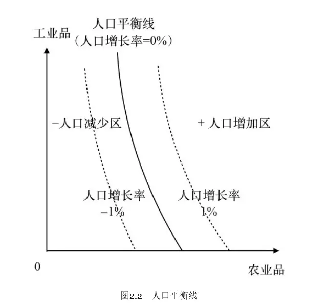
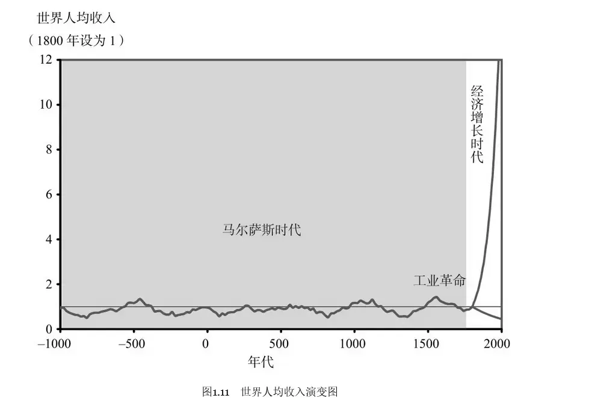
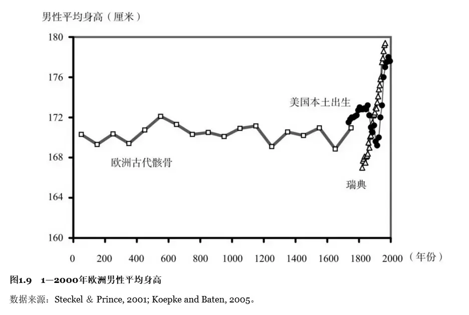
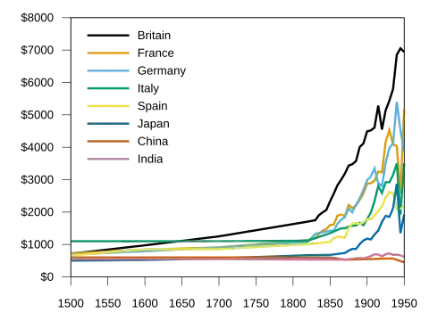
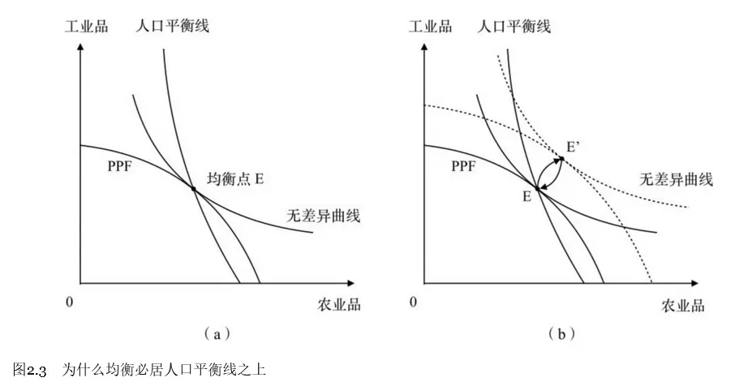
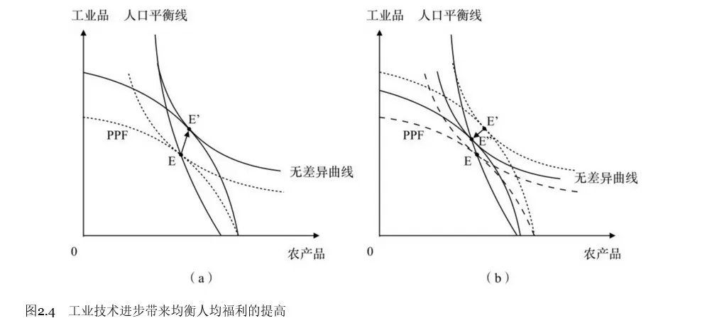
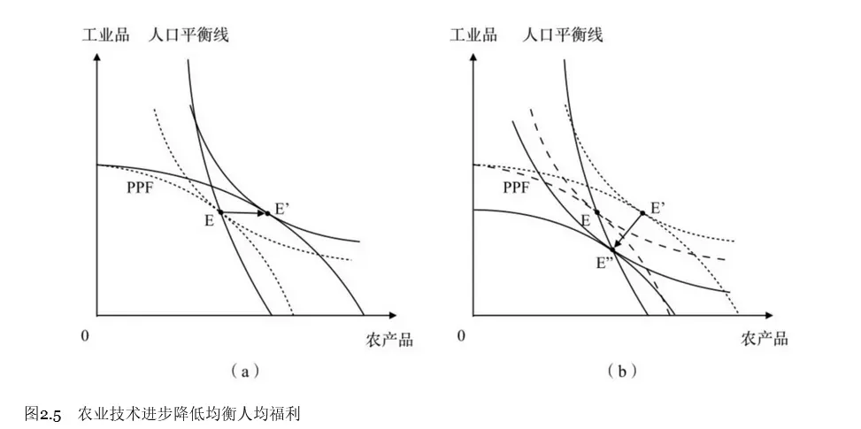
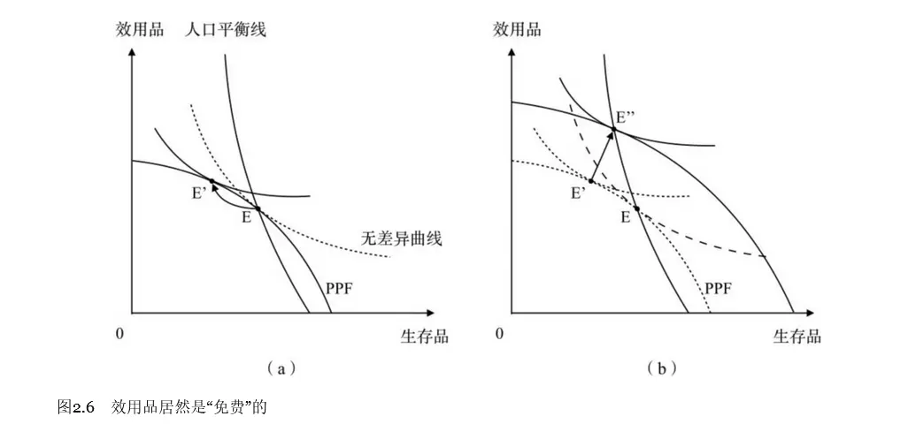

#  A Malthusian Two-Sector Model

> For a class presentation: some of the mathematical derivation details in The Origin of Rich Species.

## A Bounty on the Question

The doctoral dissertation of the author of The Origin of Rich Species hopes to be readable even by high school students; here I only introduce a simplified version of the classical model.

This book was written to refute the mainstream Malthusian mechanism. The charm of macroeconomic history and economic growth lies in shaping a **view of history** through simple models.

[Wu Lemin's The Origin of Rich Species argues that Malthus's explanation of the Malthusian trap is wrong, so what is the real cause of the Malthusian trap?](https://www.zhihu.com/question/585741754/answer/2916018611)

The bounty for rebuttal is as follows:

## The Malthusian Narrative

### Malthus is the founding father of the population–resources–environment field.


- When society becomes rich, people have more children;
- When society becomes poor, people have fewer children.
- In the end per capita income settles at a level.
- By the same logic, when the growth of production cannot keep up with population growth, disaster follows.


### A Growth Narrative

> In the long history of economic growth, only one thing seems to have happened — the Industrial Revolution.
> — Gregory Clark ([Gregory Clark](https://en.wikipedia.org/wiki/Gregory_Clark_ "economist"))

- Was per capita real income in the Ming dynasty really the same as in the Song dynasty?
- If prosperity is perfect, why can it not last?
- Why does history always oscillate between democracy and non-democracy?
- Why could the Industrial Revolution break the Malthusian trap?
- Can a single unified model describe the whole history of economic growth?

## The Two-Sector Model

First analyze sectoral progress and social welfare.



Only survival is considered.

To survive, people must have agricultural products, but not necessarily industrial goods.





That is the single-sector Malthusian case, so the distinct properties of the two sectors are the core idea that generalizes this model.



The case where both sectors progress at the same time:

The case where only the industrial sector progresses:

**Only the industrial sector expands, while the rest shrinks in equal proportion.**

**Only the industrial sector expands, while the rest shrinks in equal proportion.**

 **Changing Preferences** 

By analogy with the moon and sixpence, let's now turn industry and agriculture into two sectors: utility and survival.

- The utility sector: art, literature, roses...
- The survival sector: national defense, engineering, rice...

People prefer utility goods, so the fertility rate temporarily deviates (to the lower side), raising social welfare.



I personally admire this two-sector improvement. Its conclusion also fits historical trends: as history develops, the pursuits of art, beauty, and spirit can all be seen as utility goods, and in fact human civilization has always attached increasing importance to utility goods beyond survival.

At the same time, **the pursuit of utility goods may be at odds with the reproduction of civilization**. For example, pursuing a dream and giving up marriage, giving up the survival's fivepence for the moon in the sky, and mistreating one's body for the sake of appearance.

The Origin of Rich Species makes the same **assumption** about reproduction as The Selfish Gene: genes prompt us to care about the continuation of our genes, but we do not deliberately calculate the probability of reproducing.



Factors affecting the increase of social welfare:

- The rate of progress of the utility-goods and survival-goods sectors.
- The preference structure.
- Per capita consumption (the population-balance line)

## An Algebraic Proof of the Model (the Simple Case)

$$
\max U(x,y)=x^{1-\beta}y^\beta
$$

$$
\begin{cases}
\text{Survival sector:}X=AL_A^{1-\gamma_A}H_A^{\gamma_A} \\\\
\text{Utility sector:}Y=BL_B^{1-\gamma_B}H_B^{\gamma_B}
\end{cases}
$$

### Assumption 1: $\gamma_A=\gamma_B\equiv\gamma<1$ (if relaxed)



Being less than 1 is for diminishing marginal returns.

Equality means population shrinkage delivers the same shock to both sectors (the factor contribution rate).



$$
\max U(x,y)=x^{1-\beta}y^\beta
$$

$$
\begin{cases}
\text{Survival sector:}&X=AL_1^{1-\gamma}H_1^\gamma\\\\
\text{Utility sector:}&Y=BL_2^{1-\gamma}H_2^\gamma\\\\
\text{Land:}&L_1+L_2=L\\\\
\text{Labor:}&H_1+H_2=H&
\end{cases}
$$

Next, solve: `backward induction` — `social decision` — `utility` — `product` — `factors`.

What needs to be decided is how many factors each product consumes.

$$L_2=L-L_1,\quad H_2=H-H_1$$

$$
U=(AL_1^{1-\gamma}H_1^{\gamma})^{1-\beta}[B(L-L_1)^{1-\gamma}(H-H_1)^{\gamma}]^{\beta}
$$

Taking logs makes it simpler to handle:

$$
V=(1-\beta)\left[\ln A+(1-\gamma)\ln L_1+\gamma\ln H_1\right]+\beta\left[\ln B+(1-\gamma)\ln\left(L-L_1\right)+\gamma\ln\left(H-H_1\right)\right]
$$

Optimization means the partial derivative is 0.
$$
\frac{\partial V}{\partial L_1}=\frac{(1-\gamma)(1-\beta)}{L_1}-\frac{(1-\gamma)\beta}{L-L_1}=0
$$
$$
L_1^\*=(1-\beta)L,\quad L_2^\*=\beta L
$$
Likewise,

$$
\frac{\partial V}{\partial H_1}=\frac{\gamma(1-\beta)}{H_1}-\frac{\gamma\beta}{H-H_1}=0
$$
$$H_1^\*=(1-\beta)H,\quad H_2^\*=\beta H$$
After deciding the factors, next substitute into the product decision $X=AL_1^{1-\gamma}H_1^\gamma$.

$$
\begin{aligned}X^{\*}&=A\left(L_{1}^{\*}\right)^{1-\gamma}(H_{1}^{\*})^{\gamma}=A[(1-\beta)L]^{1-\gamma}[(1-\beta)H]^{\gamma}\\\\&=A\left(1-\beta\right)L^{1-\gamma}H^{\gamma}\end{aligned}
$$ For the per capita level, divide by H again,

$$
\begin{aligned}
x&=A(1-\beta)\left(\frac{H}{L}\right)^{\gamma-1} \\\\ y&=B\beta\left(\frac{H}{L}\right)^{\gamma-1}
\end{aligned}
$$
After the product decision, substitute into the utility $U=x^{1-\beta}y^{\beta}$,

$$
\begin{aligned}\mathrm{U}&=A\left(\frac{H}{L}\right)^{\gamma-1}\left(\frac{B}{A}\right)^\beta(1-\beta)^{1-\beta}\beta^\beta\\\\&=x\left(\frac{B}{A}\right)^\beta\left(\frac{\beta}{1-\beta}\right)^\beta\end{aligned}
$$


Why factor out x? Malthus's assumption proceeds from per capita grain, that is, the equilibrium of per capita output.


### Assumption 2: $g_H\equiv\frac{\dot{H}}{H}=n=\delta\left(\ln x-\ln\bar{x}\right)$

A description of the Malthusian trap.

Differential equations — the relationship between a derivative and a value — the relationship between an increment and a stock — dynamic equations.

$\bar{x}$ is the average level of survival-goods consumption that keeps the population unchanged.

### Conclusion One

The expression for equilibrium utility:

$$
U^E=\bar{x}\left(\frac{B}{A}\right)^\beta\left(\frac{\beta}{1-\beta}\right)^\beta
$$

Equilibrium per capita utility grows with the degree to which the output structure is utility-oriented ($\frac{B}{A}$), with the relative preference for utility goods ($\beta$), and with the per capita survival-goods consumption needed to maintain the population balance ($\bar{x}$).

The illustrated case, not yet proven:

The relationship between the growth rates of the different sectors and social welfare.

To keep the model simple, only a closed society is considered, with no foreign trade.

The growth rate of survival goods is $g_A$; the growth rate of utility goods is $g_B$.

### Lemma: $g_A-(1-\gamma)g_H\to0$

The Malthusian population-growth assumption: $g_H\equiv\frac{\dot{H}}{H}=n=\delta\left(\ln x-\ln \bar{x}\right)$

> Meaning: population growth depends on the level of per capita survival-goods consumption.

The equilibrium per capita consumption: $x=A(1-\beta)\left(\frac{H}{L}\right)^{\gamma-1}$

Simplify land resources to 1, giving $x=A(1-\beta)^{\gamma}H^{\gamma-1}$, and substitute into $g_H$:

$$
g_H=\delta\left[\ln A+\gamma\ln(1-\beta)+(\gamma-1)\ln H-\ln x\right]
$$

Use M to stand for $\ln A+\gamma\ln(1-\beta)$, simplifying to:

$$g_H=\delta\left[M+\gamma\ln(1-\beta)-\ln x\right]$$

Differentiate M,

$$
\mathrm{d}M=g_A+(\gamma-1)g_H=g_A+(\gamma-1)\delta\left[M+\gamma\ln(1-\beta)-\ln x\right]
$$
At the steady state, $dM=0$; substitute and solve,

$$
M^*=\frac{g_A}{(1-\gamma)\delta}-\gamma\ln(1-\beta)+\ln\bar{x}
$$

And at this point we also have: $\mathrm{d}M=g_A+(\gamma-1)g_H=0$

> The process by which $M$ approaches the equilibrium $M^*$ is the process by which $dM$ approaches 0.

### Theorem Three: The Per Capita Utility Growth Rate and the Two Sectors' Growth Rates

Study the per capita utility growth rate (which can also be seen as per capita income) and its relationship to the growth of the two sectors.

> A macroeconomic balanced growth path; phase-diagram analysis is exactly this.

Away from the steady state ($\bar{x} \neq x$),

the utility is:

$$
U=A\left(\frac{H}{L}\right)^{\gamma-1}\left(\frac{B}{A}\right)^{\beta}(1-\beta)^{1-\beta}\beta^{\beta}
$$



For a factor X, the macro factor X changes with time (X(t)).

Differentiate ln(X) with respect to t.

$$
\begin{aligned}&\frac{d\ln X(t)}{dt}=\frac{d\ln X(t)}{dX(t)}\frac{dX(t)}{dt}\\\\&=\frac{\frac{dX(t)}{X(t)}}{dt}=\frac{\dot{X}(t)}{X(t)}=g(\text{growth rate})\end{aligned}
$$



Take logs and differentiate to linearize, and we get:

$$g_U=\beta\left(g_B-g_A\right)+g_A-(1-\gamma)g_H$$
The part after is the lemma, already shown to tend to 0.

Thus we obtain the relationship between per capita welfare (income) and survival goods and utility goods.

$$
g_U=\beta\left(g_B-g_A\right)
$$
According to this conclusion, there should be only one reason for the long-run stagnation of per capita income:

the growth rate of utility goods can never exceed the growth rate of survival goods.

More complex cases would introduce migration and trade (by setting a migration rate to satisfy the population-balance line) and technological competition (requiring some mathematics of stochastic processes); intuitively they can be understood through multi-level games (The Three-Body Problem: The Dark Forest), and I will not elaborate the specific mathematical models here.

For a **simple reading of the latter part**, see:

[Competitive Selection Theory](https://blog.huaxiangshan.com/zh-cn/posts/fzqy/#%E7%AB%9E%E6%8B%A9)

---

> Author: [滑翔闪](https://github.com/hzp2333/hzp2333.github.io)  
> URL: https://blog.huaxiangshan.com/en/posts/mess/  

