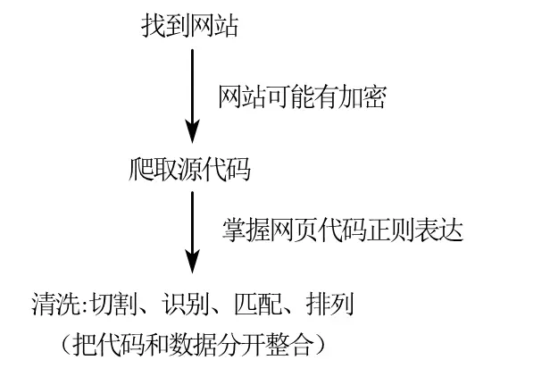
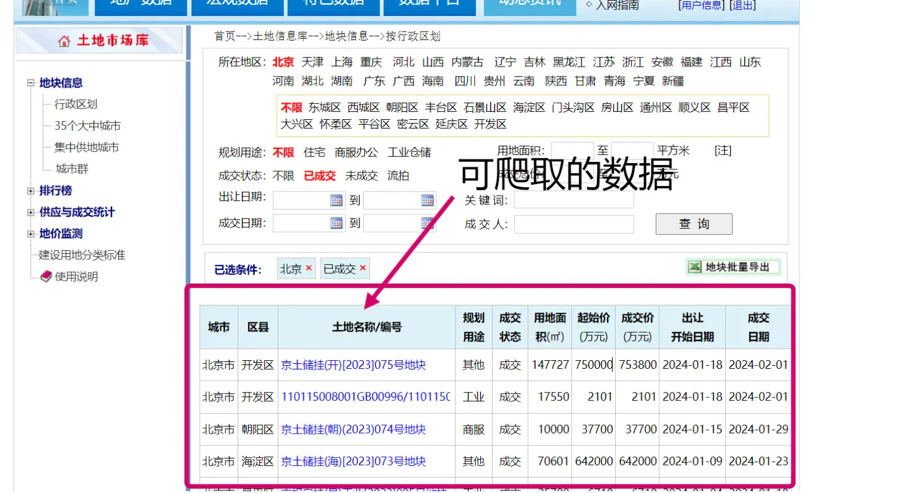
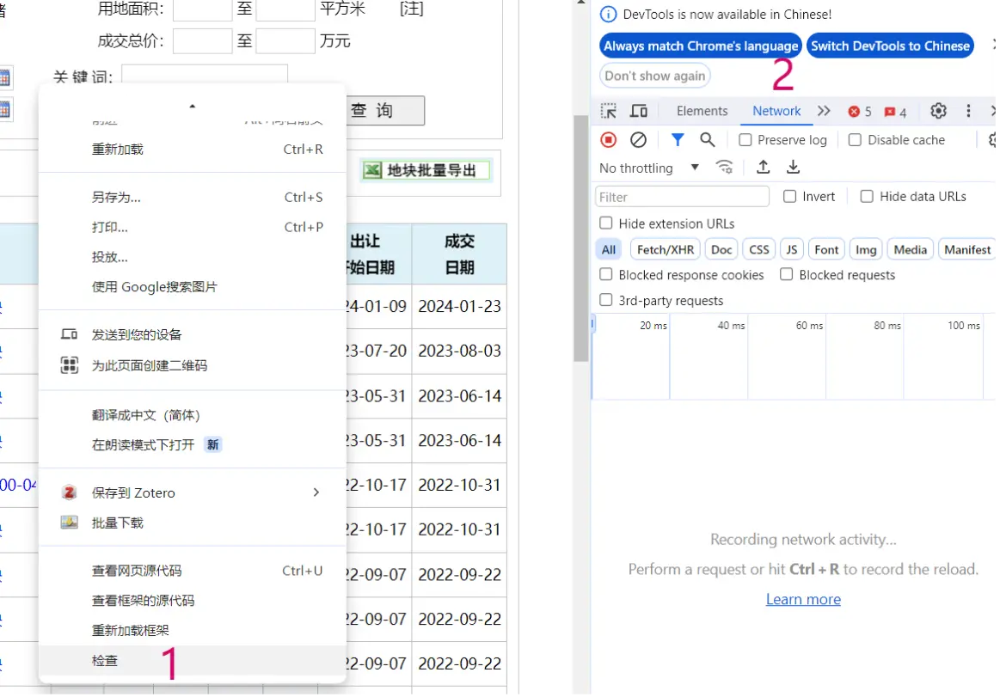
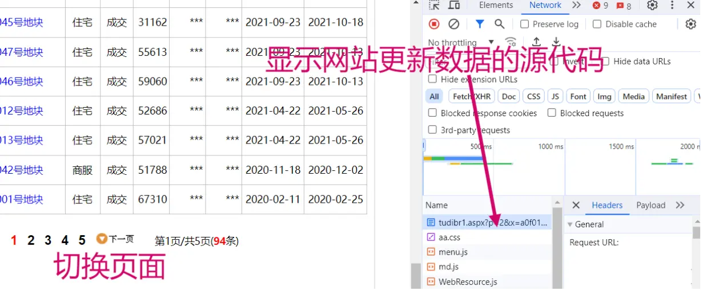
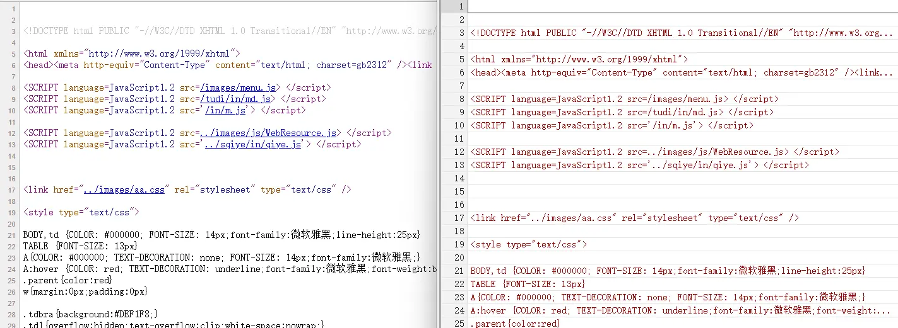
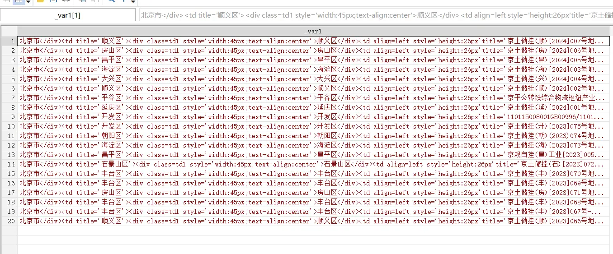
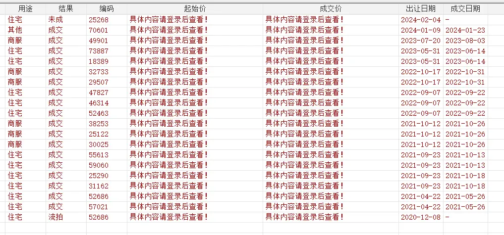

# Stata: Learning Web Scraping


## Introduction

What is a web crawler? It's scraping that follows "what you see is what you get". Every website has source code, and that source code naturally contains the information the website displays. When you grab the source code, data and code are mixed together; we then clean it up to get clean data. **The Stata code is attached at the end. Crawler code isn't very reusable; this post mainly documents my web scraping learning process.**

 

For the whole crawling process, **getting the website's source code is the most critical step**. For heavily encrypted websites (like "China Judgments Online"), you'd also need to spoof IPs, switch between multiple accounts, and break through text encryption — unfortunately Stata can't do any of that. What Stata is good at is crawling defenseless websites and then quickly cleaning and processing the data. Although the part Stata is good at — "splitting code and data" — is just a matter of practice, using Stata for a first taste of web scraping is still pretty friendly for an individual.

## 1. Grabbing the Page Source Code

The data website: the land market database of the Guoxin Real Estate Information Network. The page looks like this:

> Some schools have purchased this database; see if you can log in via IP.
>
> You can spoof your IP to log in with Python, but Stata seems unable to do that for now. This post is only for learning.



Right-click — Inspect — in the panel on the right, click into "Network".



Then we switch the page number of the website; the website updates its data, and on the right we get the corresponding source code for the data change.

 
  For this website's data-switching source code, switching a few times reveals that what controls **the page change is the code p=2**. Likewise, when p=1, it corresponds to the first page of data. When you hit an encrypted website, this work gets much harder.

```html
http://www.crei.cn/tudi/tudibr1.aspx?p=2&x=a0f010000&k=&k1=&k2=&k3=&k4=&c=&j1=0&j2=0&m1=0&m2=0
```

## 2. Web Scraping in Stata

### 1. Importing the Website

First set the working path:

```SAS
  *-website: Guoxin Real Estate Transaction Network: http://www.crei.cn/tudi/index.aspx
  *-time: February 2024
  *-set the working path
	clear all
	global path "F:\桌面\stata土地网爬虫"
	global prcs "$path\process" 
	cd "$D" 
	set scheme s2color   //plot style
```

Then import the website, using Stata's copy command to pull in the source code.

> Use unicode to set the encoding as needed to avoid garbled text.

```SAS
  *-[1] import the url
    copy "http://www.crei.cn/tudi/tudibr1.aspx?p=1&x=a0f000000&k=&k1=&k2=&k3=&k4=&c=&j1=0&j2=0&m1=0&m2=0 " "test.txt", replace	
  *-Note: set the font format to avoid garbled text, and force-delete the backup file at the end
  *-Note: store characters 1 to 200000 and label them as variable v
    local file = "test.txt"
    unicode analyze "`file'"
    unicode encoding set gb18030
    local file = "test.txt"
    unicode translate "`file'", transutf8
    unicode erasebackups, badidea
    local file = "test.txt"
    infix strL v 1-200000 using "`file'",clear
```

You can compare the page source code in Stata (after entering the website, right-click and view the page source). See the figure below:

 

### 2. Initial Splitting

- **keep command:** keeps which rows of the Stata data.
- **split command:** splits the table content by a certain symbol into multiple cells.
- **sxpose command:** transposes and rearranges the data.

> Looking at the page source, we can see the data we want is all in the row with `<font face="宋体">`. The real-estate entries are separated by `<tr onmouseover=this....`. The closing code `</table><br><center>` should also be deleted. After splitting, transpose it.


```SAS
  *-[2] initial data splitting
  *-Note: use the split function to split the retained data; this part requires knowing regular expressions
  *-Note: inspect the page source and keep the rows where the needed data lives; note the data uses SimSun
    keep if index (v,`"<span id="bra1"><font face="宋体">"')
    split v ,p(`"<tr onmouseover=this.style.background='#BDDFFF' onmouseout=this.style.background='#ffffff'  style='background:#ffffff' ><td style='height:35px'><div class=td1 style='width:42px;text-align:center'>"')
  *-Note: also remove the extra parts at the end of this code: v 211 and v 212
    split v 21 ,p(`" </table><br><center>　"')
	*</table><p align=left>
	Drop v v 1 v 212 v 21
	Rename v 211 v 21
	Sxpose ,clear
  *-Note: sxpose transposes and rearranges the data
```

As shown, up to this point the first 20 records of the first page have been scraped and given an initial split.

 

### 3. Further Splitting

- **replace:** replace the code to be split with "滑翔闪" or "" (empty) to mean deletion, then split it all at once.

```SAS
  *-[3] further split the data
  *-Note: replace the unwanted middle characters with the Zhihu user "滑翔闪"!
	replace _var = subinstr (_var,`"</div><td title='"',"滑翔闪",.)
	replace _var = subinstr (_var,`"'><div class=td1 style='width:45px;text-align:center'>"',"滑翔闪",.)
	replace _var = subinstr (_var,`"</div><td align=left style='height: 26 px'title='"',"滑翔闪",.)
	Replace _var = subinstr (_var, `"//"' ,"", .)
	replace _var = subinstr (_var, `"'><div class=td1 style='width:220px'><a href=http:www.crei.cn/tudi/tdbr.aspx?id="' ,"滑翔闪", .)
	Replace _var = subinstr (_var, `" target=_blank  class=tdbrw>"' ,"滑翔闪", .)
	replace _var = subinstr (_var,`"</a></div></td><td title='"', "滑翔闪",.)
	replace _var = subinstr (_var,`"'><div class=td1 style='width:40px;text-align:center'>"',"滑翔闪",.)
	replace _var = subinstr (_var,`"</div><td width=40>"',"滑翔闪",.)
	replace _var = subinstr (_var,`"</td><td align=right>"',"滑翔闪",.)
	Replace _var = subinstr (_var,`"<td align=right title='"',"滑翔闪",.)
	replace _var = subinstr (_var,`"'> *** </td><td align=right title='"',"滑翔闪",.)
	replace _var = subinstr (_var,`"'> *** </td><td nowrap>"',"滑翔闪",.)
	replace _var = subinstr (_var,`"<td nowrap>"',"滑翔闪",.)
	replace _var = subinstr (_var,`"'> *** </td>"',"",.)
  *-Note: do it for me — land a Fire Punch on the character "滑翔闪"!
	Split _var ,p(`"滑翔闪"')
	Drop _var 1
```

### 4. Organizing and Saving

```SAS
  *-[4] add variable labels
	Ren _var 11 城市
	Ren _var 12 ID
	Ren _var 13 ID 2
	Ren _var 14 地块
	Ren _var 15 代码
	Ren _var 16 地块 2
	Ren _var 17 类型
	Ren _var 18 用途
	Ren _var 19 结果
	Ren _var 110 编码
	Ren _var 111 起始价
	Ren _var 112 成交价
	Ren _var 113 出让日期
	Ren _var 114 成交日期
  *-[5] save the data
        Save "$path\爬虫土地. Dta", replace
```

**The starting price and transaction price parts are encrypted with JS, so they can't be scraped; this post mainly documents the principles and workflow of crawling.**



Stata can't log in with an IP and account, so it can't scrape the prices.

### 5. Scraping Multiple Pages

Forvalues: a Stata loop command. By replacing **p=1** in the source code with **p=`i'**, you can scrape in a loop.

> Note that often the first page and the pages after the second page are scraped differently; for example, on this website the ending page-number code differs. Because the land market network is encrypted, Stata can only scrape the first and second pages.

```SAS
*======================================
* Part 2 scrape multiple pages (133 pages total)
* data source: Guoxin Real Estate Transaction Network - land market data
*======================================
	Forvalues i = 2/133{  //use a loop to scrape pages 2-133 and merge them with page 1
	Di `i'
	Clear
  *-[1] import the url
	qui copy "http://www.crei.cn/tudi/tudibr1.aspx?p=`i'&x=a 00000000&k=&k 1=&k 2=&k 3=&k 4=&c=&j 1=0&j 2=0&m 1=0&m 2=0" "test`i'. Txt", replace
  *-Note: set the font format to avoid garbled text, and force-delete the backup file at the end
  *-Note: store characters 1 to 200000 and label them as variable v
    Qui local file`i' = "test`i'. Txt"
    Qui unicode analyze "`file`i''"
    Qui unicode encoding set gb 18030
    Qui unicode translate "`file`i''", transutf 8
    Qui unicode erasebackups, badidea
    Qui infix strL v 1-200000 using "test`i'. Txt", clear
  *-[2] initial data splitting
  *-Note: use the split function to split the retained data; this part requires knowing regular expressions
  *-Note: inspect the page source and keep the rows where the needed data lives; note the data uses SimSun
	qui keep if index (v,`"<span id="bra1"><font face="宋体">"')
	qui split v ,p(`"<tr onmouseover=this.style.background='#BDDFFF' onmouseout=this.style.background='#ffffff'  style='background:#ffffff' ><td style='height:35px'><div class=td1 style='width:42px;text-align:center'>"')
  *-Note: also remove the extra parts at the end of this code: v 211 and v 212
	qui split v 21 ,p(`"</table><p align=left>"')
	Qui drop v v 1  v 21
	Qui rename v 211 v 21 ylyih
	Qui sxpose ,clear
  *-Note: sxpose transposes and rearranges the data
  *-[3] further split the data
  *-Note: replace the unwanted middle characters with the Zhihu user "滑翔闪"!
	qui replace _var = subinstr (_var,`"</div><td title='"',"滑翔闪",.)
	qui replace _var = subinstr (_var,`"'><div class=td1 style='width:45px;text-align:center'>"',"滑翔闪",.)
	qui replace _var = subinstr (_var,`"</div><td align=left style='height: 26 px'title='"',"滑翔闪",.)
	Qui replace _var = subinstr (_var, `"//"' ,"", .)
	qui replace _var = subinstr (_var, `"'><div class=td1 style='width:220px'><a href=http:www.crei.cn/tudi/tdbr.aspx?id="' ,"滑翔闪", .)
	Qui replace _var = subinstr (_var, `" target=_blank  class=tdbrw>"' ,"滑翔闪", .)
	qui replace _var = subinstr (_var,`"</a></div></td><td title='"', "滑翔闪",.)
	qui replace _var = subinstr (_var,`"'><div class=td1 style='width:40px;text-align:center'>"',"滑翔闪",.)
	qui replace _var = subinstr (_var,`"</div><td width=40>"',"滑翔闪",.)
	qui replace _var = subinstr (_var,`"</td><td align=right>"',"滑翔闪",.)
	Qui replace _var = subinstr (_var,`"<td align=right title='"',"滑翔闪",.)
	qui replace _var = subinstr (_var,`"'> *** </td><td align=right title='"',"滑翔闪",.)
	qui replace _var = subinstr (_var,`"'> *** </td><td nowrap>"',"滑翔闪",.)
	qui replace _var = subinstr (_var,`"<td nowrap>"',"滑翔闪",.)
	qui replace _var = subinstr (_var,`"'> *** </td>"',"",.)
  *-Note: do it for me — land a Fire Punch on the character "滑翔闪"!
	Qui split _var ,p(`"滑翔闪"')
	Qui drop _var 1
  *-[4] add variable labels
	Qui ren _var 11 城市
	Qui ren _var 12 ID
	Qui ren _var 13 ID 2
	Qui ren _var 14 地块
	Qui ren _var 15 代码
	Qui ren _var 16 地块 2
	Qui ren _var 17 类型
	Qui ren _var 18 用途
	Qui ren _var 19 结果
	Qui ren _var 110 编码
	Qui ren _var 111 起始价
	Qui ren _var 112 成交价
	Qui ren _var 113 出让日期
	Qui ren _var 114 成交日期
 *-[5] save the data
   Qui append using "$path\爬虫土地. Dta"
   Qui save "$path\爬虫土地. Dta", replace
   }
```


## 3. Attachments and References:

### 1. References

[Baidu Netdisk](https://pan.baidu.com/link/zhihu/7QhzzcuOh5iVbwgV5mUZdRF1TFRxcjRQU39W==)

The next step is to learn the crawling commands in R, Python, and CURL; the workflow and principles are similar. Python's advantage is that it can run many threads at once and has flexible wheels you can use.

The land transaction website scraped in this post can't be crawled because of its JS encryption, but they never closed off the old source-code entry, so **the old version is still completely defenseless** — you can refer to the code in the article below to scrape the old source data.

```html
http://www.crei.cn/tudi/lawbr.aspx?p=1&a=1&jyzt=&crfs=&tdlx=&rq1=&rq2=&rq3=&rq4=&key=&ren=&cs=%C8%AB%B2%BF
```

[Teaching You to Scrape Nationwide Land Transaction Data with Stata](https://mp.weixin.qq.com/s/82TzbLJH24YLEZGvlqJfiw)

[Stata: Batch Retrieval of Longitude-Latitude Data - Spatial Econometrics](https://www.lianxh.cn/details/572.html)

[Stata Web Scraping: Scraping Regional Macro Data](https://www.lianxh.cn/details/684.html)

[Regular Expressions](https://www.stata.com/meeting/china17/slides/china17_Yuan2.pdf)

### 2. Some Papers

> **Industrial Land Prices and Firm Capacity Utilization:** scrapes land data to uncover the relationship between industrial land transaction clustering and overcapacity [^1]; 
>
> **Minimum Wages and Heterogeneous Human Capital Demand: A Study Based on Recruitment Website Data:** scrapes recruitment postings to study the demand-side features of labor [^2]； 
>
> **Industrial Robot Adoption and Labor Relations: An Empirical Study Based on Judicial Litigation** — scrapes legal documents to study robot adoption and labor disputes [^3]。

[^1]: Liu Ruohong, Xu Yanjun. Industrial Land Prices and Firm Capacity Utilization[J]. The Journal of World Economy, 2023, 46(11): 103-127. DOI: 10.19985/j.cnki. Cassjwe. 2023.11.004.
[^2]: Ma Shuang, Xiao Han, Li Ding, et al. Minimum Wages and Heterogeneous Human Capital Demand: A Study Based on Recruitment Website Data[J]. The Journal of World Economy, 2023, 46(12): 92-114. DOI: 10.19985/j.cnki. Cassjwe. 2023.12.003.
[^3]: Zhang Jun, Yan Xueling, Yu Shule, et al. Industrial Robot Adoption and Labor Relations: An Empirical Study Based on Judicial Litigation[J]. Management World, 2023, 39(12): 90-112. DOI: 10.19744/j.cnki. 11-1235/f.2023.0146.


---

> Author: [滑翔闪](https://github.com/hzp2333/hzp2333.github.io)  
> URL: https://blog.huaxiangshan.com/en/posts/pachong/  

