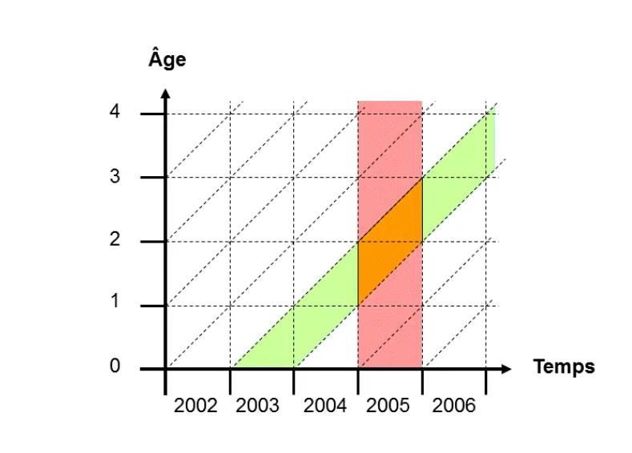
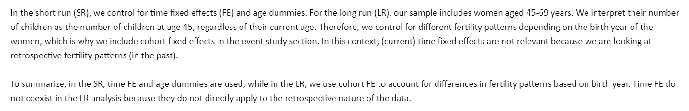
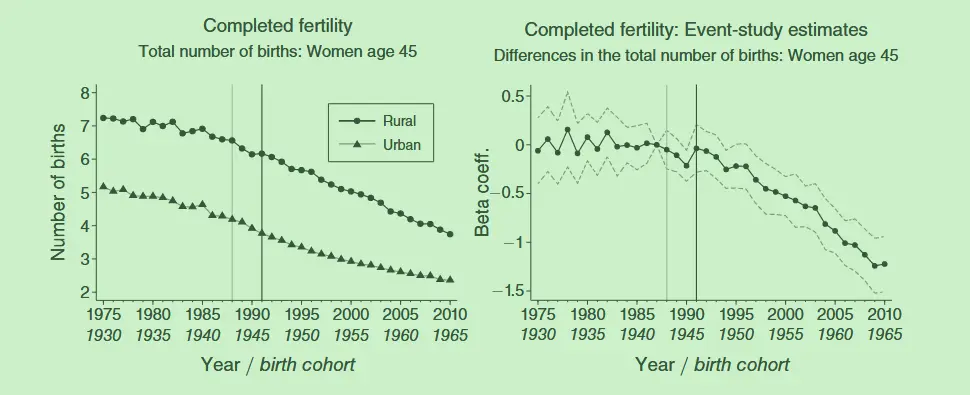
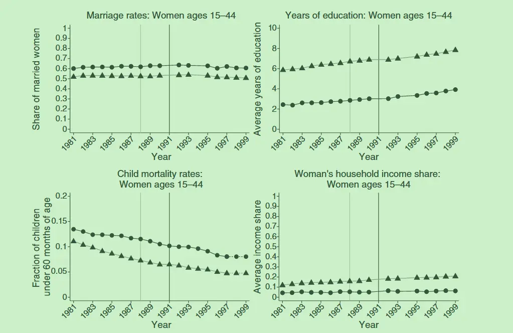
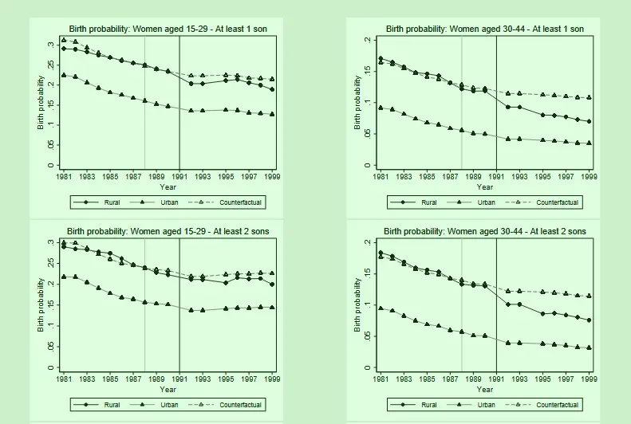

#  Pensions and Fertility

## The essentials

The paper *[Pensions and Fertility: Microeconomic Evidence](https://www.aeaweb.org/articles?id=10.1257/pol.20200440)* uses Brazilian microdata to study the relationship between pension provision and fertility.

**Conclusion:** Viewed through **economic circulation** and **factor substitution**, one traditional role of raising children is old-age support. Naturally, the provision of pensions eases that worry, so fertility falls.

**Contribution:** Historical experience shows that fertility fell around the time many high- and middle-income countries introduced or expanded their social security systems[^4]🤯. On the mechanism side of how fiscal public policy affects fertility, there's relatively little research, and most of it uses OLG macro models; this paper uses micro analysis.

**Econometric design:** I quite like this paper's econometric design. It studies how a pension reform affects women's fertility decisions, and since women in different states should react differently, it adds event-study analysis across different women's groups to strengthen the argument.

## Theoretical and real-world background

### Theory

> People say Chinese papers love to coin terms, but doesn't this AER paper coin a bunch of its own terms in its theoretical explanations? It even goes out of its way to phrase things convolutedly to highlight a made-up effect. But correspondingly, the interesting part of this paper is how it decomposes fertility decisions and summarizes them into quantifiable constraints.

#### Women's age

- **Survival effect**: Before and after the pension reform, there are both new and old women; old women already have two children and face lower fertility risk.
- **Information effect**: older women are more familiar with childrearing and so won't hoard children.
- **Saturation effect**: mothers who have already reached their desired number of children, or are in the late stage of childbearing, will reduce their likelihood of having children.
- **Pension wealth effect**: mothers near retirement and young mothers get different discounted pension streams from the reform, so their decisions react differently.
- **Salience effect**: the more obvious the pension reform's outcome, the more salient people's reaction[^2].

Consider a woman's decision to have a child. Her decision basis includes her own physical suitability for pregnancy and the number and gender composition of children she already has. Young mothers will react more readily to the pension reform, while older mothers react less; comparing the two groups' data makes the paper's analysis more credible.

#### Number and structure of children

- The more children before the reform, the less likely to add another birth.
- The more sons a family has before the reform[^3], the less likely to add another birth.

### Reality

Since the mid-twentieth century, under the influence of urbanization, medical care, education, and other expansions, **Brazil's fertility fell sharply**. Against this backdrop, Brazil carried out a comprehensive pension reform.

Before the 1970s, only **urban workers with formal jobs** were entitled to scattered, occupation-specific pensions, but the reform in the October 1988 constitution of the Federative Republic of Brazil significantly expanded pension coverage, giving rural workers pension benefits for the first time in Brazilian history.

The pension reform took effect after being legally approved in July 1991. For urban workers, the pension rules and benefits barely changed. But for **rural workers, regardless of whether they had formal employment or paid any social security contributions**, women (men) became eligible for a pension from age 55 (60).

It is precisely against this historical background that, in the paper's event study, 1988 became the event check contrasting with 1991.

## Data and methods

### APC panel

> The paper uses multiple cross-sections from the **Brazilian National Household Sample Survey (PNAD)**, covering the years 1981-1990, 1992-1993, 1995-1999, 2001-2009, and 2011-2014.

On APC panels — see my earlier note: *[HLT: Lifecycle and Wage Decomposition](https://blog.huaxiangshan.com/zh-cn/posts/hlt/)*, section one. Although the paper uses an APC panel, it doesn't actually decompose the relevant effects; instead it restricts the age cohorts and then uses event-study analysis to compare how differently people react to the policy.



Panel data tracking the same individuals is always hard to obtain, so people turned to long cross-sections, matching multiple cross-sections together. This kind of panel data is common in epidemiological and demographic statistics and is called APC (age-period-cohort) data. Obviously, an APC panel contains three data dimensions.

- Age: age, i.e. the influence of biological characteristics. For example, age's biological characteristics can divide fertility suitability, labor-force quality......
- Period: the time when the cross-section was collected, e.g. the technology level and infrastructure level at the time of each year's census......
- Cohort: the birth year/month of each cross-section, generally seen as a group that jointly experienced certain social environments or historical events, and hence is similar.

Since `age+cohort=period`, these variables are often confounded, and collinearity arises in practice.

In econometrics, one often first estimates one of the effects through some means (a clever difference based on the object's characteristics) and then regresses the remainder; or imposes additional linear constraints on the regression; or uses high-order differences (like individual-effect estimation) to estimate the three effects separately.

Demography often uses APC panels to draw Lexis diagrams:

The horizontal and vertical axes are period time and age time, and the lines in between are grouped by cohort; analysis and prediction unfold by comparing the trends and differences of the lines.


### Variables and the econometric specification

#### Dependent variables

**Short-run effect**: equals 1 if the woman gave birth within one year of the data-collection year, and 0 otherwise (based on the household roster and birth data). The sample includes female respondents of childbearing age (15 to 44) from 1981 to 1999.

**Long-run effect**: the total number of children of a woman at age 45 (including surviving and deceased children). The sample includes female respondents born between 1930 and 1969, who were aged 45 to 69 in the given survey year. The authors trace the total births of respondents older than 45 in the survey year (1984-2014) back to their fertility at age 45 (1975-2014).

The treated group is urban workers; the control group is rural workers.

#### The econometric regression

##### Difference-in-differences

$$
\begin{aligned}y
\_{igtr}^{SR}&= \alpha^{SR}+\beta\big(RURAL
\_{g}^{SR}\times POST
\_{t}^{SR}\big)\\\\&+ \gamma RURAL
\_{g}^{SR}+\lambda_{t}^{SR}+\phi
\_{r}^{SR}+\psi^{\prime}\mathbf{X}
\_{igtr}^{SR}+\epsilon_{igtr}^{SR}
\end{aligned}
$$
- Subscripts: r region, g rural-urban group, i individual, t year, r state.
- $y_{igtr}^{SR}$: the short-run effect. Gave birth within one year of the survey year.
- $RURAL_{g}^{SR}$: dummy for rural-worker women.
- $POST_{t}^{SR}$: dummy for the July 1991 rural pension policy reform.
- $\mathbf{X}\_{igtr}^{SR}$: controls for individual, job, family, and region-level characteristics.
- Effects: time effects $\lambda_{t}^{SR}$, individual effects $\phi_{r}^{SR}$, robust clustering at the federal-state level.

The pension reform lowered fertility in the short run;

In the group regression, the **young group** (15-29) is insignificant, while the **older group** (30-44) shows a significant fertility decline; the more children there are, and the higher the proportion of sons, the lower the desire for more children.
##### Instrumental variables

Treat the DID (differences in the pension-reform policy implementation) as an instrument for pensions ($\ln(pensionwealth)_{igtr}$).

First stage:
$$
\begin{aligned}\ln(pensionwealth)\_{igtr}&= \sigma^{SR}+\theta\big(RURAL\_{g}^{SR}\times POST\_{t}^{SR}\big)\\\\&+\eta RURAL\_{g}^{SR}+\delta\_{t}^{SR}+\tau\_{r}^{SR}+\kappa^{\prime}\mathbf{X}\_{igtr}^{SR}+\mu\_{igtr}^{SR}\end{aligned}
$$
Second stage:
$$
\begin{aligned}y\_{igtr}^{SR}&=\alpha^{SR}+\beta\ln\left(\widehat{pensionwealth}\right)\_{igrt}\\\\&+\gamma RURAL\_g^{SR}+\lambda\_t^{SR}+\phi\_r^{SR}+\psi^{\prime}\mathbf{X}\_{igtr}^{SR}+\epsilon\_{igtr}^{SR}\end{aligned}
$$

##### Event study

On event studies, see *[Econometrics: Event Studies 1](https://blog.huaxiangshan.com/zh-cn/posts/event1/)*.

> In short, an event study can be viewed as the dynamic treatment effect of difference-in-differences. In terms of the equation, this means time-slicing the policy variable $POST_{t}^{SR}$ and expanding it into $\sum YEAR_T^{LR}$.

$$
\begin{aligned}y\_{igtr}^{LR}&=\alpha^{LR}+\sum_{t=-16}^{23}\beta_t\big(RURAL\_g^{LR}\times YEAR_t^{LR}\big)\\\\&+\gamma RURAL_g^{LR}+\lambda\_t^{LR}+\phi\_r^{LR}+\psi^{\prime}\mathbf{X}\_{iglr}^{LR}+\epsilon\_{iglr}^{LR},\end{aligned}
$$
- Subscripts: r region, g rural-urban group, i individual, t year, r state.
- $y_{igtr}^{LR}$: the long-run effect. Total number of children at age 45.
- $RURAL_{g}^{LR}$: dummy for rural-worker women.
- $YEAR_{t}^{LR}$: policy-time dummy.
- $\mathbf{X}\_{igtr}^{SR}$: controls for years of education, marriage dummy, and lifetime labor supply.
- Effects: cohort effects $\lambda_{t}^{LR}$, individual effects $\phi_{r}^{LR}$, robust clustering at the federal-state level.

> In the difference-in-differences part, $\lambda_{t}$ is the survey-year time dummy, a time effect representing the technology level, medical level, and infrastructure at the time the data were collected;
>
> In the event-study part, $\lambda_{t}$ is the birth-year time dummy, used to flag that a particular group experienced a particular historical social environment.
>
> On this detail, I also emailed the two authors and got the following reply (many thanks to both for their kind replies 🥰).
> 
> > In the short run （SR）, we control for time fixed effects （FE） and age dummies. For the long run （LR）, our sample includes women aged 45-69 years. We interpret their number of children as the number of children at age 45, regardless of their current age. Therefore, we control for different fertility patterns depending on the birth year of the women, which is why we include cohort fixed effects in the event study section. In this context, （current） time fixed effects are not relevant because we are looking at retrospective fertility patterns （in the past）.
> >
> > To summarize, in the SR, time FE and age dummies are used, while in the LR, we use cohort FE to account for differences in fertility patterns based on birth year. Time FE do not coexist in the LR analysis because they do not directly apply to the retrospective nature of the data.
> 
> In my view, the approach is to artificially assume that some effect in age-period-time is unimportant, and so omit it directly. Frankly, I still find this not rigorous enough. But it can be defended; see below:

The dynamic treatment-effect figure shows that the urban-rural gap keeps shrinking after the reform, and fertility keeps falling after the reform[^5]. The x-axis shows cohorts, controlling for age at 45 and displaying by birth-year groups. Since age+cohort=period, but in the statistical, real-world sense period has no special meaning in this figure's statistics, the time effect can be ignored.

#### Confounders

Compares the trends in marriage rates, education, health care, income, wealth, and employment between rural and urban women; discusses the role of Brazilian cultural change in religion and television dramas, the role of trade liberalization, and the quantity-quality tradeoff between the number of children and investment in their quality (i.e. education).

## Robustness

- **Alternative age-band group regressions for comparison**: use new age bands to compare the fertility responses of different cohorts of women to the pension policy.
- **Alternative econometric specifications**: add education level as a control; linear time trends, linear time-region; distinguish whether the respondent lives with a pension recipient.
- **Sample selection**: (1) three types of sample draws: the non-self-representative municipality sample frame; self-representative areas; metropolitan areas. (2) Tighten the definition and scope of the treated and control groups based on individual occupation, home address, and parents' occupation. (3) Add rural-urban samples where husband and wife work in different occupational fields. (4) Exclude women under 15 and over 44. (5) Exclude women who gave birth past 45.
- **Standard errors**: in addition to state-level clustering, add clustering at the settlement level. To address autocorrelation, subtract the pre- and post-treatment result means respectively.
## Conclusion

I want to summarize this paper's conclusion from the angles of elevation and detail.

It verifies the historical experience — pension expansion may lower fertility.

Elevation: public welfare spending may carry a certain policy cost; there is a mechanism linking social welfare and population change.

Detail: as mentioned above. This paper's highlight is combining the context of Brazil's 1981 and 1991 reforms, and strengthening the rural-urban and women's-age-group comparisons, so the event study is also used well.

> Some personal doubts.
>
> Why don't most people think to link pension services to fertility? Because everyone assumes pension recipients have already lost the ability to become pregnant. So this is an expectations problem: women expect future pension income, so their fertility decisions change. The paper never proves this logic chain with econometric data; it's mainly argued through social and historical background analysis.

[^2]: My understanding here is to emphasize that people did form expectations about the pension reform, thereby changing their fertility decisions.
[^3]: The paper uses Brazilian land-inheritance data as evidence of son preference; most Brazilian land is inherited by men.
[^4]: Framed this way, the question instantly becomes interesting.
[^5]: The paper adds event-study analysis based on historical background; I think the fit is perfect.

---

> Author: [滑翔闪](https://github.com/hzp2333/hzp2333.github.io)  
> URL: https://blog.huaxiangshan.com/en/posts/paf/  

