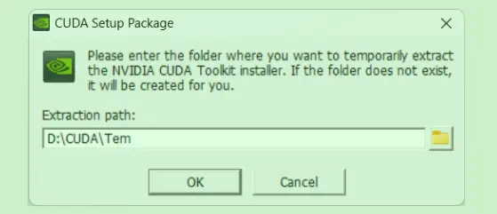
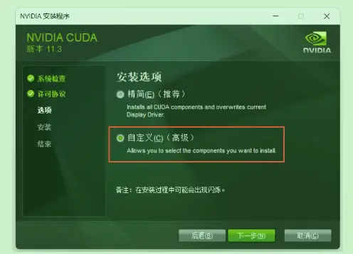
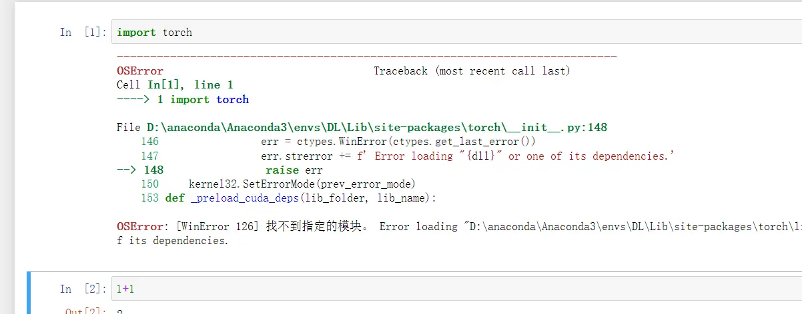
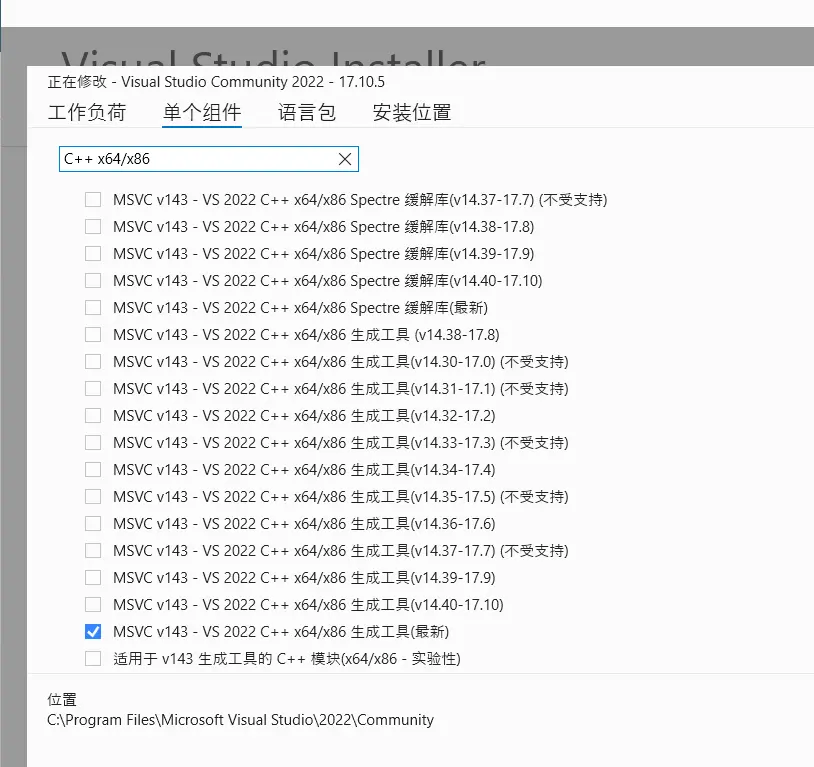

# PyTorch Setup Error: [WinError 126] The specified module could not be found.


People generally use pytorch to build neural networks these days. Building them needs the CUDA + python + pytorch trio. Here are some installation details.


**Recommended installation tutorial**:

This post supplements the parts the videos after 2024 didn't emphasize.

The Chinese pdf in the video is more detailed than the official download instructions, so I recommend it.


## Installing CUDA

### Version matching

Note: <font color="#ff0000">CUDA and pytorch versions correspond one-to-one</font>, it's not a matter of downloading the latest.

For example, as of July 26, 2024 — the latest CUDA version is 12.7, but pytorch has no matching version for it.

Version matching can be checked on the [pytorch official site](https://pytorch.org/get-started/previous-versions/).

### Downloading CUDA

After downloading from the CUDA official site, the first time you choose a download location.

At this point the download location is **temporary installer storage** — the folder is deleted after downloading.



The second custom install location is the real CUDA install location. If the second location is the same as the first, the files will be deleted.



## Installing Pytorch

After installing according to the tutorial, running it in python gives the following error:

```
 [WinError 126] The specified module could not be found.
```



The real cause is that the WIN11 environment conflicts with Pytorch.
Many python-related component errors are the same issue.

The solution is to download [visual studio](https://visualstudio.microsoft.com/zh-hans/downloads/?cid=learn-navbar-download-cta)

and download `MSVC v143-VS 2022 C++x64/x86 生成工具(最新)` inside it.

> The English name is `MSVC v143 -VS 2022 C++ x64/x86 build tools (Latest)`




## References

- [OSError: [WinError 126] The specified module could not be found]（ https://github.com/pytorch/pytorch/issues/131662 ）
- [LeNet study notes](https://blog.bdim.moe/zh/posts/2024-7-13/)


---

> Author: [滑翔闪](https://github.com/hzp2333/hzp2333.github.io)  
> URL: https://blog.huaxiangshan.com/en/posts/pytorch/  

