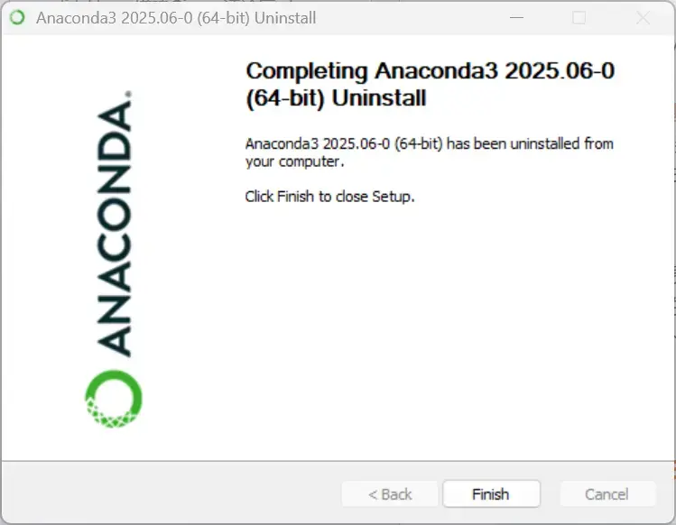
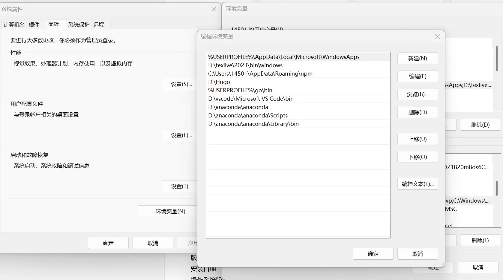
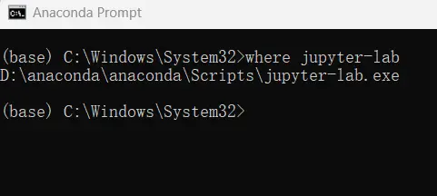
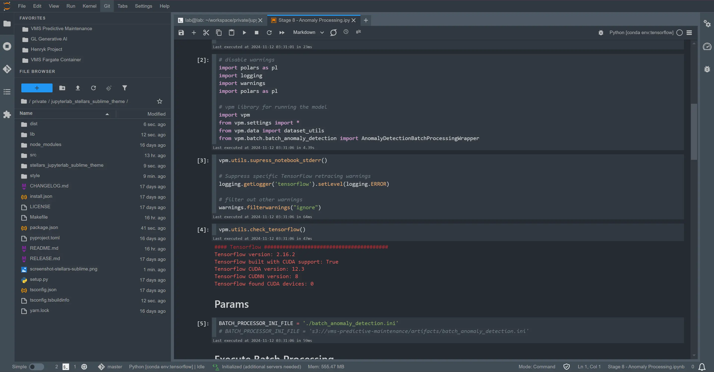
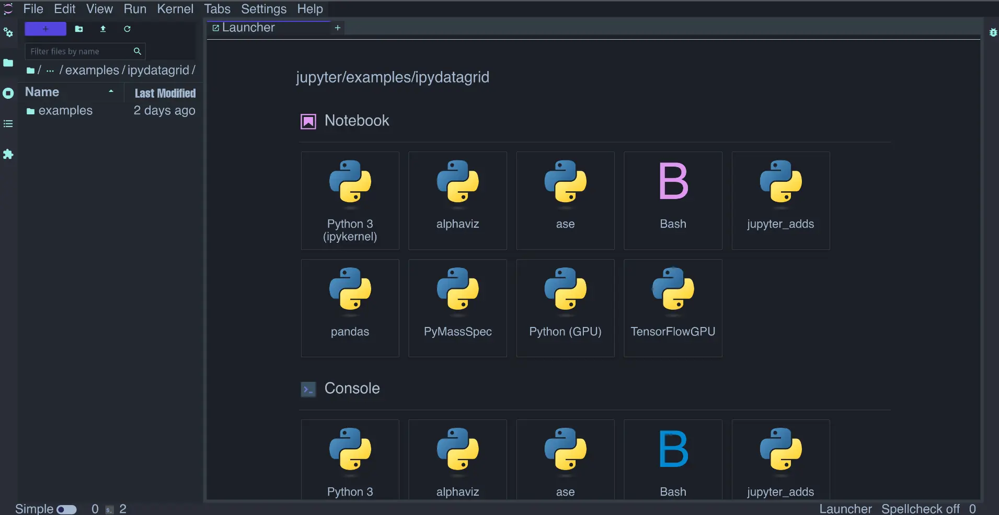

# Uninstalling and Installing Anaconda


After anaconda crashed for the second time, I understood why people so highly recommend vscode and pycharm as practical ides for python. But I still quite like the idea of using the browser as an ide. Compared to notebook, I prefer jupyter, so I've decided to redo the whole installation process here.

## Uninstalling anaconda

Open ` anaconda prompt` , download and run the uninstall command.

> Its purpose is to clean up Anaconda's config files and environment settings.

```
conda install anaconda-clean
anaconda-clean --yes
```

Next, open the folder where you previously installed anaconda and run the uninstaller `Uninstall-Anaconda3.exe`. For example, mine is at `D:\anaconda\anaconda`.



## Installation

Download one from the [official site](https://www.anaconda.com/download/success) and install it all the way through.

After installing, add `path` in the computer's advanced environment settings: the first one is your own install path.

```
D:\anaconda\anaconda
D:\anaconda\anaconda\Scripts
D:\anaconda\anaconda\Library\bin
```



## Jupyter shortcuts and working directory

To make it easier to launch, first create a shortcut pointing to `jupyter`.

Type `where jupyter-lab` in ` anaconda prompt` to find the location. Then search online for a matching `.ico` icon. I recommend downloading from this [site]( https://icon-icons.com/search/icons/jupyter?utm_source=chatgpt.com "111").


Next, set the working directory, which is the folder `jupyter` opens by default.

Enter the following command in ` anaconda prompt` to create the settings:

```
jupyter notebook --generate-config
```

Next, find the generated config file `C:\Users\<your username>\.jupyter\jupyter_notebook_config.py`.

Search for `notebook_dir` inside it and change it to the directory you want:
`c.ServerApp.notebook_dir = 'D:\PyTorch_practice'`.

## Pytorch environment setup

For deep learning, you need to first download cuda, then set up an environment where pytorch can run.

See [CUDA download](https://blog.huaxiangshan.com/zh-cn/posts/pytorch/#cuda-%E4%B8%8B%E8%BD%BD). The key point is to match the corresponding cuda version with the pytorch version when downloading. For example, I downloaded cuda 12.4, but since the latest pytorch hadn't adapted to cuda 12.4 yet, I chose to download a pytorch environment suited for cuda 12.1.

Next, open `anaconda prompt` to set up the environment.

Although the latest python is 3.13, the most compatible version is 3.11. Now let's create the jupyter environment:

### Specify the python version and manage environments uniformly on the D drive.

```
conda config --remove pinned_packages python
```

```
conda create -p D:\anaconda_envs\MLGPU python=3.11 -y
```

### Switch to the corresponding environment and install pytorch-related packages:

```
conda activate MLGPU
```

```
conda install pytorch torchvision torchaudio pytorch-cuda=12.1 -c pytorch -c nvidia -y
```

### Some python packages I commonly use:

> - Install in batches, otherwise it's easy to hit conflicts and freezes. (The symptom is that in Task Manager, python's disk usage stays at 0 for a long time but the download doesn't finish.)
> - 
> - In the future, also be careful to reduce mixing pip and conda. Mixing itself doesn't hurt, but when there are many packages it can crash the environment.
> - When downloading python, you can reasonably turn off security software like Huorong, as these programs slow disk write speed.


```
conda install -y scikit-learn statsmodels networkx igraph -c conda-forge --verbose

conda install -y matplotlib seaborn plotly -c conda-forge --verbose

conda install -y openpyxl xlrd xlwt python-dateutil  -c conda-forge --verbose

conda install -y tqdm -c conda-forge --verbose

pip install aquarel

pip install jieba
```

### Register the jupyterlab kernel

```
conda install -y jupyterlab -c conda-forge

jupyter lab

pip install ipykernel

python -m ipykernel install --user --name=MLGPU --display-name "Python (MLGPU)"
```

## Jupyter plugins and appearance

Chinese language pack download (needs to run in the base environment)

```
pip install jupyterlab-language-pack-zh-CN
```

Plugins I personally recommend:

- [variableInspector](https://github.com/jupyterlab-contrib/jupyterlab-variableInspector): you can click to view the data attributes of the current code.
- [execute-time](https://github.com/deshaw/jupyterlab-execute-time): view the runtime record of the current code.
- [upyterlab-lsp](https://pypi.org/project/jupyterlab-lsp/): code auto-completion.

Theme plugins I quite like:

> Of course, dark mode is a must.

[jupyterlab_stellars_sublime_theme](https://github.com/stellarshenson/jupyterlab_stellars_sublime_theme)


[jupyterlab_stellars_sublime_theme](https://github.com/stellarshenson/jupyterlab_stellars_sublime_theme)




[jupyterlab_ariakedark_theme](https://github.com/eduardotlc/jupyterlab_ariakedark_theme)




---

> Author: [滑翔闪](https://github.com/hzp2333/hzp2333.github.io)  
> URL: https://blog.huaxiangshan.com/en/posts/pytorch2/  

