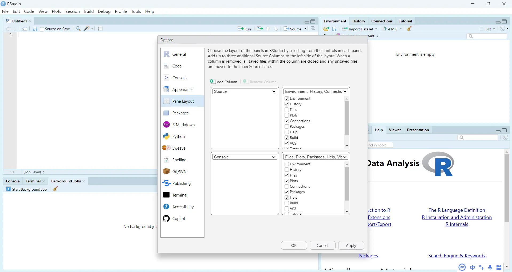
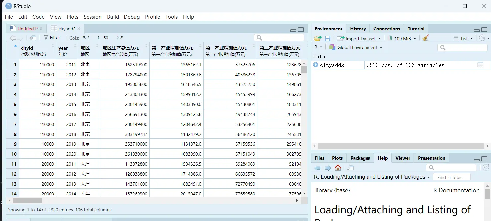
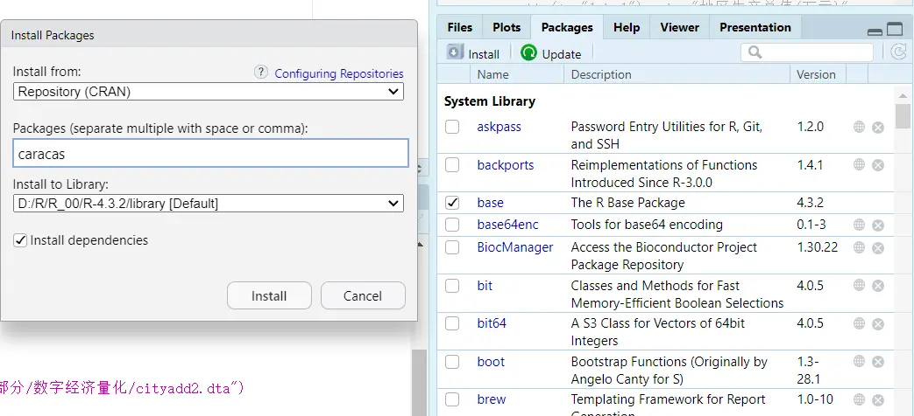
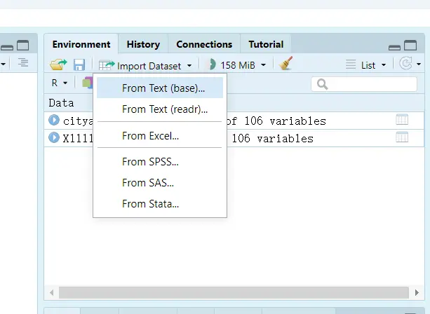
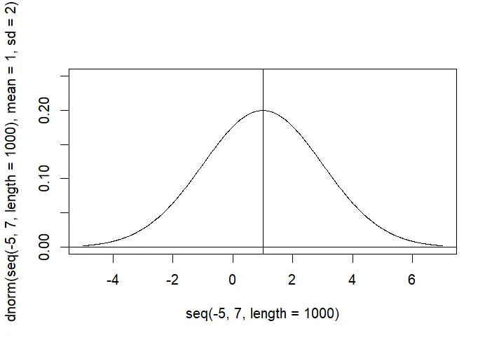
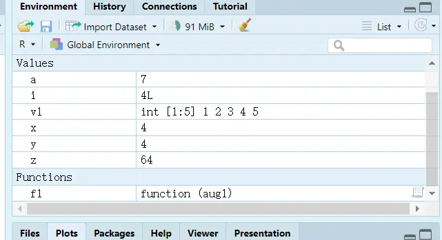

# R Basics 1: Interface Introduction and Syntax Structure


[R Notes 1: Interface Introduction and Syntax Structure](https://blog.huaxiangshan.com/zh-cn/posts/r1/)

[R Notes 2: Data Cleaning, Plotting, and Econometrics](https://blog.huaxiangshan.com/zh-cn/posts/r2/)

Notes on my R learning journey. Personally, as an economics learner who **only runs regressions**, Stata is more than enough[^2]. Whatever it lacks I usually fill with Python wheels, and even for DSGE I use MATLAB's Dynare add-on. For econometrics, R's regression table formatting and export are not very friendly, which is a bit of a turn-off.

Although it's not of much use to me right now, there are three reasons I'm learning it:

- I support open source[^1], so I wanted to get my feet wet with R;
- I'm currently using RStudio to write my blog files;
- I've looked at analyst-type internship postings at big companies like Kuaishou, ByteDance, Tencent, and Baidu, and they generally require using R to handle SQL databases.

## Recommended Tutorials

### My Recommendations

- Forum: [Capital of Statistics](https://cosx.org/)

- Run R code online: [Runoob](https://www.runoob.com/r/r-tutorial.html)

- The foreign counterpart of Runoob: [w3schools](https://www.w3schools.com/r/r_lists.asp)

- A recommended [blog site](https://tecdat.cn/)

- Strongly recommended: [Statistical Software](https://www.math.pku.edu.cn/teachers/lidf/docs/Rbook/html/_Rbook/index.html) R, an electronic lecture notes by [Teacher Li Dongfeng](https://www.stat-center.pku.edu.cn/zxry/zxjy/ldf/1227393.htm)

- Strongly recommended: [R in Data Science](https://bookdown.org/wangminjie/R4DS/index.html), an electronic lecture notes by Teacher Wang Minjie

- Strongly recommended: [Introduction to Econometrics with R](https://www.econometrics-with-r.org/index.html) — the textbook has a strong interactive feel!

- Because R can generate websites, many teachers at home and abroad have written their courses as online electronic lecture notes.
  >
  > Writing a blog is accumulation; writing lecture notes is dedication. There are more and more such teachers, so China should keep getting better too.
  >
  > See the big collection of R electronic books at [bookdown](https://bookdown.org/).
  >
  > Most teachers' electronic lecture notes will recommend [this one](https://r4ds.had.co.nz/).
  
- R project: Mounment's [GitHub repo](https://github.com/Mounment/R-Project?tab=readme-ov-file)

- Domestic tutorials[^3], recommended:

I like tutorials that are quick to get into but detailed enough at the key points, and most of the notes in this post come from this video:

> After watching the syntax introduction in the video, I suggest going straight to the electronic lecture notes.
>
> The later videos get complicated; no need for them.



### Electronic Lecture Notes and Textbooks

  Table source: [A carefully curated list of the latest and top R books across all fields in 2022](https://zhuanlan.zhihu.com/p/530525295)

| Field | Top R Books or Resources | Author | Book URL |
| :----- | ----------------------------------------------------------------------------------------------- | ---------------------------------------------------------------------- | ------------------------------------------------------------------------------------------------------------------- |
| R Programming | R Programming: Based on the Tidyverse | Zhang Jingxin | [https://zhuanlan.zhihu.com/p/467134727](https://zhuanlan.zhihu.com/p/467134727) |
| R Programming | R Tutorial | Li Dongfeng | [https://www.math.pku.edu.cn/teachers/lidf/docs/Rbook/html/\_Rbook/index.html](https://www.math.pku.edu.cn/teachers/lidf/docs/Rbook/html/_Rbook/index.html) |
| R Programming | Advanced R | Hadley | [https://adv-r.hadley.nz/](https://adv-r.hadley.nz/) |
| R Programming | Efficient R programming | Colin Gillespie, Robin Lovelace | [https://csgillespie.github.io/efficientR/](https://csgillespie.github.io/efficientR/) |
| R Visualization | ggplot 2: Elegant Graphics for Data Analysis | Hadley | [https://ggplot2-book.org/](https://ggplot2-book.org/) |
| R Visualization | Interactive web-based data visualization with R, plotly, and shiny | Carson Sievert | [https://plotly-r.com/](https://plotly-r.com/) |
| R Visualization | Modern Statistical Graphics | Zhao Peng, Xie Yihui, Huang Xiangyun | [https://bookdown.org/xiangyun/msg/](https://bookdown.org/xiangyun/msg/) |
| R Visualization | rstudio:: conf 2020 data visualization workshop | Kieran Healy | [https://github.com/rstudio-conf\-2020/dataviz](https://github.com/rstudio-conf-2020/dataviz) |
| R Visualization | R Graphics Cookbook, 2 nd edition | Winston Chang | [https://r-graphics.org/](https://r-graphics.org/) |
| R Visualization | The Beauty of Data Visualization in R | Zhang Jie | [https://gitee.com/easyshu/Beautiful-Visualization-with-R](https://gitee.com/easyshu/Beautiful-Visualization-with-R) |
| Documentation | R Markdown Cookbook | Xie Yihui | [https://bookdown.org/yihui/rmarkdown-cookbook/](https://bookdown.org/yihui/rmarkdown-cookbook/) |
| Documentation | R Markdown: The Definitive Guide | Xie Yihui | [https://bookdown.org/yihui/rmarkdown/](https://bookdown.org/yihui/rmarkdown/) |
| Documentation | bookdown: Authoring Books and Technical Documents with R Markdown | Xie Yihui | [https://bookdown.org/yihui/bookdown/](https://bookdown.org/yihui/bookdown/) |
| R Package Development | R Packages | Hadley | [https://r-pkgs.org/](https://r-pkgs.org/) |
| Shiny | Mastering Shiny | Hadley | [https://mastering-shiny.org/](https://mastering-shiny.org/) |
| Shiny | Engineering Production-Grade Shiny Apps | Colin Fay, Sébastien Rochette, Vincent Guyader and Cervan Girard | [https://engineering-shiny.org/](https://engineering-shiny.org/) |
| Shiny | JavaScript for R | John Coene | [https://javascript-for-r.com/](https://javascript-for-r.com/) |
| Applied Statistics | Statistical Inference via Data Science | Chester Ismay and Albert Y. Kim | [https://moderndive.com/](https://moderndive.com/) |
| Applied Statistics | Introduction to Modern Statistics | Mine Çetinkaya-Rundel | [https://openintro-ims.netlify.app/](https://openintro-ims.netlify.app/) |
| Applied Statistics | Modern Applied Statistics and R | Huang Xiangyun | [https://bookdown.org/xiangyun/masr/](https://bookdown.org/xiangyun/masr/) |
| Applied Statistics | Statistics and R (Courseware) | Zhang Jingxin | tidy-R Language Group 2 (222427909) group files |
| Experimental Design | The Grammar of Experimental Designs | Emi Tanaka | [https://emitanaka.org/edibble-book/](https://emitanaka.org/edibble-book/) |
| Bayesian | Doing Bayesian Data Analysis in brms and the tidyverse | A Solomon Kurz | [https://bookdown.org/content/3686/](https://bookdown.org/content/3686/) |
| Bayesian | Introduction to Bayesian Econometrics: A GUIded tour using R | Andrés Ramírez-Hassan | [https://bookdown.org/aramir21/IntroductionBayesianEconometricsGuidedTour/](https://bookdown.org/aramir21/IntroductionBayesianEconometricsGuidedTour/) |
| Bayesian | An Introduction to Bayesian Reasoning and Methods | Kevin Ross | [https://bookdown.org/kevin\_davisross/bayesian-reasoning-and-methods/](https://bookdown.org/kevin_davisross/bayesian-reasoning-and-methods/) |
| Bayesian | Statistical rethinking with brms, ggplot 2, and the tidyverse: Second edition | A Solomon Kurz | [https://bookdown.org/content/70a06054-8138-4d90-aaa0-895f57aab1b4/](https://bookdown.org/content/70a06054-8138-4d90-aaa0-895f57aab1b4/) |
| Data Science | R for Data Science | Hadley | [https://r4ds.had.co.nz/](https://r4ds.had.co.nz/) |
| Data Science | Tidyverse Skills for Data Science in R | Carrie Wright, Shannon Ellis, Stephanie Hicks, and Roger D. Peng | [https://leanpub.com/tidyverseskillsdatascience](https://leanpub.com/tidyverseskillsdatascience) |
| Data Science | R in Data Science | Wang Minjie | [https://bookdown.org/wangminjie/R4DS/](https://bookdown.org/wangminjie/R4DS/) |
| Data Science | Data Science Live Book | Pablo Casas | [https://livebook.datascienceheroes.com/](https://livebook.datascienceheroes.com/) |
| Data Science | R in Action (Third Edition) | Rob Kabacoff | [https://livebook.manning.com/book/r-in-action-third-edition/](https://livebook.manning.com/book/r-in-action-third-edition/) |
| Data Science | Modern Data Science with R （2 nd） | Benjamin S. Baumer, Daniel T. Kaplan, and Nicholas J. Horton | [https://mdsr-book.github.io/mdsr2e/](https://mdsr-book.github.io/mdsr2e/) |
| Machine Learning | mlr 3 book | Official | [https://mlr3book.mlr-org.com/](https://mlr3book.mlr-org.com/) |
| Machine Learning | Tidy Modeling with R | MAX KUHN AND JULIASILGE | [https://www.tmwr.org/index.html](https://www.tmwr.org/index.html) |
| Machine Learning | Hands-On Machine Learning with R | Bradley Boehmke & Brandon Greenwell | [https://bradleyboehmke.github.io/HOML/](https://bradleyboehmke.github.io/HOML/) |
| Machine Learning | Feature Engineering and Selection: A Practical Approach for Predictive Models | Max Kuhn and Kjell Johnson | [http://www.feat.engineering/](http://www.feat.engineering/) |
| Machine Learning | An Introduction to Statistical Learning with R | Gareth James, Daniela Witten, Trevor Hastie, Robert Tibshirani | [https://trevorhastie.github.io/ISLR/](https://trevorhastie.github.io/ISLR/) |
| | | | |
| Machine Learning | Machine Learning with R: Based on mlr 3 verse (Courseware) | Zhang Jingxin | tidy-R Language Group 2 (222427909) group files |
| Deep Learning | Deep Learning with R, Second Edition | François Chollet with Tomasz Kalinowski and J. J. Allaire | [https://www.manning.com/books/deep-learning-with-r-second-edition](https://www.manning.com/books/deep-learning-with-r-second-edition) |
| Text Mining | Supervised Machine Learning for Text Analysis in R | EMIL HVITFELDT AND JULIA SILGE | [https://smltar.com/](https://smltar.com/) |
| Text Mining | QUANTEDA TUTORIALS | Kohei Watanabe and Stefan Müller | [https://tutorials.quanteda.io/](https://tutorials.quanteda.io/) |
| Text Mining | Text Analysis Tutorials | LADAL | [https://slcladal.github.io/index.html](https://slcladal.github.io/index.html) |
| Econometrics | Introduction to Econometrics with R | Christoph Hanck, Martin Arnold, Alexander Gerber, and Martin Schmelzer | [https://www.econometrics-with-r.org/](https://www.econometrics-with-r.org/) |
| Econometrics | Beyond Multiple Linear Regression: Applied Generalized Linear Models and Multilevel Models in R | Paul Roback and Julie Legler | [https://bookdown.org/roback/bookdown-BeyondMLR/](https://bookdown.org/roback/bookdown-BeyondMLR/) |
| Econometrics | Mixed Models with R Getting started with random effects | Michael Clark | [https://m-clark.github.io/mixed\-models-with-R/](https://m-clark.github.io/mixed-models-with-R/) |
| Time Series | Forecasting: Principles and Practice （3 rd ed） | RobJHyndman | [https://otexts.com/fpp3/](https://otexts.com/fpp3/) |
| Time Series | Lecture Notes on Financial Time Series Analysis | Li Dongfeng | [https://www.math.pku.edu.cn/teachers/lidf/course/fts/ftsnotes/html/\_ftsnotes/index.html](https://www.math.pku.edu.cn/teachers/lidf/course/fts/ftsnotes/html/_ftsnotes/index.html) |
| Finance | Tidy Finance with R | Christoph Scheuch, Stefan Voigt, and Patrick Weiss | [https://tidy-finance.org/](https://tidy-finance.org/) |
| Spatial Data Analysis | Geocomputation with R | Robin Lovelace, Jakub Nowosad, Jannes Muenchow | [https://geocompr.robinlovelace.net](https://geocompr.robinlovelace.net) |
| Spatial Data Analysis | Spatial Data Science with applications in R | Edzer Pebesma, Roger Bivand | [https://keen-swartz-3146c4.netlify.app/](https://keen-swartz-3146c4.netlify.app/) |
| Spatial Data Analysis | NHH ECS 530 2021 course: Spatial data analysis （with R） | Roger Bivand | [https://rsbivand.github.io/ECS530\_h21/](https://rsbivand.github.io/ECS530_h21/) |
| Causal Inference | The Effect: An Introduction to Research Design and Causality | Nick Huntington-Klein | [https://theeffectbook.net/](https://theeffectbook.net/) |
| Causal Inference | Causal Inference: The Mixtape | Scott Cunningham | [https://mixtape.scunning.com/index.html](https://mixtape.scunning.com/index.html) |
| Social Sciences | Data Analytics for the Social Sciences Applications in R | G. David Garson | |
| Social Sciences | A Business Analyst's Introduction to Business Analytics | Adam Fleischhacker | [https://www.causact.com/](https://www.causact.com/) |
| Social Sciences | Computing for the Social Sciences | Benjamin Soltoff | [https://cfss.uchicago.edu/notes/intro-to-course/](https://cfss.uchicago.edu/notes/intro-to-course/) |
| Network Analysis | Methods for Network Analysis | Mark Hoffman | [https://bookdown.org/markhoff/social\_network\_analysis/](https://bookdown.org/markhoff/social_network_analysis/) |
| Network Analysis | Handbook of Graphs and Networks in People Analytics: With Examples in R and Python | Keith McNulty | [https://ona-book.org/](https://ona-book.org/) |
| Network Modeling | workshop 2020\_Network Modeling for Epidemics | [http://statnet.org](http://statnet.org) | [https://statnet.org/nme/d1.html](https://statnet.org/nme/d1.html) |
| Model Computation | Model Estimation by Example Demonstrations with R | Michael Clark | [https://m-clark.github.io/models-by-example/](https://m-clark.github.io/models-by-example/) |
| Model Computation | Computer-age Calculus with R | Daniel Kaplan | [https://dtkaplan.github.io/RforCalculus/](https://dtkaplan.github.io/RforCalculus/) |
| Big Data | Mastering Spark with R | Javier Luraschi, Kevin Kuo, Edgar Ruiz | [https://therinspark.com/](https://therinspark.com/) |
| Meta-Analysis | Doing Meta-Analysis in R: A Hands-on Guide | Harrer, M., Cuijpers, P., Furukawa, T.A., & Ebert, D.D | [https://bookdown.org/mathiasHarrer/Doing\_Meta\_Analysis\_in\_R/](https://bookdown.org/mathiasHarrer/Doing_Meta_Analysis_in_R/) |
| Survival Analysis | Applied Survival Analysis Using R | Dirk F. Moore | |

## Downloading R

My environment:

R (the language itself) + RStudio (IDE) + Rtools (package management, Windows only)

Downloading is simple — just click through and say yes all the way.

R itself: [https://cran.r-project.org/](https://cran.r-project.org/)

RStudio desktop software: [https://posit.co/download/rstudio-desktop/](https://posit.co/download/rstudio-desktop/)

R itself comes with Chinese support, but RStudio doesn't. There's a [Chinese localization GitHub project](https://github.com/s0521/rstudio_cn), but it doesn't work well and I don't recommend it — you'll get crashes and incompatibility bugs, which is a hassle.

## RStudio Interface and Setup

### Interface Introduction

Menu path for page settings: `tools` - `global option` - `Pane Layout`



At this point,

The `source` panel in the top-left (after creating a new R script project) is where you write code.

The `console` in the bottom-left shows the results.

The top and bottom sections on the right are customizable panels. For example, `history` shows your code run history; `environment` is the variable environment, where you can use `import Dataset` to load Stata, Excel, and other data; `file` shows the computer directories of your working environment.


### Managing and Downloading Packages

#### Manual Installation

Using R over the long term is tough on your computer's storage, because you keep downloading packages.

On Windows, R is generally managed with Rtools. Recent versions of R should come with this toolkit; if not, just install it from the [official site](https://cran.r-project.org/bin/windows/Rtools/history.html) — just install the .exe.

In the `file` panel, there's a `Packages` section; click `install` there to install packages.


#### Installing and Loading via Commands

> R is a language for statisticians. I personally find its base syntax not very elegant, but since it's open source, once you load the right packages it becomes a real joy.

For example, to install the `car` package, you can use the following commands:

```R
# Installing a package
install.packages("car") # This is a comment
# Loading a package
library(caret) 
# Load a single function from a package
# car::vif()
# Update packages
update.packages()
# Remove a package
remove.packages()
# Get help
?help
help("library")
# Help on a keyword
help.search("library")
# Help on a package
help(packages = "ggplot2")
```

> Since different packages may have functions with the same name, when loading two packages causes a conflict, the same-named function from the later package will override the earlier one.

#### Setting the Working Directory

```R
# View the current directory
getwd()
# Set the working directory; note that forward slashes are used
setwd("F:/桌面")
# Get a file path; this opens a file browser to find the file manually, and clicking it returns the file path
file.choose() 

# Save R files (.RData)
save()
save.image()
# Load an R file
load("F:/文档1")
load(file.choose() )

# Load a package's dataset
data()
```

#### Loading Data

In Stata, one window can only load one dataset, but R can load multiple.



```R
# Show all data objects in the current environment panel, listed by dataset name
ls()
# Remove an object
rm(list = ls())
```

## Syntax

### Data Types

| Type | Example or Description | Type |
| ------ | ---------------------------------- | --------- |
| Numeric | 2333    233.3                      | numeric   |
| Character | 'Next one is you'  "JOJO"  "2333"   | character |
| Logical | TRUE T FALSE F                     | logical   |
| Missing value | For example, forcing text into a number fails | NA        |
| Blank value |                                    | NULL      |
| Not a number | Not a Number                 | NaN       |
| Infinity | abbreviation of "Infinite"                   | Inf       |

```R
# Check the data type
is.numeric(123)
is.character('123')
is.logical(FALSE)
is.na(NA)
is.null(NULL)
is.nan(NaN)
# Convert the data type
as.numeric('123')
as.character(123)
as.logical(FALSE)
```

### Data Structures

#### Assignment and Vectors

The usual order of introduction: assignment, indexing, slicing.

```R
# Assignment
# object_name <- object_value
# Shortcut: Alt -

v1 <- 1:5 # Generate the vector v1 corresponding to 1 through 5
v2 <- c(v1,3,2,44,6) # Link/connect, nested
v3 <- rep(v2,times = 2)# repeat: repeat the whole sequence twice
v4 <- rep(v2,each = 2)# repeat: repeat each element twice
v5 <- rep(v2,times=2 , each = 2)# each is applied first, then times
v6 <- seq(from = 2, to = 9, by = 3) # Start from 2, add 3 each time, until it exceeds 9
v7 <- seq(from = 2, to = 12, length.out = 3) # Constrain the vector length, so the extra values are averaged out
v8 <- c('JOJO' ,'下一个就是你了')
v9 <- c('JOJO' ,T , 123) # There is coercion here; character > logical > numeric

# Vector names
names(v2)<- v9 # Change the names of v2 to v9
# At this point v2 looks like this
JOJO TRUE  123 <NA> <NA> <NA> <NA> <NA> <NA> 
   1    2    3    4    5    3    2    3    6 
# Vector length
length(v9)
length(v9)<- 9

# Vector indexing
# Unlike Python, whose default index starts from 0, R's index starts from 1 by default
# Unlike Python, where a negative sign means the reverse direction, in R a negative index means dropping that index value
v7[3] 
v7[c(1,3,5)]
v2[c(1,4)]
v2[-c(1,4)]  # Drop the values at indices 1 and 4
v2[c('JOJO' ,'TRUE')]
v1[v1%%2==1] # Conditional indexing: odd numbers with remainder 1 when divided by 2

# Constants
pi # Pi
letters # Lowercase letters
LETTERS # Uppercase letters
month.abb # Month abbreviations, "Jan"
month.name # Full month names, "January" 
```

#### Matrices

Matrices are just vector commands stacked together.

```R
# Matrix
m1 <- matrix(
	1:6,
	nrow = 2, # Two rows
	# ncol = 3, # Columns
	byrow = F, # Fill column-wise, so there's no need to specify ncol
	dimnames = list(c('r1','r2'),
					c('c1','c2','c3'))
    )
# Like vectors, matrices accept only one data type
# Create an empty 3*3 matrix
m0 <- matrix(NA,nclo = 3,nrow=3) 

m2 <- matrix(
    c(1:6, letters[1:6]),
    nrow = 3,
    byrow = TRUE,
    dimnames = list(c('r1', 'r2', 'r3'),
                    c('c1', 'c2', 'c3', 'c4'))
  )

# Row and column names
colnames(m1) # Columns
rownames(m1) # Rows
dimnames(m2)<-list(c) # Row and column names

# Dimension info, i.e., the shape command in Python
dim(m1) 
ncol(m1)
nrow(m1)

# Matrix indexing
m2[1,2] # Return the value at row 1, column 2
m2[1,] # Return the vector of the first row
m2[c(1,3),c(2,4)]
# Slicing by index name works the same way
m2['r1',]

# Convert to a vector
as.vector(m1)  # Extract column-wise in order
#array
```

#### Lists

Unlike vectors and matrices, lists can combine different data types and structures.

```R
v1 <- 1:5
m1 <- matrix(
  1:6,
  nrow = 2, 
  byrow = F, 
  dimnames = list(c('r1','r2'),
                  c('c1','c2','c3'))
)
# Unlike vectors and matrices, lists can hold different data types and structures
l1<- list(com1 = v1,
          com2 = m1)
# List names
names(l1)
# List indexing. A video said these commands are different, i.e., they differ in returning a list, matrix, or vector, but I tried them and there doesn't seem to be a difference.
l1$com1 		
l1[['com2']] 	
l1['com2']    
l1[20]

# Create a new component
l1$com3<- 3:6
l1

# Flatten the list
unlist(l1) # Reduce the list to a vector; indices become which list and which value
```

#### Data Frames

A special kind of list — the panel data and time series we often work with are built using data frames.

```R
# Create a data frame
df1 <- data.frame(
	C1 = 2:5,
	C2 = letters[2:5]
	)
df1

# Dimension info
dim(df1)
ncol(df1)
nrow(df1)

# Row and column names
dimnames(df1) # Column and row names
names(df1) # Row names
colnames(df1)
rownames(df1)

# Data frame indexing
df1[1:2 ,2]
df1[,2]
df1[,"c1"]
df1['1',]
df1[[2]]
df1$c1
df1[2]
df1['c1']

# Create a new column
df1$c3 <- 1:4

# Generate a grid-search data frame
expand.grid(mtry = 2:5,
			  ntree=c(200,500))
```

### Basic Operations and Functions

#### Basic Operations

```R
1+2 # Addition
3-2 # Subtraction
3*4 # Multiplication
8/5 # Division

c(1:4)/c(2:5)       # If lengths differ, the shorter one is recycled
2^3 				# Power
exp(1)
log(x=25，base=5)   # Log base 5 of 25
sqrt(4) 			# Square root
abs(-5.6) 			# Absolute value
slign(-5.6)			# Sign
round(3.1415926,2)	# Keep the specified number of decimal places
signif(3.1415926,2) # Keep significant digits
ceiling(3.2)		# Smallest integer greater than this number
floor(3.2)			# Largest integer smaller than this number

# Numeric comparison
== != > >= < <=
2 %in% 2:5 # Whether it is contained in
& 	# And
| 	# Or
!	# Not
```

#### Vector Function Operations

```R
v2 <- c(3,2,7,4,6,8,11,21)
max(v2)				# Maximum
cummax(v2)			# Maximum within the corresponding length range; returns a vector
min(v2)
cummin(v2)
sum(v2)				# Sum
cumsum(v2)			# Cumulative sum
prod(v2)			# Product
cumprod(v2)			# Cumulative product

mean(v2)			# Mean
median(v2)			# Median
sd(v2)				# Standard deviation, computed using the sample formula
var(v2)				# Variance, computed using the sample formula

rev(v2)				# Reverse the vector, i.e., reverse the order
sort(v2)			# Sort

v2 <- rep(v2,times=2)
table(v5)			# Frequency count
unique(v5)			# Value levels, arranged in the order the numbers first appear

# Index functions
which(v5==7)		# Return the indices that satisfy the condition
which.max(v5)		# Return the index of the first occurrence when the maximum is repeated
which.min(v5)

# Intersection
intersect(1:5,4:7)
# Set difference
setdiff(1:5,4:7)
# Union; keeps only the element's position value, and keeps one even if there are duplicates
union(1:5,4:7)
```

#### Data Frame and Matrix Operations

##### Data Frame

```R
dfs <- data.frame(
  a = 1:5,
  b = 3:7,
  d = letters[1:5]
)

# Row and column merging
df1 <- dfs[1:3, ]
df1
df2 <- dfs[3:5, ]
df2

# Row merging
rbind(df1, df2) # Rows increase, columns stay the same
cbind(df1, df2) # Columns increase, rows stay the same

# Row and column operations
colMeans(dfs[,1:2])		# Column means
colSums(dfs[,1:2])		# Column sums
rowMeans(dfs[,1:2])		# Row means
rowSums(dfs[,1:2])		# Row sums

# apply(data frame, 1 for rows or 2 for columns, function)
apply(dfs[,1:2],2,sd) 	# Compute the standard deviation by column
apply(
	dfs[,1:2],
	2,
	function(x){sum(is.na(x))}
	)

# Data structure info
str(dfs)			# Data types
summary(dfs)		# Minimum and maximum values
View(dfs)			# Display the data frame
head(dfs,n=2)		# Show the first two rows (n=2)
tail(dfs,n=2)		# Show the last two rows (n=2)


```

##### Matrix

```R
m3 <- matrix(
	c(5,7,3,4),
	ncol = 2,
	byrow = T,
    )
m3
m4 <- matrix(
	c(5,7,3,4,8,9),
	ncol = 3,
	byrow = T,
    )
m4

t(m3)			# Transpose
det(m3)			# Determinant
m3 %*% m4		# Matrix multiplication
solve(m3)		# m3 %*% x = E, solve for x
solve(m3,m4)	# m3 %*% x = m4, solve for x
```

#### Character Functions

```R
# Concatenate characters
paste(1:5,collapse = "+")
paste(letters[1:5],collapse = "-")
paste(1:5,letters[1:8],collapse = "~")
paste(1:5,letters[1:8])

# Character length
nchar(month.name)
# Convert letters to uppercase
toupper(month.name)
# Convert letters to lowercase
tolower(month.name)
# Index of elements containing a certain character
grep("JU",month.name)
# Replace characters
gsub("e","000",month.name)	# Replace the parts of month.name containing "e" with "000"
```

#### Distribution Functions

```R
set.seed(24) 					# Random seed
sample(1:2,12,replace = T)		# Draw 12 samples with replacement (T) from 1 and 2. You've probably seen random sampling in Stata placebo tests
rnorm(10,mean=1,sd=2) 	# r random number + distribution (norm)
pnorm(1,mean=1,sd=2)		# p cumulative probability
qnorm(0.5,mean=1,sd=2)		# q quantile
dnorm(1,mean=1,sd=2)		# d probability density

plot(x = seq(-5, 7, length = 1000),
     y = dnorm(seq(-5, 7, length = 1000),
               mean = 1,
               sd = 2),
     type = "l",
     ylim = c(0, 0.25))
abline(h = 0, v = 1)

# Take 1000 numbers between -5 and 7, following a normal distribution with mean 1 and standard deviation 2
# Add a horizontal line at value 0 and a vertical line at value 1
```



### Basic Syntax

#### Loops

Stata simplifies this to `local`, `global`, and `foreach` for looping over variables; the downside is that it's not convenient for adding and subtracting across rows.

```R
# For loop
for (x in c(-2,3,0,4)){
	print(x)
	y= abs(x)
	z=y^3
	print(z)
	print("____")
	}

# Using a macro variable to define the loop
for (variable in vector){
	} 

# While loop
v1 <- 1:5
i<-1
while(i<=length(v1)){
    print(i)
    print(sum(v1[1:i]))
    i=i+1
    print(i)
    print("####")
}

  df <- data.frame(c1 = 2:5,
                   c2 = 4:7,
                   c3 = -19:-16)
  
  # Loop over each row of the data frame
  for (i in 1:nrow(df)) {
    # Compute the sum of each row and print it
    print(sum(df[i, ]))
  }

#next: skip
#break: stop
  for (i in 1:nrow(df)) {
    # Compute the sum of each row and print it
    if(i==3){break}
    print(sum(df[i, ]))
  }
```

#### Conditionals

If-else is old hat, so I won't give too many examples here.

```R
a <- 7
if (a > 6) {
  print("a > 6")
} else {
  print("a <= 6")
}


s = 45
if (s %% 2 ==0) {
  print("偶数")
} else {
  print("奇数")
}

ifelse(55 %% 2 ==0,"偶数" "奇数")
```

#### Writing Functions



```R
name <- function(parameters){
	the actual operation
	}
# Define a function: factorial
f1 <- function(aug1){
	res1<-1:aug1
	res2<-prod(res1)
	return(res2)
}
# Use the function
f1(10)

# Define a function: addition
f2<-function(aug1,aug2=4){
    res <- aug1+aug2
    return(res)
}
f2(2333)
f2(2333,6666) # This overrides the default value aug2=4
```

## Data Wrangling

The tidyverse package's official site: [https://www.tidyverse.org/](https://www.tidyverse.org/)

You can download the test dataset here: [https://moxingjiqi.shinyapps.io/dataset/](https://moxingjiqi.shinyapps.io/dataset/)

The `haven` package in tidyverse supports reading SPSS, Stata, and SAS.

> It's best not to include Chinese characters in file paths, otherwise you can easily get garbled text and import failures.

### Import and Export

Table source: [R in Data Science](https://bookdown.org/wangminjie/R4DS/index.html)

| Format | Command |
| -------------------- | -------------------------------------------------- |
| .txt                 | `read.table()`                                     |
| .csv                 | `read.csv()` and `readr::read_csv()`               |
| .xls and .xlsx       | `readxl::read_excel()` and `openxlsx::read.xlsx()` |
| .sav （SPSS files）     | `haven::read_sav()` and `foreign::read.spss()`     |
| .Rdata or rda        | `load()`                                           |
| .rds                 | `readRDS()` and `readr::read_rds()`                |
| .dta                 | `haven::read_dta()` and `haven::read_stata()`      |
| .sas 7 bdat （SAS files） | `haven::read_sas()`                                |
| Internet             | `download.file()`                                  |
|                      |                                                    |

```R

# Import CSV data
# Custom data list
d.small <- read_csv("John, 33, 95
Kim, 21, 64
Sandy, 49, 100
", col_names=c("name", "x", "y") )

# Read a file 1
data <- read_csv("testcsv.csv")
# Read a file 2
rawdata<- read.table(file.choose(),head=T,sep=",")
# head: treat the first row as variable names; sep: CSV delimiter
head(rawdata,n=4)	# Output the first 4 rows of the data
tail(rawdata,n=10)	# Output the last 10 rows of the data
rawdata[95:105]		# Output rows 95-105
str(rawdata)		# Check the data types

# read.csv(file.choose())
# data.table::fread(file.choose())

# Export CSV data
write.table(rawdata,	# Object to export
           "test.csv",	# Export path
           sep=",",		# Export delimiter
           row.names=F)	# Row names

# Read an Excel sheet
library(readxl)
data1<- read_excel(file.choose())

# Get csv files in bulk
library(readr)
library(dplyr)
# Set the folder path
folder_path <- "F:/桌面/房地产PB/"
# Get the paths of all csv files in the folder
csv_files <- list.files(folder_path, pattern = "\\.csv$", full.names = TRUE)
# Create an empty list to store the read csv data
data_list <- list()
# Loop through and read each csv file, storing it in data_list
for (file in csv_files) {
  data <- read_csv(file)
  data_list[[file]] <- data
}
# Combine all the data into one data frame
combined_data <- bind_rows(data_list)
# View the combined data
print(combined_data)

```

[^1]: Using Zotero for reference management was the start of my love for the open-source philosophy.
[^2]: At least the vast majority of journal master files are do-files. As for plotting, Stata's `schemepack` package is already powerful enough to be adjusted to R's default style.

[^3]: Selling courses in China really is second to none.


---

> Author: [滑翔闪](https://github.com/hzp2333/hzp2333.github.io)  
> URL: https://blog.huaxiangshan.com/en/posts/r1/  

