# R Notes 2: Data Cleaning, Plotting, and Econometrics


[R Notes 1: Interface Introduction and Syntax Structure](https://blog.huaxiangshan.com/zh-cn/posts/r1/)

[R Notes 2: Data Cleaning, Plotting, and Econometrics](https://blog.huaxiangshan.com/zh-cn/posts/r2/)

> Recommended learning resources are in [R Notes 1: Interface Introduction and Syntax Structure](https://blog.huaxiangshan.com/zh-cn/posts/r1/)
>
> Common databases and cleaning ideas were already introduced in the [Stata version](https://blog.huaxiangshan.com/zh-cn/posts/data/); here I focus on recording commonly used R code for data cleaning.
>
> While organizing this, I kept feeling the power of open source. Every task has a native R trick, but all sorts of packages keep popping up to save you effort, so...
>
> **Even if guidance has shattered, please become the king of package-calling!**

## Data Cleaning

### Working Directory

```R
# Clear all variables
rm(list=ls())
# View the current directory
getwd()
# Set the working directory; note that forward slashes are used
setwd("F:/桌面")
# Get a file path; this opens a file browser to find the file manually, and clicking it returns the file path
file.choose() 
```

### Data Import

Table source: [R in Data Science](https://bookdown.org/wangminjie/R4DS/index.html)

| Format | Command |
| -------------------- | -------------------------------------------------- |
| .txt                 | `read.table()`                                     |
| .csv                 | `read.csv()` and `readr::read_csv()`               |
| .xls and .xlsx       | `readxl::read_excel()` and `openxlsx::read.xlsx()` |
| .sav （SPSS files）     | `haven::read_sav()` and `foreign::read.spss()`     |
| .Rdata or rda        | `load()`                                           |
| .rds                 | `readRDS()` and `readr::read_rds()`                |
| .dta                 | `haven::read_dta()` and `haven::read_stata()`      |
| .sas 7 bdat （SAS files） | `haven::read_sas()`                                |
| Internet             | `download.file()`                                  |

If you run into garbled Chinese text, add an encoding.

```R
read.table(…, fileEncoding = “UTF-8”)
```

Source: [Statistical Analysis (with R as the Tool): Supplementary Materials](https://xueningzhu.github.io/Statistical-Analysis-with-R/)

```R
### 1. read.rable() ###
# Read from txt, with "\t" as the delimiter
# head means viewing the first few rows
tes = read.table("./data/top250.txt", header = TRUE, sep = "\t",fileEncoding = "GBK"); head(tes)


### 2. read.csv() ###
# Dedicated function read.csv
movie_csv = read.csv("./data/top250.csv",fileEncoding = "GBK"); head(movie_csv)

library("readxl") # Load the package
# The col_names parameter is again used to set whether the first row is treated as variable names
movie_excel = data.frame(read_excel("./data/top250.xlsx", col_names = TRUE));head(movie_excel)
```

Manual input:

```R
mydatatxt<-"name gender age
张三 M 20
李四 F 23
"
```

Code for bulk-merging Excel and CSV files

```R
# Get csv files in bulk
library(readr)
library(dplyr)
# Set the folder path
folder_path <- "F:/桌面/文件夹/"
# Get the paths of all csv files in the folder
csv_files <- list.files(folder_path, pattern = "\\.csv$", full.names = TRUE)
# Create an empty list to store the read csv data
data_list <- list()
# Loop through and read each csv file, storing it in data_list
for (file in csv_files) {
  data <- read_csv(file)
  data_list[[file]] <- data
}
# Combine all the data into one data frame
combined_data <- bind_rows(data_list)
# View the combined data
print(combined_data)

#————————————————————————————————————————————————————
# Get xlsx files in bulk
library(readxl)
library(dplyr)

# Set the folder path
folder_path <- "F:/桌面/文件夹/"
# Get the paths of all xlsx files in the folder
xlsx_files <- list.files(folder_path, pattern = "\\.xlsx$", full.names = TRUE)
# Create an empty list to store the read xlsx data
data_list <- list()
# Loop through and read each xlsx file, storing it in data_list
for (file in xlsx_files) {
  data <- read_excel(file)
  data_list[[file]] <- data
}
# Combine all the data into one data frame
combined_data <- bind_rows(data_list)
```

### Checking Data Types

```R
names(中国城市数据库)		# View the column numbers corresponding to the variable names
str(中国城市数据库) 		# Check the data types
summary(中国城市数据库)	# Max, min, and mean; only supports numeric columns
summary(中国城市数据库[, c(2, 4:6)])	# View column 2 and columns 4 to 6
summary(中国城市数据库[,2:12])			# View columns 2 to 12
```

### Renaming Variables

The simplest method — select

> Note! We want to rename the column 年份 to year, i.e., the assignment is year = 年份!
>
> If the file contains special symbols, wrap them with \`\` symbols

```R
library(dplyr)
names(中国城市数据库)
data<-rename(中国城市数据库,year = 年份 ,GDP = `地区生产总值(万元)` ,one = `第一产业增加值(万元)`)
```

By the way, here's a more complicated way to rename (basic R syntax):

```R
# Rename the first column to bb
setwd("F:/桌面/R")
中国城市数据库 <- readxl::read_excel("中国城市数据库.xlsx")
colnames(中国城市数据库)[1] <- 'bb'   
# Similarly, row names are changed with rownames
```


If a variable name is too long and we don't know which column the variable to rename is in, use `names(中国城市数据库)`; the result will show the variable names and their corresponding column numbers.

### Creating New Variables

I recommend Method 1.

#### Method 1

```R
d3 <- mutate(中国城市数据库,
       year = 年份/2
)
```

#### Method 2

```R
# Mainly use transform()
# The first argument is the name of the data frame to operate on
# The following arguments are the operation formulas
# The left side of the formula is the new variable name
# The right side of the formula is the specific operation
mydata <- transform( mydata,
sum = x1 + x2,
mean = (x1 + x2)/2 
)
```

#### Method 3

```R
mydata$mean <- (mydata$x1 + mydata$x2)/2 
# Create a new variable named mean, obtained by averaging the two original variables (x1 and x2)
mydata$empty_variable <- NULL
# Create an empty variable
```

#### Extracting and Appending Characters

Create a new variable x by extracting a string of length 4 from variable var starting at position 1.

```R
中国城市数据库 <- 中国城市数据库 %>%
  mutate(x = substr(var, 1, 4))
# Append at the end  
中国城市数据库2 <- 中国城市数据库2 %>%
  mutate(x = paste0(var, "_suffix"))
# Add at the front
中国城市数据库2 <- 中国城市数据库2 %>%
  mutate(x = paste(var, "_suffix"))
```

### Data Type Conversion

Including date conversion.

```R
mydata$x <- as.factor(mydata$x)
# Other types
as.numeric('123')
as.character(123)
as.logical(FALSE)
```

### Dates and Times

##### Date Conversion

```R
as.Date('1/15/2020', format = '%m/%d/%Y')
###(2) Convert characters to POSIXct/POSIXlt time format ###
as.POSIXct(1472562988, origin = "1960-01-01")# Convert a date value, using "1960-01-01" as the origin
```

##### Extracting Date Components

```R
library(lubridate)
# Load the lubridate package
t = "2020-11-20 01:30:29"
year(t)# Extract the year
## [1] 2020
month(t)# Extract the month
## [1] 11
mday(t)# Extract the day of the month
## [1] 20
wday(t)# Extract the day of the week
## [1] 6
hour(t)# Extract the hour
## [1] 1
minute(t)# Extract the minute
## [1] 30
second(t)# Extract the second
## [1] 29
```

##### Date Calculations

```R
# Find the number of days between any two dates
begin = as.Date("2016-03-04")
end = as.Date("2016-05-08")
(during = end - begin)
## Time difference of 65 days
# Find the number of weeks and hours between any two dates
difftime(end, begin, units = "weeks")
## Time difference of 9.285714 weeks
difftime(end, begin, units = "hours")
## Time difference of 1560 hours
```

### Sorting, Selecting, and Grouping

#### Filtering Rows

```R
# Select rows in mydata with year 2020 and cityid >= 1100
filter(mydata, year == 2020, cityid >= 1100)
# Exclude rows in mydata with year 2020 or cityid >= 1100
filter(mydata, !(year == 2020| cityid >= 1100))
```

#### Selecting Columns

```R
# Drop the columns from year to cityid
select(mydata, -(year:cityid))
```

#### Sorting

```R
# Sort by GDP
order(中国城市数据库$$地区生产总值.万元.)
# When a variable name contains (), use .. in place of the name so R can recognize it
# Sort by GDP in descending order
sorted_values <- sort(中国城市数据库$地区生产总值.万元., decreasing = TRUE)
```

#### Grouped Processing

```R
library(dplyr)
# Use the dplyr package to compute group means
中国城市数据库 <- 中国城市数据库 %>%
  group_by(国界) %>%
  mutate(
    乡村振兴边境 = mean(乡村振兴, na.rm = TRUE),
    产业兴旺边境 = mean(产业兴旺, na.rm = TRUE),
    生态宜居边境 = mean(生态宜居, na.rm = TRUE),
    治理有效边境 = mean(治理有效, na.rm = TRUE),
    乡风文明边境 = mean(乡风文明, na.rm = TRUE),
    生活富裕边境 = mean(生活富裕, na.rm = TRUE)
  )
```

### Matching and Merging

Although R has a built-in `merge` similar to Stata's, it's weaker and can only do one-to-one matching, so I recommend the `dplyr` package here.


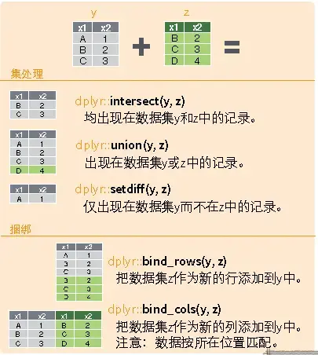

```R
library(dplyr)
# Horizontal
dplyr::left_join(a,b,by="x1")
dplyr::right_join(a,b,by="x1")
dplyr::inner_join(a,b,by="x1")
dplyr::outer_join(a,b,by="x1")
dplyr::semi_join(a,b,by="x1")
dplyr::anti_join(a,b,by="x1")
# Vertical
dplyr::intersect(a,b)
dplyr::union(a,b)
dplyr::setdiff(a,b)
dplyr::bind_rows(a,b)

# Example
# Match city data and pilot policy by id and year
# For partial matching, slice by index [m,n:l]
merged_data <- dplyr::left_join(中国城市数据库, 智慧城市,by = c("year", "id"))
merged_data2 <- merge(中国城市数据库[,3:5], 智慧城市, by = "year", all = TRUE)
```

### Handling Outliers

#### Removing Duplicates

```R
unique_data <- 中国城市数据库 %>%
  distinct(id, year, .keep_all = TRUE)
```

#### Data Imputation

`na.rm = TRUE` is a parameter usually used to specify whether to remove missing values when performing calculations on data. When the `na.rm` parameter is set to `TRUE`, the function removes missing values from the data before computing; when it is set to `FALSE` or omitted, the function includes the missing values and returns `NA` as the result.

**Cross-Sectional Interpolation**

```R
# Replace missing values in the gdp column of 中国城市数据库 with the column mean
中国城市数据库[is.na(中国城市数据库$gdp), ]$gdp <- mean(中国城市数据库$gdp, na.rm = TRUE)

# Replace outliers less than 0 in the score column of 中国城市数据库 with missing values
中国城市数据库[which(中国城市数据库$score < 0), ]$score <- NA

# Replace missing values in the score column of 中国城市数据库 with the column mean
中国城市数据库[is.na(中国城市数据库$score), ]$score <- mean(中国城市数据库$score, na.rm = TRUE)
```

**Panel Interpolation**

Referring to Stata's [interpolation command](https://blog.huaxiangshan.com/zh-cn/posts/data/#4%E6%8F%92%E5%80%BC%E6%B3%95), I found a similar interpolation method in R.

```R
library(dplyr)
library(zoo)
# Treat the data frame as panel data, group by id and year, and interpolate "地区生产总值.万元."
中国城市数据库_new <- 中国城市数据库 %>%
  arrange(id, year) %>%
  group_by(id)
# Interpolation
中国城市数据库_new <- 中国城市数据库_new %>%
  mutate(地区生产总值.万元. = na.approx(地区生产总值.万元.))
# Extrapolation
中国城市数据库_new <- 中国城市数据库_new %>%
  mutate(地区生产总值.万元. = na.approx(地区生产总值.万元., method = "constant"))
```

#### Winsorizing

Referring to [Equivalent Commands in R and Stata - statar](https://www.lianxh.cn/details/1228.html), using the `statar` package.

Values beyond a specific range are replaced with the value at the boundary of that range.

```R
library(statar)
statar::winsorize(v, probs = c(0.01, 0.99))

# R can also first compute the data distribution and then delete based on it
# Compute the percentiles
quantiles <- quantile(中国城市数据库2$R.D内部经费支出.万元., probs = c(0.01, 0.99))

# Replace the extreme values
中国城市数据库2$R.D内部经费支出.万元.[中国城市数据库2$R.D内部经费支出.万元. < quantiles[1]] <- quantiles[1]
中国城市数据库2$R.D内部经费支出.万元.[中国城市数据库2$R.D内部经费支出.万元. > quantiles[2]] <- quantiles[2]
```

#### Deleting Data

Delete blank values and values that don't apply to the questionnaire.

Since Stata can only operate on one table at a time, you add and remove everything on a single table; but R supports working with multiple tables, so in practice filtering is achieved by **extracting the appropriate data to form a new table**.

```R
# Delete the rows with year 2020, and drop columns 5 and 10
中国城市数据库_new <- 中国城市数据库[中国城市数据库$year != "2020", -c(5, 10)]

# Use a loop function
# Create a character vector containing the variable names to be imputed
var <- c("var0", "var1", "var2", "var3", "genshin")
# Loop through each variable name
for (i in var) {
  # Delete specific values in the variable
  data <- subset(data, !(data[, i] == -88 | data[, i] == -99 | is.na(data[, i]) | data[, i] <= 0))
}
```

## Plotting

This section refers to the electronic lecture notes [Statistical Software](https://www.math.pku.edu.cn/teachers/lidf/docs/Rbook/html/_Rbook/index.html) R by [Teacher Li Dongfeng](https://www.stat-center.pku.edu.cn/zxry/zxjy/ldf/1227393.htm).

[My data source](https://github.com/Mounment/R-Project/blob/master/%E7%BA%A2%E9%85%92%E6%95%B0%E6%8D%AE%E5%88%86%E6%9E%90/wineQualityReds.csv)

ggplot2 is about divide-and-conquer plotting, so its syntax consists of
$$
Step 1 (specify the dataset, specify the axes) + Step 2 (specify the plot type) + Plot 3 (decoration) + Combination 4 (......)
$$
The general steps for plotting with ggplot2 are:

- Prepare the data, usually a data frame, and generally in long format, i.e., each observation time takes one row and each observed variable takes one column.
- Input the data into the `ggplot()` function, and specify which graphical attributes each variable in the plot maps to, such as the x coordinate, y coordinate, color, shape, etc. These mappings are called aesthetic mappings, or aesthetics.
- Choose a suitable plot type; the function name starts with `geom_`, such as `geom_point()` for a scatter plot. The plot type is called a geom for short. Connect the `ggplot()` part and the `geom_xxx()` part with a plus sign. You can already make a plot at this point; the following steps are further refinements.
- Set an appropriate coordinate system, such as `coord_cartesian()`, `scale_x_log10()`, etc. Again connect with a plus sign.
- Set the title, legend position, and so on, such as `labs()`. Again connect with a plus sign.

A rough template for this workflow is:

```R
library(ggplot2)
p <- ggplot(data=<input data frame>,
  mapping=aes(<dimension>=<variable name>,
    <dimension>=<variable name>, <...>))
p + geom_<plot type>(<...>) + 
  scale_<mapping>_<type>(<...>) +
  coord_<type>(<...>) +
  labs(<...>)
```

### Scatter Plots and Line Plots

The syntax really doesn't feel as clean and convenient as Stata's (

- `geom_point()`: scatter points; similarly, add a line plot with `geom_line()`
- `geom_smooth()`: fitted line
- `scale_x_log10`: log-transform the x-axis with base 10
- `color = quality`: fill colors by group according to the `quality` variable
- `facet_wrap(~ quality)`: slice into groups by the `quality` variable; it can also be `(a~b)`, which is two-dimensional grouping. You can also use `facet_grid(row variable ~ column variable)`.

```R
setwd("F:/桌面/R")
testdata <- readr::read_csv("wineQualityReds.csv")
names(testdata)
library(ggplot2)
# qplot for quick plotting
qplot(x=chlorides , y=chlorides , data=testdata, geom = "point")

# Plot with ggplot
p <- ggplot(data = testdata,
            mapping = aes(
              x = residual.sugar,
              y = chlorides,
              color = quality,
              fill = quality))
p1 <- p + geom_point() + geom_smooth(method = "loess") + 
  scale_x_log10(labels = scales::dollar) +
  labs(
    x = "横坐标",
    y = "纵坐标",
    title = "test标题",
    subtitle = "随便找的数据",
    caption = "数据来源: github"
  )+  facet_wrap(~ quality)
print(p1)
ggsave(filename="文件名.png")
```

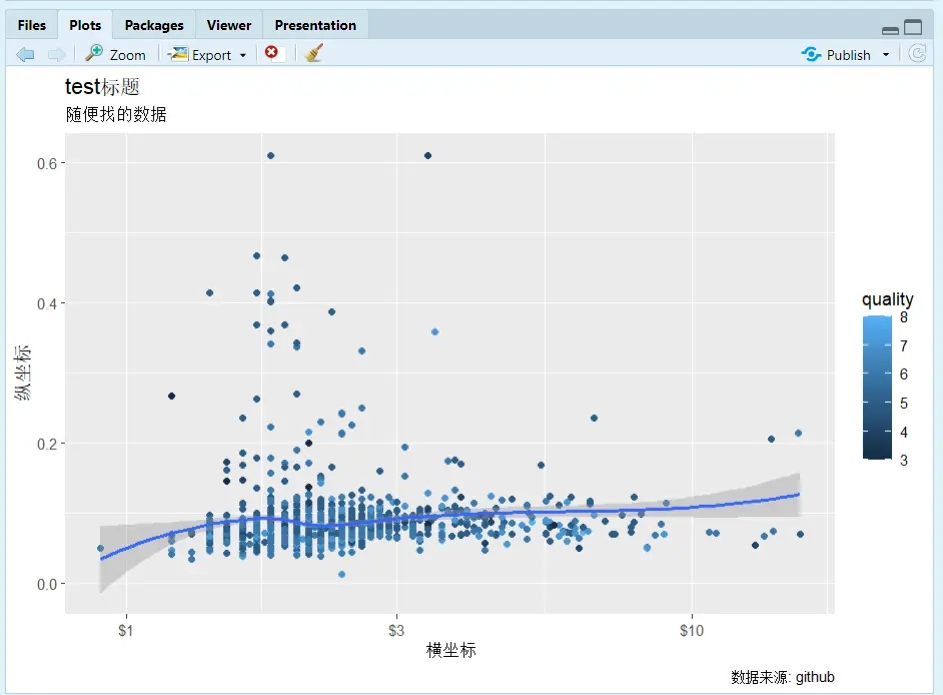

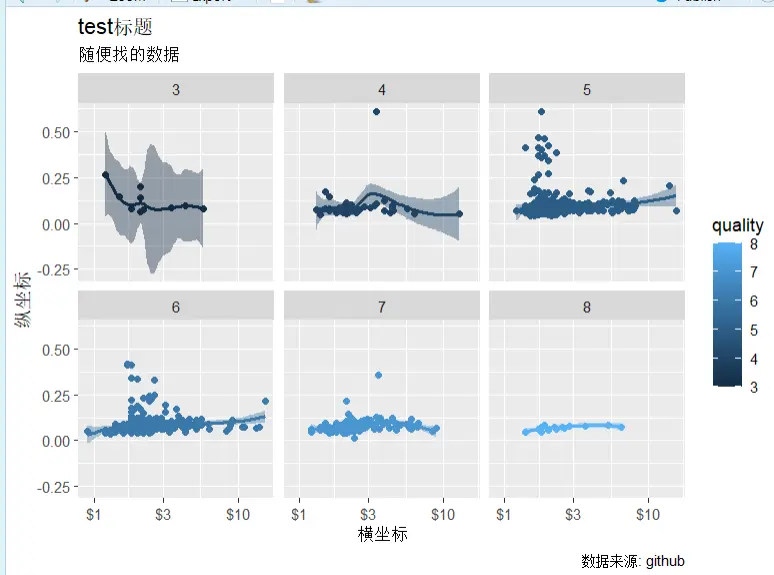

### Bar Charts

```R
# Count using the dataset
数据集 <- 原始数据集 |>
  select(分类变量) |>
  count(分类变量) |>
  mutate(比例值 = n / sum(n))


p<-ggplot(数据集, aes(
    x = 分类变量
	y = n, # Can also change to the ratio value
    fill =religion # Different categories in different colors ))
    
p+geom_col()
 +labs(y = "纵坐标名字")
 +guides(fill = "none") # Whether to remove the legend
 + coord_flip() # Swap the x and y axes
 + geom_col(position = "stack") # Stack
 +facet_grid(A ~ B) # Facet into groups
   

```

A bar chart grouped internally

```R
df3 <- gss_sm |>
  select(bigregion, religion) |>
  group_by(bigregion, religion) |>
  summarise(n = n(), .groups="drop_last") |>
  mutate(ratio = n / sum(n)) 

p <- ggplot(df3, aes(
    x = bigregion, 
    y = n,
    fill = religion)) 
p + geom_col()
```

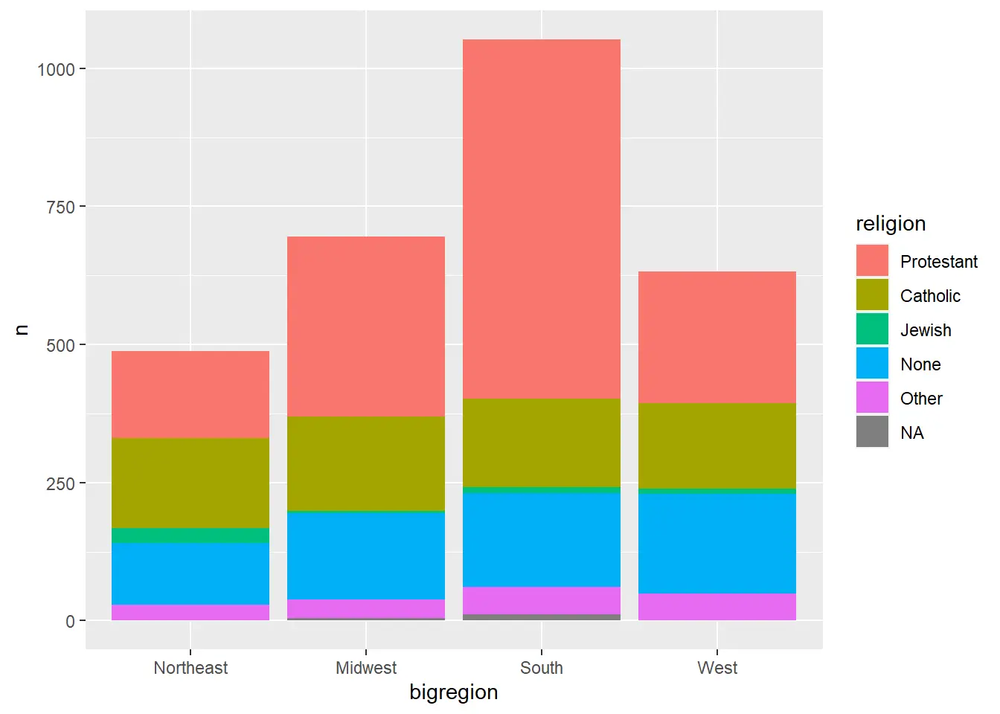
### Histograms

```R
# midwest is a dataset bundled with ggplot
# Histogram
p <- ggplot(midwest, aes(x = area))
p + geom_histogram()
# Kernel density plot
ggplot(midwest, aes(
  x = area, 
  color = state,
  fill = state)) +
  geom_density(alpha = 0.3) # alpha = 0.3 sets the transparency
# Histogram with kernel density
ggplot(midwest, aes(x = area)) +
  geom_histogram(
    mapping = aes(y = ..density..), 
    alpha = 0.6) +
  geom_density(size = 1.1)
```

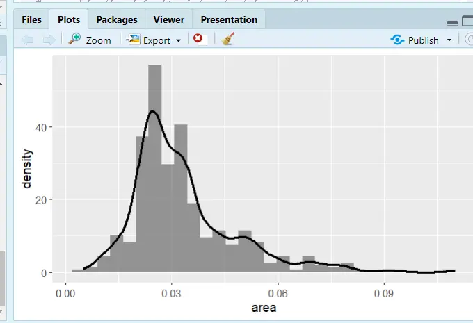
### Box Plots

```R
# Just change ggplot(dataset, aes(categorical x, target y))
p <- ggplot(midwest,aes(state,area))+
  stat_boxplot(geom = 'errorbar',width=0.3,cex=1)+ #errorbar
  geom_boxplot(cex=1)+
  labs(x=NULL)+
  theme_classic(base_size = 18)+
  theme(panel.border = element_rect(size = 1,fill = 'transparent'),
        legend.position = 'none',
        axis.text = element_text(color = 'black')) # Theme adjustments
p
```

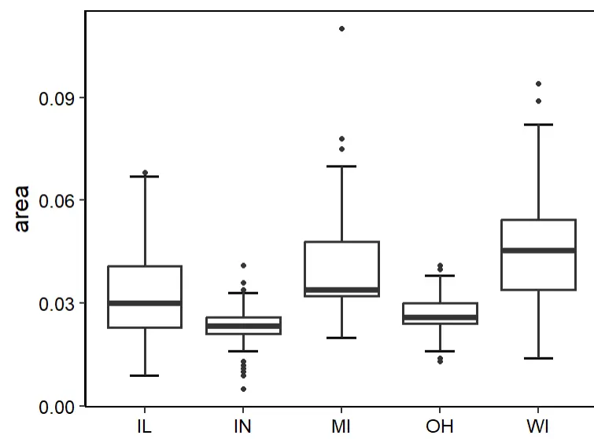

### Word Clouds

```R
library(wordcloud2)
wordcloud2(demoFreq)
```


### Correlation Heatmap

Reference: [Drawing Correlation Heatmaps in R](https://zhuanlan.zhihu.com/p/458889477)

```R
# Load the package      
library(ggcorrplot)    
cormtcars <- round(cor(mtcars), 3) # round() sets the number of decimal places
ggcorrplot(cor(cormtcars)) 

# The default is squares; change to circles and add the correlation coefficients
ggcorrplot(cormtcars,method = "circle",lab=T)

# Use the cor_pmat() function from the ggcorrplot package to compute p-values:
pmtcars <- cor_pmat(mtcars)
ggcorrplot(cormtcars,hc.order = T,  # Hierarchical clustering to reorder the matrix
           ggtheme = ggplot2::theme_void(base_size = 15), # Theme changes
           colors = c("CornflowerBlue","white","Salmon"), # Custom colors; choose what you like, or refer to the figure styles in well-designed papers.
           lab = T,lab_size = 5,    # Font size of the correlation coefficient text
           tl.cex = 15,             # Axis label font size
           p.mat = pmtcars,         # Add significance information
           sig.level = 0.01,        # Significance level
           pch = 4,                 # Mark the cells that aren't significant enough; pch selects the marking style, and you can try other numbers to see what style each gives
           pch.cex = 10)            # Size of the non-significant marks; use insig = "blank" to blank out the non-significant cells

```

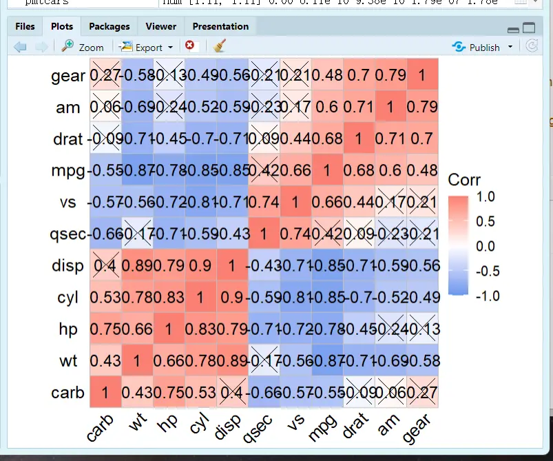

### Bubble Plots

```R
# Set the working environment
setwd("F:/桌面/R")
中国城市数据库 <- readxl::read_excel("中国城市数据库.xlsx")
# Load the packages
library(ggplot2)
library(dplyr)
# Rename the dataset columns
names(中国城市数据库)
str(中国城市数据库)
data<-rename(中国城市数据库,year = 年份 ,GDP = `地区生产总值(万元)` ,one = `第一产业增加值(万元)` ,id=`行政区划代码`)
data <- mutate(data,
             pro = substr(id, 1, 2), # Extract characters; the first two digits of cityid represent the province
             lgone=log(one,base=10)  # Log-transform
)
# Plot
p<-ggplot(data[1:400,],
          mapping =aes(
              x=year, 
              y=GDP, 
              size=lgone, # Bubble size weight
              color = pro,# Line color grouping, by province
              fill = pro))# Fill color grouping, by province
p+ geom_point(shape=21,colour="black",alpha = .5)+geom_smooth(method = "loess", aes(group = pro))
```

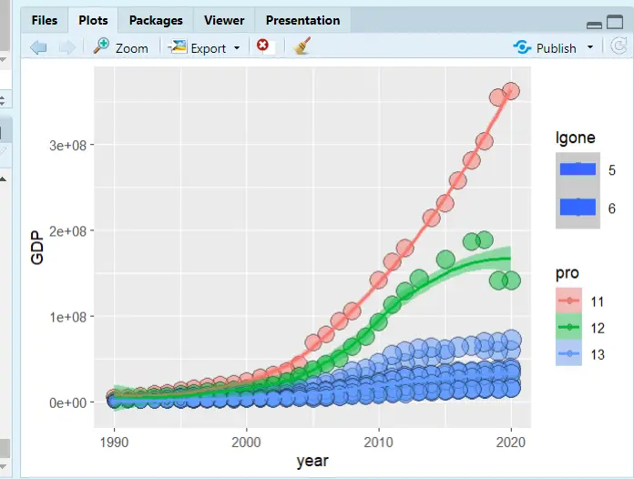

### Combining Plots

Recommended reading: [The most comprehensive guide to combining and stitching plots in R](https://cloud.tencent.com/developer/article/1515198)

#### Loading Packages and Plotting

```R
# Load the plotting packages
library(ggplot2)
library(ggprism)
library(reshape)
library(ggpubr)
# Data
df <- data.frame(A = c(1, 2, 3, 4, 5, 6, 8, 12, 13),
                 B = c(1, 2, 4, 5, 7, 10,5,6,8),
                 C = c(1, 5, 6, 7, 8, 9, 10, 11, 13),
                 D = c(1, 2, 5, 8, 10, 13,5,8,6))

df1=melt(df)
colnames(df1)=c("group","value")


# fig.1
p1<-ggplot(df1,aes(x=group,y=value))+
  stat_boxplot(geom = "errorbar", width=0.1)+
  geom_boxplot(aes(fill=group), 
               outlier.colour="white")+
  geom_jitter(width = 0.2)+
  theme_prism(palette = "candy_bright",
              base_fontface = "plain",
              base_family = "serif",
              base_size = 16,
              base_line_size = 0.8, 
              axis_text_angle = 45)+
  scale_fill_prism(palette = "candy_bright")+
  theme(legend.position="none")
p1


# fig.2
p2<-ggplot( df1, aes(x = group, y=value,color=group,fill=group) ) +
  geom_bar(stat="summary",fun=mean,position="dodge")+
  stat_summary(fun.data = 'mean_sd', geom = "errorbar", width = 0.3)+
  labs(x="Samples",y=NULL)+
  theme_prism(palette = "candy_bright",
              base_fontface = "plain",
              base_family = "serif",
              base_size = 16,
              base_line_size = 0.8, 
              axis_text_angle = 45)+
  scale_fill_prism(palette = "candy_bright")+
  theme(legend.position="none")
p2


# fig.3
p3<-ggplot(df1, aes(x = group, y=value,fill=group))+
  geom_violin(trim = T,position = position_dodge(width = 0.1))+
  geom_boxplot(alpha=1,outlier.size=0, size=0.3, width=0.2,fill="white")+
  stat_summary(fun="mean",geom="point",shape=21, size=2,fill="blue")+
  labs(x="Samples",y=NULL)+
  theme_prism(palette = "flames",
              base_fontface = "plain",
              base_family = "serif",
              base_size = 16, 
              base_line_size = 0.8,
              axis_text_angle = 45)+
  scale_fill_prism(palette = "candy_bright")+
  theme(legend.position = 'none')
p3


# fig.4
p4<-ggplot(df) +
  geom_segment(aes(x=A, xend=A, y=0, yend=B), color="grey",size=1) +
  geom_point( aes(x=A, y=B,color=A), size=4 ) +
  theme_prism(palette = "pearl",
              base_fontface = "plain", 
              base_family = "serif",
              base_size = 14,
              base_line_size = 0.8, 
              axis_text_angle = 45) +
  theme(legend.position = "none") +
  ggtitle("Lollipop Chart")
p4
```

#### Combining Plots

```R
# cowplot package
cowplot::plot_grid(p1,p2,p3,p4,ncol = 4)

# gridExtra package

gridExtra::grid.arrange(p1,p2,p3,p4,                        layout_matrix=rbind(c(1,2),c(3,4)))# Split the figure into 4 regions; the top two hold Figure 1 and Figure 2, and the bottom two hold Figure 3 and Figure 4

gridExtra::grid.arrange(p1,p2,p3,p4,                      layout_matrix=rbind(c(1,2,3,4)))# Arrange horizontally

gridExtra::grid.arrange(p1,p2,p3,p4,                    layout_matrix=rbind(c(1),c(2),c(3),c(4)))# Arrange vertically
```

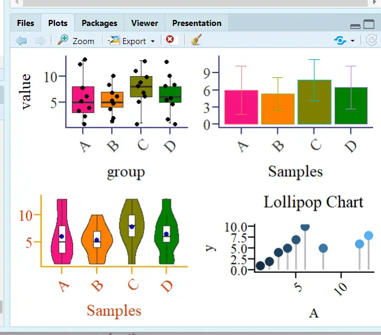

## Econometrics

Recommended package: the `bruceR` package developed by Zhihu expert [包寒吴霜](https://zhuanlan.zhihu.com/p/281150493), with the goal of replacing SPSS! I often read this expert's articles on regression, and in their view, economic regression is just a special variant of general/generalized/multilevel linear models.

> Since R is mainly used in biomedical statistics, the mainstream R package three-line tables and the three-line tables required in economics are not the same.

### Descriptive Statistics and Output

#### Descriptive Statistics

```R
library(bruceR) 
head(mtcars) # Data bundled with R
mtcarsdemo <- mtcars[c("mpg", "disp", "hp", "drat", "wt", "qsec")] 
Describe(mtcarsdemo, digits = 2, file = "describe") 
# digits means the number of decimal places to keep
# Output the result to Word
```

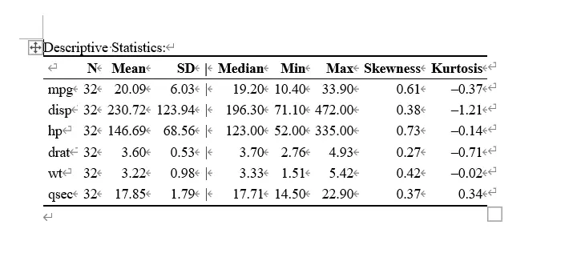

#### Correlation Analysis

The package this expert developed is terrifyingly good! Short, elegant, and efficient!

Still using the `Describe` command

```R
library(bruceR) 

Describe(mtcarsdemo, # Dataset
	digits = 2, 	 # Decimal places
	plot = T, 		 # Plotting feature
	upper.triangle = T, # Scatter plots in the upper-right triangle
	upper.smooth = "loess") # Fitted line; lm is linear, loess is quadratic
```

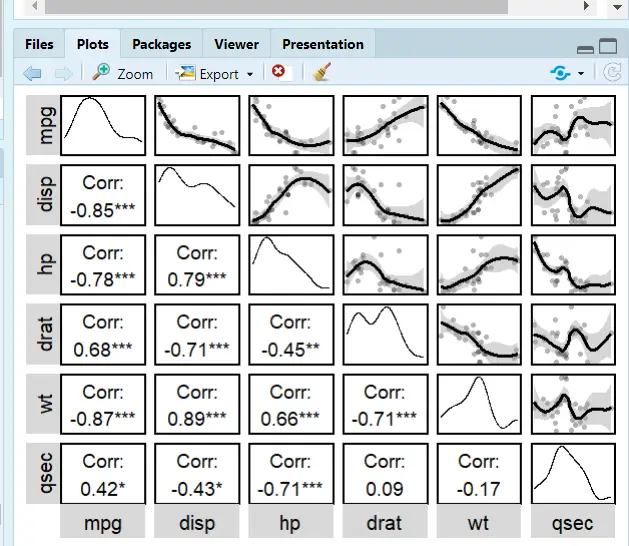
### Regression and Word Output

#### Regression

- `robust="HC1"`: robust mode setting; HC1 is `reg y x,r` in Stata
- `cluster="stratum"`: same as Stata; cluster is hierarchical clustering to handle autocorrelation
- `family=binomial`: whether to use binomial regression

```R
regress(Temp ~ Month + Day + Wind + Solar.R, data=airquality, robust=TRUE)
regress(case ~ age + parity + education + spontaneous + induced,
        data=infert, family=binomial, robust="HC1", cluster="stratum")
```

#### Regression Output

The `bruceR` package merges the three-line table output of reg into generalized multilevel regression,

The following two regression code snippets are equivalent:

```R
# Code 1:
lm2 = lm(Temp ~ Month + Day + Wind + Solar.R, data=airquality)
model_summary(lm2, robust="HC1")
# Code 2:
regress(Temp ~ Month + Day + Wind + Solar.R, data=airquality, robust=TRUE)
```

So use the `lm` model to output the regression results:

```R
library(bruceR) 
head(airquality) # Built-in dataset
names(airquality)
lm1 = lm(Temp ~ Month + Day, data=airquality)
lm2 = lm(Temp ~ Month + Day + Wind + Solar.R, data=airquality)
model_summary(lm1)
model_summary(lm2, robust="HC1")
model_summary(list(lm1, lm2), file="OLS Models.doc")
```

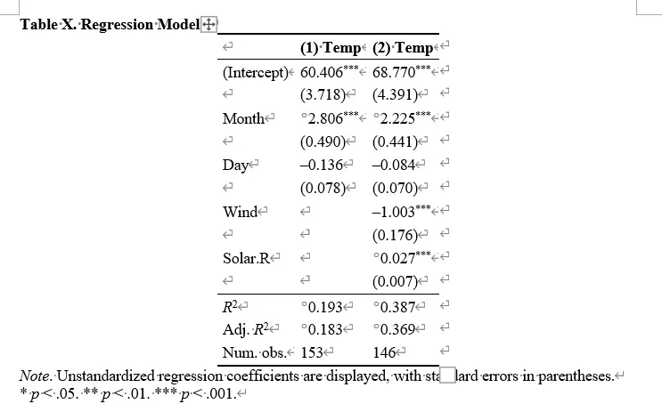


---

> Author: [滑翔闪](https://github.com/hzp2333/hzp2333.github.io)  
> URL: https://blog.huaxiangshan.com/en/posts/r2/  

