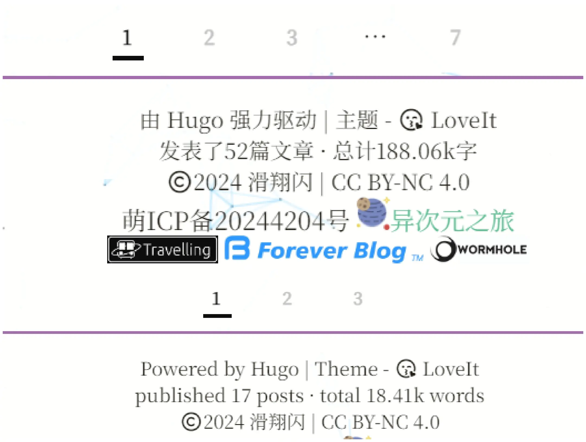
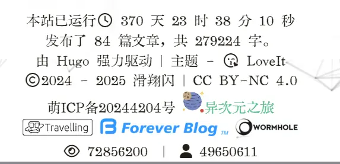
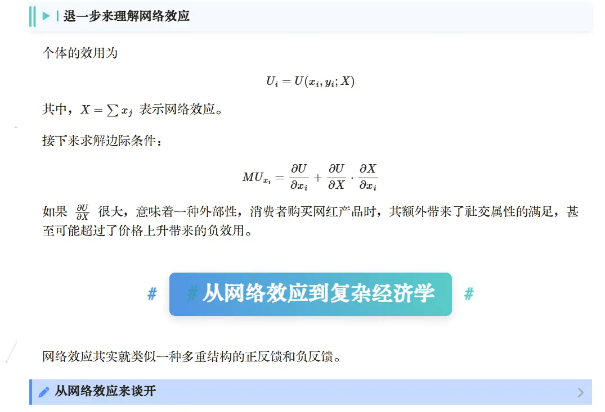
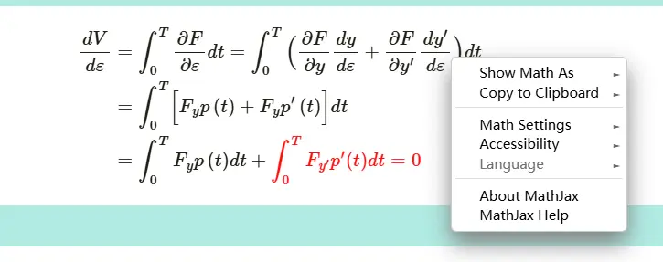

# Hugo Customization 2


## Custom fonts

See [Hugo Custom Fonts](https://blog.huaxiangshan.com/zh-cn/posts/font/)

## Site runtime with multilingual support


Add the **site runtime** and **total blog word count** to the footer, with automatic **multilingual** switching:

The effect looks like this:



A typical multilingual Hugo blog has an `i18n` file, whose purpose is to read the page language parameter and then replace the corresponding text.
### Total word count

#### Adding a total blog word count

Find `<your blog folder>\layouts\partials\footer.html`,

and add the following code inside it:

```HTML

{{ $articleCount := len .Site.RegularPages }}
{{ $totalWordCount := 0 }}
{{ range .Site.Pages }}
{{ $totalWordCount = add $totalWordCount .WordCount }}
{{ end }}

{{ i18n "articleCount" (dict "Count" $articleCount) }}，{{ i18n "totalWordCount" (dict "WordCount" $totalWordCount) }}。

```

Then find `<your blog folder>\i18n`

and add the following in `zh-CN.toml`:

```HTML
# === footer/wordcount ===

[articleCount]
other = "发布了 {{ .Count }} 篇文章"

[totalWordCount]
other = "共 {{ .WordCount }} 字"
```

and add the following in `en.toml`:

```HTML
# === footer/wordcount ===

[articleCount]
other = "published {{ .Count }} posts"

[totalWordCount]
other = "total {{ .WordCount }} words"
```

>Multilingual switching is clearly a one-to-one character match.
>
>So in the `i18n` file, each [call name] can only have one `other=`, and [call names] must not be duplicated, so that characters can be switched one-to-one automatically.

#### A bug

If, like me, you added a music player to every blog post page via aplayer, you'll hit a bug.

 

Hugo's built-in word count conflicts with aplayer. A pure-music player will disappear, while a player with lyrics might stick around. The reason is unknown. When rendering locally, updating the blog content and triggering a refresh makes the music player reappear, but after uploading to GitHub for rendering it doesn't work.



Recently I used Claude Code with the DeepSeek v3.2 model to test this bug.

I found the music plugin's failure is roughly due to this:

The LoveIt theme uses Hugo's Scratch system as a "feature flag" mechanism:

- The `music` shortcode sets this when it executes: `{{- .Page.Scratch.SetInMap "this" "music" true -}}`
- `assets.html` checks: `{{- if (.Scratch.Get "this").music -}}` to load the music assets.

`wordcount.html` introduces a **change**:

```go
{{- $posts := where .Site.RegularPages "Type" "posts" -}}
{{- range $posts -}}
  {{- $totalWords = add $totalWords .WordCount -}}
  {{- $totalPosts = add $totalPosts 1 -}}
{{- end -}}
```

When Hugo executes `.Site.RegularPages`:

To get the WordCount, Hugo needs to compute each post's content, which resets the page's Scratch state. In the process, the Scratch state that was maintained within a single rendering pass gets disturbed.

My personal observation is that whether a comment plugin is installed also affects this bug, seemingly for the same reason — the Scratch state value appears to be cleared.

In the comment section, `layouts/partials/comment.html` has code like this:

```html
{{- dict "comment" $commentConfig | dict "config" | merge (.Scratch.Get "this") | .Scratch.Set "this" -}}
```

Local rendering can reload the `this` map in scratch by updating the site, but after uploading to GitHub it tends to get mapped to empty.

The modified flow:

```txt
Previous flow: music shortcode → Scratch set → theme conditional check → load assets
Modified flow: directly detect the DOM → dynamically load assets → self-initialize
```




Looking back, this bug is quite similar to the one in [Chinese blog TOC navigation failure](https://blog.huaxiangshan.com/zh-cn/posts/toc/).
### Site runtime

#### Adding a custom `custom.js`

Create a custom JavaScript file `\static\js\custom.js` in the site root directory.

Write the following code into it:

```js
/* Site runtime */
// Get the current language setting
function getCurrentLanguage() {
    // Assume you have a global variable or method to get the current language
    return document.documentElement.lang || 'zh'; // Defaults to Chinese
}

// Update the site runtime
function runtime() {
    window.setTimeout(runtime, 1000);
    let startTime = new Date('02/18/2024 15:00:00');
//Write your own site launch time here
    let endTime = new Date();
    let usedTime = endTime - startTime;
    let days = Math.floor(usedTime / (24 * 3600 * 1000));
    let leavel = usedTime % (24 * 3600 * 1000);
    let hours = Math.floor(leavel / (3600 * 1000));
    let leavel2 = leavel % (3600 * 1000);
    let minutes = Math.floor(leavel2 / (60 * 1000));
    let leavel3 = leavel2 % (60 * 1000);
    let seconds = Math.floor(leavel3 / (1000));

    // Select the corresponding text based on the language setting
    let language = getCurrentLanguage();
    let runtimeText;

    if (language === 'zh') {
        runtimeText = '本站已运行<i class="far fa-clock fa-fw"></i> '
            + ((days < 10) ? '0' : '') + days + ' 天 '
            + ((hours < 10) ? '0' : '') + hours + ' 时 '
            + ((minutes < 10) ? '0' : '') + minutes + ' 分 '
            + ((seconds < 10) ? '0' : '') + seconds + ' 秒 ';
    } else if (language === 'en') {
        runtimeText = 'Running for <i class="far fa-clock fa-fw"></i> '
            + ((days < 10) ? '0' : '') + days + ' d '
            + ((hours < 10) ? '0' : '') + hours + ' h '
            + ((minutes < 10) ? '0' : '') + minutes + ' m '
            + ((seconds < 10) ? '0' : '') + seconds + ' s ';
    } else {
        // Default text (you can choose another language or keep Chinese/English)
        runtimeText = '本站已运行<i class="far fa-clock fa-fw"></i> '
            + ((days < 10) ? '0' : '') + days + ' 天 '
            + ((hours < 10) ? '0' : '') + hours + ' 时 '
            + ((minutes < 10) ? '0' : '') + minutes + ' 分 '
            + ((seconds < 10) ? '0' : '') + seconds + ' 秒 ';
    }

    // Update the content on the page
    document.getElementById('run-time').innerHTML = runtimeText;
}

runtime();

```

Those who are interested can also check out this site's complete [custom.js](https://github.com/hzp2333/hzp2333.github.io/blob/master/js/custom.js).

Find `<your blog folder>\layouts\partials\assets.html`, and add the following code on the line above the `{{- partial "plugin/analytics.html" . -}}` at the very end:
```html
<script type="text/javascript" src="https://cdn.jsdelivr.net/npm/jquery@2.1.3/dist/jquery.min.js"></script>

{{- /* custom js file */ -}}

<script type="text/javascript" src="/js/custom.js"></script>
```

This way the blog can call the custom js file. Other js files can be written here too.
#### Modifying `i18n`


Find `<your blog folder>\i18n`

Add the following in `zh-CN.toml`:

```HTML
[runtime]
other = "本站已运行{{ .Days }}天 {{ .Hours }}小时 {{ .Minutes }}分钟 {{ .Seconds }}秒"
```

Add the following in `en.toml`:

```HTML
[runtime]
other = "The site has been running for {{ .Days }} days {{ .Hours }} hours {{ .Minutes }} minutes {{ .Seconds }} seconds"
```

## Background

### Blog background

We can set the blog background by directly adding a js file in `footer.html`.

This post uses the honeycomb striped network. There are other js options too, like grid, sphere, wave, ribbon...

For a reference, see: [Some recommended clean and pretty blog background effects](https://herenpeng.github.io/2023/03/14/javascript/%E6%8E%A8%E8%8D%90%E5%87%A0%E7%A7%8D%E7%AE%80%E6%B4%81%E7%BE%8E%E8%A7%82%E7%9A%84%E5%8D%9A%E5%AE%A2%E8%83%8C%E6%99%AF%E6%95%88%E6%9E%9C/)

```js
Ribbon:

<script id="ribbon" size="150" alpha='0.9' zIndex="-2" src="https://cdn.jsdelivr.net/gh/theme-next/theme-next-canvas-ribbon@1/canvas-ribbon.js"></script>

Wave:

<script src="https://cdnjs.cloudflare.com/ajax/libs/three.js/87/three.js"></script>
<script src="https://cdn.jsdelivr.net/gh/theme-next/theme-next-three@latest/three-waves.min.js" ></script>

Honeycomb:

<script src="https://cdn.bootcss.com/canvas-nest.js/1.0.0/canvas-nest.min.js"></script>

Random dots:

<script src="https://cdnjs.cloudflare.com/ajax/libs/three.js/87/three.js"></script>
<script src="https://cdn.jsdelivr.net/gh/theme-next/theme-next-three@latest/canvas_lines.min.js" ></script>

Light sphere:

<script src="https://cdnjs.cloudflare.com/ajax/libs/three.js/87/three.js"></script>
<script src="https://cdn.jsdelivr.net/gh/theme-next/theme-next-three@latest/canvas_sphere.min.js" ></script>

```

### Notes

Introducing a js background needs to limit its scope.

For example, if you introduce it in the footer without defining a scope, the footer links will be covered and become unclickable.



It's best to define an environment block at the start of the footer for layering:

```js

<!-- Footer -->
<footer class="footer">
    <div class="footer-container">
        <div class="footer-line">

```

Finally, set the introduced js to the **bottom layer**: `data-zIndex="-1"`

```js
    <!-- Include canvas-nest.min.js -->
    <script src="https://cdn.bootcss.com/canvas-nest.js/1.0.0/canvas-nest.min.js" 
        data-color="0,0,0" 
        data-count="150" 
        data-zIndex="-1">
    </script>
</body>
</html>
```


## Mascot

I added it in `header.html`:

```html
<!DOCTYPE html>
<html lang="zh">
<head>
  <meta charset="UTF-8">
  <meta name="viewport" content="width=device-width, initial-scale=1.0">
  <title>Sakana widget integration</title>
  <style>
    /* Fix the Sakana widget to the bottom-left of the page */
    #sakana-widget-container {
      position: fixed;
      bottom: 10px;
      left: 10px;
      width: 268px;
      height: 268px;
    }
    #sakana-widget {
      width: 100%;
      height: 100%;
    }
  </style>
</head>
<body>
  <div id="sakana-widget-container">
    <div id="sakana-widget"></div>
  </div>

  <script>
    function initSakanaWidget() {
      new SakanaWidget({
        size: 300,
        autoFit: true,
        character: 'chisato',
        controls: true,
        rod: true,
        draggable: true,
        stroke: { color: '#b4b4b4', width: 10 },
        threshold: 0.1,
        rotate: 0,
        title: false
      }).mount('#sakana-widget');

      // Detect the screen width on init
      checkScreenWidth();
      window.addEventListener('resize', checkScreenWidth);
    }

    function checkScreenWidth() {
      var screenWidth = window.innerWidth;
      var container = document.getElementById('sakana-widget-container');
      if (screenWidth <= 960) {
        container.style.display = 'none';
      } else {
        container.style.display = 'block';
      }
    }
  </script>

  <!-- Only initialize after the library finishes loading -->
  <script 
    async
    onload="initSakanaWidget()"
    src="https://cdn.jsdelivr.net/npm/sakana-widget@2.2.2/lib/sakana.min.js">
  </script>
</body>
</html>


```

## Heading styles

### What I changed

The heading styles I changed:

- **H2 to H6 headings**:
	- Font size shrinks step by step from 30.
	- Added interactivity — hover to enlarge.
	- Keeps each heading on its own line.
- **H2**: shadow effect, gradient blue box + surrounded by `#`, centered
- **H3 to H6**:
	- The lower the level, the more vertical lines. For example, the H4 heading (`#### h4`) in the image has two vertical lines on the left, while H3 has only one.
	- Headings are wrapped in a transparent box with a shadow effect.
	- Compatible with day/night mode switching.
- **H4 to H6**: added an equilateral triangle as decoration.

The effect looks like this:



### How to change

In `<your blog>\assets\css\_custom.scss`, add the following:

> If you previously customized heading styles, remember to delete them.

```js
/* Headings **************************/

/* ====================================================================== */
/* H2 heading: centered + gradient + left/right # decoration */
/* ====================================================================== */
.page.single h2 {
    position: relative !important;
    display: block !important; /* Make sure the heading is a block-level element occupying its own line */
    width: max-content !important; /* Let width adapt to content so margin: auto can center it */
    margin: 2.5rem auto !important; /* Center the block-level element */
    font-weight: bold !important;
    font-size: 30px !important;
    line-height: 1.4 !important;
    color: #fff !important;
    background: linear-gradient(90deg, #4a90e2, #50c9c3) !important;
    border-radius: 8px !important;
    padding: 10px 24px !important;
    text-align: center !important;
    /* --- Enhanced Shadow --- */
    box-shadow: 0 4px 12px rgba(0, 0, 0, 0.15) !important;
    transition: all 0.3s ease !important; /* Keep transition for smooth hover */
}

/* --- H2 Interactive Hover Effect --- */
.page.single h2:hover {
    box-shadow: 0 8px 20px rgba(0, 0, 0, 0.25) !important; /* Deeper shadow on hover */
    transform: scale(1.02) !important; /* Keep only the enlargement effect */
    cursor: pointer !important;
}

/* H2 Dark Mode Shadow */
[data-theme="dark"] .page.single h2 {
    box-shadow: 0 5px 15px rgba(0, 0, 0, 0.3) !important;
}

/* H2 Dark Mode Hover */
[data-theme="dark"] .page.single h2:hover {
    box-shadow: 0 8px 25px rgba(0, 0, 0, 0.6) !important;
}


/* Hide the theme's auto-generated anchor */
.page.single h2 .headerlink,
.page.single h2 a.headerlink {
    display: none !important;
}

/* H2 left/right # decoration */
.page.single h2::before {
    content: "#" !important;
    position: absolute !important;
    left: -32px !important;
    top: 50% !important;
    transform: translateY(-50%) !important;
    color: #4a90e2 !important;
    font-weight: bold !important;
    font-size: 1.4rem !important;
}

.page.single h2::after {
    content: "#" !important;
    position: absolute !important;
    right: -32px !important;
    top: 50% !important;
    transform: translateY(-50%) !important;
    color: #50c9c3 !important;
    font-weight: bold !important;
    font-size: 1.4rem !important;
}

/* ====================================================================== */
/* H3-H6: left-aligned + multiple vertical lines for levels + light background + shadow + triangle symbol */
/* ====================================================================== */

/* Hide built-in anchor */
.page.single h3 a.headerlink,
.page.single h4 a.headerlink,
.page.single h5 a.headerlink,
.page.single h6 a.headerlink {
    display: none !important;
}

/* Common base styles */
.page.single h3,
.page.single h4,
.page.single h5,
.page.single h6 {
    position: relative !important;
    display: block !important;
    margin: 20px 0 12px !important;
    line-height: 1.5 !important;
    font-weight: bold !important;
    border-radius: 0 6px 6px 0 !important;
    /* --- Transparent background for light mode --- */
    background: rgba(74, 144, 226, 0.05) !important;
    /* --- Enhanced shadow for light mode --- */
    box-shadow: 0 2px 5px rgba(0, 0, 0, 0.08) !important;
    transition: all 0.3s ease !important; /* Keep transition for smooth hover */
}

/* --- H3-H5 Interactive Hover Effect --- */
.page.single h3:hover,
.page.single h4:hover,
.page.single h5:hover {
    transform: translateX(4px) !important; /* Move slightly to the right */
    background: rgba(74, 144, 226, 0.1) !important; /* Increase opacity */
    box-shadow: 0 4px 10px rgba(0, 0, 0, 0.12) !important; /* Slightly stronger shadow */
    cursor: pointer !important;
}


/* Dark Mode General Styles */
[data-theme="dark"] .page.single h3,
[data-theme="dark"] .page.single h4,
[data-theme="dark"] .page.single h5,
[data-theme="dark"] .page.single h6 {
    /* --- Lighter, transparent background for dark mode --- */
    background: rgba(255, 255, 255, 0.08) !important;
    /* --- Stronger, darker shadow for dark mode --- */
    box-shadow: 0 2px 8px rgba(0, 0, 0, 0.3) !important;
    color: #E5E7EB !important; /* Ensures text is light */
}

/* Dark Mode H3-H5 Hover */
[data-theme="dark"] .page.single h3:hover,
[data-theme="dark"] .page.single h4:hover,
[data-theme="dark"] .page.single h5:hover {
    transform: translateX(4px) !important;
    background: rgba(255, 255, 255, 0.15) !important; /* Increase opacity */
    box-shadow: 0 4px 10px rgba(0, 0, 0, 0.5) !important; /* Stronger shadow */
}


/* H3: 1 vertical line */
.page.single h3 {
    font-size: 22px !important;
    padding: 10px 18px !important;
}
.page.single h3::before {
    content: "" !important;
    position: absolute !important;
    left: 0 !important;
    top: 0 !important;
    bottom: 0 !important;
    width: 5px !important;
    background-color: #4a90e2 !important;
    border-radius: 3px 0 0 3px !important;
}

/* H4: ▶ + 2 vertical lines */
.page.single h4 {
    font-size: 18px !important;
    padding: 8px 14px 8px 38px !important; /* Increased left padding for symbol */
}
/* Triangle Symbol */
.page.single h4::before {
    content: "▶" !important;
    position: absolute !important;
    left: 18px !important;
    top: 50% !important;
    transform: translateY(-50%) !important;
    font-size: 12px !important;
    color: #50c9c3 !important;
}
/* Two Vertical Lines (efficiently using box-shadow) */
.page.single h4::after {
    content: "" !important;
    position: absolute !important;
    left: 0 !important;
    top: 15% !important; /* Make lines shorter than heading height */
    bottom: 15% !important;
    width: 3px !important;
    background-color: #50c9c3 !important;
    border-radius: 2px !important;
    box-shadow: 6px 0 0 #50c9c3 !important; /* Creates the second line */
}

/* H5: ▶ + 3 vertical lines */
.page.single h5 {
    font-size: 16px !important;
    padding: 6px 14px 6px 42px !important; /* Increased left padding */
}
/* Triangle Symbol */
.page.single h5::before {
    content: "▶" !important;
    position: absolute !important;
    left: 22px !important;
    top: 50% !important;
    transform: translateY(-50%) !important;
    font-size: 10px !important;
    color: #34495e !important;
}
/* Three Vertical Lines (using box-shadow) */
.page.single h5::after {
    content: "" !important;
    position: absolute !important;
    left: 0 !important;
    top: 15% !important;
    bottom: 15% !important;
    width: 2px !important;
    background-color: #34495e !important;
    border-radius: 2px !important;
    box-shadow: 5px 0 0 #34495e, 10px 0 0 #34495e !important; /* Creates 2nd and 3rd lines */
}

/* NEW H6: ▶ + 1 dashed line */
.page.single h6 {
    font-size: 15px !important;
    padding: 5px 12px 5px 30px !important;
    background: none !important; /* Simpler style for H6 */
    box-shadow: none !important;
    border-radius: 0 !important;
    border-bottom: 1px solid #eee !important;
}
[data-theme="dark"] .page.single h6 {
    border-bottom: 1px solid #444 !important;
}
/* Triangle Symbol */
.page.single h6::before {
    content: "▶" !important;
    position: absolute !important;
    left: 8px !important;
    top: 50% !important;
    transform: translateY(-50%) !important;
    font-size: 10px !important;
    color: #777 !important;
}
[data-theme="dark"] .page.single h6::before {
    color: #888 !important;
}

/* --- H6 Interactive Hover Effect --- */
.page.single h6:hover {
    transform: translateX(2px) !important; /* Smallest shift */
    color: #4a90e2 !important; /* Highlight text color */
    cursor: pointer !important;
}
[data-theme="dark"] .page.single h6:hover {
    color: #50c9c3 !important;
}

```


## Rendering math formulas in the blog

Although the **[LoveIt](https://hugoloveit.com/zh-cn/theme-documentation-content/#%E6%95%B0%E5%AD%A6%E5%85%AC%E5%BC%8F)** theme provides math formula support via [KaTeX](https://katex.org/), I personally think the experience is not as good as [MathJax](https://www.mathjax.org/).

To use `MathJax`, first create `mathjax.html` in `<your blog>\layouts\partials`.

`mathjax.html`: right-click on the site's formulas to support copying the formula code.



```html
{{ if .Params.math }}
<script>
  MathJax = {
    tex: {
      inlineMath: [["$", "$"]],
    },
    displayMath: [
      ["$$", "$$"],
      ["\[\[", "\]\]"],
    ],
    svg: {
      fontCache: "global",
    },
  };
</script>
<script src="https://polyfill.io/v3/polyfill.min.js?features=es6"></script>
<script
  id="MathJax-script"
  async
  src="https://cdn.jsdelivr.net/npm/mathjax@3/es5/tex-mml-chtml.js"
></script>
{{ end }}
```

Then add the call in `<your blog>\layouts\partials\header.html`:

```html
{{ partial "mathjax.html" . }}
```

In each post, to enable math formula rendering, put this at the top:

```
Math = true
```


Since Hugo, when rendering Markdown documents, generates HTML based on syntax like `_`/`*`/`>>`, and some escaped-character text (like `\(`/`\)`/`\[`/`\]`/`\\`) gets escaped automatically, you need extra escape-character expressions in these places to enable automatic rendering:

- `_` -> `\_`
- `*` -> `\*`
- `>>` -> `\>>`
- `\(` -> `\\(`
- `\)` -> `\\)`
- `\[` -> `\\[`
- `\]` -> `\\]`
- `\\` -> `\\\\`

For example, if I render the following formula:

```
\[
V(\varepsilon)=\int_{0}^{T}F[t,\underbrace{y^{*}\left(t\right)+\varepsilon p\left(t\right)}_{y(t)},\underbrace{y^{*}\left(t\right)+\varepsilon p^{\prime}\left(t\right)}_{y^{’}\left(t\right)}]dt
\]
```

It will actually become:

\[
V （\varepsilon）=\int_{0}^{T}F[t,\underbrace{y^{*}\left （t\right）+\varepsilon p\left （t\right）}_{y （t）},\underbrace{y^{*}\left （t\right）+\varepsilon p^{\prime}\left （t\right）}_{y^{’}\left （t\right）}]dt
\]

Only by converting to `\_` `^\*` `\\[ \\]` is it correct:

```
\\[
V(\varepsilon)=\int\_{0}^{T}F[t,\underbrace{y^{\*}\left(t\right)+\varepsilon p\left(t\right)}\_{y(t)},\underbrace{y^{\*}\left(t\right)+\varepsilon p^{\prime}\left(t\right)}\_{y^{'}\left(t\right)}]dt
\\]
```

\\[
V （\varepsilon）=\int\_{0}^{T}F[t,\underbrace{y^{\*}\left （t\right）+\varepsilon p\left （t\right）}\_{y （t）},\underbrace{y^{\*}\left （t\right）+\varepsilon p^{\prime}\left （t\right）}\_{y^{'}\left （t\right）}]dt
\\]

But in my own experience, sometimes converting only half the commands in a formula is enough for it to render — how many commands to convert seems related to rendering complexity.

For example, I render `$2\_i^\*-2_j^*$` — $2_i^\*-2_j^*$, and since the formula is simple, it renders the same whether or not I convert the commands.


## References

- [Total word count]( https://thirdshire.com/hugo-stack-renovation/#%E6%80%BB%E5%AD%97%E6%95%B0%E7%BB%9F%E8%AE%A1%E5%8F%91%E8%A1%A8%E4%BA%86x%E7%AF%87%E6%96%87%E7%AB%A0%E5%85%B1%E8%AE%A1x%E5%AD%97 )
- [Adding site runtime](https://lewky.cn/posts/hugo-3.2.html/#%E6%B7%BB%E5%8A%A0%E7%AB%99%E7%82%B9%E8%BF%90%E8%A1%8C%E6%97%B6%E9%97%B4)
- [Some Hugo template syntax](https://zishu.me/blog/213.html/)
- [Hugo total post count and total word count](https://flynx.dev/post/hugo-total-count/)


---

> Author: [滑翔闪](https://github.com/hzp2333/hzp2333.github.io)  
> URL: https://blog.huaxiangshan.com/en/posts/runtime/  

