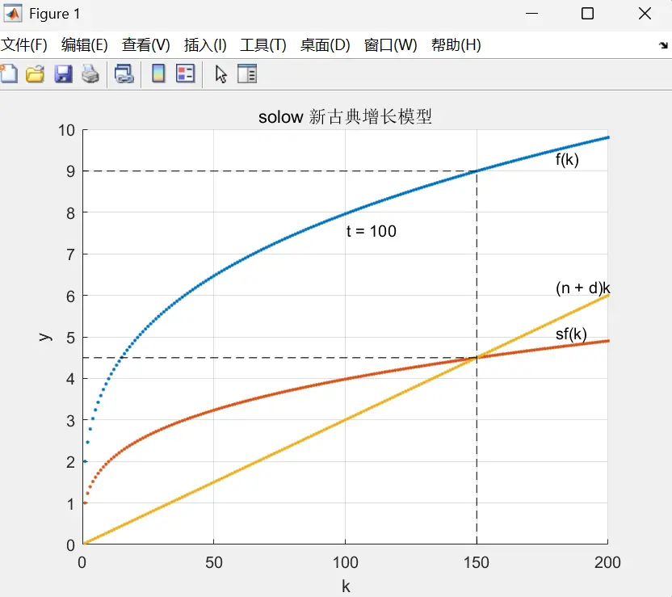
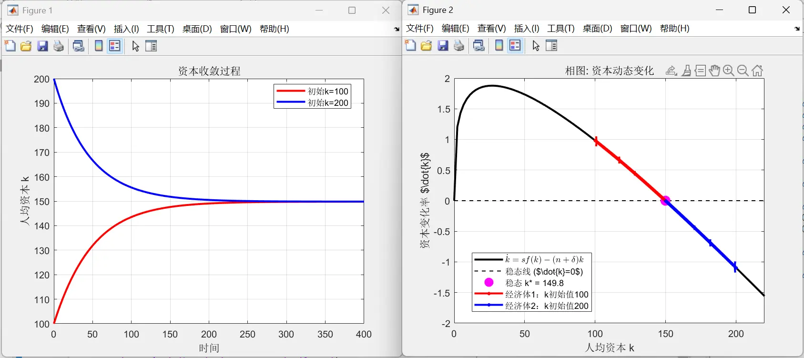
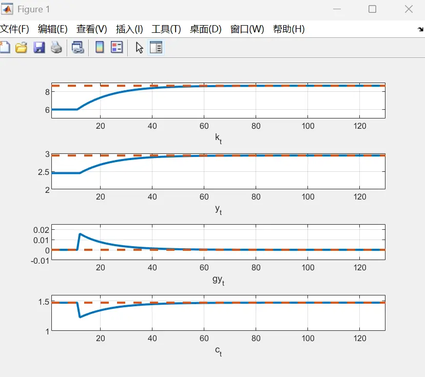

# Solow Model MATLAB Simulation Code


> "Once you start thinking about (how the economy grows), you can't think about anything else."
> 
> — Robert E. Lucas
## The Idea of the Solow Model

Robert Merton Solow, the 1987 Nobel laureate in economics, passed away on December 21, 2023, at the age of 99. This blog post was written in his memory[^1].


Although the Solow model's assumptions are fairly strict[^2] and it has since given way to later models, he pioneered the neoclassical analytical paradigm of "economic growth", and the "**total factor productivity**" (the Solow residual) that his conclusions produced has become one of the most important evaluation indicators of a contemporary economy.

Its conceptual framework is:

1. Decompose the contribution to economic growth (output) into several basic factors: labor, capital, technological progress, population growth...
2. The process of economic growth is the process of factor changes; we can try to characterize the dynamic process of factor growth.
3. There is convergence in the dynamic changes of factors; the time-path of a factor moving from non-convergence to convergence is a balanced growth path of an economy.

$$\dot{k}=f(k)$$

Take the formula above, for example; simply put, it characterizes the relationship between the per-capita capital **growth rate** ($\dot{k}$) and the **per-capita** capital **stock** (${k}$).

**Convergence** means that after per-capita capital grows to a certain level, the growth rate becomes hard to increase further and instead approaches 0. In the formula, this is: $△k=0=\dot{k}=f(k)$.

> Like the Malthusian population trap: when per-capita income rises, people get richer and are more likely to have children; the population grows, and per-capita income falls. When per-capita income falls, people get poorer and have fewer children; the population shrinks, and per-capita income rises again. This back-and-forth — the process that makes per-capita income **tend toward stability** — is the process in which per-capita income and its growth rate restrain each other.
> 
> The Solow model does further decomposition on top of this.
> 
> - A lower starting point means progress may be faster; a higher starting point means progress may be slower.
> - What the Solow model tries to explain is the phenomenon that "low-income countries develop faster than high-income countries in the early stage". For example, after World War II, postwar Asian countries entered a golden age of development. After the war people preferred saving, which also inspired Solow to assume an exogenous saving rate.
> - The convergence property of the Solow model later inspired scholars to discuss whether the economic levels of high-income and developing countries would converge. See another blog post, *[Convergence: From the "Limit of a Formula" to the "Limit of Growth"](https://blog.huaxiangshan.com/zh-cn/posts/shounian/)*.

Here I mainly introduce the MATLAB plotting code, so I won't go into the mathematical proof.
For a more detailed explanation of the Solow model, see:

- [Solow Model](https://blog.econfinny.com/2024/11/17/solow-model/)
- [Intermediate Macroeconomics | Lecture 3: The Solow Growth Model](https://mp.weixin.qq.com/s/fhhiaZrmlYW70oibSTagWA)
- [Advanced Macroeconomics Notes (Romer Edition)](https://zhuanlan.zhihu.com/p/613416303)


The two core steady states of the Solow model:

Solving for the steady state:
$$
\dot{k}=sf(k)-(n+\delta)k=0
$$


Solving for the golden rule:

$$
f^{\prime}(k_{\mathrm{gold}})=n+\delta
$$


## MATLAB Convergence Plot



The plotting code is divided into four parts:

1. Set parameters: initial per-capita capital, depreciation rate, saving rate, technological progress rate, total factor productivity growth rate, population growth rate, number of periods, and capital input elasticity.

```matlab
t=100; % number of periods
kmax=200; % maximum capital per worker
alpha=0.3; % elasticity of output with respect to capital input
s=0.5; % marginal propensity to save
n=0.02; % population growth rate
d=0.01; % capital depreciation rate
A0=2; % total factor productivity
K=1:kmax; % capital level per worker (horizontal axis)
```


Very often, the most controversial part of a macro model is the parameters. Improvements in mathematical models, empirical evidence from micro data, statistical methods, and our understanding of the roles of factors all affect the range of parameter values.


2. Set the functions:
 $$f(k)=Ak^\alpha$$
  $$\dot{k_t}=sf(k_t)-(n+g+d)k_t$$
```matlab
for k1=1:kmax % loop along the horizontal axis to compute the function values
y(k1,1)=A0*(k1^alpha); % total production function
sy(k1,1)=s*y(k1,1); % actual investment
nd(k1,1)=(n+d)*k1; % required investment
end
```


3. Convergence condition:
naturally, this is $\dot{k_t}=sf(k_t)-(n+g+d)k_t=0$. So the logic of the code below is to compare `sy(k1,1)` and `nd(k1,1)`. When they are not equal, it increases or decreases per-capita capital $k$ based on the greater-than or less-than sign.


Here we set the capital motion equation to $\dot{k_t}=sf(k_t)-(n+g+d)k_t$, and based on its sign we set k to increase or decrease by one.

Actually, when considering the discrete case, the most precise expression is:

  $$\dot{k_t}=\frac{sf(k_t)-dk_t}{1+g+n}$$
  that is:
    $${k_{t+1}}=\frac{sf(k_t)+(1-d)k_t}{1+n+g}$$
The equilibrium condition means ${k_{t+1}}={k_{t}}$; substituting and simplifying, only at equilibrium convergence can it be simplified to $0=\dot{k_t}=sf(k_t)-(n+g+d)k_t$. But out of equilibrium ($\dot{k_t} \neq 0$), writing the motion equation as $\dot{k_t}=sf(k_t)-(n+g+d)k_t$ is not rigorous.



For economics, both R and MATLAB are close to being defeated by Python. The remaining advantage of R is that statisticians at top journals will prioritize developing R packages.

Like Stata, MATLAB still holds the mainstream for now because most papers distribute code as `.m` and `.do` files. As models get more complex, Python has a bigger advantage in **optimizing code** and **tuning algorithms** for computation. I have seen quite a few new researchers doing macro models online starting to switch from MATLAB to Python to optimize their computation.


```matlab
if sy(k1,1) > nd(k1,1) % decide based on the differential equation's result
k1=k1+1;
elseif sy(k1,1) < nd(k1,1)
k1=k1-1;
end
```

4. Plotting code

For example:

```matlab
scatter(K,y, '.'); %plot per-capita capital (horizontal axis) and function values
```

The complete code is as follows:

```matlab
%% solow neoclassical growth model
% a MATLAB dynamic simulation
%% convergence simulation
%% original code: https://github.com/DiegoCiccia/SolowGrowthModel/blob/main/solow.m
% uncomment the commented parts below to compare the convergence of two economies starting from two different initial positions.

%%————————————parameter settings——————————————%%

t=100; % number of periods
kmax=200; % maximum capital per worker
alpha=0.3; % elasticity of output with respect to capital input
s=0.5; % marginal propensity to save
n=0.02; % population growth rate
d=0.01; % capital depreciation rate
A0=2; % total factor productivity
K=1:kmax; % capital level per worker (horizontal axis)
y=zeros(length(K),1); % output array
sy=zeros(length(K),1); % actual investment array
nd=zeros(length(K),1); % required investment array

%%————————————formula definition——————————————%%

for k1=1:kmax
	y(k1,1)=A0*(k1^alpha); % total production function
	sy(k1,1)=s*y(k1,1); % actual investment
	nd(k1,1)=(n+d)*k1; % required investment
end

%%————————————plotting——————————————%%

scatter(K,y, '.');
text(max(K)-20, max(y)-0.5, 'f(k)')
title('solow 新古典增长模型')
xlabel('k')
ylabel('y')
hold on
grid on
scatter(K,sy,'.')
text(max(K)-20, sy(kmax,1)+0.2, 'sf(k)')
scatter(K,nd,'.')
text(max(K)-20, nd(kmax,1)+0.2, '(n + d)k')

k1=50; % initial capital (first economy)
% k2=200; % initial capital (second economy)

for i=1:t
u=plot([k1,k1],[0,y(k1,1)], 'k--'); % draw the vertical line for the current capital
drawnow
l=plot([k1,0],[y(k1,1), y(k1,1)], 'k--'); % draw the horizontal line for the current output
drawnow
m=plot([k1,0],[sy(k1,1), sy(k1,1)], 'k--'); % draw the horizontal line for actual investment

drawnow
n=plot([k1,0],[nd(k1,1), nd(k1,1)], 'k--'); % draw the horizontal line for required investment
drawnow
delete(u); % delete the vertical line
delete(l); % delete the horizontal line
delete(m); % delete the actual-investment horizontal line
delete(n); % delete the required-investment horizontal line
o=text(mean(K),mean(y),['t = ', num2str(i)]); % display the current period

drawnow

delete(o); % delete the displayed period text
% u=plot([k2,k2],[0,y(k2,1)], 'b--'); % draw the second economy's current capital vertical line
% drawnow
% l=plot([k2,0],[y(k2,1), y(k2,1)], 'b--'); % draw the horizontal line for the second economy's current output
% drawnow
% m=plot([k2,0],[sy(k2,1), sy(k2,1)], 'b--'); % draw the horizontal line for the second economy's actual investment
% drawnow
% n=plot([k2,0],[nd(k2,1), nd(k2,1)], 'b--'); % draw the horizontal line for the second economy's required investment
% drawnow
% delete(u); % delete the vertical line
% delete(l); % delete the horizontal line
% delete(m); % delete the actual-investment horizontal line
% delete(n); % delete the required-investment horizontal line

if sy(k1,1) > nd(k1,1) % decide based on the differential equation's result
	k1=k1+1;
elseif sy(k1,1) < nd(k1,1)
	k1=k1-1;
end

% if sy(k2,1) > nd(k2,1) % decide for the second economy based on the differential equation's result
% k2=k2+1;
% elseif sy(k2,1) < nd(k2,1)
% k2=k2-1;
% end

if i==t
plot([k1,k1],[0, y(k1,1)], 'k--') % last draw of the first economy's capital vertical line

drawnow
plot([k1,0],[y(k1,1), y(k1,1)], 'k--') % last draw of the first economy's output horizontal line

drawnow
plot([k1,0],[sy(k1,1), sy(k1,1)], 'k--') % last draw of the first economy's actual-investment horizontal line

drawnow
plot([k1,0],[nd(k1,1), nd(k1,1)], 'k--') % last draw of the first economy's required-investment horizontal line

drawnow
% plot([k2,k2],[0, y(k2,1)], 'b--') % last draw of the second economy's capital vertical line

% drawnow
% plot([k2,0],[y(k2,1), y(k2,1)], 'b--') % last draw of the second economy's output horizontal line
% drawnow
% plot([k2,0],[sy(k2,1), sy(k2,1)], 'b--') % last draw of the second economy's actual-investment horizontal line
% drawnow
% plot([k2,0],[nd(k2,1), nd(k2,1)], 'b--') % last draw of the second economy's required-investment horizontal line
% drawnow

	end

end

text(mean(K),mean(y),['t = ', num2str(t)]) % display the final period
```

## MATLAB Phase Diagram: Different Initial Capital

Compare two economies with all other parameters identical, differing only in **initial per-capita capital** $k_1$ (and thus in convergence direction).

Under the given parameters, the Solow model's per-capita capital converges to a level of 149.8. So if a country's initial per-capita capital is above this value, it will fall; if below, it will rise.



```matlab
%% Solow neoclassical growth model example
% 1. capital convergence curves for two initial values
% 2. phase diagram: the relationship between \dot{k} and k (with arrows marking direction)
% here I reuse the parameters set in the previous section's code

clear; clc; close all;

%% =============== parameter settings ===============

t = 400; % total number of simulation periods
alpha = 0.3; % elasticity of output with respect to capital
s = 0.5; % saving rate
n = 0.02; % population growth rate
d = 0.01; % depreciation rate
A0 = 2; % total factor productivity
kmax = 250; % capital display range (dynamically adjusted based on simulation results)

%% =============== convergence simulation with different initial values ===============

k1_init = 100; % economy 1 initial capital
k2_init = 200; % economy 2 initial capital

% preallocation

k1 = zeros(t+1,1);
k2 = zeros(t+1,1);
k1(1) = k1_init;
k2(1) = k2_init;

% iteratively update the capital level

for i = 1:t
	k1(i+1) = k1(i) + s*A0*(k1(i)^alpha) - (n+d)*k1(i);
	k2(i+1) = k2(i) + s*A0*(k2(i)^alpha) - (n+d)*k2(i);
end

% dynamically adjust the display range
kmax = max([k1; k2]) * 1.1;

%% =============== 1) draw the convergence plot ===============

figure(1);
plot(0:t, k1, 'r-', 'LineWidth', 2); hold on;
plot(0:t, k2, 'b-', 'LineWidth', 2);
xlabel('时间', 'FontSize', 12);
ylabel('人均资本 k', 'FontSize', 12);
title('资本收敛过程', 'FontSize', 14);
legend(sprintf('初始k=%.0f', k1_init), sprintf('初始k=%.0f', k2_init), ...
'Location','best');
grid on;
set(gca, 'FontSize', 10)

%% =============== 2) draw the phase diagram ( \dot{k} vs k ) ===============

% prepare the phase-diagram data
k_cont = linspace(0, kmax); % continuous capital values
f_k = A0 * k_cont.^alpha; % production function
sy = s * f_k; % actual investment
nd = (n + d) * k_cont; % required investment
dotk = sy - nd; % capital change rate

% compute the trajectory data
dotk1 = s*A0*k1.^alpha - (n+d)*k1;
dotk2 = s*A0*k2.^alpha - (n+d)*k2;

% compute the steady-state value
k_star = (s*A0/(n+d))^(1/(1-alpha));
figure(2);

% 1) draw the main phase-diagram curve
plot(k_cont, dotk, 'k-', 'LineWidth', 2); hold on;

% 2) draw the steady-state line
plot([0 kmax], [0 0], 'k--', 'LineWidth', 1);

% 3) draw the steady-state marker
plot(k_star, 0, 'mo', 'MarkerSize', 10, 'MarkerFaceColor', 'm')

% 4) draw the trajectory points
plot(k1, dotk1, 'r.-', 'MarkerSize', 12, 'LineWidth', 2);

plot(k2, dotk2, 'b.-', 'MarkerSize', 12, 'LineWidth', 2);

% 5) add the trajectory arrows
arrow_step = 20; % arrow interval step

% economy 1 arrows
for i = 1:arrow_step:length(k1)-1
	quiver(k1(i), dotk1(i),...
	k1(i+1)-k1(i), dotk1(i+1)-dotk1(i),...
	0, 'Color', 'r', 'MaxHeadSize', 1.5, 'LineWidth', 2)
end

% economy 2 arrows
for i = 1:arrow_step:length(k2)-1
	quiver(k2(i), dotk2(i),...
	k2(i+1)-k2(i), dotk2(i+1)-dotk2(i),...
	0, 'Color', 'b', 'MaxHeadSize', 1.5, 'LineWidth', 2)
end

% 6) graph annotations
title('相图: 资本动态变化', 'FontSize', 14);
xlabel('人均资本 k', 'FontSize', 12);
ylabel('资本变化率 $\dot{k}$', 'Interpreter', 'latex', 'FontSize', 12);
legend('$\dot{k} = s f(k) - (n + \delta)k$',...
'稳态线 ($\dot{k}=0$)',...
sprintf('稳态 k* = %.1f', k_star),...
'经济体1：k初始值100',...
'经济体2：k初始值200',...
'Location','best', 'Interpreter', 'latex');
grid on;
set(gca, 'FontSize', 10)
xlim([0 kmax])
```

## MATLAB Shock Plot: Different Saving Rates

The core figure of modern macro DSGE models is one that shows how factors change after being hit by a shock.

The Solow model assumes the saving rate is exogenous. The code below assumes an initial saving rate of 0.4; with an initial per-capita capital of 6, the saving rate is later adjusted to 0.5.

What it finally computes is per-capita capital, per-capita output, the per-capita output growth rate (take logs of output then first-difference: $\log y_t-\log y_{t-1}\approx\frac{y_t-y_{t-1}}{y_{t-1}}$), and per-capita consumption.




```matlab
clear all
clc
%%————————————parameter settings——————————————%%

alpha=0.5; % elasticity of output with respect to capital
delta=0.1; % depreciation rate
g=0.05; % technological progress rate
n=0.02; % population growth rate
s=0.5; % saving rate (exogenous)

k_ss=(s/(delta+g+n))^(1/(1-alpha)); % solve for the steady state

T=1000;

kt(1)=6; % initial value of per-capita capital k
yt(1)=kt(1)^alpha; % initial value of per-capita output y
ct(1)=(1-0.4)*yt(1); % initial consumption c; the Solow model assumes exogenous saving, and here the initial saving rate is 0.4

%%————————————function settings——————————————%%

for j = 2:T
kt(j) = (s * kt(j-1)^alpha + (1 - delta) * kt(j-1)) / (1 + g + n);
yt(j)=kt(j-1)^alpha;
ct(j)=(1-s)*yt(j);
end

%%————————————plotting——————————————%%

tt=120;
t=1:tt+10;

subplot(4,1,1) % divide into four rows and one column, plot in the first row
plot(t,[kt(1)*ones(1,10) kt(1:tt)],'-','LineWidth',2);
% kt(1)*ones(1,10) artificially fills the first 10 points with the initial data
hold on % keep the current figure and continue plotting
plot(t,k_ss*ones(1,tt+10),'--','LineWidth',2)
grid on % turn on the grid
xlabel('k_{t}')
axis([1 130 5 9]) % the minimum and maximum ranges of the x and y axes, respectively

subplot(4,1,2)
plot(t,[yt(1)*ones(1,10) yt(1:tt)],'-','LineWidth',2);
hold on ; grid on
plot(t,k_ss^alpha*ones(1,tt+10),'--','LineWidth',2)
xlabel('y_{t}')
axis([1 130 2 3])

subplot(4,1,3)
gy=diff(log(yt(1:tt+1))); % take the log and then first-difference
plot(t,[zeros(1)*ones(1,10) gy],'-','LineWidth',2);
hold on ; grid on
plot(t,zeros(1,tt+10),'--','LineWidth',2)
xlabel('gy_{t}')
axis([1 130 -0.01 0.025])

subplot(4,1,4)
plot(t,[ct(1)*ones(1,10) ct(1:tt)],'-','LineWidth',2);
hold on ; grid on
plot(t,(1-s)*k_ss^alpha*ones(1,tt+10),'--','LineWidth',2)
xlabel('c_{t}')
axis([1 130 1 1.6])
```

[^1]: The blog tags already have Stata, Python, and R; here I'm adding MATLAB.
[^2]: The Solow model assumes exogenous saving and is a single-sector model; these became points for later models to improve on.


---

> Author: [滑翔闪](https://github.com/hzp2333/hzp2333.github.io)  
> URL: https://blog.huaxiangshan.com/en/posts/solow/  

