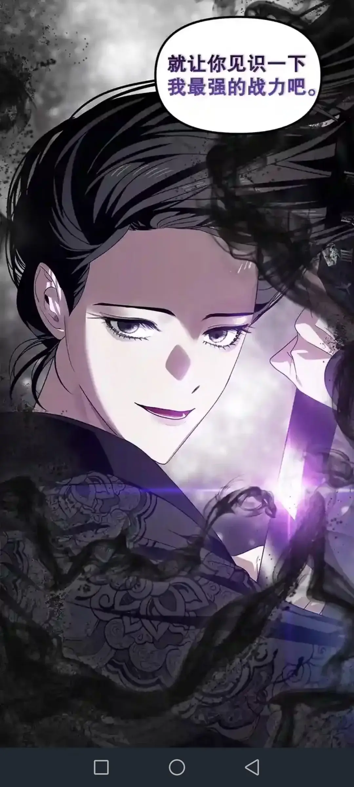
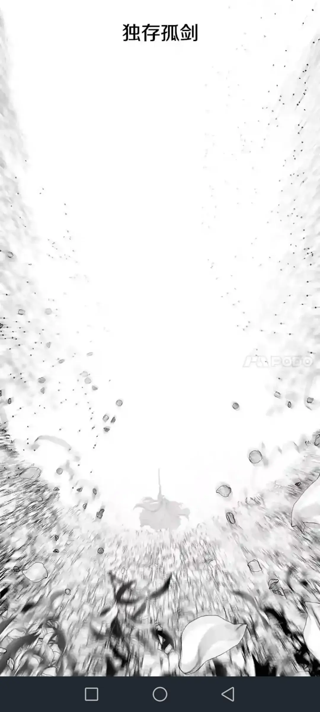

# Archive: SSS-Class Revival Hunter, Chapter 84

> This archive is [SSS-Class Revival Hunter](https://www.bilibili.com/read/readlist/rl682564) ([Chapter 84](https://www.bilibili.com/read/cv22477503/?from=readlist&jump_opus=1)), found purely by chance. The original is a Korean novel, and the column someone posted on Bilibili was only a machine translation. I stumbled on it, thought it was good, so I asked my classmate cc to polish the language and archived it. In the end I trimmed it to my own taste. The machine translation unexpectedly produced a kind of stream-of-consciousness feel,
>
> "Here is a rose, and a rose, and a rose, and a rose."

Winter. It was snowing.

The master's steps were light, like a gust of wind sweeping across the ice. In the white world, the master's black robes and the ground seemed to flow like brushstrokes.

"How long do you intend to keep running?"

"When it comes to lightness kung fu, I won't lose."

"Everything ends sooner or later."

"Can't you see? This world has become an endless field of snow. Heaven and earth are vast — I can go anywhere!"

"You can't go anywhere." The spirit behind him surged with strength, its great sword sweeping across to part the wind and snow and close the distance. "If you were at your peak, I might have no way to stop you. Now there's barely any life left in you. Less than an hour, isn't it? Do you still plan to keep fighting?"

"Aha, how despicable."

"Truly despicable." The spirit swung its great sword.

"Fine, I admit it." The master turned aside and dodged lightly. "My allotted life is nearly spent; indeed I can no longer run."

"So you can be reasoned with." The spirit laughed and swung its sword.

The master gripped the sword hilt. "Then let me show you my strongest ultimate technique."

The Heavenly Demon Divine Art, first form — Starvation Sword.

"A great famine is the starved corpses strewn across the fields in a year of disaster; it is the desperate gesture of emaciated parents exchanging their children to eat."

The blades sliced through the winter wind, giving off a piercing shriek.

"That lord said to dry the neighbor's child's body into jerky and bury it in the snow. Have you heard the rumor in town? Have you heard the stories in the village? When you dig through the snow with a shovel in winter, the children's flesh jams the shovel."

"Bang!" The master's blade landed on the spirit's great sword.

"I think that was a year of famine."

"Yes, a famine year. A famine year is like a disease; it returns at any time."

"But this is chance." The spirit swung its great sword against the winter wind. "Some years happen to be abundant, some happen to be poor; everything in this world follows its own course. Demonic cult leader, since you grieve for accidental tragedy, you should also smile for accidental joy. The depth to which a person sinks in sorrow is no different from the height to which they wander in happiness."

"Clang!" The long sword and the broad sword crossed; snowflakes drifted down and the red plum blossoms all fell.

"There was a day when I wandered down the road, and the boundless wheat fields surged and rolled from the horizon, spreading all the way before my eyes. It was a bright day, when even the wind carried warmth. The wheat waves rose and fell, revealing a few frolicking children, jumping, running, breathing. Wave after wave of laughter, overflowing with joy and vitality, now appeared and now vanished among the full, drooping ears of wheat."

Deep autumn; the wind rose. Red leaves blazed like fire across the hills and plains; the open fields stretched wide, golden waves reaching the sky.

"You speak to me of the wailing of children buried in the snow? Then let me tell you of the laughter of children playing hide-and-seek among the wheat ears." Maple leaves swirled behind the spirit's blade. "Whether deep winter or deep autumn, it is something that happened by chance on some chance day. When I am about to die, what I remember will surely be the sight of children playing hide-and-seek. That's obvious, isn't it?"

The master cut through the maple leaves. The Heavenly Demon Divine Art, second form — Thirst Sword.

"Both are chance? But chance abundance doesn't kill; chance hunger and thirst can kill. Death is death — everything ends."

The blazing sun hung overhead; the heat was unbearable.

"There's not a drop of water; I will rise up for the people who have died!"

The mountains and rivers dried up, the plants withered yellow, the fruits shriveled, the insects and birds hoarse; the riverbed was strewn with tens of thousands of desiccated fish, their waterless eyes bulging from bodies already turned to dried fish.

"Zeng," "dang." Amid the clash of blades, ever faster and more continuous, countless shards of sword-light spread out dazzling before my eyes. They drew closer, and the exchange grew fiercer and more dangerous.

"It is indeed a very hot summer, but to take a bath in such a hearty summer would be rather refreshing, wouldn't it?" The spirit raised its broad sword like a mountain, watertight. "You taught the young master wrong."

"...What did you say?"

"Ah, I went a bit far. Rather than taught wrong, say you taught too early." The spirit's sword-light came on like flowing water. "I like to sing of the world's happiness. Casting your gaze on others' pain is fine too, but you can't do that forever."

"Why?"

Crash! The scorching wind surged, and dead branches rustled.

"This kid hasn't yet tasted the sweetness of the world." The offense and defense shifted imperceptibly.

"You must let him taste delicacies from the mountains and seas. Only after tasting them will he grieve for those who can never eat them in their lifetime. Only when summer needs water will he weep for those who thirst for lack of it. You think the human heart is a candle's wick — that it just needs to burn. But a candle will one day burn itself out. Do you know, cult leader, this kid hasn't been in love yet, hasn't loved anyone."

The sword poured down like a waterfall, unceasing.

"You've memorized all the pain and sorrow in the world — you're just putting on airs! You taught far too early!"

"I will teach him how to laugh from the bottom of his heart, how to live without pretense. I will teach him how to rely on others, how to stay with someone for life. Only when there's truly no way out will I let him learn sorrow, and finally grow strong."

"You..."

Rain fell like sweet dew on the long-drought land; the swelling current swept away the shriveled dead fish, and where the rain slid down the bark, new shoots soon sprouted, and the grass and trees flourished.

"Do you intend to replace my disciple?!"

The Heavenly Demon Divine Art, third sword — Drowning Sword.

"Yes."

"You dare!" Lightning flashed like a net and thunder roared. The ever-heavier rain gradually gathered into torrents, and the gurgling torrents linked with one another, scouring the fragile river channels full of holes.

"You actually dare to covet my only disciple?"

The rain overflowed, and out of it flowed tens of thousands of crimson roses.

"What a joke! I am his master!"

The reservoir beneath their feet collapsed with a roar, and the village was swallowed by the flood.

"It was I who taught him to fight the beastmen, I who inspired him to wield spiritual energy. I finally carved this untalented piece of rotten wood into something useful — how could I let a heretic cult leader like you barge in!"

Countless roses rose from the boundless water's surface, roses crimson as blood flowing in from all directions. The two of them hung suspended over the waves and petals.

"Swinging a sword is a joyful thing!" The sound of rain and swords could not drown out the spirit's wild, unbridled laughter. "Pain? A sword swung with pain — what is that? Too demonic! The joy of smelling the flowers' fragrance, the delight of greeting the summer rain naked — that's what's good."

"The young master is my disciple, born to become the leader of this cult!"

"You heretic cult leader!"

An endless, infinite, boundless red; a crimson red, a rose red, and also the red of peonies.

Hundreds of millions of roses bloomed in an instant; the flood vanished, the wind stilled, the rain stopped, and the sound of the two swords clashing receded abruptly. Between heaven and earth there was no superfluous sound, no superfluous color — only red, endless red, the red that filled my eyes.

The world turned red into a field of flowers.

Spring. The flowers began to flow, but no longer had thorns; red peonies danced across the sky like drifting clouds of dawn.

"The sixth move of the Peony Orchid Sword — Orchid Pot Orchid Frame, gouging out your cervical acupoint!"

The master stepped back a few paces and dodged precisely.

I saw it.

"The seventh sword of the Heavenly Demon Divine Art."

I heard it.

The spirit countered with the fourth move of the Haihua Mande — Autumn Night Falling Moon.

I saw the two men's swords.

I saw the peonies they were stepping on.

Red peonies crushed fragrant underfoot.

Only when I could see it did I know: the duel was nearing its end.

The master was going to lose.

Amid the brilliant sea of flowers, the master was covered in blood. The gap in strength between the master and the spirit was plain to see. Even fighting and retreating, she could hardly withstand the spirit's overwhelming onslaught. The cost of trying was wounds all over her body.

The spirit settled into a stance. "I will use the first move of the Sunset Falling-Flower Sword — Moonlit Night Coming Sword."

The master's breathing grew faint.

"My inner power is exhausted; even using true qi is a luxury. I..." The master's lips trembled. "I never completed the final sword-path of the Heavenly Demon Divine Art. There is only one reason: abandoned by my mother, forgotten by the world, buried by wind and snow, soaked in cold — this is the death I have believed in since childhood."

"But—" The master raised her long sword high, like the hand of a clock at noon, pointing toward the heavens. "The irony is that the ninth sword of the Heavenly Demon Divine Art was only completed after the world was destroyed."

"......"

"Above the heavens and below the heavens, I alone am supreme."

"Whether I raise my eyes to the boundless sky, or lower my gaze to measure the limitless earth, of this vast heaven and earth only I remain."

"If the world is winter, then I am the candle; I sing for all under heaven, and so my death shall also be the death of heaven and earth."

The sword, radiant beyond measure, split the vault of the sky.

"My ninth sword of the Heavenly Demon shall leave its testament upon the snowy plain."

"The Heavenly Demon Divine Art, my final form — the Lone Sword Standing Alone."

Winter tore through spring. In the crevice where the petals parted, the four seasons turned and cycled, and deep winter returned, howling down. The myriad red peonies turned into hundreds of millions of snowflakes and froze the world.

The lonely sword — this strike sings the death of the world.

"Fine, I admit it. As the last warrior in such a world, this is a very fitting strike."

"But loneliness, of all things, I know better than you." He raised the broad sword with both hands. "How long have you kept watch alone in such a boring world? Three years, or two? Of course not. Because there has always been a martial-arts alliance leader by your side. The moment he died, you went mad."

The hilt began to tremble, the blade began to tremble, the earth trembled, the sky trembled, and that pure-white torrent in midair also trembled faintly.

"Sorry. I held on alone for a hundred and thirty years."

The sword came out — formless, a single strike.

The roses withered, the peonies bloomed, the summer rain fell in sheets, the great waves towered to the sky, the red leaves blazed like fire, the wheat waves rolled like a sea. Winter, autumn, summer, spring, summer, autumn, winter — winter turned red, and red surged out of winter……

I could hardly understand that strike, but right now there was something more important than understanding the sword.

"Master."

"Master, are you all right?..."

The master stared blankly up at the winter sky, her eyes already unfocused. My chest jolted, and I touched the master's hand and took her pulse. Alive. The master was still alive.

"Master..."

"So that's it," the master said. "So that's how it is."

"So that's it, my only disciple. You, from the very beginning, only wanted to help me — coming from beyond the frontier, drawn by my name..." Her voice grew lighter and lighter. "It was all a complete lie."

The master's voice grew smaller and smaller.

"Thank you," the master said.

"Disciple, have you been happy, meeting me?"

I nodded.

"Mm..."

"Can I be remembered by you as a flower?"

"Master..."

"I want to know what flower."

"A peony..." I held the master's body. "I'll remember you as a red peony, Master."

"Haha." The master laughed softly. "How beautiful."

The master stroked my face. "So beautiful..."

Then the master swept her remaining hand toward the distance, gently, like a newborn bird flapping its wings.

"My disciple..."

In silence, the towering snow mountain was cleaved in two.

The mountain split in two stood still, as if it had always been so.

The master breathed out white puffs.

"I suppose I was dreaming a pure white dream..."

"Master..." I buried my face in the master's shoulder, in the stilled breath, toward a person born with the fragrance of snow.

Winter was cut apart; the master had torn winter apart.

That day,

the winter of a world was cut apart.

---

> Author: [滑翔闪](https://github.com/hzp2333/hzp2333.github.io)  
> URL: https://blog.huaxiangshan.com/en/posts/sss/  

