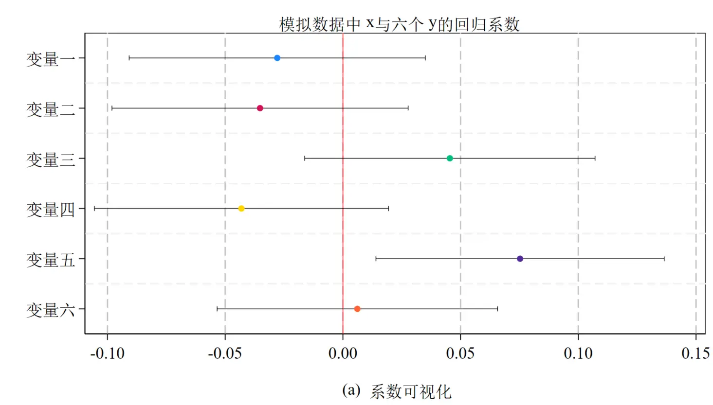
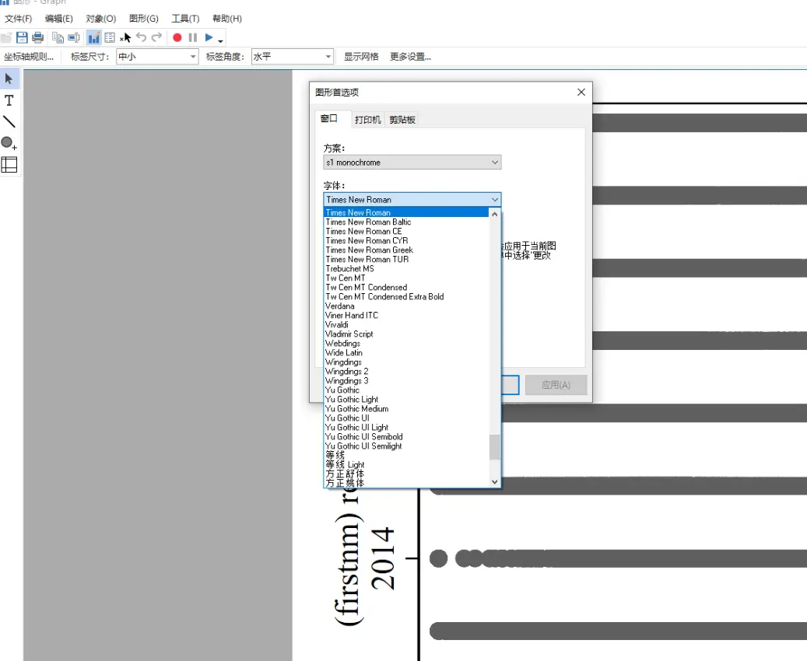
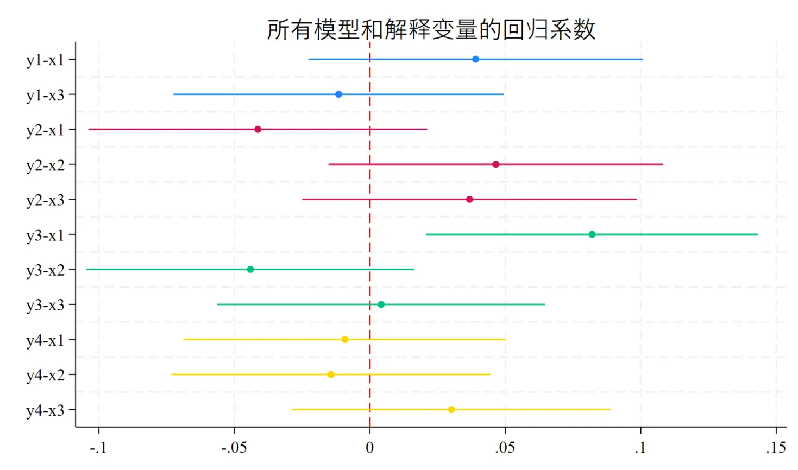
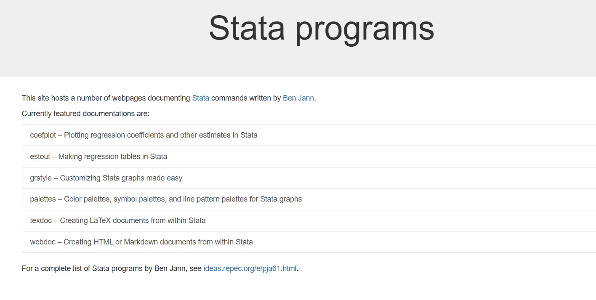
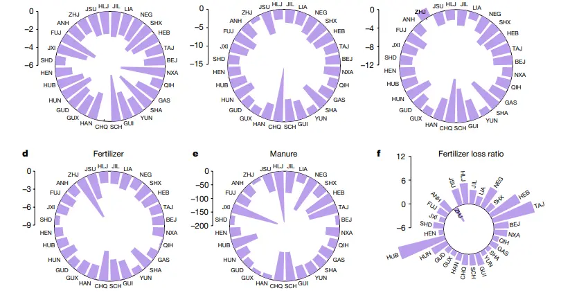
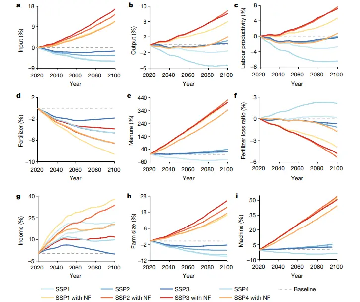
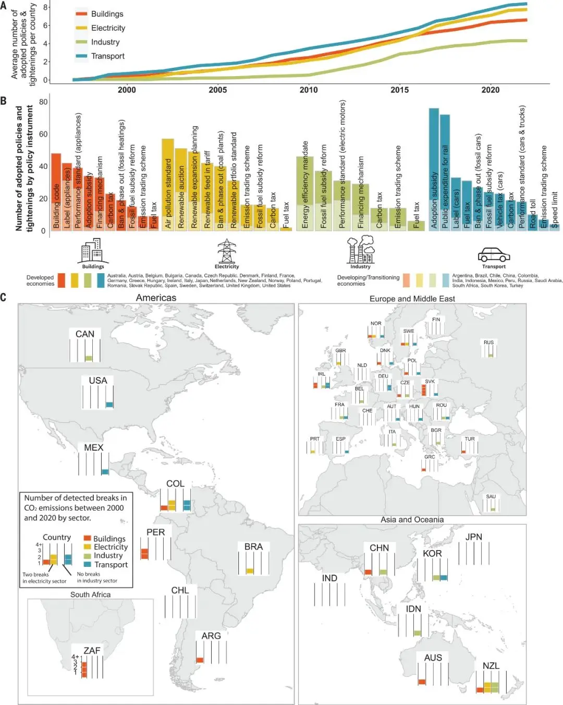

# Setting Chinese and English Fonts in Stata Figures


With the rise of the "**building an independent knowledge system**" trend, Chinese journals' typesetting requirements are getting stricter[^1] — for example, table variables can't contain English names. And there's the long-standing requirement that figures use SimSun for Chinese and Times for English.

Stata's graph box only supports setting one font uniformly, so the Chinese and English fonts need to be set separately in the code.


## Coefficient Plots and Mixed Chinese-English Fonts

Use the local macro command to store the font commands.

```stata
local zh1 `"fontface "SimSun":"'     // SimSun
local en1 `"fontface "times":"'      // times
```

Then apply the corresponding settings in the graph, for example:

```stata
 title(`"{`zh1' 模拟数据中}{`en1' x}{`zh1'与六个}{`en1' y}{`zh1'的回归系数}"', size(medium))
```

The concrete code:

- Generate six y variables
- Generate one x variable
- Regress the six y variables on x (six regressions)
- Visualize the coefficients

The plot style is `stcolor`, the new default style added in Stata 18. I personally like the fully-enclosing frame[^3]. I'd recommend setting both the label and font size to `medium`; otherwise it's hard to see when you later combine figures.

```SQL
clear
set seed 20250707
set obs 1000

* explanatory variable x
gen x = rnormal(0, 1)

* six dependent variables y1–y6 (each with a coefficient close to 0)
gen y1 =  0.01*x + rnormal(0, 1)
gen y2 = -0.02*x + rnormal(0, 1)
gen y3 =  0.015*x + rnormal(0, 1)
gen y4 = -0.005*x + rnormal(0, 1)
gen y5 =  0.012*x + rnormal(0, 1)
gen y6 =  0.00*x + rnormal(0, 1)


local ys y1 y2 y3 y4 y5 y6

foreach y of local ys {
    reg `y' x
    estimates store m_`y'
}


local zh1 `"fontface "SimSun":"'     // Chinese font
local en1 `"fontface "times":"'      // English and number font

* draw the figure
coefplot ///
    (m_y1, rename(x = `"{`zh1' 被解释变量1}"')) ///
    (m_y2, rename(x = `"{`zh1' 被解释变量2}"')) ///
    (m_y3, rename(x = `"{`zh1' 被解释变量3}"')) ///
    (m_y4, rename(x = `"{`zh1' 被解释变量4}"')) ///
    (m_y5, rename(x = `"{`zh1' 被解释变量5}"')) ///
    (m_y6, rename(x = `"{`zh1' 被解释变量6}"')), ///
    keep(x) ///
    drop(_cons) ///
    horizontal ///
    xline(0, lcolor(red) lpattern(solid) lwidth(vthin)) ///
    xlabel(-0.15(0.05)0.15, labsize(medium) grid glcolor(gs12) format(%4.2f)) ///
    ylabel( ///
        1 `"{`zh1'变量一}"' ///
        2 `"{`zh1'变量二}"' ///
        3 `"{`zh1'变量三}"' ///
        4 `"{`zh1'变量四}"' ///
        5 `"{`zh1'变量五}"' ///
        6 `"{`zh1'变量六}"', ///
        labsize(medium) nogrid) ///
    ytitle("", margin(small)) ///
    xtitle(`"{`en1' (a)}{`zh1' 系数可视化}"', size(medium) margin(medium)) ///
    title(`"{`zh1' 模拟数据中}{`en1' x}{`zh1'与六个}{`en1' y}{`zh1'的回归系数}"', size(medium)) ///
    legend(off) ///
    scheme(stcolor) ///
    recast(scatter) ///
    ciopts(recast(rcap) lcolor(black) lwidth(vthin)) ///
    graphregion(color(white) lcolor(black) lwidth(vthin)) ///
    plotregion(lcolor(black) lwidth(vthin))
```





Stata's Chinese support is really poor. So even after using the method above, your English might all come out in SimSun, or the Chinese might still be in Hei. That's because the system hasn't truly recognized the fonts. In that case, as shown below, first open a graph and, under `Edit - Preferences - Fonts`, set each part of the figure to the font you want. After that, running it again should be recognized properly.






**This kind of visualization test is becoming more common.** For example, is a city policy (a 0/1 binary variable) an exogenous shock[^5]? You regress policy adoption on variables like city GDP, city population, and city economic growth rate — variables that are exogenous to the study and represent city characteristics. The theoretical meaning of the regression coefficient is then the average difference between pilot and non-pilot cities; if it's insignificant, the difference is small, which to some extent tests whether the policy's implementation is exogenous[^4].

<font color="#ff0000">Another issue with mixed Chinese-English typesetting is that the Times font sits a bit higher</font> (for example, the x, y, and (a) in the figure titles), so it's best to avoid mixing Chinese and English in titles.

If you want to show different coefficient terms across multiple regressions, just use the `keep` command to limit the coefficients:

```SQL
clear
set obs 1000
set seed 20250707

* generate explanatory variables x1-x3
forvalues i = 1/3 {
    gen x`i' = rnormal(0, 1)
}

* generate dependent variables y1-y4, with coefficients randomly close to 0
gen y1 = 0.01*x1 - 0.02*x2 + 0.015*x3 + rnormal(0,1)
gen y2 = -0.005*x1 + 0.012*x2 + 0.008*x3 + rnormal(0,1)
gen y3 = 0.02*x1 - 0.01*x2 + 0.00*x3 + rnormal(0,1)
gen y4 = -0.015*x1 + 0.01*x2 - 0.005*x3 + rnormal(0,1)


local ys y1 y2 y3 y4
local xs x1 x2 x3

foreach y of local ys {
    reg `y' `xs'
    estimates store m_`y'
}

*the keep subcommand keeps the coefficient terms you want to show for each regression

coefplot ///
    (m_y1, keep(x1 x3) rename(x1="y1-x1" x3="y1-x3")) ///
    (m_y2, rename(x1 = "y2-x1" x2 = "y2-x2" x3 = "y2-x3")) ///
    (m_y3, rename(x1 = "y3-x1" x2 = "y3-x2" x3 = "y3-x3")) ///
    (m_y4, rename(x1 = "y4-x1" x2 = "y4-x2" x3 = "y4-x3")), ///
    drop(_cons) ///
    horizontal ///
    xline(0, lcolor(red)) ///
    title("所有模型和解释变量的回归系数") ///
    legend(off)

```



For the use of the `coefplot` command in event studies, see "[Two Ways to Test Parallel Trends](https://blog.huaxiangshan.com/zh-cn/posts/event3/#coefplot-%E5%91%BD%E4%BB%A4)".

By the way, the `coefplot` command was developed by Professor [Ben Jann](https://repec.sowi.unibe.ch/stata/), who has also developed a series of very popular command packages.


## Side Discussion: Do Different Disciplines Plot Differently?

My roommate is in electronic information engineering, and every time he sees my regression figures he wonders how a paper can get published with such plain graphs. But honestly, compared with all the fancy figures in biostatistics, information statistics, and health statistics, the most complex figure in economics — aside from GIS — is probably the coefficient plot in an event study; the rest is just big tables.


Still, there does seem to be a trend — **coefficient plots** are becoming more and more common.

Now look at the economics articles published in Nature and Science. Many of my teachers complain these papers couldn't get into a top economics journal, yet they make it into Nature and Science — **does that mean the discipline of economics is falling apart**? I personally think they're exploiting **interdisciplinarity**, and environmental and resource economics is especially good at cashing in on this bonus.

The figure styles in these papers are also completely different, closer to the plotting style and analytical paradigm of science and engineering.

Example: *Ageing threatens sustainability of smallholder farming in China*, published in Nature[^2].

> This paper uses a panel model with survey data from over 30,000 rural households in China to explore the relationship between rural population aging (the share of household members over 65) and agricultural sustainability. It selects nine indicators to describe agricultural sustainability, including farm size, farmer education, labor productivity, total agricultural input and output, cost-profit margin, machinery input, fertilizer input, and fertilizer use efficiency (FUE).






Example 2: *Climate policies that achieved major emission reductions: Global evidence from two decades*, published in Science

(There are plenty more similar Chinese environmental-economics papers out there)

> This paper conducts a global, systematic ex-post evaluation to identify the policy combinations that achieved major emission reductions among 1,500 climate policies implemented in 41 countries across six continents from 1998 to 2022. Our approach combines a comprehensive climate policy database with a machine-learning-based extension of the common difference-in-differences method. We identify 63 successful policy interventions, with total reductions of between 0.6 and 1.8 billion metric tons of CO2. Our insights into effective but rarely studied policy combinations highlight the important role of price-based instruments in well-designed policy mixes, and the policy effort needed to close the emissions gap.




[^1]: Many universities are now raising the reward level for Chinese-language publications and lowering it for English-language ones.
[^2]: Science and Nature papers have always been very short, sometimes with no appendix at all — the exact opposite of the trend in economics.
[^3]: A teacher once told me the figure frames should be very thin, because thick ones look bad in print — though most top journals I've seen use thick outer borders. Either way, I'd recommend a medium font size to balance clarity and looks.
[^4]: Of course, this is only a test of a necessary condition — all econometric tests are necessary conditions, not sufficient ones. That's why some people think econometrics is just a discipline of persuasion, convincing people that something might be a sufficient condition by piling up countless necessary conditions.
[^5]: The exclusion restriction of instrumental variables and the exogeneity of explanatory variables are getting more attention, and tests of random assignment are becoming more common.


---

> Author: [滑翔闪](https://github.com/hzp2333/hzp2333.github.io)  
> URL: https://blog.huaxiangshan.com/en/posts/stata_font/  

