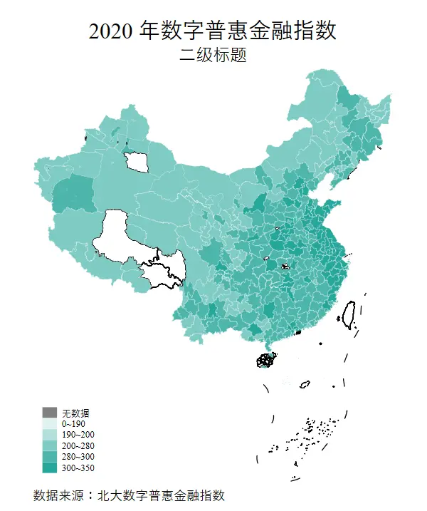
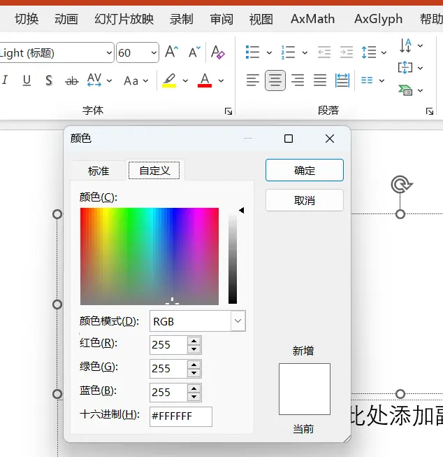
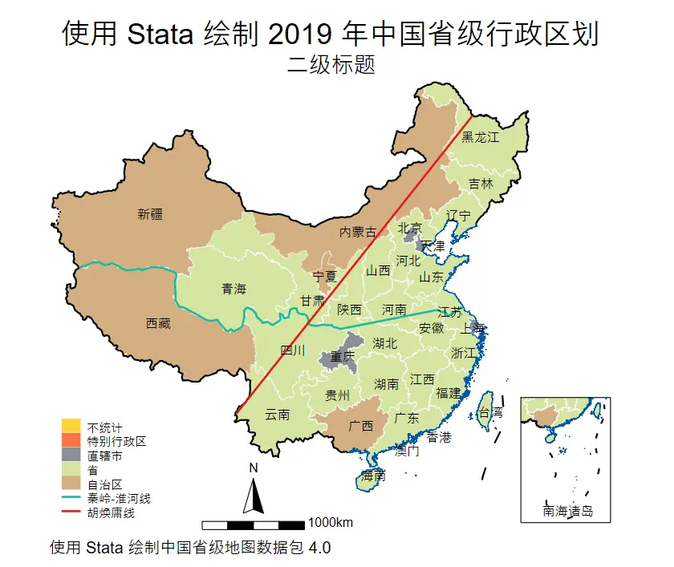
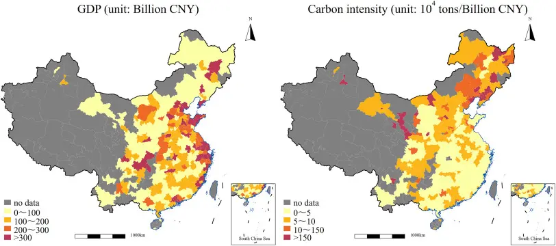
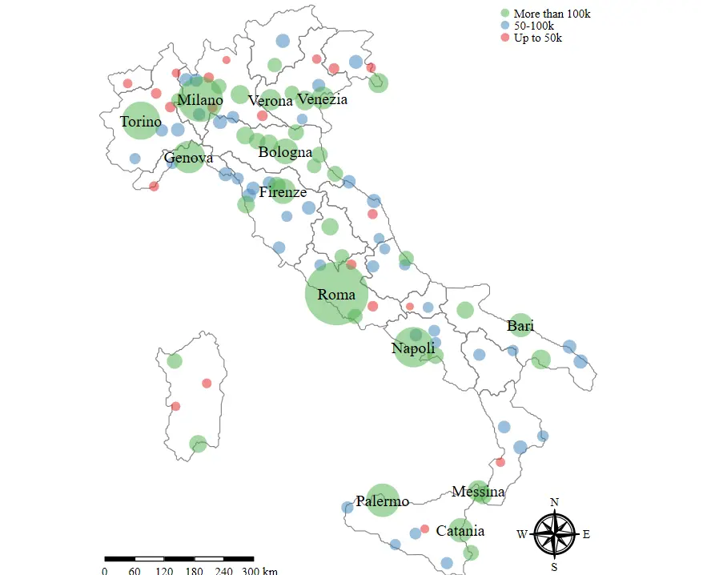
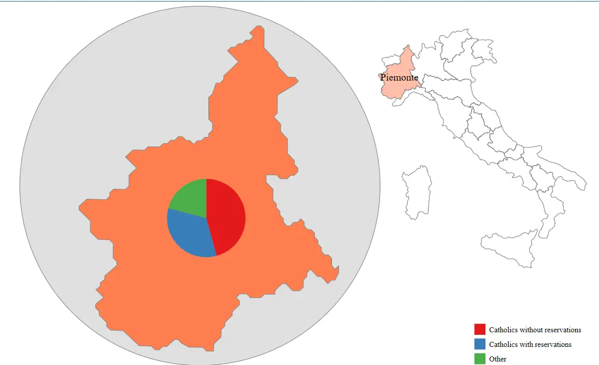

# Drawing GIS Choropleth Maps with Stata


This post documents the process of drawing GIS choropleth maps in Stata.

All the data mentioned in this post can be downloaded from the [repository](https://github.com/hzp2333/STATAGIS).

## Getting Map Files

`ESRI Shapefile` files are spatial geographic data developed by the [Environmental Systems Research Institute](https://www.esri.com/en-us/home). They store both spatial locations and attribute data. The basic files are mainly:

- **Main file (.shp):** stores the spatial information of geometric features, i.e., XY coordinates. The map outline information of a GIS image is stored in this file.
- **Table file (.dbf):** a dBase table that stores the attribute information of the geographic data.
- **Index file (.shx):** stores index information about how the .shp data is stored — where the XY coordinate input points are, how many XY coordinate pairs there are, and so on.

Here are some data sources I found:

- [Dabing's blog](http://gaohr.win/site/blogs/2017/2017-04-18-GIS-basic-data-of-China.html)
- [National Catalogue Service for Geographic Information](https://www.webmap.cn/main.do?method=index)
- [GADM data](https://gadm.org/data.html): comprehensive international maps.
- [China map data found on GitHub](https://github.com/GaryBikini/ChinaAdminDivisonSHP)
- [Rstata materials](https://github.com/Wsf921109/stata-prov-map?tab=readme-ov-file): provincial divisions of the China map. Domestic courses are world-class; personally I think the best Stata-focused content comes from "Lianxianghui" and "Rstata". Even though I'm a firm ~~freeloading~~ open-source advocate, I often read their popular-science articles to learn Stata. Here a kind soul has uploaded the database related to Rstata.
- [Institute of Geographic Sciences and Natural Resources Research, CAS](https://www.resdc.cn/Default.aspx): perhaps China's semi-official source?

  

If you still can't find what you want, you can use the Alibaba Cloud map to generate map files.

Go to [Alibaba Cloud DataV](http://datav.aliyun.com/portal/school/atlas/area_selector), click to download the file (I recommend the "other download" option, which gives you a `.json` file).

After downloading, go to the [converter](https://mapshaper.org/) to convert it. Click `Select`, upload the `.json` file, then click `export` to export the converted file.

> It seems that because of data encoding or encryption, files converted from the Alibaba Cloud map sometimes can't be read by Stata.
>
> In that case, use `spshape2dta` to convert them.

## Basic StataGis Operations

### Installing the Required Commands

You just need the `main file (.shp)` and the `table file (.dbf)`.

Install the relevant commands in Stata beforehand.

```sql
ssc install shp2dta, replace   //file conversion command
ssc install mif2dta, replace  //file conversion command
ssc install spmap, replace  //GIS plotting command
```

### Converting and Fixing Encoding Issues

Using a GIS map file made by a Bilibili user: [2019 China Map - Map Approval No. GS(2019)1822](https://pan.baidu.com/s/1lybhxKO3EL5JKATULS-0CA?pwd=zkks)

The example data I use here is: [PKU Digital Financial Inclusion Index 2011_2020](https://idf.pku.edu.cn/yjcg/zsbg/513800.htm)

There are two files to convert here: the China map file `市` (cities) and the nine-dash line file `九段线` (nine-dash line).

```sql
clear 
cd F:\桌面\GIS_sum\2019中国地图审图号\例子
//set the working folder, since some gis command options work better with relative paths

import excel "F:\桌面\GIS_sum\2019中国地图审图号\例子\北大数字普惠金融指数2011_2020.xlsx", sheet("Sheet1") firstrow
keep if year == 2020
rename pref_name_year18 ct_name
save d2020data ,replace
//load the data

spshape2dta 市
spshape2dta 九段线
//here I use spshape2dta because shp2dta cannot convert these

clear 
cd F:\桌面\GIS_sum\2019中国地图审图号\例子
unicode encoding set gb18030
unicode analyze 市.dta 
unicode translate 市.dta, invalid 
//recompile to fix some garbled Chinese characters
//one-time command; to reuse it you need to delete the generated encoding file bak.stunicode in the directory
```

If a file can't be converted — for example, the Alibaba Cloud map — it seems maps made in GIS also can't be converted by `shp2dta`. That's why `spshape2dta` is used here.

> Apart from this, [the two commands don't differ much](https://www.cda.cn/discuss/post/details/61cd24316276b453ec6f9bc2). The downside of `spshape2dta` is that you can't customize the name; you just follow it directly with the filename, and it automatically generates the two files you need. The label file is `.dta`, and the outline file is `_shp.dta`.

### Matching Data and Label Files

```sql
use 市.dta
rename __ ct_name
save 市.dta ,replace

use d2020data
merge 1:1 ct_name using 市.dta
drop _merge
gen ID =_ID
save city_data2020,replace
```

### Plotting Commands

Let's start plotting. The basic plotting command is as follows:

```sql
grmap digitization_level using 市_shp.dta  , ///
	id(ID) osize(vvthin ...) ocolor(white ...) ///
	clmethod(custom) clbreaks(-1 0 190 200 280 300 350) ///
	fcolor(gray "224 242 241" "178 223 219" "128 203 196" "77 182 172" "38 166 154") ///
	leg(order(2 "无数据" 3 "0~190" 4 "190~200" 5 "200~280" 6 "280~300" 7 "300~350")) ///
		graphr(margin(medium)) ///
			line(data(九段线_shp.dta)) ///
	ti("2020 年数字普惠金融指数") ///
	subti("二级标题") ///
	caption("数据来源：北大数字普惠金融指数", size(*0.8))
```



### Parameter Explanations

The parameter explanations below were generated by GPT 3.5, with some additions by me.

- `grmap type`: specifies the graph type as a map.
- `using chinaprov40_coord.dta`: specifies the map data file, which contains the coordinate information of the provincial administrative divisions.
- `id(ID)`: specifies the unique identifier variable in the map data. It links the map coordinates to the labels and data.
- `osize(vvthin ...)` and `ocolor(white ...)`: set the thickness and color of the map boundary lines.
- `vvthin` is a predefined line style in Stata; it means a very thin line. When drawing maps, you can use different line thicknesses to distinguish different geographic features or boundaries.

  > From thin to thick: vvthin, vthin, thin, medium, thick, vthick, vvthick.
  >
- `clmethod(custom)` and `clbreaks(0 1 2 3 4 5)`: custom classification method and classification intervals. Here they correspond to the provincial categories: municipalities directly under the central government, provinces, special administrative regions, and so on.
- `fcolor(...)`: specifies the fill colors for different categories.

  > The example uses RGB color definitions; you can check the color codes in PowerPoint's custom color picker.
  >

  
- `leg(...)`: sets the order and labels of the legend.
- `graphr(margin(medium))`: sets the graph margins.
- `line(data(chinaprov40_line_coord.dta) by(group) ...)`: draws the map boundary lines, specifying the boundary line data file and attributes such as color. Here the nine-dash line file is used.
- `polygon(data(polygon) fcolor(black) ...)`: draws map polygons, specifying fill color, line thickness, and other attributes. Here it's the legend and the compass.
- `label(data(chinaprov40_label) ...)`: labels the map, specifying the label data file and label text. `label(ename)` is English, `label(cnname)` is Chinese.
- `ti("一级标题: 2019 年中国省级行政区划")`: sets the main title.
- `subti("二级标题")`: sets the subtitle.
- `caption("使用 Stata 绘制中国省级地图", size(*0.8))`: sets the graph caption.

## Processing Flowchart

> Map line data (optional): for example, the lines for mountains, rivers, mountain ranges, the nine-dash line, the Qinling-Huaihe line, and the Hu Huanyong Line.


graph TD;
0(获取地图文件)==>1(地图主文件.Shp);
0(获取地图文件)==>11(线条主文件.Shp);
0(获取地图文件)==>3(表文件.dbf);
1(地图主文件.Shp)==转译==>2(地图轮廓数据);
11(线条主文件.Shp)==转译==>9(地图线条数据);
3(表文件.dbf)==转译==>4(标签文件);
5(数据分析文件)==>6(匹配文件);
4(标签数据)==>6(匹配文件); 6(匹配文件)==id标识==>7(画图);
2(地图轮廓数据)==id标识==>7(画图);
9(地图线条数据)==id标识==>7(画图)


Looks complicated? Here's a simple summary of the steps:

- Get the data we want to describe — the value for each province.
- Match the descriptive data to `_db.dta` (the index file, converted from the `.dbf` file).
- Open the matched data, and additionally load the map outline data (`_coord.dta`) (converted from the `.shp` file).
- Optionally: you can add a label file (whether to show each province's name).

## Provincial Level (China)

> From Rstata. You can download the learning materials from the [GitHub repository](https://github.com/Wsf921109/stata-prov-map) — provincial panel data for GIS maps and related data.





Map outline data:

`chinaprov40_db.dta`

`chinaprov40_coord.dta`

Line data: for example the nine-dash line, the Hu Huanyong Line, etc.

`chinaprov40_line_db.dta`

`chinaprov40_line_coord.dta`

Label position data

`chinaprov40_label.dta`

For drawing the compass and scale bar

`polygon.dta`



### Actual Plotting

```sql
cd /Users/ac/Documents/系列课程/使用Stata绘制中国省级地图（版本4）/
* plotting a discrete variable
use chinaprov40_db.dta, clear 
encode 类型, gen(type)
codebook type

*if the grmap command is not activated, just run: grmap, activate

grmap type using chinaprov40_coord.dta, ///
	id(ID) osize(vvthin ...) ocolor(white ...) ///
	clmethod(custom) clbreaks(0 1 2 3 4 5) ///
	fcolor("254 212 57" "253 116 70" "138 145 151" "213 228 162" "210 175 129") ///
	leg(order(2 "不统计" 3 "特别行政区" 4 "直辖市" 5 "省" 6 "自治区" 11 "秦岭-淮河线" 14 "胡焕庸线")) ///
	graphr(margin(medium)) ///
	line(data(chinaprov40_line_coord.dta) by(group) size(vvthin *1 *0.5 *1.2 *0.5 *0.5 *1.2) pattern(solid ...) ///
		color(white /// provincial boundary color
			  black /// national boundary color
			  "0 85 170" /// coastline color
			  "24 188 156" /// Qinling-Huaihe line color
			  black /// small map frame color
			  black /// scale bar and compass color
			  "227 26 28" /// Hu Huanyong line color
			  )) ///
	polygon(data(polygon) fcolor(black) ///
		osize(vvthin)) ///
	label(data(chinaprov40_label) x(X) y(Y) label(cname) length(20) size(*0.8)) ///
	ti("一级标题: 2019 年中国省级行政区划") ///
	subti("二级标题") ///
	caption("使用 Stata 绘制中国省级地图", size(*0.8))
gr export pic1.png, replace width(1200)

* English version
grmap type using chinaprov40_coord.dta, ///
	id(ID) osize(vvthin ...) ocolor(white ...) ///
	clmethod(custom) clbreaks(0 1 2 3 4 5) ///
	fcolor("254 212 57" "253 116 70" "138 145 151" "213 228 162" "210 175 129") ///
	leg(order(2 "Not within the scope of statistics" 3 "Special administrative region" 4 "Municipality directly under" "the Central Government" 5 "Province" 6 "Autonomous Region" 11 "Qinling Huaihe River Line" 14 "Hu Huanyong line")) ///
	graphr(margin(medium)) ///
	line(data(chinaprov40_line_coord.dta) by(group) size(vvthin *1 *0.5 *1.2 *0.5 *0.5 *1.2) pattern(solid ...) ///
		color(white /// provincial boundary color
			  black /// national boundary color
			  "0 85 170" /// coastline color
			  "24 188 156" /// Qinling-Huaihe line color
			  black /// small map frame color
			  black /// scale bar and compass color
			  "227 26 28" /// Hu Huanyong line color
			  )) ///
	polygon(data(polygon) fcolor(black) ///
		osize(vvthin)) ///
	label(data(chinaprov40_label) x(X) y(Y) label(ename) length(20) size(*0.6)) ///
	ti("title1: China’s provincial administrative divisions in 2019") ///
	subti("title2") ///
	caption("Use Stata to draw provincial maps of China", size(*0.8))
gr export pic2.png, replace width(1200)


```



### Other Examples

```sql
* plotting example:
* 1. GDP of Chinese provinces and cities in 2020
import delimited using "2020年中国各省市地区生产总值.csv", clear encoding(utf8)
gen prov = substr(省份, 1, 6)
save 2020年中国各省市地区生产总值, replace 

use chinaprov40_db.dta, clear 
gen prov = substr(省, 1, 6)
merge 1:1 prov using 2020年中国各省市地区生产总值
replace 地区生产总值 = -1 if missing(地区生产总值)
grmap 地区生产总值 using chinaprov40_coord.dta, ///
	id(ID) osize(vvthin ...) ocolor(white ...) ///
	clmethod(custom) clbreaks(-1 0 20000 40000 60000 80000 120000) ///
	fcolor(gray "224 242 241" "178 223 219" "128 203 196" "77 182 172" "38 166 154") ///
	leg(order(2 "无数据" 3 "< 2 万亿元" 4 "2～4 万亿元" 5 "4～6 万亿元" 6 "6～8 万亿元" 7 "> 8 万亿元")) ///
	graphr(margin(medium)) ///
	line(data(chinaprov40_line_coord.dta) ///
		/// remove the Qinling-Huaihe line (4) and Hu Huanyong line (7)
		select(keep if inlist(group, 1, 2, 3, 5, 6)) ///
		by(group) size(vvthin *1 *0.5 *0.5 *0.5) ///
		pattern(solid ...) /// solid line
		color(white /// provincial boundary color
			  black /// national boundary color
			  "0 85 170" /// coastline color
			  black /// small map frame color
			  black /// scale bar and compass color
			  )) ///
	polygon(data(polygon) fcolor(black) ///
		osize(vvthin)) ///
	label(data(chinaprov40_label) x(X) y(Y) label(cname) length(20) size(*0.8)) ///
	ti("2020 年中国各省市地区生产总值") ///
	subti("二级标题") ///
	caption("数据来源：各地统计局", size(*0.8))
gr export pic3.png, replace width(1200)

* distribution of Chinese industrial enterprises in 2013 and their distance from the Qinling-Huaihe line
* convert the coordinate system
* conversion method 1: https://czxb.shinyapps.io/crs-trans/
* note: the uploaded csv file should contain numeric lon and lat variables; the observation limit is about 100,000, and it cannot be used by multiple people at the same time.
use gq2013sample, clear 
keep 经度 纬度
ren 经度 lon
ren 纬度 lat
export delimited using "待转换.csv", replace 

* conversion method 2: use the R script in the attachment

* process the converted data
import delimited using "转换后的数据.csv", clear 
gen id = _n
save 转换后的数据, replace 

use gq2013sample, clear 
gen id = _n
merge 1:1 id using 转换后的数据
drop _m id *度
encode 北方或南方, gen(north)
save pointdata, replace 

use chinaprov40_db.dta, clear
spmap using chinaprov40_coord.dta, id(ID) ///
	ocolor("black" ...) osize(vvthin ...) ///
    line(data(chinaprov40_line_coord.dta) ///
		/// Hu Huanyong line (7)
		select(keep if inlist(group, 1, 2, 3, 4, 5, 6)) ///
		by(group) size(vvthin *1 *0.5 *1.5 *0.5 *0.5) ///
		pattern(solid ...) ///
		color(white /// provincial boundary color
			  black /// national boundary color
			  "0 85 170" /// coastline color
			  "0 85 170" /// Qinling-Huaihe line color
			  black /// small map frame color
			  black /// scale bar and compass color
			  )) ///
	polygon(data(polygon) fcolor(black) ///
		osize(vvthin)) ///
	label(data(chinaprov40_label) x(X) y(Y) label(cname) length(20) size(*0.8)) ///
    point(data(pointdata) by(north) ///
    	fcolor("227 26 28%30" "24 188 156%30") ///
        x(x) y(y) ///
        proportional(与秦岭淮河线的距离) ///
        size(*0.1) legenda(on)) ///
    leg(order(7 "秦岭-淮河线" 10 "北方工企业" 11 "南方工企业")) ///
    ti("2013 年中国工业企业与秦岭-淮河线的距离", color(black)) /// 
    subti("二级标题") ///
    graphr(margin(medium)) ///
    caption("数据来源：2013 年中国工业企业数据库，使用高德地图地理编码接口解析经纬度", size(*0.8))
gr export pic4.png, replace width(1200)

* GDP and industrial structure of Chinese provinces in 2019
use 各省历年GDP, clear 
drop if 省份 == "中国"

replace 地区生产总值_亿元 = 地区生产总值_亿元 / 1000
merge m:m 省代码 using chinaprov40_db.dta
replace 地区生产总值_亿元 = -1 if missing(年份)
grmap 地区生产总值_亿元 if 年份 == 2019 | missing(年份) ///
	using chinaprov40_coord.dta, id(ID) ///
	clmethod(custom) clbreaks(-1 0 40 60 80 100 120) /// 
	fcolor("gray" "237 248 233" "199 233 192" "161 217 155" "116 196 118" "49 163 84") ///
	ocolor("gray" ...) ///
	ti("2019 年中国各省地区生产总值 & 产业结构", size(*1.1)) ///
	subtitle("数据来源：CSMAR经济金融数据库") ///
	graphr(margin(medium)) ///
	osize(vvthin ...) ///
	legend(size(*1.1) ///
		order(2 "无数据" 3 "< 40千亿" ///
			4 "40～60千亿" 5 "60～80千亿" ///
			6 "80～100千亿" 7 "> 100千亿" ///
			14 "第一产业" 15 "第二产业" 16 "第三产业")) ///
	caption("二级标题", size(*0.8)) ///
	line(data(chinaprov40_line_coord.dta) ///
		/// remove the Qinling-Huaihe line (4) and Hu Huanyong line (7)
		select(keep if inlist(group, 1, 2, 3, 5, 6)) ///
		by(group) size(vvthin *1 *0.5 *0.5 *0.5) ///
		pattern(solid ...) ///
		color(white /// provincial boundary color
			  black /// national boundary color
			  "0 85 170" /// coastline color
			  black /// small map frame color
			  black /// scale bar and compass color
			  )) ///
	polygon(data(polygon) fcolor(black) ///
		osize(vvthin)) ///
	label(data(chinaprov40_label) x(X) y(Y) label(cname) length(20) size(*0.8)) ///
	diagram(data(piedata) x(X) y(Y) v(第一产业占GDP比重_百分比 第二产业占GDP比重_百分比 第三产业占GDP比重_百分比) ///
		type(pie) legenda(on) os(vvthin) ///
			size(1.5) fc("102 194 165" "252 141 98" "229 196 148") ///
			oc("102 194 165" "252 141 98" "229 196 148"))

gr export "pic5.png", replace width(1200)

grmap 地区生产总值_亿元 if 年份 == 2019 | missing(年份) ///
	using chinaprov40_coord.dta, id(ID) ///
	clmethod(custom) clbreaks(-1 0 40 60 80 100 120) /// 
	fcolor("gray" "237 248 233" "199 233 192" "161 217 155" "116 196 118" "49 163 84") ///
	ocolor("gray" ...) ///
	ti("2019 年中国各省地区生产总值 & 第一产业比重", size(*1.1)) ///
	subtitle("数据来源：CSMAR经济金融数据库") ///
	graphr(margin(medium)) ///
	osize(vvthin ...) ///
	legend(size(*1.1) ///
		order(2 "无数据" 3 "< 40千亿" ///
			4 "40～60千亿" 5 "60～80千亿" ///
			6 "80～100千亿" 7 "> 100千亿" ///
			15 "第一产业比重")) ///
	caption("二级标题", size(*0.8)) ///
	line(data(chinaprov40_line_coord.dta) ///
		/// remove the Qinling-Huaihe line (4) and Hu Huanyong line (7)
		select(keep if inlist(group, 1, 2, 3, 5, 6)) ///
		by(group) size(vvthin *1 *0.5 *0.5 *0.5) ///
		pattern(solid ...) ///
		color(white /// provincial boundary color
			  black /// national boundary color
			  "0 85 170" /// coastline color
			  black /// small map frame color
			  black /// scale bar and compass color
			  )) ///
	polygon(data(polygon) fcolor(black) ///
		osize(vvthin)) ///
	diagram(data(piedata) x(X) y(Y) v(第一产业占GDP比重_百分比) ///
		type(frect) legenda(on) os(vvthin) ///
			size(1.5) fc("252 141 98") ///
			oc("252 141 98") refsize(none))
gr export "pic6.png", replace width(1200)

* population density by province
use 中国人口空间分布省级面板数据集.dta, clear 
ren 省份 省
merge m:1 省 using chinaprov40_db.dta
keep if 年份 == 2015 | missing(年份)
replace 均值 = -1 if missing(均值)
grmap 均值 using chinaprov40_coord.dta, ///
	id(ID) osize(vvthin ...) ocolor(white ...) ///
	clmethod(custom) clbreaks(-1 0 100 1000 2000 3000 4000) ///
	fcolor(gray "224 242 241" "178 223 219" "128 203 196" "77 182 172" "38 166 154") ///
	leg(order(2 "无数据" 3 "< 100 人/平方公里" 4 "100～1000 人/平方公里" 5 "1000～2000 人/平方公里" 6 "2000～3000 人/平方公里" 7 "> 3000 人/平方公里" 14 "胡焕庸线")) ///
	graphr(margin(medium)) ///
	line(data(chinaprov40_line_coord.dta) ///
		/// remove the Qinling-Huaihe line (4)
		select(keep if inlist(group, 1, 2, 3, 5, 6, 7)) ///
		by(group) size(vvthin *1 *0.5 *0.5 *0.5 *1.2) ///
		pattern(solid ...) ///
		color(white /// provincial boundary color
			  black /// national boundary color
			  "0 85 170" /// coastline color
			  black /// small map frame color
			  black /// scale bar and compass color
			  "227 26 28" /// Hu Huanyong line color
			  )) ///
	polygon(data(polygon) fcolor(black) ///
		osize(vvthin)) ///
	label(data(chinaprov40_label) x(X) y(Y) label(cname) length(20) size(*0.8)) ///
	ti("2015 年中国各省平均人口密度") ///
	subti("二级标题") ///
	caption("数据来源：中国科学院资源环境科学与数据中心", size(*0.8))
gr export pic7.png, replace width(1200)
```

### Adjusting the Compass and Legend

You can change the effect by identifying the relevant data IDs and modifying their coordinates.

```sql
* move the compass to the upper right
use chinaprov40_line_db.dta, clear
* the compass corresponds to IDs 40 and 41
use chinaprov40_line_coord.dta, clear
replace _X = _X + 3000000 if inlist(_ID, 40, 41)
replace _Y = _Y + 4000000 if inlist(_ID, 40, 41)
save chinaprov40_line_coord2.dta, replace 

use polygon, clear
replace _X = _X + 3000000 if _ID == 38
replace _Y = _Y + 4000000 if _ID == 38
save polygon2, replace

use chinaprov40_label, clear
replace X = X + 3000000 if cname == "N"
replace Y = Y + 4000000 if cname == "N"
save chinaprov40_label2, replace 

use chinaprov40_db.dta, clear 
encode 类型, gen(type)
grmap type using chinaprov40_coord.dta, ///
	id(ID) osize(vvthin ...) ocolor(white ...) ///
	clmethod(custom) clbreaks(0 1 2 3 4 5) ///
	fcolor("254 212 57" "253 116 70" "138 145 151" "213 228 162" "210 175 129") ///
	leg(order(2 "不统计" 3 "特别行政区" 4 "直辖市" 5 "省" 6 "自治区" 11 "秦岭-淮河线" 14 "胡焕庸线")) ///
	graphr(margin(medium)) ///
	line(data(chinaprov40_line_coord2.dta) by(group) size(vvthin *1 *0.5 *1.2 *0.5 *0.5 *1.2) pattern(solid ...) ///
		color(white /// provincial boundary color
			  black /// national boundary color
			  "0 85 170" /// coastline color
			  "24 188 156" /// Qinling-Huaihe line color
			  black /// small map frame color
			  black /// scale bar and compass color
			  "227 26 28" /// Hu Huanyong line color
			  )) ///
	polygon(data(polygon2) fcolor(black) ///
		osize(vvthin)) ///
	label(data(chinaprov40_label2) x(X) y(Y) label(cname) length(20) size(*0.8)) ///
	ti("使用 Stata 绘制 2019 年中国省级行政区划") ///
	subti("二级标题") ///
	caption("版本：使用 Stata 绘制中国省级地图数据包 4.0", size(*0.8))
gr export pic8.png, replace width(1200)

* adjust the position of the scale bar (move it up slightly)
use chinaprov40_line_db.dta, clear
* the scale bar corresponds to IDs 42 and 43
use chinaprov40_line_coord2.dta, clear
replace _Y = _Y + 200000 if inlist(_ID, 42, 43)
save chinaprov40_line_coord3.dta, replace 

use polygon2, clear
replace _Y = _Y + 200000 if _ID == 39
save polygon3, replace

use chinaprov40_label2, clear
replace Y = Y + 200000 if cname == "1000km"
save chinaprov40_label3, replace 

use chinaprov40_db.dta, clear 
encode 类型, gen(type)
grmap type using chinaprov40_coord.dta, ///
	id(ID) osize(vvthin ...) ocolor(white ...) ///
	clmethod(custom) clbreaks(0 1 2 3 4 5) ///
	fcolor("254 212 57" "253 116 70" "138 145 151" "213 228 162" "210 175 129") ///
	leg(order(2 "不统计" 3 "特别行政区" 4 "直辖市" 5 "省" 6 "自治区" 11 "秦岭-淮河线" 14 "胡焕庸线")) ///
	graphr(margin(medium)) ///
	line(data(chinaprov40_line_coord3.dta) by(group) size(vvthin *1 *0.5 *1.2 *0.5 *0.5 *1.2) pattern(solid ...) ///
		color(white /// provincial boundary color
			  black /// national boundary color
			  "0 85 170" /// coastline color
			  "24 188 156" /// Qinling-Huaihe line color
			  black /// small map frame color
			  black /// scale bar and compass color
			  "227 26 28" /// Hu Huanyong line color
			  )) ///
	polygon(data(polygon3) fcolor(black) ///
		osize(vvthin)) ///
	label(data(chinaprov40_label3) x(X) y(Y) label(cname) length(20) size(*0.8)) ///
	ti("使用 Stata 绘制 2019 年中国省级行政区划") ///
	subti("二级标题") ///
	caption("版本：使用 Stata 绘制中国省级地图数据包 4.0", size(*0.8))
gr export pic9.png, replace width(1200)
```

## City Level (China)

See [Stata Learning: How to Draw Provincial and City Choropleth Maps (Ten-Dash-Line Version)?](https://zhuanlan.zhihu.com/p/591146315)



I dug up the paper's data source.

But when I used it, the map command `grmap` mysteriously threw an error with my data: `r(198),option t() required `. Logically this should mean a missing comma or parenthesis, but I checked and there was no problem; switching to `spmap` fixed it. The two have identical syntax, so you can swap them directly.

## County Level (China)

Same as above, omitted.

## The Geoplot Command

Compared with `spmap` and `grmap`, the commands are more concise and offer more definition options. [Ben Jann (University of Bern)](https://www.stata.com/meeting/uk23/slides/UK23_Jann.pdf)

[Data source](https://github.com/benjann/geoplot)

[Recommended tutorial](https://medium.com/the-stata-guide/maps-in-stata-iii-geoplot-a764cf42688a)

### Installing the Required Commands

```sql
clear
ssc install geoplot, replace
ssc install palettes, replace
ssc install colrspace, replace
ssc install moremata, replace
```

### Loading the Data

```sql
cd F:\桌面\GIS_sum\geoplot

local url http://fmwww.bc.edu/repec/bocode/i/
geoframe create regions  `url'Italy-RegionsData.dta, id(id) coord(xcoord ycoord) ///
shpfile(Italy-RegionsCoordinates.dta)
geoframe create country  `url'Italy-OutlineCoordinates.dta
geoframe create capitals `url'Italy-Capitals.dta, coord(xcoord ycoord)
geoframe create lakes    `url'Italy-Lakes.dta, feature(water)
geoframe create rivers   `url'Italy-Rivers.dta, feature(water)
```

Explanation:

> geoframe create calls the named map label file, and id (unique identifier) coord (longitude and latitude) ///
> shpfile (map outline file)
>
> Each macro definition represents one layer.
>
> With these macro definitions, next time you only need to call the name to draw a map — less time and effort.

### Plotting

#### Basic Command

The advantage of this command is that you can layer maps with simple parentheses.

```
geoplot (area regions fortell, label("@lb-@ub (N=@n)")) (line regions)
```

> - `area` means drawing an area map here, using the map outline of the `regions` macro; the plotting variable is `fortell`.
> - `label`: on the map, these variables are replaced with their actual values. For example, if a region's lower bound is `20`, its upper bound is `50`, and it contains `100` cells, the final label will read `"20-50 (N=100)"`.
> - `@lb`: the lower bound of each region.
> - `@ub`: the upper bound of each region.
> - `@n`: the number of each region.
> - `line` means calling the line plot of `regions`.

#### Bubble Chart

```
	geoplot ///
    (area regions) ///
    (point capitals i.size [w=pop98], color(Set1, opacity(50)) mlcolor(%0)) ///
    (label capitals city if pop98>250000, color(black)) ///
    , legend compass sbar(length(300) units(km))
```



1. `(area regions)`: draws the map area, representing the boundaries or extent of the geographic region.
2. `(point capitals i.size [w=pop98], color(Set1, opacity(50)) mlcolor(%0))`: draws a scatter plot of cities, where city size is determined by `i.size`, colors use the `Set1` palette, opacity is `50%`, and the city label color is `%0`, i.e., black. City size is based on the `pop98` variable, which represents the city's population.
3. `(label capitals city if pop98>250000, color(black))`: labels city names, but only for cities with population above `250,000`, with black label color.
4. `, legend compass sbar(length(300) units(km))`: adds a legend, compass, and scale bar. The scale bar length is `300` units, in kilometers.

#### Zoomed-In Map

```sql
geoplot (area regions)                                           /// 
    (area regions         if id==1, fc(Coral*.5) lc(gray))       /// 
    (label regions region if id==1, color(black))                /// 
    (area regions         if id==1, fc(Coral) lc(gray) /*
                                 */ box(circle pad(5) fc(gs14))) /// 
    (pie regions relig1 relig2 relig3 if id==1, lab(, reverse))  /// 
    , legend(pos(se) rowgap(1)) zoom(4/5: 6 90 210)
```

- `(area regions)`: draws the map area, representing the boundaries or extent of the geographic region.
- `(area regions if id==1, fc(Coral*.5) lc(gray))`: draws the map area of a specific region where `id==1`, with fill color `Coral*.5` and gray boundary line color.
- `(label regions region if id==1, color(black))`: labels the name of the specific region, but only where `id==1`, with black label color.
- `(area regions if id==1, fc(Coral) lc(gray) /* ... */ box(circle pad(5) fc(gs14)))`: draws the map area of a specific region where `id==1`, and adds a box around it with fill color `Coral` and gray boundary line color.
- `(pie regions relig1 relig2 relig3 if id==1, lab(, reverse))`: draws a pie chart in the specific region, but only where `id==1`. The pie chart includes the `relig1`, `relig2`, and `relig3` variables, with labels reversed.
- `, legend(pos(se) rowgap(1))`: sets the legend position to the southeast, with row gap `1`.
- `zoom(4/5: 6 90 210)`: sets the map zoom ratio to `4/5` and specifies the displayed range.
  

## Map Usage Standards

[Notice of the Ministry of Natural Resources on Issuing the "Specifications for the Representation of Public Map Content"](https://www.gov.cn/gongbao/content/2023/content_5752310.htm)

[Use Maps Correctly — Not a Single Mistake Allowed](http://politics.people.com.cn/n1/2022/0830/c1001-32514471.html)

TL;DR: using a single-province map or a street/township map is fine; using the full map of China is more troublesome.

- When using the full map of China, the scale and framing requirements are strict.
- Boundary lines: some national borders are temporarily undetermined or change slightly every year.
- Territory issues: Hong Kong, Macau, Taiwan, the islands of Hainan, the Diaoyu Islands, and so on.
- The nine-dash line must never be missing!
- Annotations of confidential data such as military-related information must not appear.
- It's best to include a legend and compass, and keep them consistent with the official versions.

For journals, it's best to refer to: [Standard Drawing of Map Illustrations in Scientific Journals and Common Problems](https://www.cjstp.cn/article/2021/1001-7143/1001-7143-32-6-699.shtml)

For the most official maps, see: [Standard Map Service](http://bzdt.ch.mnr.gov.cn/index.html). After drawing your own map, you can also submit it here for review.

> The official source does not provide shp files, only eps and jpg files.
>
> The "official" shp files circulating on the market are all made by individuals, so you need to check them carefully.


---

> Author: [滑翔闪](https://github.com/hzp2333/hzp2333.github.io)  
> URL: https://blog.huaxiangshan.com/en/posts/statagis/  

