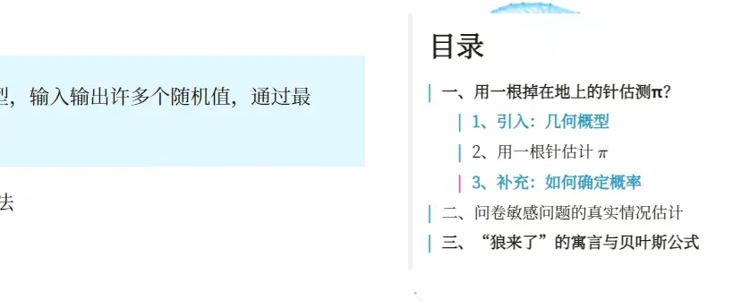
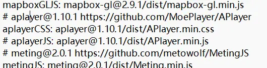

# Table of Contents Navigation Fails on the Chinese Blog


## Problem 1

> Environment: Hugo extended version + the LoveIt theme series

Hugo generates a table of contents for every blog post, and the TOC headings should support click-to-jump. A few days ago I noticed that on my blog, the Chinese pages couldn't jump to headings, while the English ones still could.



## The cause

After asking the [doit theme maintainer](https://github.com/HEIGE-PCloud/DoIt/issues/1209), I got the cause of the error:

I'd added a BGM to the page (as below) — this feature uses [APIayer](https://github.com/DIYgod/APlayer), and APIayer in turn calls [smoothScroll](https://github.com/alicelieutier/smoothScroll).



smoothScroll's default settings use English parameters; after introducing APIayer to play music, the TOC jump [return value becomes null](https://github.com/alicelieutier/smoothScroll/blob/master/smoothscroll.js#L100).

```js
        if (location.hash !== this.hash) window.history.pushState(null, null, this.hash)
        // using the history api to solve issue #1 - back doesn't work
        // most browser don't update :target when the history api is used:
        // THIS IS A BUG FROM THE BROWSERS.
        // change the scrolling duration in this call
        var node = document.getElementById(this.hash.substring(1))
        if (!node) return; // Do not scroll to non-existing node
```

## The solution

In the end I found a solution in the blog post [APlayer causing blog TOC navigation to fail](https://blog.wangriyu.wang/2018/06-Aplayer.html).

Modify `APlayer.min.js` in the `<personal website>\assets\lib\aplayer` directory.

The blogger [鱼の乐](https://blog.wangriyu.wang/) has provided his modified [APlayer.min.js](https://src.wangriyu.wang/lib/Aplayer/APlayer.min.js).

If the blogger's domain hasn't been renewed, you can refer to the file I copied:

[APlayer.min.js](https://github.com/hzp2333/hzp2333.github.io/blob/master/lib/aplayer/APlayer.min.js)

Just replace the whole file.

**These problems have been exposed since 2018, and it looks like there won't be any maintenance going forward, so I suggest fixing it yourself**.

## Problem 2

When I added the giscus comment section, this problem appeared again? The previous solution also stopped working.

Huge thanks here to [@yllhwa](https://blog.yllhwa.com/) for the help😍👍.

Copy `themes\LoveIt\assets\data\cdn\jsdelivr.yml` to `<your website>\assets\data\cdn\jsdelivr.yml`.

Then comment out `aplayerJS: aplayer@1.10.1/dist/APlayer.min.js`.




---

> Author: [滑翔闪](https://github.com/hzp2333/hzp2333.github.io)  
> URL: https://blog.huaxiangshan.com/en/posts/toc/  

