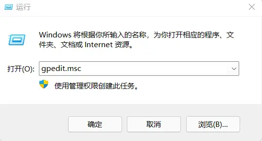
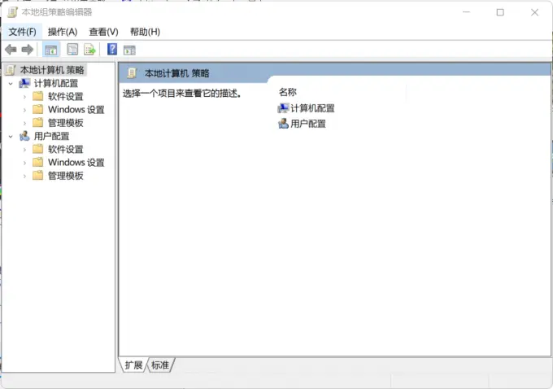
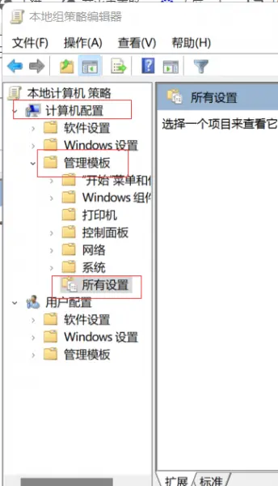
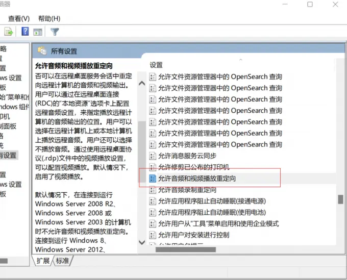
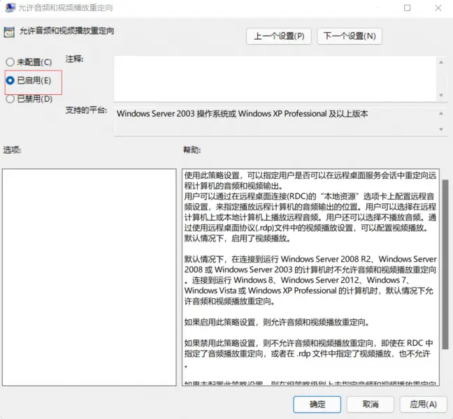
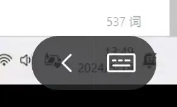
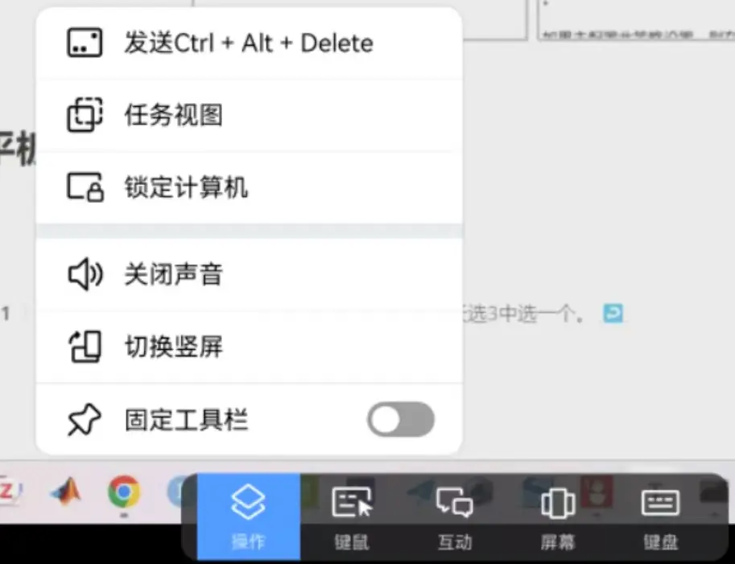

# Audio Issues When Remotely Controlling a PC with a ToDesk Tablet


>My current **latest streaming solution** is Moonlight; my evaluation of the various streaming solutions I have tried is at the end.

I finally switched to a gaming laptop. Since I usually carry my computer around everywhere, I picked the Tianxuan 3, which has the strongest battery life and lightest weight among value gaming laptops[^1].

But I miscalculated in the end; after adjusting for a while I still found it too bulky, so I decided to use a tablet to remotely control it.

There are many remote-control options:

ToDesk, Sunlogin, TeamViewer, RustDesk, Parsec...

> Speed, convenience, and image quality — ToDesk is number one in all of them (Parsec is better, but connecting requires an external network). The free version has no privacy screen, but in my dorm room nobody pays any attention to my computer screen (

My setup: Huawei MatePad Soft Light Edition + ToDesk + Tianxuan 3 Core Edition.

Here I will mainly cover how to enable remote audio transmission.

## PC Side

You need the sound-card driver protocol to transmit the computer's audio to the controlling device.

If there is no sound-card driver, create a `.text` file as follows, enter the code, rename it to end with `.bat`, and run it.

```react
@echo off

pushd "%~dp0"

dir /b C:\Windows\servicing\Packages\Microsoft-Windows-GroupPolicy-ClientExtensions-Package~3*.mum >List.txt

dir /b C:\Windows\servicing\Packages\Microsoft-Windows-GroupPolicy-ClientTools-Package~3*.mum >>List.txt

for /f %%i in ('findstr /i . List.txt 2^>nul') do dism /online /norestart /add-package:"C:\Windows\servicing\Packages\%%i"

pause
```

Then start the audio invocation:

Open the Run window, type gpedit.msc in the Run box, and click OK.



Open the editing interface.



In the menu bar, select 【Computer Configuration】-【Administrative Templates】-【All Settings】in order.

Scroll down the page on the right, find the "Allow audio and video playback redirection" option, right-click it, and choose Edit.


Enable "Allow audio and video playback redirection".


## Tablet Side

Click the **expand arrow** in the bottom-right corner of the control page.



Click to turn on audio; once it is on, the corresponding button becomes "turn off audio".

**If you switch away from the tablet page and come back to no sound, turn audio off and then back on.**


## Notes

- After enabling audio transmission, **even if the computer is muted, the controlling device still has sound**, and the volume is controlled by the controlling device.
- Since tablets generally have no earpiece, audio is played through the speakers by default.
- I use Bluetooth earbuds connected to the tablet; sometimes the audio plays through the speakers and sometimes through the earbuds. From what I have observed, you need to **connect the earbuds to the tablet first, and then start the remote control**, so the audio goes through the earbuds rather than the speakers.

## Brief Review of Streaming Solutions

- Huawei: I flashed a Huawei PC Manager onto the Tianxuan; in its settings you can enable remote control, and on Huawei phones and tablets you can find remote control under `Smart Connection`. **Includes a privacy screen, decent speed, no gaming mouse support, lower image quality — basically a ToDesk with an extra privacy screen.**

- ASUS: requires a personal Microsoft account; mine is a family account, so it does not work.

- [Parsec](https://parsec.app/downloads): **high image quality, low latency, game support, no privacy screen, easy to set up (you just need a VPN when logging into the software on the device)**. It should be the best solution in general — but it is not compatible with the Huawei tablet, where the mouse wheel and audio playback fail.

- [Moonlight](https://github.com/moonlight-stream) + [Sunshine](https://github.com/LizardByte/Sunshine): a drop-in replacement for Parsec, and optimized for Steam — the ultimate solution for streaming from anywhere. The downside is that the campus network assigns a random IP each time, so I have to reconfigure it. This is the solution I am currently using. Another drawback — occasionally the audio still stutters, and **the mouse optimization is poor too**. Changing to a remote-friendly mouse in `moonlight` works, but then it no longer suits games[^2].

[^1]: With the 4060 config, it basically came down to choosing among the OMEN 9, the Lenovo Y7000, and the Tianxuan 3.
[^2]: For example, in games like Genshin Impact and Honkai: Star Rail that hide the mouse cursor, enabling this feature will make you lose the mouse-look function in-game.


---

> Author: [滑翔闪](https://github.com/hzp2333/hzp2333.github.io)  
> URL: https://blog.huaxiangshan.com/en/posts/todesk/  

