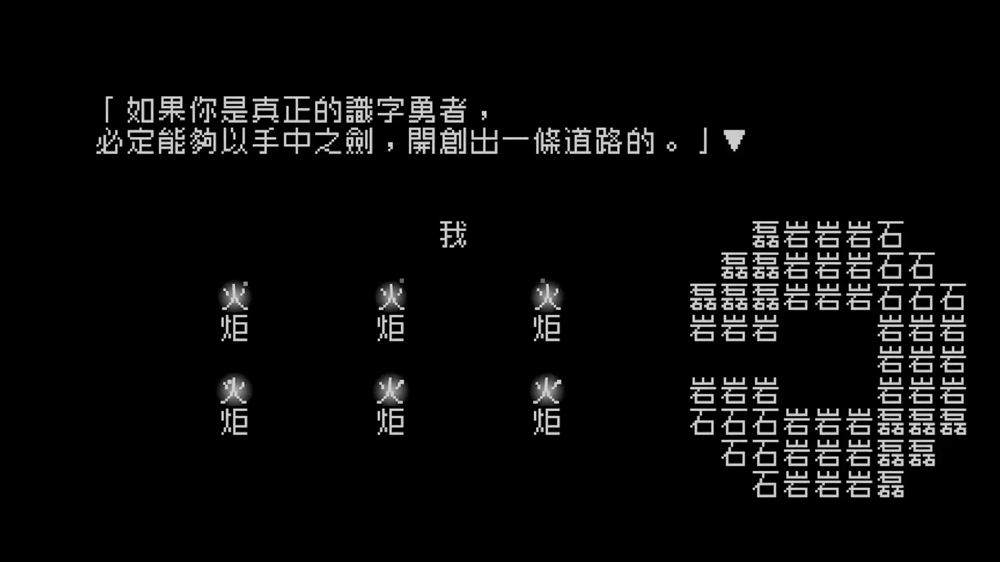
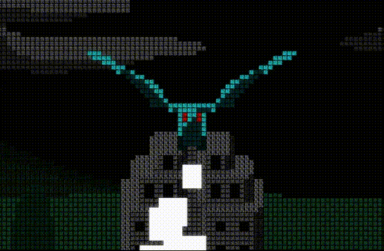
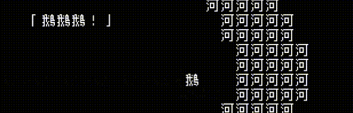
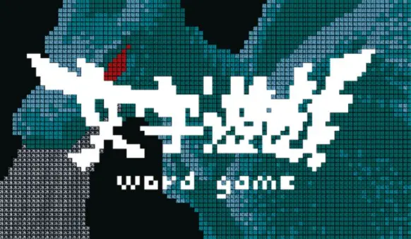

# Word Game: Back to the Written Word



 

Words are my only weapon, and they will be my greatest strength.

 

This is the hero's opening self-introduction, but if the player has the patience to reach the third layer's true ending, they'll discover the tragedy, the hidden story, and the love behind those words.

It's precisely the game's three endings that made me feel the whole game is like the Chinese character "回" — a "return" in meaning, and a loop-shaped circle in its level structure.

**Form and meaning fused into one: no beauty in a game exceeds this.**

## An Audiovisual Experience No Foreign Language Can Copy

The most brilliant audiovisual experience in the whole game is, without doubt, its masterful use of "characters." The three-dot water radical in "溪" (stream) ripples and flows; the two dots flanking "火" (fire) send up drifting smoke; the symmetrical character "門" (door) can fold inward on both sides and slowly knock shut.

These strokes of genius make the game impossible to translate into English; only learners of Chinese can get the purest experience — this is the sediment of five thousand years of Chinese pictographic characters.

Of course, pure text has another benefit: there's no picture-making more wonderful than the one in your head. (

Also worth mentioning are the transitions and animations. For example, when the "giant" reaches out to grab a friend, it uses the 2D nature to cast a shadow at his feet — a natural transition. When the dragon appears, the scene change is done with a text-flipping effect, achieving perfect unity with the dragon's rolling eyes!

## Gameplay Second, Cleverness First

The whole game is built around taking Chinese characters apart:

1. Delete negation words to change the sentence's meaning.
2. Rearrange the word order to change the meaning.
3. Break apart and reassemble radicals to rebuild characters.

Through further permutations and combinations, the deeper puzzles of Word Game are like twisting a "text-based Rubik's cube" to spell out the "key line." There are mainly two techniques: assembling and rotating.

But it's also because of the flexibility of character combinations that some words and sentences feel forced. And after the initial amazement of the first puzzle, later puzzles can feel a bit long-winded and dull.

> More than its mediocre gameplay, the game's core is its cleverness: constantly digging into item and scene descriptions to distill interesting combinations. For example, the "门" (door) in "五花八门的颜色" (colors of all kinds) is the exit the player has been searching for, and the protagonist "我" (I) can pop out of other characters' mouths at any moment. It's these text puzzles, built on the misalignment between item descriptions and visual form, that fill the game with wit and humor.

## Clever Puns and References

The key characters and items are actually homophonic puns on Word editing terms; the whole adventure "loops back" to the text itself, from playing a character to creating characters, and this also foreshadows the third ending.

The three mentors: Bold, Italic, and Underline.

Items: the Sword of Backspace, also known as the "Sword of Delete," and the Undo Potion — Word's undo: the cheat code: Ctrl+Z.

## An Ending That Isn't Necessarily Happy

The short boss fights make the arrival of the three endings feel too rushed, and the mystery of the friend "Ace's" teleportation is never really explained (for a few levels I was amazed at how fast Ace moved and thought it was foreshadowing, but it turned out to be nothing), which rather sours the experience.

Even the true hidden ending isn't a complete and happy one. To avoid spoilers, I won't say much here. But I believe that after playing this "looping" word game, players will all feel:

"Hero, words are my only weapon, and they will be my greatest strength."

The three endings are also three transformations of the characters.  "我" (I) becomes "人" (person), and "人" becomes the "input cursor: |" in a text editor. 

It's because of "only" that "greatest" appears, so I call this story's ending a tragic one.

But even in hardship, words can still be used, which seems like an invincible redemption. If you feel pain, then why not write down your feelings and create. Words won't 100% become the weapon that rescues reality, but the faith and thought contained in words may redeem the soul — just that, yet it is already everything that Chinese characters express.

---

> Author: [滑翔闪](https://github.com/hzp2333/hzp2333.github.io)  
> URL: https://blog.huaxiangshan.com/en/posts/wzyy/  

