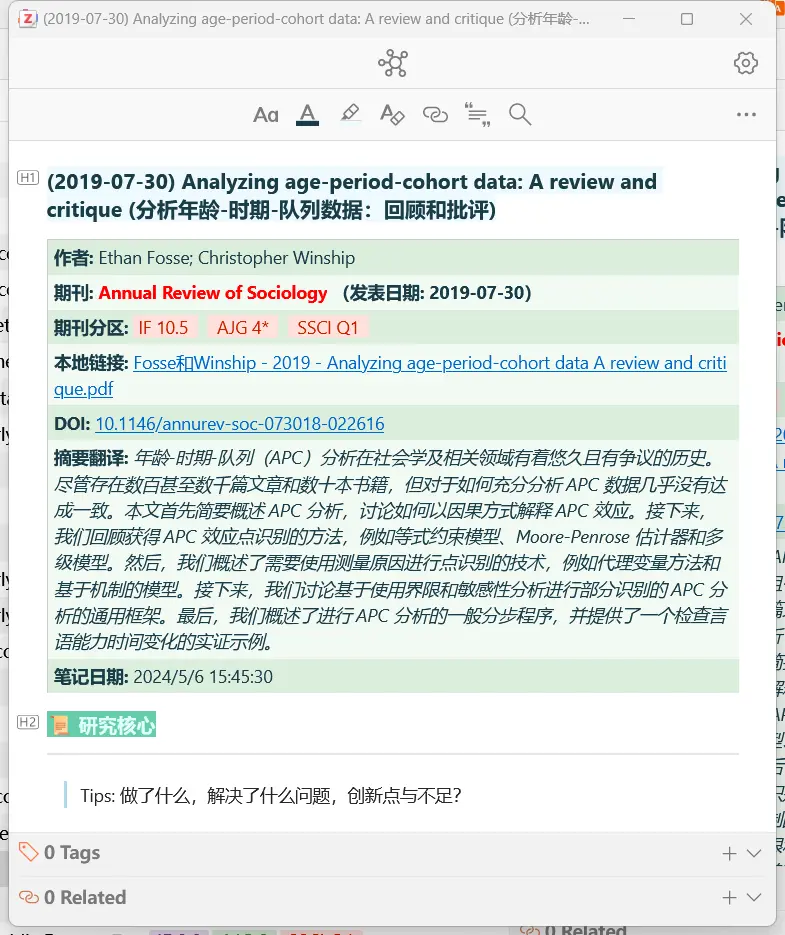
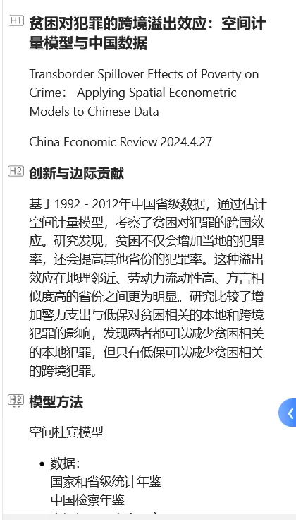
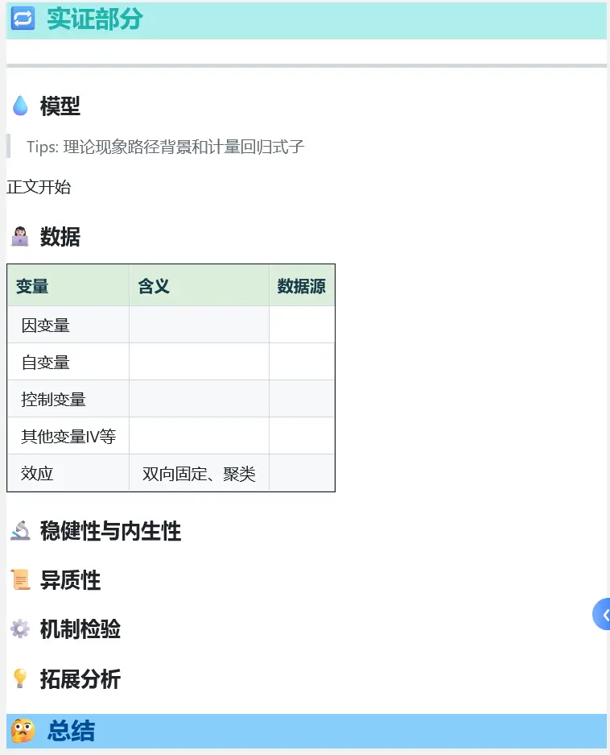
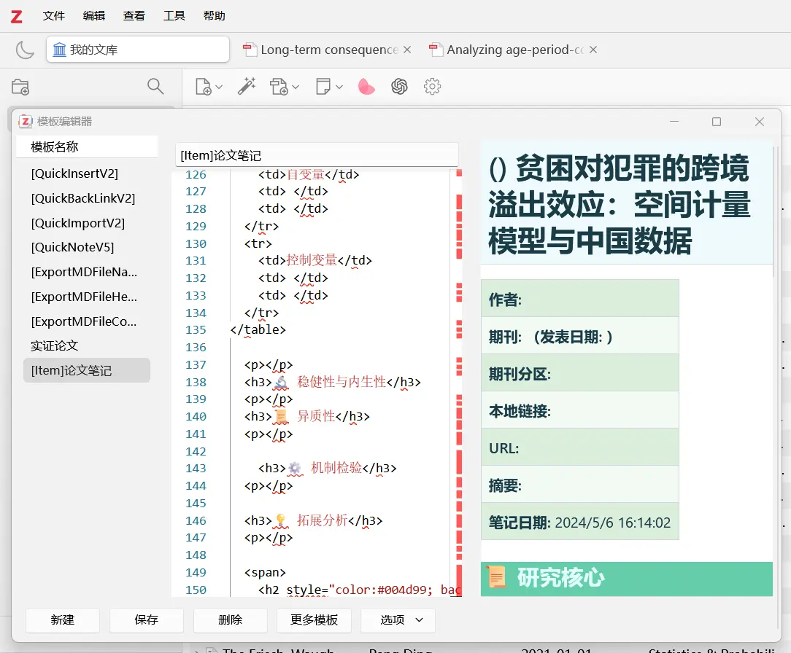
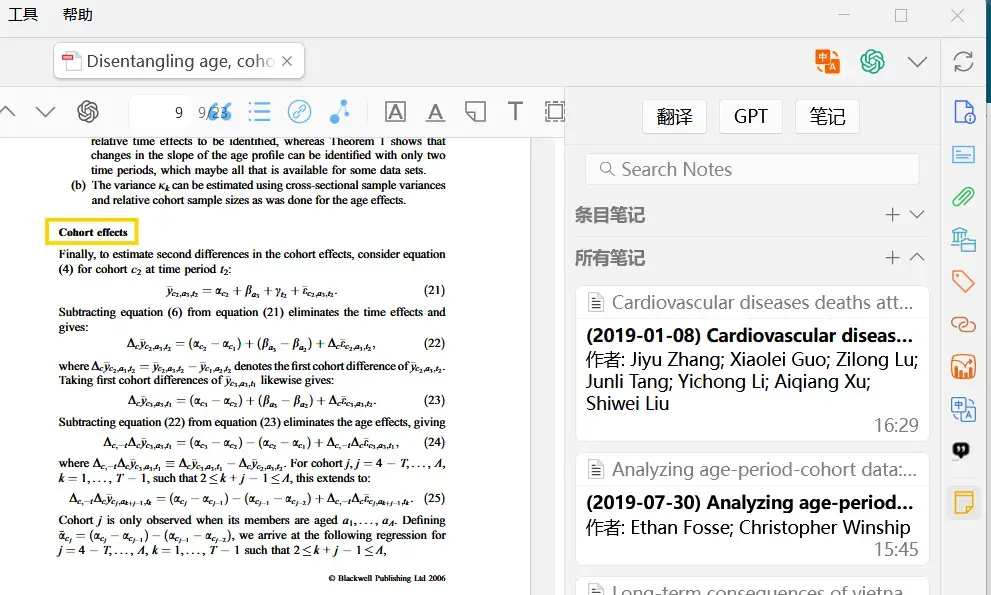

# Zotero 7 Better Notes: An Empirical Economics Note Template


As everyone knows, Zotero has a ton of god-tier plugins, and Better Notes is one of them. You can read papers and write Markdown notes directly inside Zotero.

A lot of the time teachers ask us to make a PPT for a paper presentation. If your Markdown template is written well, using it as a PPT isn't out of the question (

Combined with plugins like Zotero Style, Jasminum, Green Frog, ZoteroGPT, and Translate, we can also **auto-fill the notes.**

> Two paper topics I came up with recently, after a bunch of fancy operations, turned out to have insignificant data. No new inspiration either, so I went back to tinkering with math and software.
>
> Insignificance actually shows how reliable econometrics is — it is not forced significance; everyone is practicing alchemy, and someone will eventually dig up the real treasure. The one who does will say it was economic intuition and research taste — which is a bit mystical[^1].
>
> I am writing this post because after the Zotero 7 update my old templates stopped being compatible, and I also wanted to add a paper-reading note template that suits me.


## 1. Installing Better Notes

GitHub project: [https://github.com/windingwind/zotero-better-notes](https://github.com/windingwind/zotero-better-notes)

The project's [discussions](https://github.com/windingwind/zotero-better-notes/discussions) (discuss) is where everyone shares templates.

## 2. Adding Templates

Copy my template, or go to the discussions and copy whichever template you want.

### Template 1: Utterly Simple



The text part is the heading; `<h1>` represents a level-one heading, and `</li>` represents an unordered list.

```html
<h1>标题</h1>
<p></p>
<h2>创新与边际贡献</h2>
<p></p>
<h2>模型方法</h2>
<ul>
  <li>数据：</li>
  <li>因变量：</li>
  <li>自变量：</li>
  <li>控制变量：</li>
</ul>
<h2>稳健性和内生性 </h2>
<p></p>
<h2>机制检验</h2>
<p></p>
<h2>异质性</h2>
<p></p>
<h1>总结</h1>
<p></p>
```

### Template 2: Fancy

Adapted from: [Self-use SCI note template](https://github.com/windingwind/zotero-better-notes/discussions/771)

You can find my modified source code on [GitHub](https://github.com/windingwind/zotero-better-notes/discussions/973) or [Zhihu](https://zhuanlan.zhihu.com/p/696175807).

> This is the image shown at the start of the post.  
> You will need to additionally install the Zotero Style, Green Frog, and Translate plugins as template support.



Since the Hugo blog does not support embedding Zotero's HTML code (it even renders incorrectly in a code block),

you can find the source code on [GitHub](https://github.com/windingwind/zotero-better-notes/discussions/973) (#973), or find the code on [Zhihu](https://zhuanlan.zhihu.com/p/696175807).

### Loading the Template and Errors:

`Zotero top-left corner` - `Edit` - `Template Editor` - `New` - `paste the code into the middle` - `Save`



-   Possible error case 1: **_Template New Template: 1714978248098 Error: ReferenceError: topItem is not defined_**

Because the template name has to be in the form `[Item]论文笔记`. Do not ask — it is legacy underlying code from Zotero 6.

-   Possible error case 2: **_Template Preview Error: TypeError: Zotero. ZoteroStyle. Data. Ztoolkit. ItemTree. FieldHooks. GlobalCache is undefined_**

Here the note template reads file metadata through Zotero Style; it will not work if the versions do not match.

The code in this post corresponds to,

`Zotero 7.0.0-beta.77+adaa61f2c` + `Ethereal Style 4.4.2` + `Better Notes 1.1.4-49`.

> It is also because the recent Zotero 7 versions have all been bug-fix optimizations, and the version has stabilized, that I decided to update my Better Notes template.
>
> A heads-up: Better Notes is still stuck at version 2023.12[^2], so note export still seems to have some issues.

-   Possible error case 3: many people still get errors after the above two steps, and the reason is still that this note template needs to read file metadata. If you add the note template to a PDF attachment directly instead of the paper entry, it will error out because there is no metadata.

## 3. Using the Template

After opening the PDF you want to read (make sure the PDF has Zotero entry information),

click the plus sign in the item-notes row on the right - New Note from Template - then open the template you want in the popup.



## 4. Economics at Home and Abroad

Finally, some thoughts from reading papers recently. Right now, domestic economists have a terrible reputation, and everyone says you have to go abroad to study economics (poor me, with my bad English, naturally chose to hunker down domestically). I agree, since the mainstream economics framework comes from the West.

But this is not a question of comparing totals; it is a question of catching up. A huge number of domestic universities cannot even scrape together quality teaching resources for the "three highs" (advanced micro, macro, and econometrics)[^3], yet research progress is advancing by leaps and bounds — you could say the new generation has competed the difficulty way up (

- Ten years ago, a complete regression workflow in *Economic Research Journal* was enough.

- Five years ago, econometrics had already become widespread.

  Even your thesis would get pushed to include econometrics if it did not have any.

- Nowadays, look at the recent issues of *China Industrial Economics*, *Management World*, and *The Journal of World Economy*: a large chunk of good papers are already **mathematical-model qualitative analysis + social reality analysis + econometric argumentation, three-in-one.** At least in format they have fully aligned with international standards.

  The increasing number of papers I read recently — heterogeneity and mechanism tests — feel like they are mixing testing with economic-meaning analysis. I get the feeling the big shots are at the stage of "a formless move beats a formed move."

Considering only purely domestically-trained scholars: research rigor has caught up, and what remains is original thought. Catching up on that will take at least another 20 years, right? Even if someone proposes a genius innovation theory this year, it still needs 20 years for the theory to pass the test of history and society.
## Other Zotero-Related Posts

[Huaxiangshan: Word as a LaTeX Replacement?](https://zhuanlan.zhihu.com/p/624450256)

[Huaxiangshan: Should You Upgrade Zotero 6 to 7?](https://zhuanlan.zhihu.com/p/673661938)

[Huaxiangshan: Zotero and RSS Subscriptions for Economics Journals](https://blog.huaxiangshan.com/zh-cn/posts/zoterorss/)


[^1]: Lately I wonder if I have been brainwashed — economics always needs to tell an interesting story, yet the so-called "taste" is not up to me to decide. And speaking of problems, with so many issues in the Chinese economy right now, I cannot even come up with one concretely researchable question — that is pretty sad...
[^2]: Upgrading Zotero 6 to 7 broke a whole wave of plugin compatibility, and I feel it is getting laggier too.
[^3]: The 101 Plan actually has no soil to take root in, does it?


---

> Author: [滑翔闪](https://github.com/hzp2333/hzp2333.github.io)  
> URL: https://blog.huaxiangshan.com/en/posts/zoteronote/  

