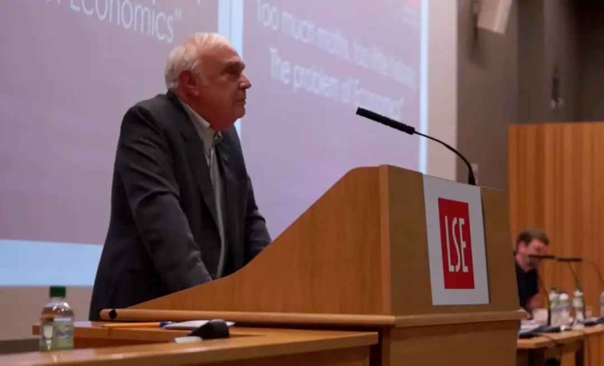
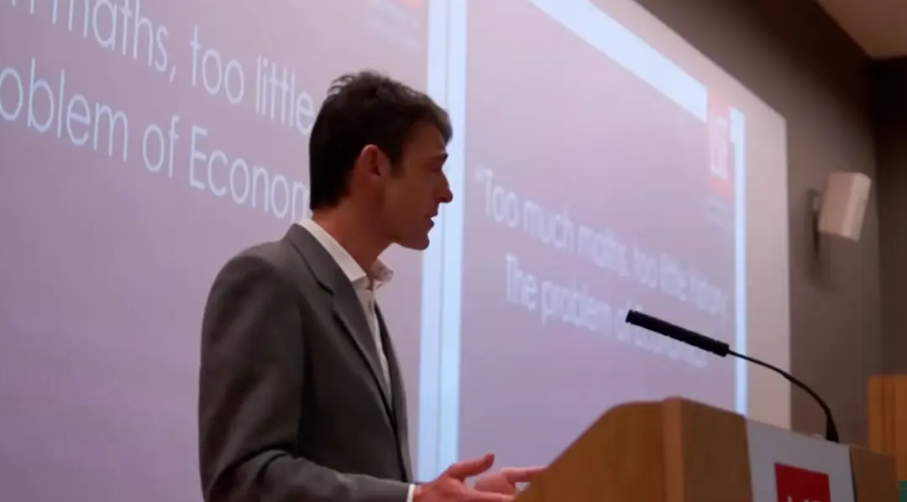
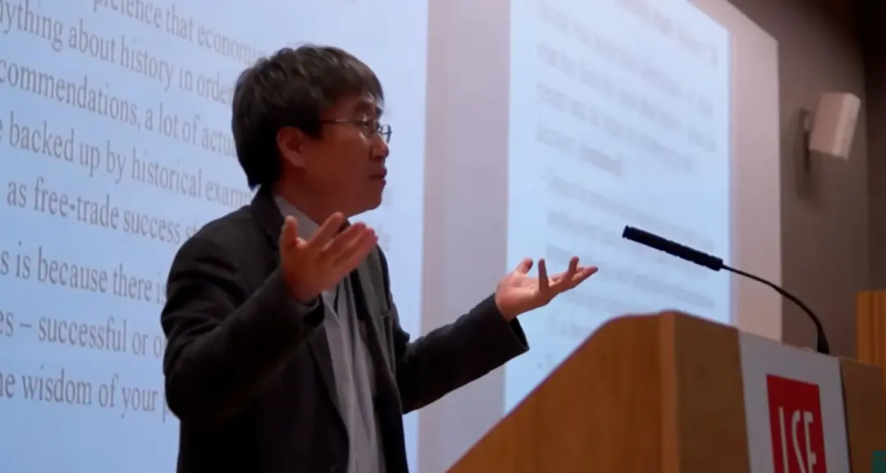
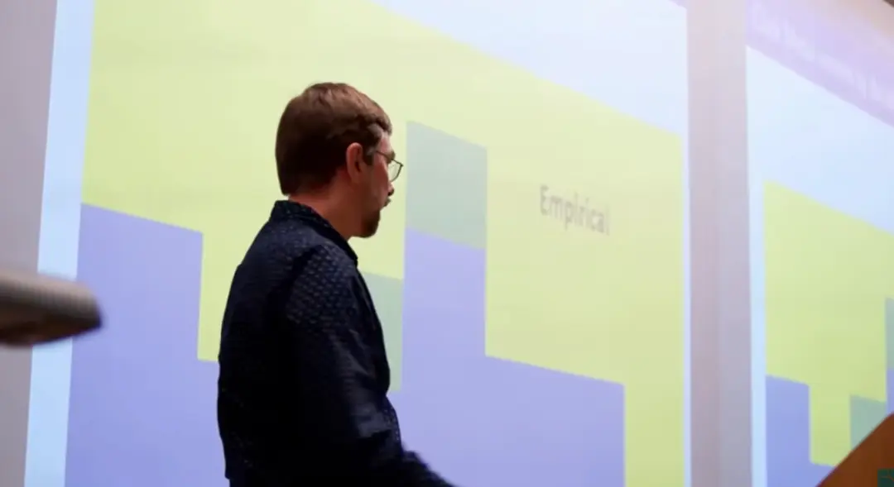

# 转载：LSE 经济辩论，经济中的数学与历史

> 转发自[经济学原理](https://mp.weixin.qq.com/s/V1LKcc6KB-c-k0f54ZlpAA)微信公众号
> 
> 来  源：Too much Maths, too little History: The problem of Economics；
> 
> 伦敦政治经济学院经济史系；原始视频资料可见[网站](http://lsesueconomicssociety.com/)。

油管原视频如下：



这场辩论发生在 2015 年。

# 辩论演讲

## Robert Skidelsky

> 英国经济史学家、作家与上议院终身贵族议员，现为华威大学政治经济学名誉教授。他以撰写关于约翰·梅纳德·凯恩斯的三卷传记闻名，该作品被视为凯恩斯生平与思想的权威研究，曾赢得多项历史与传记类大奖。Skidelsky 在经济学方法论、财政政策及技术变革的政治影响等领域有广泛写作和评论，是经济思想界的重要声音。

女士们、先生们，我与同事 Chang Ha-Joon 博士的职责，便是试图向诸位阐明这一命题的合理性：在当下教学与研究范式下的经济学中，存在着**数学**运用过度、**历史**研究不足的问题。我们不妨从一个显而易见的问题切入：人们为何研习**经济学**？本质上，是为了理解经济体的运行逻辑。而理解这一逻辑存在两种截然不同的路径，即数学推演与历史溯源，二者在**认识论**层面呈两极对立之势。

先谈数学。数学研究试图实现且宣称能够达成两大目标：其一，探究具有**必然真理性**的命题，这也是**逻辑学**的核心范畴；其二，推导可被证明的命题。经济学家对数学的推崇，实则聚焦于其二，即借助数学生成**可证命题**。但经济学所应用的研究对象是社会系统，该系统具有高度复杂性，复杂到无法通过数学获得可靠的证明结果，这就使得经济学家极易陷入对数学的第一种认知，即我所称的**柏拉图式数学观**。纵观经济学发展历程，总能发现经济学家将数学奉为构建严谨且精妙的经济学定律的通途，正如一位知名经济学家所言，这类定律堪比**天体力学定律**。2008 至 2009 年金融危机后，诺贝尔奖得主 Paul Krugman 的表述，精准概括了这种极具诱惑力的柏拉图式认知倾向：经济学界之所以走入歧途，是因为经济学家群体将披着晦涩数学外衣的形式美感，误作客观真理。经济学家沉迷于理想化的传统经济图景 ——**理性个体**在**完美市场**中互动，而此番不过是为这一图景披上了繁复的数学外衣。这种悄然向**柏拉图主义**的偏移，能够解释诸多学者所发现的一个现象，即**数理经济学**具有强烈的**规范导向性**。

经济学模型与飞机模型截然不同，后者是现实世界的微缩复刻，而经济学模型则通过一系列**假设**逼近现实。理论上，假设的选取应基于其对现实的**解释力**，但实际操作中，假设的选择往往出于便捷性考量，典型表现为通过排除**无关变量**实现方程的可解性。但需明确，这些变量排除行为属于主观选择，我们必须始终牢记，其划定了研究的核心问题，亦引导着研究的路径走向，本质上映射着经济学家的价值判断。一旦进入基于假设的**数理建模**阶段，经济学家实则是将自身认定的重要问题纳入研究框架，同时框定了问题的讨论范式，排除了其他可能的分析视角。这种**排他性**，加之数理经济学几乎无法实现任何命题的严格证明，使得数理经济学产生了一种强烈的倾向：迫使现实世界向模型靠拢，而非让模型贴合现实。这是数理经济学存在的一大关键偏误。

那么，历史在经济学中应扮演何种角色？我认为，历史的核心作用是为经济学提供**现实校验**。诸如 “风险（risk）在平均水平上被合理定价这类金融理论命题，若结合**金融市场**的实际运行规律与**经济史**的客观事实，根本无法成立。能够为经济学提供有效现实校验的历史分支，包括经济史、**经济思想史**以及**政治社会史**，但这些学科在标准**经济学课程体系**中均被排斥或边缘化，其教学空间基本被数理经济学挤占。经济学排斥历史的背后，存在着一种隐性的深层原因，即学界普遍认为，历史所能为经济学提供的启示，均已被纳入最新的经济学教材。这一荒谬的认知，对经济学研究造成了严重的负面影响，其根源在于笔者所称的**物理学情结**—— 这是诸多经济学家均易陷入的认知误区。经济学始终渴望跻身**硬科学**之列，若将经济学等同于自然科学，便会认为历史的经验教训已融入最新的**经济学模型**，回顾历史上的理论谬误便毫无意义。

19 世纪初，Jean-Baptiste Say—— 其因萨伊定律（Say's Law）闻名 —— 便曾言道：研究那些早已被推翻、理应被摒弃的荒谬观点与理论，究竟有何实际价值？试图重拾这类理论，不过是无意义的学究行为。一门科学的发展越完善，其历史便越简短。面对理论谬误，我们的使命并非重拾，而是彻底遗忘。经济思想史的研究境遇恰是如此，当代经济学课程完全奉守 Say 的这一信条，将梳理过往理论谬误视为教学的排斥项，这也是绝大多数经济学课程体系中，经济思想史研究几近空白的根源 —— 学界认为这类研究不过是对谬误的复盘，而我们早已超越这些谬误。但事实恰恰相反，研究经济思想史的核心意义，在于让我们认识到，经济学领域的核心争论从未真正解决，且至今仍困扰着学界。**货币数量论** 是否成立？**政府支出**是否具有天然的低效性？经济学家对这类问题的分歧始终存在，当代各**经济学流派**，实则都是这些历史争论的延续。若仅以主流教材的单一视角对这些争论进行简化阐释，将彻底消解经济学的丰富性、多元性及其对现实的解释力。

掌握经济思想史知识，能够让经济学家摒弃**自负（hubris）**，避免对自身推崇的学派 —— 无论是**新古典学派**还是**后凯恩斯学派**—— 持有绝对的认同。因此，经济学家不应追求构建一套全面、普适、永恒的**经济学理论**，而应致力于理解并紧跟持续演变的经济系统。研究历史能够清晰揭示，经济学命题的真理性具有**语境依赖性**。例如，无人能否认**凯恩斯革命**源于**大萧条**的时代背景，也无人能否认 Friedman 的**货币主义**是对 20 世纪 70 年代**通货膨胀**的理论回应。再举一个颇具争议的例子，19 世纪 70 年代的**边际革命**，实则是对 Marx **劳动价值论**的反驳，而 “**生产要素**按其**边际产品**获得报酬” 这一观点，实则是对企业家社会价值的明确肯定。

经济学家试图通过大量运用**统计学**与**计量经济学**，为经济认知融入历史视角，但 Robert Solow 在其一篇极具参考价值的论文中精准指出：一切狭义的**经济活动**，均嵌入于由**社会制度**、习俗、信念与态度构成的网络之中，经济活动的具体结果，无疑会受到这些背景因素的影响 —— 部分因素缓慢渐变，部分因素则突变无常。一旦**时间序列**足够长，有望对不同**假说**进行区分时，其**平稳性**便会大幅降低，**噪音水平**也会相应上升。在此情况下，只需稍加巧思与持续尝试，研究者几乎可以得到任何期望的研究结论。

最后，历史向我们揭示，**经济思想**的形成始终映射着**权力结构**。金融理论的发展，实则反映了银行业摆脱**国家监管**的利益诉求，这一点毋庸置疑。

我以一核心观点作结：经济学的发展路径，并非从具体到一般，这是学界的一大认知谬误。经济学并非始于局部且不完备的理论，再通过数学推演逐步发展为更具一般性的理论，进而不断接近经济生活的客观真理 —— 这是自然科学的发展模式，却从未适用于经济学。我倡导 “因地制宜” 的经济学研究理念，即针对不同的问题与场景，选取适配的经济学分析方法，而非预设某一种方法具有绝对的优越性。例如，**发展经济学**对数学工具的需求相对较低，因为其核心研究问题聚焦于**政府治理**；反之，若要预测某一特定产品或经济部门的**供需状况**，数学工具则具有极高的实用性，甚至是不可或缺的。由此可见，**数理微观经济学**确有其研究价值，甚至至关重要。但即便如此，标准经济学课程体系中历史维度的缺失，实则是该学科**多元性**与想象力丧失的表征，经济学研究已陷入自满，其诸多理论框架也已趋于陈旧。

 如今，学生从大学毕业时，往往认为经济学研究仅有唯一范式，即大学一、二、三年级所教授的方法。这种研究范式的单一性，滋生了学界的**智识傲慢**，经济学家将非自身研究范式的经济学研究视为低阶研究，即便表面上表现出包容，其背后的优越感也不言而喻。笔者希望今晚的交流能够保持理性与平和，而对历史的认知，理应让经济学这一学科摒弃傲慢，更具现实价值。

## Francesco Caselli

> 意大利裔经济学家，现任伦敦政治经济学院（LSE）诺曼·索斯诺教授及经济学系前任系主任。他的研究涵盖宏观经济学、经济发展与增长差异等领域，是英國學術界的资深学者。Caselli 曾在芝加哥大学与哈佛大学任教，担任多个顶级经济学期刊的编辑职务，并当选英国学术院与计量经济学会院士。

 感谢 Skidelsky 勋爵的分享，接下来由我发言，我绝不会抱有任何居高临下的态度。各位，我并不确定经济学研究中是否存在数学运用过度的问题，或许是过度，亦或许是不足。作为开场，我认为最有意义的方式，是向诸位阐释数学于我这位经济学家而言的价值、我的使用方式 —— 毕竟我确实会运用数学工具，以及我为何会使用它。我的研究始终始于**观察**，从未例外。我始终致力于发掘那些看似令人困惑、难以理解且具有重要研究价值的事实。经济现象不断发生，而经济学家的核心使命，便是解释这些现象背后的成因。从诸多层面而言，经济学本质上就是一门历史学科，因为其研究对象是已然发生的事件 —— 这些事件或许由历史学家、记者记录，或许蕴含于**数据**之中。当发现这些客观事实后，经济学家会如同历史学家一般，对其进行解读、分析，构建**叙事逻辑**，阐释具体情境下的事件成因。

我的研究几乎从未以数学为起点，而是始于**直觉**、**预感**，始于脑海中用文字构建的叙事逻辑。我会先以文字梳理思路：这一事实十分有趣，无论是当下发生还是两百年前发生，其背后的成因究竟为何？或许可以构建这样的解释逻辑：事实 A 引发事实 B，事实 B 进而引发事实 C。这一过程，便是**理论构建**的过程，而理论构建并非必然需要数学工具。社会学、历史学均有其理论体系，任何对现象的解释，本质上都是理论的构建。但无论以文字还是数学表达，任何理论都应具备**逻辑一致性**，能够自圆其说，无遗漏、无谬误，避免推导偏差。

那么，数学工具的价值究竟何在？于我而言，我会先以文字构建叙事逻辑，再尝试以数学语言重构同一逻辑，这一过程的价值在于：人的理性思考存在局限性，我无法仅通过文字思考，穷尽论证过程中的所有潜在疏漏，而数学工具能够及时揭示这些疏漏，发出警示：你的叙事逻辑过于简化，存在未考虑到的变量。

 我举一个简单的例子，便于非经济学专业的诸位理解。我的同事 Steve 是一位**劳动经济学家**，其研究聚焦于工资变动对**劳动供给**的影响，即工资上涨后，劳动者的工作意愿是否会提升。若仅以文字进行简单分析，很容易得出一个看似合理的结论：工资上涨，劳动者的工作回报增加，其工作意愿理应提升，进而可能直接将这一结论作为研究基础。但倘若强制自己以数学语言重构这一分析逻辑，便会立刻发现分析的疏漏 —— 这一点经济学专业的诸位应当熟知：工资上涨后，劳动者的可支配收入增加，其对**闲暇**的消费能力也随之提升。因此，工资上涨对劳动供给的影响具有不确定性，既可能促进劳动供给增加，也可能导致其减少。由此可见，若仅依赖文字分析，极易陷入认知偏差，而数学工具能够有效规避这一问题。

 这是我运用数学工具的第一种方式：将其作为**思维工具**，排查推理过程中的谬误。但需明确的是，研究的起点并非数学，这一点至关重要。若仅因数学推导结果与简单直觉相悖，便直接向同行宣称 “数学推导表明结论如此”，必然会遭到学界的质疑。我必须回归文字分析，理解数学推导背后的逻辑：为何最初的直觉存在偏差？遗漏了哪些变量？若数学推导缺乏文字逻辑的支撑，无直觉、无推理的佐证，那么这一推导结果便不构成有效的经济学研究结论。

因此，经济学研究中，文字叙事与数学叙事是相互印证、相辅相成的双重逻辑。数学叙事能够让研究者保持审慎，而文字叙事始终是研究的核心。这也是我教授经济学的核心理念 —— 修读过我课程的诸位应当知晓，我的课堂中几乎不使用数学工具，我认为经济学的核心知识，均可通过文字进行讲授。但倘若未事先以数学工具校验推理逻辑，我也无法确信文字阐释的准确性，而在完成数学校验后，便可以依托文字阐释进行教学。

 我运用数学工具的第二种方式，在微观经济学领域愈发重要 —— 这一方式与计算机技术高度适配，且恰好反驳了方才支持 “数学过度、历史不足” 这一观点的学者所提出的 “数学工具无法应对复杂经济问题” 的论断。笔者认为事实恰恰相反，数学工具是应对复杂经济问题的绝佳手段，即便是比我更具智识的学者，也难以仅凭文字分析应对高度复杂的经济问题。

以微观经济学为例，当经济系统遭受**外部冲击**时 —— 如政府实施**财政紧缩政策**、**央行**调整**利率**—— 这一冲击会影响数百万**经济主体**的行为，包括消费者、企业、政府其他部门、**境外经济主体**。这些经济主体的行为回应，又会引发其他主体的后续回应，即产生**第二轮效应**：企业的行为影响消费者，消费者的行为影响政府，政府的行为又反作用于企业。目前，几乎无人能够梳理清楚这一错综复杂的连锁反应与反向反馈逻辑。但倘若能够对经济主体的**信息处理方式**与**行为决策逻辑**进行合理刻画 —— 这是一个重要前提 —— 便可以将其转化为**数学模型**，植入计算机系统，进而模拟经济系统的整体回应，构建相应的叙事逻辑。

 以上便是我认为数学工具具有重要价值的原因，它是我研究**工具箱**中的核心工具，但并非唯一工具，也非首要工具。研究的起点，始终是文字层面的逻辑思考，而失去数学工具，经济学家便如同工匠失去了一件核心工具。

接下来，我针对方才的分享，作几点即兴回应。我认为，学界对经济学存在一大核心误解，且这一误解并非仅针对数学工具的运用。首先，我想提出一个一般性观点：学界极易将数学工具的运用，与经济学存在的其他问题相混淆。若本次讨论的主题是经济学的其他潜在问题，我或许会站在批评者一方。例如，学界对数学工具运用的讨论，往往与经济学假设的合理性、现实性，以及假设是否应随时代演变的讨论交织在一起。若针对这一主题展开讨论，我会深表认同，因为经济学的假设体系确实存在诸多问题，例如对经济主体**完全理性**、**完全信息能力**的假设，但这些问题与数学工具本身无关：即便仅以文字分析，不合理的假设也会推导出无效的结论；同理，数理分析中，不合理的假设同样会产生无效结果。反之，合理的假设下，无论文字分析还是数理分析，均能得出有效结论。因此，必须明确区分两个议题：经济学假设的合理性问题 —— 笔者认为诸多假设均不合理，以及数学方法论的运用问题，二者完全相互独立。

 其二，另一大严重的学界误解是：经济学存在一套**统摄一切的模型**，所有经济学家均受制于这一模型，并试图将所有经济现象纳入其中。这一认知与事实完全相悖，Paul Krugman 的相关观点亦非我所认同 —— 况且，Krugman 已多年未参与经济学的学术研讨会。回归我的研究逻辑：观察现象，构建叙事逻辑，而非将现象强行纳入某种柏拉图式的万能模型。正如 Robert Solow 所言，经济学研究应 “因地制宜”，针对具体问题，构建适配的分析模型与叙事逻辑，这也是学界的普遍做法。

关于历史，我无需过多赘述，因为经济学研究中早已融入了大量的历史维度。我举一个具体的小例子，虽非决定性证据，但足以说明问题：我校经济系自今年起，每年将为两篇最佳**博士学位论文**颁发奖项。论文的研究主题涵盖当下的热点问题，如**大衰退**、孟加拉乡村的发展、当代劳动力市场等，而今年的两位获奖者，其研究主题均为历史问题：一位研究**拿破仑大陆封锁政策**对法国**棉纺织业**发展的影响，另一位研究 19 世纪末欧美**电报网络整合**的经济后果。正是被认为 “无视历史” 的经济学家，将最佳博士论文奖颁给了这两位历史经济领域的研究者。

此外，经济学家始终与数据打交道，而分析数据的过程，本质上就是对历史的研究 —— 数据承载着历史信息，经济学家的使命，便是解读这些历史信息。因此，笔者认为，经济学家在很大程度上，就是历史学家。

## Ha-Joon Chang

> 韩国发展经济学家，现任英国东方与非洲研究学院（SOAS）经济学研究教授，专长制度经济学与发展政策研究。张夏准长期关注历史经验与现实政策的结合，批评单纯依赖自由市场理论，强调国家在经济发展中的积极角色。他的著作如《踢开梯子》和《资本主义不告诉你的 23 件事》在全球广泛流传，对主流经济学提出深刻质疑

 感谢诸位的到来，也感谢主办方组织这场精彩的交流活动。我想以《生活大爆炸》中 Sheldon Cooper 博士的一句话开场 —— 在他看来，其是继 Stephen Hawking 之后最伟大的科学家 —— 他认为，解开宇宙的奥秘，需要三大工具：数学、科学与历史，其中，并无经济学的一席之地。

 诚然，不少人认为历史研究枯燥且无实际价值，正如根据 Alan Bennett 的经典戏剧改编的电影《历史系男生》中，Raji 这一角色 —— 由年轻的 Russell Tovey 饰演 —— 被历史老师要求定义历史时，给出了一个简洁且令许多人认同的答案：历史，不过是一件事接着另一件事。

如今，诸多经济学家将历史研究视为低阶的智识活动，其价值堪比观看火车运动、收集宝可梦卡牌。当然，这一认知正逐渐改变，但不可否认的是，经济学界存在着一种明显的**智识层级**：研究内容与现实世界的关联度越低，其智识层面的 “优越感” 便越强。若你是顶尖的学者，便会研究与现实几乎无关的数理建模问题，例如**图灵机**—— 当然，我并非否认这类研究的价值，但这类学者却被视为比其他研究者更具智识优势。若你的能力稍逊一筹，便会成为计量经济学家，但核心工作并非简单的回归分析，而是计量理论研究；若你的能力再弱一些，便会从事宏观经济学研究；若你的能力仍有不足，便会成为像我一样的发展经济学家；而若你的能力被认为 “垫底”，便会成为经济史学家。倘若你还在通过走访调研工厂管理者，试图理解企业的生产组织方式，那在部分人看来，你一定存在某种问题。

这种智识层级并非经济学界独有，例如《生活大爆炸》中便有明确的层级划分：理论物理学家居于顶端，实验物理学家次之，而仅毕业于麻省理工学院、从事工程学研究的 Howard，则被视为层级最低的群体。我并非说经济学家的这种认知是特例，但这种认为抽象理论与数理建模至高无上的思维，确实影响深远。但笔者认为，经济学家必须研习历史、理解历史，并从历史中汲取经验教训，究其原因，至少有五点：

第一，这是一个显而易见却至关重要的观点：历史是现实的源头，若无法理解过去，便无法真正认知当下。这一命题看似浅显，却常被学界忽视。

第二，人们对历史的认知 —— 或更准确地说，人们自认为的历史认知 —— 会通过影响决策塑造现实，并进而影响未来，这其中也包括经济学家构建经济学模型的决策。尽管部分经济学家声称，制定政策建议无需任何历史知识，但事实上，诸多政策建议均以历史案例为支撑。例如，倡导**自由贸易**的经济学家，其最有力的论据便是：英国与美国正是凭借自由贸易成为经济超级大国。没有什么比真实且成功的现实案例，更能说服他人认同政策的合理性。若要推行反通胀政策，便会以联邦德国与津巴布韦为案例，而非 20 世纪 60、70 年代通货膨胀率接近 20%、但经济实现高速增长的韩国。经济学家往往会选取这类选择性的历史案例，这一现象在学界十分普遍。笔者曾撰写多部著作，揭示英美自由贸易的官方历史叙事存在严重偏差：18 世纪末至 19 世纪初，英国是世界上贸易保护主义最严重的国家；而自 19 世纪 30 年代起的 120 年间，美国始终是贸易保护程度最高的经济体。若学界知晓这些历史事实，无论是自由贸易的理论倡导者还是政策制定者，其对自身政策的信念都会动摇，也难以说服他人认同自由贸易的合理性。

第三，历史研究能够让我们对诸多被视为理所当然的**经济学假设**提出质疑。即便诸位认为这一观点早已是共识，但这些认知从未真正融入经济学教育之中。例如，如今诸多不可买卖的事物 —— 人类、劳动力、童工服务、政府职位 —— 在过去均是完全可交易的；反之，100 年前甚至 50 年前不可交易的事物，如今却成为市场交易的核心标的，例如各类金融衍生品。许多国家直到 19 世纪末才设立**专利制度**；而金融衍生品之所以发展成如今的规模，仅仅是因为 1982 年，美国两大金融监管机构认定，可基于通货膨胀率、天气等无法实际交付的标的签订金融衍生品合约。这一认定催生了一系列全新的金融产品。了解这些历史事实后便会发现，所谓 “自由市场的边界是由永恒的科学定律划定、政治逻辑不应介入” 的观点，实则毫无依据，市场的边界本质上是由政治与伦理决策所界定。再举一例，若知晓 20 世纪 50 至 70 年代 —— 即所谓的**资本主义黄金时代**—— 是发达资本主义经济体历史上增长最快的时期，而这一时期恰恰伴随着严格且持续加强的监管与高税收，便会对当下 “减税与放松监管是实现经济增长的最佳方式” 的主流认知提出质疑。20 世纪 40 至 50 年代，美国的两位总统 Harry Truman 与 Dwight Eisenhower，甚至被部分人视为 “偏左”，在其执政期间，最高个人所得税率高达 92%，但在此期间，美国的人均经济增长率仍达到 2.5%；而在过去三十年的新自由主义实践中，美国的人均经济增长率仅为 1.5%。了解这些历史数据后，人们便会对经济学的底层假设产生新的思考。

第四，历史研究能够让我们看清**经济理论的局限性**。正如笔者所言，现实往往比理论更复杂，历史上诸多成功的经济案例 —— 无论是国家、企业还是个体层面 —— 均无法通过单一经济理论得到充分解释。Robert 曾提及经济学存在诸多不同流派，笔者在《经济学的用户指南》一书中也曾指出，经济学至少存在九大流派，且各流派均有其优势与不足。这些流派的诞生，均是为了解决特定的经济问题，其背后依托着不同的政治假设、人性假设与伦理假设，适用于不同的研究场景与问题。为阐释这一点，笔者以 “新加坡难题” 为例：在主流的全球化报纸与书籍中，新加坡的成功仅被归因于自由贸易政策与对外国投资者的开放态度，但这些叙事却忽略了以下事实：新加坡 90% 的土地归政府所有，85% 的住房由政府所有的住房公司提供，实行强制储蓄制度，且国有企业创造的产值占 GDP 的比例高达 22%，其中便包括著名的新加坡航空公司。笔者曾向研究生提出问题：请找出任意一种经济理论 —— 无论是新古典主义、凯恩斯主义、制度主义还是重商主义 —— 能够单独解释新加坡的经济成功。答案是，不存在这样的理论。因此，要理解现实经济，必须掌握不同的经济理论与历史经验，即便是分析数据，也需要深厚的历史知识支撑。例如，在分析经济开放度与经济增长的回归模型时，学者通常以有效保护率或其他指标衡量开放度，但倘若不了解研究对象的历史，便极易出现研究偏差。以 20 世纪 60 至 80 年代的韩国为例，政府实施严格的**外汇配给制度**，使得关税税率几乎失去实际意义 —— 无论关税税率高低，政府均可通过掌控银行拒绝为企业提供外汇。若了解韩国的这一历史背景，便会对以关税数据衡量韩国开放度的做法提出质疑。笔者因研究韩国而知晓这一事实，但世界上还有 50 至 70 个国家存在类似情况，其关税税率同样不具备实际参考价值。因此，即便是合理运用数据，也需要掌握研究对象的历史细节。

 最后但同样重要的一点是，研习历史是经济学家的道德责任，其目的是尽可能减少以人类为对象的**现实实验**。这是一个严肃的问题：经济学家的理论与政策，实则已造成了大量的人类悲剧，例如苏联的计划经济、转轨国家的 “大爆炸” 式市场化改革、大萧条后的紧缩政策，以及发展中国家的**结构调整计划**，这些政策均摧毁了无数人的生活。当然，研习历史并不能完全避免重蹈覆辙，但能够大幅降低犯错的概率。因此，出于道德责任，经济学家必须研习历史。

以上是笔者的核心观点，接下来我想从更实际的角度展开论述。诸多经济学家虽认同历史研究的价值，但在制定课程体系、分配教学课时时，却以 “需要教授大量数学知识” 为由，舍弃历史课程，甚至声称 “学生可以自学历史，但若不系统教授，学生便无法掌握数学”。笔者认为这一观点存在严重问题：若仅口头认同历史研究的重要性，却未在教学中落实，那这种认同便毫无意义。若真的认为历史研究至关重要，就必须将其纳入课程体系，进行系统的教学。因为历史研究并非简单的文字阅读，其需要特定的推理方式、理解能力与实证分析技巧，这些能力必须通过系统教学才能获得。若历史研究未被纳入课程体系，便无法期望学生主动开展相关研究。当下的学生为了求职，需要完成大量的实习，根本没有多余的时间自学历史。因此，若不将历史研究纳入经济学核心课程，即便学生有学习的意愿，也难以付诸实践。

## James Foreman-Peck

> 英国经济学者、卡迪夫大学商学院名誉教授，专注经济增长、技术、人力资本以及区域与产业政策的研究，并积极推进经济史在理解现代经济问题中的作用。他曾任欧洲历史经济学会主席，并为多个政策机构提供咨询。作为本次辩论的主持人，他长期倡导历史方法与经济理论交融的思考方式。

我绝不会像 Chang Ha-Joon 博士那样风趣幽默，我很喜欢支持方的诸位所讲的笑话与观点，但听下来发现，诸位的论述并未涉及我所从事的研究领域，也与我所接触的经济学学术现状不符。

Chang Ha-Joon 博士提及经济学界存在智识层级，数理经济学与计量经济学居于顶端，发展经济学则处于下游，因此我准备了一张图表，展示了不同年代**克拉克**得主的研究领域分布。克拉克奖由美国经济学会颁发，原每两年一次，现改为每年一次，授予美国学界公认的 40 岁以下最杰出的经济学家，这一奖项的选拔标准极为严苛，甚至超过了诺贝尔奖。图表中，蓝色代表理论经济学家，黄色代表实证经济学家，绿色代表实证方法论研究者 —— 当然，对学者研究领域的划分存在争议，但从图表中可以清晰看到，21 世纪 10 年代的过去 5 年里，没有任何一位数理建模研究者获得该奖项，事实上，其中一位获奖者是发展经济学家 Esther Duflo。若回溯历史，也极少能发现纯数理研究的获奖者。制作这张图表前，我原本认为数理与理论研究在经济学中的重要性曾远高于当下，但令我意外的是，即便是早期的获奖者，也有大量学者致力于数据分析与实证研究。

另一张图表也能印证这一观点：经济学的理论研究热度在 20 世纪 80 年代达到顶峰。这张图表统计了经济学三大顶级期刊的论文发表情况，将论文分为理论研究与实证研究两类，其中红色代表实证研究，蓝色代表理论研究。20 世纪 80 年代，经济学顶级期刊中约三分之二的论文为理论研究，而如今这一比例已降至三分之一，实证研究的占比则达到三分之二。

由此可见，经济学研究早已不再单纯聚焦于建模，而是大幅转向实证分析与现实问题研究。如今的诸多实证研究，并非高度数理化，也并非完全基于模型，而是以理论为基础，开展实证分析 —— 这一点学界已形成共识，因为理论能够为数据解读与分析提供支撑。

因此，笔者认为，当下的经济学研究中，实证研究占比更高、理论研究占比更低，且实证研究的质量也大幅提升，为经济学发展提供了诸多重要的洞见。我举两个具体的例子：

第一个例子是 Marian Bertrand 与 Sendhil Mullainathan 的研究，他们将伪造的简历投递给真实的招聘广告，所有简历的内容完全一致，仅在姓名上进行区分：一部分简历使用典型的白人姓名，另一部分则使用典型的黑人姓名 —— 这一点在美国很容易实现，因为不同种族的姓名存在明显的文化差异。研究发现，使用白人姓名的简历，获得面试邀请的比例约为 10%，而使用黑人姓名的简历，获得面试邀请的比例仅为 6%。这意味着，黑人求职者需要多投递 50% 的简历，才能获得与白人求职者相同数量的面试机会。这一研究具有深远的学术与政策影响，已在多个国家、不同场景下被反复验证，涉及不同种族、性别等维度，且均得出了令人信服的结论：劳动力市场中存在明显的歧视现象。英国首相近期宣布，大学入学申请将隐去申请者姓名，这一政策正是基于该研究的结论。此外，该研究的方法论并非经济学家首创，而是源于社会学家，经济学家借鉴了这一方法，并进行了本土化的改进与完善。

第二个例子是关于**最低工资**的研究。20 世纪 90 年代，学界开展了大量关于最低工资对就业影响的研究，结果发现，提高最低工资要么对就业无显著影响，要么仅造成小幅的就业减少。尽管学界对 “无影响” 与 “小幅影响” 存在争议，但核心结论一致：最低工资对就业的负面影响极小，这一结论对政策制定具有重要的参考价值。英国 2000 年推出全国最低工资制度，在很大程度上便是基于这些实证研究的结论。

 需要说明的是，“最低工资对就业无负面影响” 的结论，与经典的**竞争性劳动力市场模型**相悖。根据该模型，劳动力需求曲线向右下方倾斜，提高最低工资理应导致就业岗位减少。但经济学理论具有足够的灵活性，能够解释这一实证结论，例如在存在**市场摩擦**的劳动力市场中，劳动者需要主动搜寻工作，此时提高最低工资便可能不会造成就业减少，甚至可能促进就业。

但同时也需注意，这些实证结论均基于最低工资水平较为温和的场景，如英美两国，这并不意味着将最低工资提高至 15 英镑或 20 英镑，仍能获得同样温和的效果。因此，在笔者看来，当下的经济学研究具有高度的应用性，紧密结合现实世界，能够为政策制定提供支撑，这与批评者所描述的 “脱离现实、纯数理化” 的经济学形象完全不符。

若经济学研究并非如批评者所言那般糟糕，为何其公众形象却不尽如人意？笔者认为，根源在于经济学教学与研究存在严重脱节：教学中过度聚焦于数学工具，缺乏足够的实证背景与应用场景，也未注重培养学生运用经济学工具解决现实问题的能力。

因此，笔者的结论是：我认同支持方的部分观点，经济学教学应适当减少模型与数学的比重 —— 是边际调整，而非全盘舍弃，正如我此前所言，数学工具具有重要的研究价值；同时，应在经济学课程体系中增加历史研究的内容，我对此持开放态度；此外，经济学家应加强与其他社会科学家的交流与合作，这一点并无不妥。但另一方面，笔者也对 “增加历史研究将彻底改变经济学” 的观点持怀疑态度。归根结底，经济学是一门社会科学，研究的是复杂的社会互动关系，其面临的问题具有高度复杂性，不存在简单的解决方案。加强与其他学科的交流虽能为经济学研究提供新的视角，但难以实现革命性的变革，让经济学彻底变成一门全新的学科。

即便在当下，经济学也早已是一门多元的学科，并非由推崇自由市场、主张小政府的学者所垄断，从 Joseph Stiglitz 到 Danny Kahneman，再到 Robert Lucas，学界存在着持有不同观点、提出不同政策建议的学者，且均在当下的经济学框架内开展研究。

# 讨论环节

## 第一段

**主持人：**

我想进一步探讨 Steve Pischke 教授提出的核心观点：经济学本科教学与学术研究之间存在脱节。这一区分值得深入讨论，我相信现场诸位也有自己的看法。我想请问各位嘉宾，是否认为 “数学过度、历史不足” 这一命题，适用于本科教学的程度，远高于适用于经济学研究与知识创新的程度？

**Chang Ha-Joon：**

我认为二者之间的脱节确实存在，课堂教学的内容与学界的研究前沿存在明显的滞后。但我认为，若仅通过 “小幅调整”—— 例如增加少量历史课程、减少少量数学课程 —— 无法解决根本问题。当下经济学本科课程体系的设计，存在一个核心假设：大部分学生将继续攻读研究生学位。但事实是，90% 的本科学生毕业后将进入职场，就职于私营企业、国际组织、非政府组织或智库等机构。对于这些学生而言，当下过于抽象、与现实脱节的课程体系，无法满足其职业发展的需求。这是一个我们必须直面的严重问题，不能仅以 “学界已有前沿研究” 为由，忽视本科教学的弊端。例如，学生在课堂上学习的是抽象的**对偶定理**与大量的数学知识，却没有时间学习其他与现实相关的内容。

**Robert Skidelsky：**

我完全认同 Chang Ha-Joon 博士的观点。我曾在华威大学多年负责批改硕士学位论文，发现所有论文的写作范式高度固化：先提出一个直觉性的观点，再将其转化为数学模型，最后通过某种方式进行检验，而检验结果往往是不确定的。但完成这一过程，便被视为具备了经济学研究的能力，至于后续能否开展有价值的研究，则无人关注。这是本科教学延伸至研究生阶段的问题。

此外，我想对反对方的观点提出质疑：反对方将数学的运用划分为 “建模” 与 “实证研究” 两类，但我并不认同这一划分。支持方的核心观点是，诸多实证研究并非基于时间序列或比较序列的数理分析，而是以非数理的历史研究为基础，阐释历史事实。将所有研究都局限于数理方法 —— 无论是建模还是统计 —— 的框架内，正是经济学研究的问题所在，因为该学科已过度依赖数理工具。

**Francesco Caselli：**

我完全不同意这一观点。实证研究 —— 包括截面数据、面板数据，甚至时间序列分析 —— 为经济学带来了海量的知识与洞见，其价值是无可估量的。Steve Pischke 教授举的两个例子便足以说明，计量经济学能够帮助我们揭示世界的重要规律，对于诸多经济学问题，计量经济学是唯一有效的研究方法。我们有幸拥有这一工具，若舍弃它，将是经济学的巨大损失。

**Robert Skidelsky：**

我们并非否定计量经济学的价值，而是质疑 “数理方法是唯一研究路径” 的观点。你似乎将实证研究等同于统计分析，而我此前已明确表达了对历史研究的认同。

**Francesco Caselli：**

我确实认同历史研究的价值，那么你认为哪些历史研究具有重要的参考意义？

## 第二段

**主持人：**

我们先保持秩序，接下来请现场观众发表观点。

**观众 1：**

我想对 Francesco Caselli 教授的观点提出质疑，核心问题在于经济学对政策制定的核心作用 —— 这里的政策制定指的是技术性的政策制定。例如，央行行长需要决定是否加息，以及加息的幅度，历史研究能够帮助我们判断 “是否应该加息”，但若无严谨的计量模型与理论框架，如何确定加息的具体幅度？美联储当下是否应加息，是一个需要历史分析的问题，但美联储应加息多少，若缺乏计量模型的支撑，又该如何给出依据？请问这一问题是向我个人提出，还是向支持方整体提出？支持方是否认为应彻底舍弃数学工具？

**Robert Skidelsky：**

 当然，我们并非主张舍弃数学工具，制定利率政策必然需要依托 “利率变动的经济影响” 相关理论，但这一理论本身就存在诸多争议。部分学者认为，利率政策对物价与实体经济的影响均相对有限，这一争议由来已久。21 世纪初，宏观经济政策几乎完全依赖利率政策，通过各类指标判断加息或降息的时机，但事实证明，这种单一的政策框架是不完善的。金融危机后，关于利率政策的争议再次升温，在利率触底零下限后，政策制定者更是陷入了困境。因此，央行行长在制定政策时，必须了解这些理论争议，再结合实际情况做出判断。数据当然重要，包括量化数据，但纯经济史与经济思想史的知识，对于央行行长的决策而言同样不可或缺。事实上，那些不盲从于既有经济理论、具备独立判断能力的央行行长，都会在决策中融入历史视角。例如，伯南克应对大衰退的政策，便是基于其对大萧条的历史研究、数理模型与统计分析的结合 —— 尽管他的决策并非完美。

**观众 2：**

 作为一名经济学本科毕业生，我将三年的本科学习总结为：过度学习无用的数学知识，几乎未接触历史研究。我并非反对数学，事实上我十分喜爱数学，但我反对过度依赖单一工具解释整个经济系统。我们何时才能不再只学习**约束最优化**—— 这不过是 19 世纪的数学知识 —— 而是学习其他能够帮助我们理解经济这一**开放、复杂、适应性系统**的有用工具？心理学、政治学、历史学、社会学在哪里？当然，也包括 21 世纪的数学知识，为何这些内容未被纳入课程体系？

**主持人：**

这是一段观点鲜明的陈述，感谢这位观众。

**观众 3：**

我想回应 Francesco Caselli 教授的观点，他将 “经济学假设的合理性” 与 “数学工具的运用” 两个问题进行了区分，但我认为二者存在紧密的关联。经济思想史的研究能够告诉我们，定量分析与数理建模的需求，实则限制了经济学假设的选取。例如，经济学家推崇**理性预期**，正是因为其便于建模；假设经济主体具有自利倾向，也是因为其能够构建**封闭模型**。即便是引入了行为偏差的理性行为假设，仍是对人类行为的简化刻画，而这种简化正是为了便于构建方程与封闭模型。

**Francesco Caselli：**

在理性预期理论出现之前，数理模型中普遍使用**适应性预期**，而适应性预期的建模难度远低于理性预期。因此，从适应性预期到理性预期的转变，是向更复杂的数理建模迈进，且笔者认为，这一转变并未提升假设的合理性。此外，当下诸多经济学批评者推崇**基于主体的建模**，这一方法属于数理建模的范畴，且完全舍弃了最优化分析，其建模难度远低于基于最优化的模型。因此，“经济学假设的选取受制于数理建模的便捷性” 这一观点并不成立。事实上，舍弃适应性预期、采用理性预期，是向更复杂的数学方法迈进；而采用基于最优化的模型，也比基于主体的建模更复杂。

**观众 4：**

我的问题是：若经济学教学引入更多的理论多元性，增加历史研究的比重，是否会改变经济学研究生的知识结构，进而影响其就业时雇主的需求？我猜测，雇主之所以青睐数理化的经济学毕业生，是因为数理模型更易落地，也更易向金融市场的客户推销 —— 毕竟可以通过构建模型进行理论上的预测。那么，若增加历史研究、降低数理教学的比重，经济学专业该如何吸引科研资金的投入？

**Chang Ha-Joon：**

 首先，英国的一大问题在于，经济学毕业生的主要雇主集中在金融领域，而金融领域的工作更注重量化分析。但如果毕业生就职于汽车制造企业或其他非金融企业，这类数理知识的实用性便会大幅降低 —— 这些企业的工程部门需要数学知识，但财务管理部门对数理知识的需求并不高。

更重要的是，若雇主真正需要优秀的数学人才，为何会雇佣经济学家？因为真正的数学家、物理学家与工程师，其数学能力远胜于经济学家，经济学家在数理能力上仅能排到第四位。因此，雇主雇佣经济学家，并非看重其数理能力，若仅需数理能力，雇主完全可以雇佣专业的数理人才。

经济学家需要学习其他领域的知识，提升自身的核心竞争力。事实上，接受过跨学科教育的毕业生，在就业市场上更具优势。我在剑桥大学参与发展研究中心的工作，该中心培养的发展研究博士均接受跨学科教育，这些毕业生在私营企业、世界银行、联合国等机构的求职中均表现优异，因为他们比传统的经济学毕业生更了解现实世界。

当然，课程体系的改革需要一个适应期，雇主最初可能会对跨学科培养的毕业生产生质疑：“这些学生与以往的毕业生不同，他们是否更具价值？” 但假以时日，雇主会逐渐认识到跨学科教育的优势。

**Judi Shapiro：**

我想回应 Robert Skidelsky 教授的观点，他认为发展经济学对数学的需求较低，因为其核心问题是政府治理，这也是我无法支持支持方的核心原因。我想请各位嘉宾回应这一观点：尽管各位嘉宾均认同，我们需要的是 21 世纪的经济学，而非 20 世纪的经济学，并应将前沿研究融入教学，但我认为 Chang Ha-Joon 博士的研究极具说服力 —— 其并未使用计量经济学，而是揭示了因果关系的反向性，这一研究给我留下了深刻的印象。我并非要将这一结论套用于非洲，而是希望展开相关讨论：Chang Ha-Joon 博士的研究表明，如今的发达国家，在发展过程中先形成了各类制度，而这些制度正是当下主流观点认为的经济发展的前提条件。

此外，“政府治理” 这一概念需要进一步拆解，这也是**随机对照试验**试图解决的问题。政府治理是否指政治民主？新加坡并无激烈的政治竞争，却不存在腐败问题；那么腐败是否是核心问题？这正是 Steve Pischke 教授的著作中所探讨的计量经济学研究的价值所在。

最后，我想请各位回应 “经济学研究不应从具体到一般” 的观点 —— 因为我们在构建一般性理论方面并未取得显著进展，因此不妨聚焦于具体问题，深入研究。例如，Francesco Caselli 教授研究的**资源诅咒**，我们不仅要研究 “是否存在资源诅咒”，更要研究 “为何存在资源诅咒”，而这一研究离不开计量经济学。当然，我们需要的是严谨的计量经济学，以及基于证据的论证 ——Chang Ha-Joon 博士认为洗衣机比互联网更重要，我对此表示认同，我们可以另找时间讨论这一观点。但我认为，不能将经济学的课程体系交由支持方主导，因为支持方的研究方式过于依赖断言，而断言式的研究在学术争论中难以立足。经济学研究需要证据支撑，而非仅靠模型，我们需要对模型进行检验，尽管无法得到完美的答案，但至少能让学术争论基于证据，而非谁的信念更坚定 —— 这也是为何台上的五位嘉宾均为男性的原因之一。

 **Robert Skidelsky：**

 这是一场极具感染力的发言，但其中存在非此即彼的错误命题，这类命题在政治争论中往往更易获得支持，但并未真正回应核心问题。我们从未反对证据，也从未反对运用各类工具获取证据、支撑命题。我此前关于 “发展经济学对数学需求较低” 的表述，核心意思是：发展经济学家普遍认为，发展经济学的核心问题是政府治理，而这一问题无法仅通过大量的数据与数理分析解决。政府治理涉及政治理论、制度分析，以及制度运行的语境、统治者的激励机制等诸多维度，这些问题需要多元的证据支撑，才能做出合理的判断。这一观点是否存在争议？是否因为我认为 “经济学研究需要多元工具”，就意味着诸位无法支持我的观点？这并非一场政治发言，而是客观的学术观点。

**Chang Ha-Joon：**

 我想补充一点：何为证据，取决于研究者的理论框架，证据并非独立于理论而存在。我曾在电台收听一场关于替代医学的辩论，主流医学研究者坚持认为，只有随机对照试验才能证明治疗方法的有效性，而一位英国针灸师则指出，针灸中不存在 “无效穴位”，任何穴位的针刺都会产生效果，因此无法设计针灸的安慰剂对照试验。这一例子说明，研究者的理论立场，会决定其对 “有效证据” 的界定。

 因此，经济学研究需要多元的证据：截面计量分析、时间序列分析、面板数据分析，以及历史研究、人类学研究、问卷调查、结构化访谈等。只有将各类证据结合起来，才能形成可靠的研究结论。但当下的学界存在一种误区：将计量经济学视为唯一的有效证据，甚至认为随机对照试验之外的研究均非实证研究，这一观点是极具问题的。

**Francesco Caselli：**

 能否请你解释一下，除了随机对照试验，还有哪些方法能够解决针灸的有效性验证问题？

**Chang Ha-Joon：**

这只是一个例证，用于说明理论立场对证据界定的影响，并非要探讨针灸的研究方法。我此前已举过韩国的例子：韩国政府实施严格的外汇配给制度，使得关税税率失去实际意义。因此，若不了解各国的历史与制度背景，便无法开展合理的计量经济学研究。20 世纪 80 年代，有学者通过回归分析研究工业补贴占 GDP 的比例与工业绩效的关系，但这些学者忽略了一个事实：日本的产业政策并非以补贴为主，而欧洲的产业政策则高度依赖补贴。若不了解这一历史背景，将日本与欧洲国家同等对待，便会导致研究偏差。因此，开展严谨的计量经济学研究，同样需要历史、制度等方面的知识支撑。

**Francesco Caselli：**

这一观点本质上是 “优秀的学术研究优于糟糕的学术研究”，这一点我们均认同。

**Chang Ha-Joon：**

但何为 “优秀的学术研究”，本身就是一个值得探讨的问题。

**观众 5：**

我对 “具体与一般” 的区分很感兴趣，这让我想到了卡尔・波普尔与伯特兰・罗素的 “归纳主义的火鸡” 故事。我想请问 Francesco Caselli 教授，你认为经济学与历史学的二元对立是一种虚假的困境，而实证研究是二者的基础，你在发言中提到 “历史是已然发生的事实，数据是既定的研究基础”，那么经济学家与社会科学家是否将实证数据视为既定的、外生的存在？这是否是你的观点？

**Francesco Caselli：**

 我的研究逻辑是 “从数据出发，回归数据”，研究始于观察 —— 但我理解你的问题，你想知道数据是既定的，还是历史建构的，或是认识论的一部分，这正是 “归纳主义的火鸡” 所揭示的问题：我们的研究始于观察，但观察是否是外生于研究者的？

我们可以花费数小时讨论数据的缺陷，也可以探讨这些缺陷是人为设计还是偶然造成的。作为微观经济学家，我接触的大量数据是**国民账户数据**，我的直觉是，国民账户的编制者已尽最大努力克服各类问题，尽管数据并非完美，但其中蕴含着有价值的研究信息。

**观众 6：**

那为何所有的经济学论文，其研究结果均与预期一致，且几乎没有研究者试图对模型或假说进行偏误检验或证伪？

**Francesco Caselli：**

这一观点与事实完全不符，尤其是实证研究。学界存在大量的**零结果**，诸多研究均发现某一因素的影响为零，且这些研究均已发表。

**Robert Skidelsky：**

这恰恰体现了我们的核心分歧：你认为经济学研究 “从数据出发，回归数据”，而我认为经济学研究 “从理论出发，回归理论”。当下我们所熟知的经济学理论，均非源于直接的现实观察。一个典型的例子是，从适应性预期到理性预期的转变，是理论之间的相互博弈，整个争论均发生在理论框架内，现实观察几乎未参与这一转变过程。

## 第三段：总结投票环节

**主持人：**

我的职责是结束本场辩论，接下来请双方嘉宾用最简洁的语言总结核心观点，之后我们将进行投票。

**Francesco Caselli：**

我想对 Robert Skidelsky 教授的最后一个观点进行反驳，我完全不同意 “经济学研究从理论出发，回归理论” 的说法。过去 30 年，经济学最根本的变革是**行为经济学**的兴起，其彻底改变了经济学家对人类决策行为的认知，包括经济主体的信息获取、信息处理与偏好形成等方面。这一变革的根源，正是实证研究与现实观察：20 世纪 70、80 年代，经济学家开始研究博弈论，而心理学家则通过实验室实验验证博弈论的结论，结果发现，诸多简单的博弈论结论在实验室中均被证伪。久而久之，部分经济学家开始反思，并构建新的理论模型，这也是我职业生涯中经济学领域最重大的变革。如今，大量的经济学研究均围绕行为经济学展开，研究者将行为经济学的洞见融入主流的经济建模中。因此，“经济学研究仅关注理论，不回应实证证据” 的观点，与事实完全相悖。

**Steve Pischke：**

我最后补充一点，我认同 Chang Ha-Joon 博士 “洗衣机比互联网更重要” 的观点。我认为，核心问题在于，支持方所描述的经济学，与我日常接触的经济学完全不同。Steve Pischke 教授展示的数据已清晰表明，当下的经济学并非痴迷于理论与数学的学科，而是一个高度注重实证研究的学科。经济学研究的核心是观察现实、解释事实，数学工具只是辅助手段。

**Robert Skidelsky：**

我做两点总结：第一，以工资上涨对劳动供给的影响为例，人们最初认为工资上涨会导致劳动供给增加，但后来发现闲暇的替代效应，而这一结论在 1844 年便由约翰・斯图尔特・穆勒在无任何数学工具的情况下提出。因此，我认为当下的诸多经济学研究，不过是在重复发明轮子，这是经济学的本质特征。每一代经济学家都会宣称取得了巨大的进步，认为过往的理论均已过时，当下的行为经济学、计量经济学同样如此，但我认为经济学的发展是周期性的，并非线性的进步。第二，Steve Pischke 教授在讨论劳动力市场时使用了 “摩擦” 这一概念，而这一概念源于物理学与工程学，这正是经济学家的典型思维：当理论与现实不符时，便引入 “摩擦” 等概念进行修正，而这正是我所反对的思维模式。

**Chang Ha-Joon：**

我也做两点总结：第一，我们的命题是 “经济学中数学过度、历史不足”，并非主张废除数学、将经济学变为历史学，我本人的研究从未使用数学工具，但我从未反对他人开展数理研究。我们倡导的是理论与方法论的多元性，经济学的起源正是亚当・斯密的 “劳动分工”，因此经济学研究也应实行劳动分工：部分学者开展数理研究，部分学者开展计量研究，还有部分学者开展问卷调查、历史研究等，各类研究方法与理论相互补充，才能全面理解现实世界。从这一角度而言，本命题的合理性是毋庸置疑的，因为当下的经济学研究确实过度偏重数学。毕竟，没有人拥有九辈子的时间，能够同时成为顶尖的数学家、历史学家、访谈研究者等，我们的时间与精力是有限的。第二，我们需要考量学习数学的成本收益比：学生花费大量时间学习数学知识，其所获得的收益是否匹配付出的成本？这一问题值得学界深入思考。

**主持人：**

接下来进行投票，请支持 “经济学中数学过度、历史不足” 这一命题的嘉宾与观众举手。经过简单统计，本场辩论的投票结果十分接近，我无法确定哪一方最终获胜，但这并不重要。感谢诸位的到来，也感谢各位嘉宾的精彩分享，本场辩论到此结束。

---

> 作者: [滑翔闪](https://github.com/hzp2333/hzp2333.github.io)  
> URL: https://blog.huaxiangshan.com/zh-cn/posts/econ_hs/  

