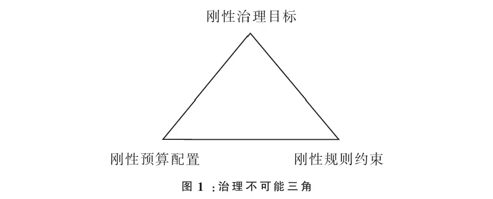
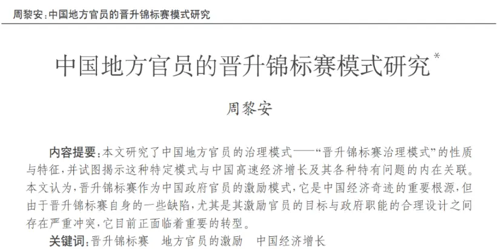
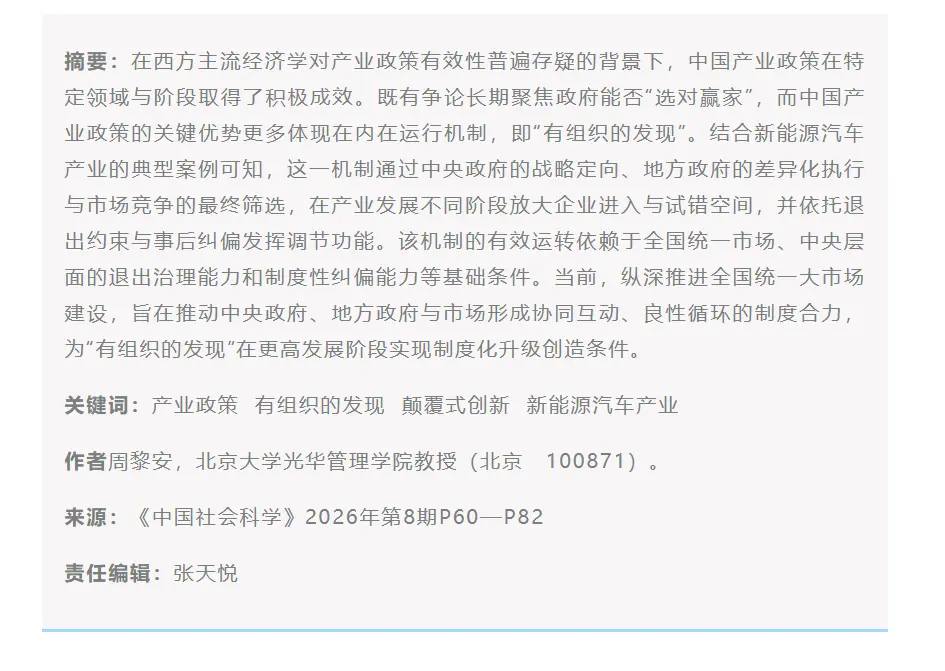

# 治理不可能三角形（信息利用视角）

> 经济学是选择的科学，如果世界总能既要又要，那就不需要经济学了。很多时候，我们习惯用非完美即走入死角的角度看待政策，但我们最终要学会的还是取舍。正如政治学是妥协的艺术，经济学也需要为选择而妥协。

最近周黎安老师提出来两个新名词，一个是**治理不可能三角形**，一个是**有组织的发现**，我想谈谈我自己的理解。周黎安老师是在财政约束的科层治理下谈论治理的不可能三角形，我们可以更加一般化一点。

**行政发包制**本质是一种**围绕中心的治理结构**。中心进行规划，然后向下分发目标，形成管理层级，每个管理层给予不同的目标，约束[^1]。

在这个框架下，我们已经默认了一个前提，**那就是任何治理都是一个具有中心的治理**。为什么会有国家，集体，族群的概念？在漫长的社会演化中，国家，公司这种中心团体的组织形式似乎总是必然出现，无政府主义并没有真正演化出来，因此我们可以认为**大一统和中心治理**似乎总是必然的🧙。

第二件事，中心治理也有代价。虽然中心治理总是必然的，但是必然性也有代价。不然，比特币的去中心化思想怎会在理念上受到追捧呢？中心化的代价就是**信息利用的局限**。对于一个组织而言，可以将信息分为公共信息和私人信息。个人知道自己的私人信息往往是最多的，但一旦形成了集体，领导或者我们的权利代理人，未必如我们自己知道这么多的私人信息。同时，管理为了高效必然形成层级，信息的层层传递充满了流失和扭曲。

例如，沿着 a-b-c 的管理链条出发，你的个人信息传递上去不利于 b，b 知道后就会瞒报或者把信息扭曲为利于自己的信息。最上面的人可能一个人管理上万人，一方面，他了解每个人的信息的成本是非常高的，另一方面，每个人之间的信息是利益相关的，做到平衡是及其困难的，而这一点已经通过“[阿罗不可能定理](https://blog.huaxiangshan.com/zh-cn/posts/shxz/)”在数学上得到证明[^2]。这就是**委托代理模型**，**信息不对称**，**公共选择理论**的出现。以前人们总是想象一个父母式的政府。社会契约告诉我们，我们把权利交给政府，政府就“自然而然”地为共同体服务了。可是现实的一些腐败行为告诉我们，这个想象太理想了，即便有社会契约在，义务的履行也不天经地义。

那怎么办？于是权利的制衡来了。我把权利移交给你，然后我们互相考核竞争。因此有了**官员晋升竞标赛理论**。但也有问题。任何一个目标成为了考核的目标后，都不会是一个好目标了（[Goodhart&#39;s Law](https://en.wikipedia.org/wiki/Goodhart%27s_law)）。例如 GDP，地方政府总是举债，投资基础设施建设[^3]，因为考核好看。最终，我国考核就东一下，西一下补充多目标考核，不断微操，如果中间出现了错误，这个错误也会被层层放大。

我们也可以从**信息利用**的角度看哈耶克和凯恩斯的辩论。比起哈耶克的《走向奴役之路》，在学界，他更受严肃对待的作品是《**知识在社会中的利用**》（The Use of Knowledge in Society, 1945）。哈耶克认为知识分散在每个个体之中，只有市场能够通过演化的市场关系挖掘出来分散的知识。所以他强调知识的分散，强调维护自由市场，强调自发秩序。政府傲慢地认为自己可以掌握分散知识，替代市场发挥作用的过程 恰恰是扭曲信息的过程，进而带来更大的错误。

哈耶克说的很对，但我们也可以说出他的**失明之处**。亚当斯密想象市场看不见的手，人人“自利”[^4]，社会变得更好。有点局部最优的加总就是全局最优😀的意思。可是博弈论告诉我们，这是错误的。**囚徒困境**中，每个人为了自己利益最大化做出决策，最终两败俱伤，恰恰是因为信息分散，他们无法沟通对方达成契约。分散的知识会带来这种情况，当信息过于分散，决策就会打架，带来零和博弈[^5]。

所以这时候需要政进行组织和协调。自由主义和凯恩斯主义达成了折中，那就是**明确政府和市场的边界**。在市场失灵，分散的信息打架的时候，由政府协调这部分信息。此时依旧存在的问题就是，政府仿佛在处理市场信息留下的炸弹，如果不小心也可能引爆。

面对这种情况，周黎安老师才说，我们要学会**有组织的发现**。凯恩斯和哈耶克的分歧在于：

- 哈耶克认为知识，信息只能自下而上，通过市场演化，任何政府妄想的替代都是一种罪恶。
- 相信有为政府的计划者认为，政府能够通过自上而下的协调，解决市场打架的信息，把他们梳理顺畅。我们常说的社会主义举国体制，集中力量办大事的优势，或许就可以看作这一点。
  
  中心治理，格局已成，接下来，就是要把权利关进制度的笼子里，互相制约。**有组织的发现就是自上而下地协调信息**，同时也要**自下而上的获得信息**。但是获取信息困难重重，我们需要付出额外的成本和代价。

管理总是一体两面，制约是有代价的。想象一下这样一个**哲学思想实验**：

我们只有一个任务 a，我们让一个富有同情心的天使👼担任这个要职。任人唯贤，自古以来就是政治上的最好想象。但是如果我们让 10 个天使，把一个任务拆解成 10 个流程，那么即便有了 10 倍的天使也无法发挥他们原有的同情心。

看起来很让人伤心？

可是，除了自己以外，谁也不知道自己是好人还是坏人。甚至更多时候，一个好人走错了路也不会自知。既然我们想象了有 10 个天使，为何不想象同样有 10 个恶棍👿？10 个天使无法释放同情心的同时，10 个恶棍也将无法释放他们的破坏欲。这就是自由裁量权约束的代价。

那么我们回到管理人身上，认真识别哪些人是好人，哪些人是坏人可以吗？是的，现实就是这样演化的，然而上有政策，下有对策，这不就是从上到下，不断考核来检测人的成色吗？最后**层层加码**，付出了巨大的检测成本，冗长的测试也降低了效率，甚至可能导致扭曲。

正因如此，或许我们可以在更一般的角度看待治理的不可能三角形——**约束（目标、财、权）**，**风险和利润的回报率**，**信息利用的效率** 才有如此的不可能三角形。

[^1]: 约束的反面就是不同的自由，术语就是自由裁量权。约束可以多种多样，可以是财政约束，也可以说规则约束，也可以是权利责任的约束
    
[^2]: 民主是个黑箱子，而投票和权利制度是实施形式。
    
[^3]: 所以我国现在强调投资于人和投资于物想结合
    
[^4]: 如何理解亚当斯密所说的自利行为，至今经济学家们仍在辩论
    
[^5]: 实际上，马克思经济理论中，解释经济危机也是这个角度。资本主义生产关系的局部最优必然导致全局的崩溃。

---

> 作者: [滑翔闪](https://github.com/hzp2333/hzp2333.github.io)  
> URL: https://blog.huaxiangshan.com/zh-cn/posts/econ_zl/  

